**Saturn V Exhibit**

**United States Space and Rocket Center \[USSRC\]**

**Davidson Center for Space Exploration**

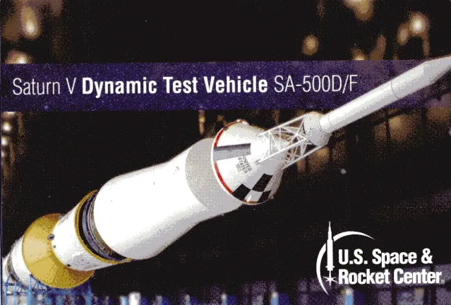

Prepared by Luke Talley

USSRC Docent Emeritus

September 15, 2024 – R10B

***Personal Note:** It was my privilege to have worked for IBM in Huntsville on the Saturn Instrument Unit \[IU\]. I worked in the Flight Evaluation Department where our jobs for each mission were to: (1) provide prelaunch and inflight mission support, (2) evaluate the inflight telemetered data, (3) identify inflight problems, (4) work with engineering groups to resolve inflight problems, and (5) review mission objectives affecting the IU and prepare computer analysis programs for upcoming Saturn flights. I am a U.S. Space and Rocket Center \[USSRC\] NASA Docent Emeritus volunteer at the Saturn V and Saturn Instrument Unit exhibits in the Davidson Center. This document contains much of the information that I present during tours of the Saturn V exhibit in the Davidson Center. I hope you enjoy the document and, if you are a visitor, I hope that you enjoy your visit to the Space and Rocket Center.*

*Regards,*

*Luke Talley*

**<u>Introduction:</u>**

This material is similar to that presented during Docent led tours of the Saturn V exhibit located in the USSRC Davidson Center *Saturn Hall*. The information provides an <u>overview</u> of the Saturn V booster and its mission.

***English units** \[pounds, feet, miles, etc.\] were standard for the Saturn/Apollo project and are used for the technical data quoted herein. Metric units \[newtons, kilograms, kilometers, etc.\] were less commonly used in United States 1960’s design and production settings. Original Saturn documents found on the internet include this use of English units. Metric units were used in programming the Apollo Spacecraft Computer but information was displayed to the Astronauts in English Units.*

*Many of the quoted numbers \[burn times, thrusts, ranges, velocities, timings, etc.\] depended on the specific launch vehicle, spacecraft, launch date, and mission. The text “**Statistical Reference**” by Orloff listed in the <u>References</u> section at the end of this document is an excellent source for specific vehicle and mission quantities.*

**Three questions frequently asked at the start of a Saturn Hall tour:**

> **Is the Saturn V inside the Saturn Hall real?** … **Answer =** **Yes** …This is the ***Saturn V Structural Dynamics Test Vehicle*** tested in the Marshal Space Flight Center Dynamic Test Stand during 1967. These tests proved that the stages could withstand the forces expected during flight. The tests also determined the stage flexural characteristics \[the bending modes\] that would be experienced during flight. Information that was incorporated into the Instrument Unit computer Flight Program and Control System designs to insure stable control of the Saturn rocket.
>
> **Did the Saturn V inside the Saturn Hall ever fly?** … **Answer = No** … The Saturn V in the Saturn Hall did NOT fly. No attempt was made to recover any of the Saturn stages so they would not be in a museum:

- First stage broke up when it crashed into the Atlantic Ocean ~350 miles from Cape Kennedy

- Second stage broke up and crashed into the Atlantic Ocean ~2500 miles from Cape Kennedy

- Third stage was either put into orbit around the sun or impacted onto the moon:

<!-- -->

- Five third stages \[Apollo 8 thru Apollo 12\] are orbiting the sun

- Five third stages \[Apollo 13 thru Apollo17\] were impacted on the moon.

> **Is the Saturn V standing outside the Saturn Hall real?** … **Answer = No** … The Saturn V OUTSIDE the Saturn Hall is full size but is NOT real; it is a model and serves as a really BIG billboard for the Space & Rocket Center.

**<u>Overview</u>**

The ***Space Vehicle*** consisted of the Saturn V Launch Vehicle, Spacecraft, and Launch Escape Tower*.*

The **Saturn V Launch Vehicle** consisted of three rocket stages (**S-IC**, **SII**, and **S-IVB**), the **Instrument Unit** **\[IU\]**, and the S-IC to S-II and S-II to S-IVB **Interstages**.

The **Space Vehicle** was 363 feet tall. The **Saturn V Launch Vehicle** \[S-IC through IU\] was ~281 feet tall. The **Spacecraft** plus **Launch Escape Tower** was ~82 feet tall.

The Saturn V in the USSRC Davidson Center \[Saturn Hall\] is the **Saturn V Structural Dynamics Test Vehicle** that was tested in the Dynamic Test Stand at **Marshall Space Flight Center \[MSFC\]** during 1967.

**<u>Apollo & Saturn Designation Numbers</u>**

The Apollo/Saturn flights are most commonly referred to by their **Apollo Mission Number**, for example Apollo 4, Apollo 11, Apollo 13, etc. Following are examples of other, and often confusing, numbering schemes that may be found in various technical references. Reference the above Saturn & Spacecraft drawing for the ‘Vehicle’ terms:

> ***Apollo Mission Number:** The most commonly used reference is the Apollo Mission Number. Some were test missions and others were manned missions.*
>
> ***Space Vehicle:** The Space Vehicle is the entire vehicle including the Saturn V Launch Vehicle, the Spacecraft, and the Launch Escape Tower.*
>
> *The **Apollo/Saturn <u>V</u> Space Vehicles** used the **AS-5xx** prefix: AS-501 through AS-512.*
>
> *Confusion example … The Apollo 17 Space Vehicle number was AS-512!*
>
> *The **Apollo/Saturn <u>IB</u> Space Vehicles** used the **AS-2xx** prefix: AS-201, AS-202, etc.*
>
> ***Launch Vehicle:** The **Saturn <u>V</u> Launch Vehicles** used the **SA-5xx** prefix, e.g., SA-501 through SA-512. Note the subtle difference between the <u>Space Vehicle</u> and the <u>Launch Vehicle</u> designations, **AS** vs **SA** prefixes, respectively.*
>
> *The **Saturn <u>IB</u> Launch Vehicles** were similarly designated with the **SA-2xx** prefix, e.g., SA-201.*
>
> *NASA Website [**https://history.nasa.gov/SP-4029/Apollo_18-10_Designations.htm**](https://history.nasa.gov/SP-4029/Apollo_18-10_Designations.htm) contains a more complete set of the designations as they related to the Saturn Launch Vehicles and Apollo Spacecraft.*

***Skylab** was the Unites States’ first Space Station \[1973-1974\] and used four mission numbers:*

> ***Skylab** … Skylab was launched into orbit using the **Saturn V S-IC and S-II Stages** that were originally designated to launch the canceled Apollo 20 Lunar Landing Mission. The Skylab Space Station was carried into orbit in place of an S-IVB rocket stage. Skylab had been constructed using S-IVB-212 as its primary structure. The crew living quarters were constructed inside what would have been the S-IVB-212 Liquid Hydrogen Tank.*
>
> ***Skylab 1, Skylab 2, & Skylab 3** were the three manned Skylab missions. These were Apollo Spacecraft launched by Saturn IB Launch Vehicles: SA-206, SA-207, and SA-208, respectively. **\***

**<u>S-IC Stage</u>**

Several S-IC test models and the first two S-IC flight models \[S-IC-1 & S-IC-2\] were built at **MSFC** by NASA and the S-IC prime contractor Boeing. Additional test models and the remainder of the S-IC flight models were built by Boeing at the **Michoud Assembly Facility \[MAF\]** near New Orleans.

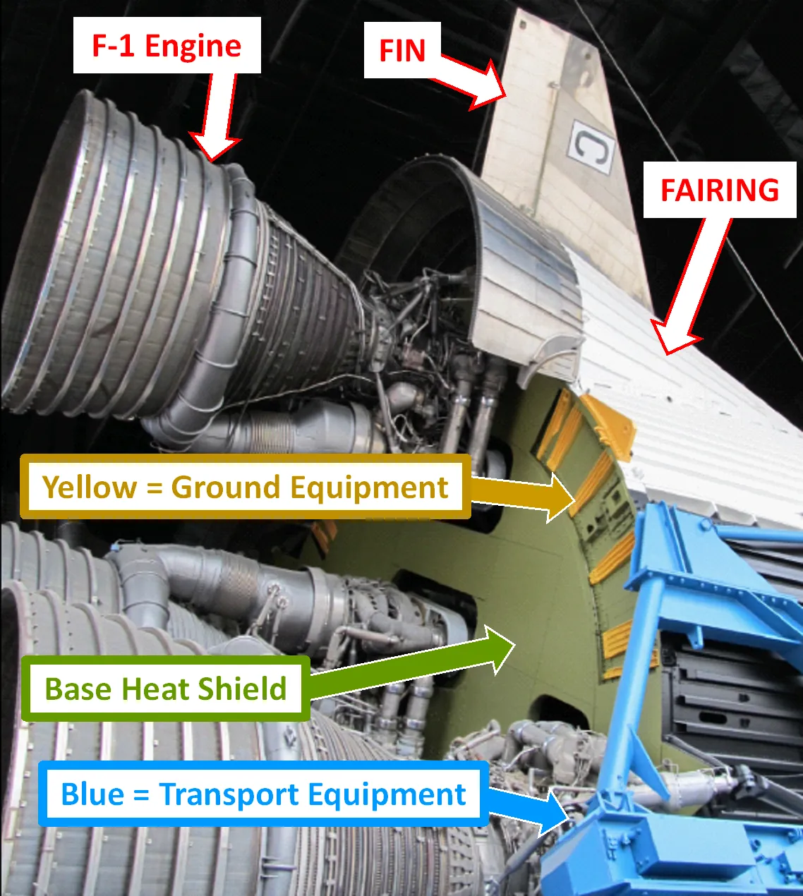

The S-IC stage in the U.S. Space and Rocket Center \[**USSRC**\] Davidson Center Saturn Hall was built at **MAF** during 1964-65. This stage was designated **S-IC-D**; **“D” for Dynamic Test Model**.

When you enter the Saturn Hall, the most obvious items are the five **F-1 Engines** attached to the base of the **S-IC Stage.** Looking upward at the base of the stage are two of the four **S-IC** **Fins** and **Fairings.** The green surface at the bottom of the stage is the **Base Heat Shield**.

> *NOTE: The **Yellow** and **Blue** items on the Saturn V Exhibit are ground handling items, are not part of the rocket stages, and would have been removed before launch. The Yellow items are structural stiffeners for handling and lifting the stages onto the test stands and the Mobile Launcher. The Blue structures are part of the ground transporters used to move the stages about.*

The S-IC Stage is 33 Feet in diameter and 138 Feet long.

> *It has been stated that the 33 Foot diameter was chosen because it was the largest diameter that would fit through the doors of the Michoud Assembly Facility building where the S-IC Stages were to be manufactured.*

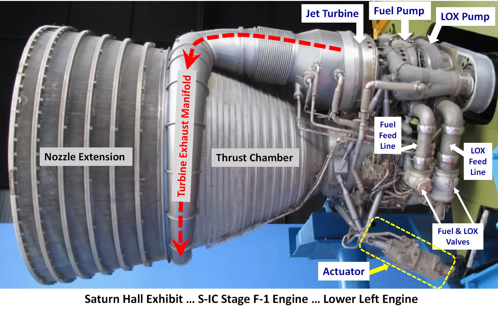The **Fins** provided stabilization during the early (atmospheric) phase of flight; their effectiveness is still debated! The **Fairings** deflected the high velocity air stream to keep it from buffeting the engines and interfering with their controlled movements used to steer the vehicle.

Each F-1 Engine weighs ~9 tons. The engine bell open end is 12 Ft in diameter and the engine stands 19 Ft high. The **‘upper half’** of the engine bell is the **Thrust Chamber** and the **‘lower half’** is the **Nozzle Extension**.

The F-1 Engine Fuel was highly refined **Kerosene \[Rocket Propellant 1 … RP-1\]** and the **Oxidizer** was **Liquid Oxygen \[LOX\]**.

Each F-1 Engine burned **1 Ton** of **Fuel** and **2 Tons** of **Liquid Oxygen** **every second** producing 1,500,000 Pounds of Thrust; equivalent to the thrust of twenty 747 Jetliner engines.

> *The five S-IC engines generated ~180 million horsepower of which 2 million horsepower was **acoustic noise!***

The F-1 Engine **Fuel** and **LOX Pumps** were driven by a single 53,000 Horsepower **Turbine** spinning at 5,500 RPM to pump the three tons of propellant through the engine ***every second***. Two **Fuel** and two **LOX Feed Lines** were symmetrically arranged one on each of two sides of the engine thereby balancing the forces on the engine.

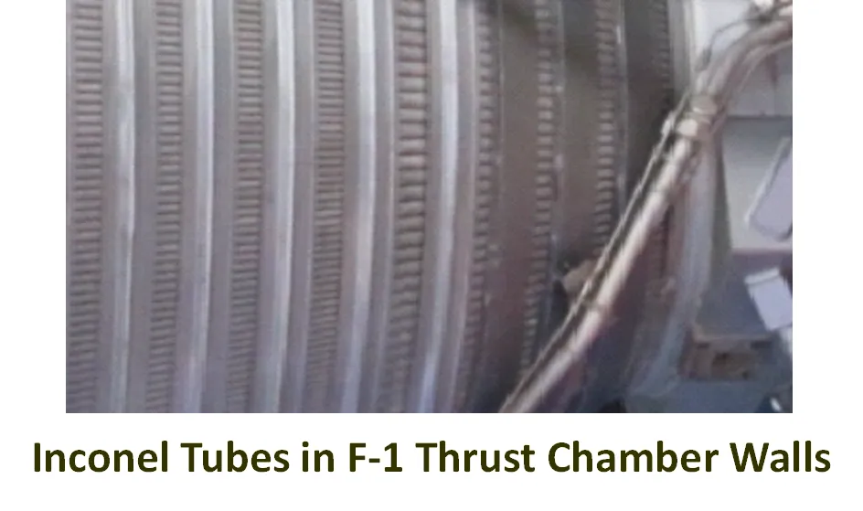The 5970º F temperature and two tons of oxygen per second inside the engine bell would destroy most metals. The **Thrust Chamber** walls were constructed from highly corrosion resistant nickel-cobalt-chromium ***Inconel X-750*** ***Tubes*** that ran the length of the ***Thrust Chamber***: 178 primary ‘downward flow’ and 356 secondary ‘upward flow’ tubes. These ***Inconel*** tubes were formed individually and then brazed together in more than 3,000 feet of ‘gold-brazed’ joining surfaces. About 80% of the 1 ton/second of kerosene fuel was pumped through these tubes before being injected into the engine for combustion. This fuel flow through the tubes cooled the thrust chamber in a process called **Regenerative Cooling**.

**Inconel Tubes**

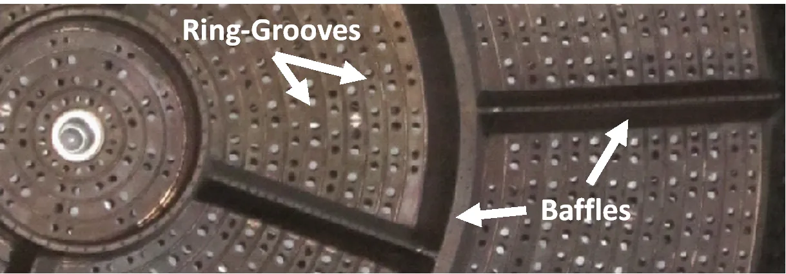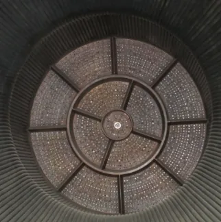

These two photos are of the large ‘copper’ **Injector Plate** at the throat of the F-1 Engine. There were 31 ring-grooves made up of 15 ring-grooves containing holes that injected oxidizer \[LOX\] and 16 ring-grooves with holes that injected fuel into the thrust chamber. The plate surface was divided into 13 compartments by 2 circular and 12 radial baffles. Fuel was injected through the baffles for cooling since they extended into the ~5,900 °F combustion space. The baffles resolved combustion instability issues experienced during the early engine design and testing.

The **Nozzle Extension** made up the lower half (approximately) of the engine and was a ***double walled*** structure \[no tubes\] made of high strength stainless steel.

Approximately 170 pounds/second of Fuel and Liquid Oxygen were burned in a small chamber called the **Gas Generator** located near the top of the engine. The Gas Generator produced the hot gas used to spin the Jet Turbine that in turn spun the Fuel and LOX Pumps that forced the 3 tons of propellants through the engine. The Gas Generator burned a ***fuel rich*** mixture of Fuel and LOX resulting in a **Turbine Exhaust** gas temperature of ~1200º F.

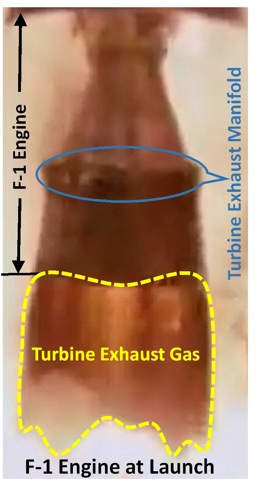The **Turbine Exhaust Manifold** ducted the jet turbine exhaust gas into the space between the inner and outer walls of the **Nozzle Extension.** The Turbine Exhaust gas flowing inside its walls COOLED the Nozzle Extension. The Turbine Exhaust Gas temperature when it reached the Nozzle Extension was 600 to 800º F and, although quite hot, was much cooler than the \>5000º F engine combustion temperature and thus prevented melting of the nozzle extension. Small openings around the interior wall of the Nozzle Extension injected the turbine exhaust into the engine bell. This directed several thousands of pounds of turbine gas thrust into the direction of the engine’s thrust ... every little bit of thrust helps!

> *The photo of an F-1 Engine during launch shows dark “sooty” flame at the base of the engine. This is the “fuel rich” and “cooler” Turbine Exhaust. The flame becomes brilliant white about 20 to 50 feet behind the engine bell. A launch video showing this can be seen at the F-1 Engine exhibit in the Saturn Hall.*

With all five engines running, about 5 tons of FUEL and 10 tons of LOX were pumped from of the respective S-IC tanks every second (\>3,300 gallons per second). The pressures in the Fuel and LOX Tanks and in the Feed Lines to the Jet Turbines had to be maintained for proper operation of the pumps. The tank pressures were maintained by feeding pressurized gases back into the *top* of the Fuel and LOX tanks as the propellants were drawn from the *bottom* of the tanks.

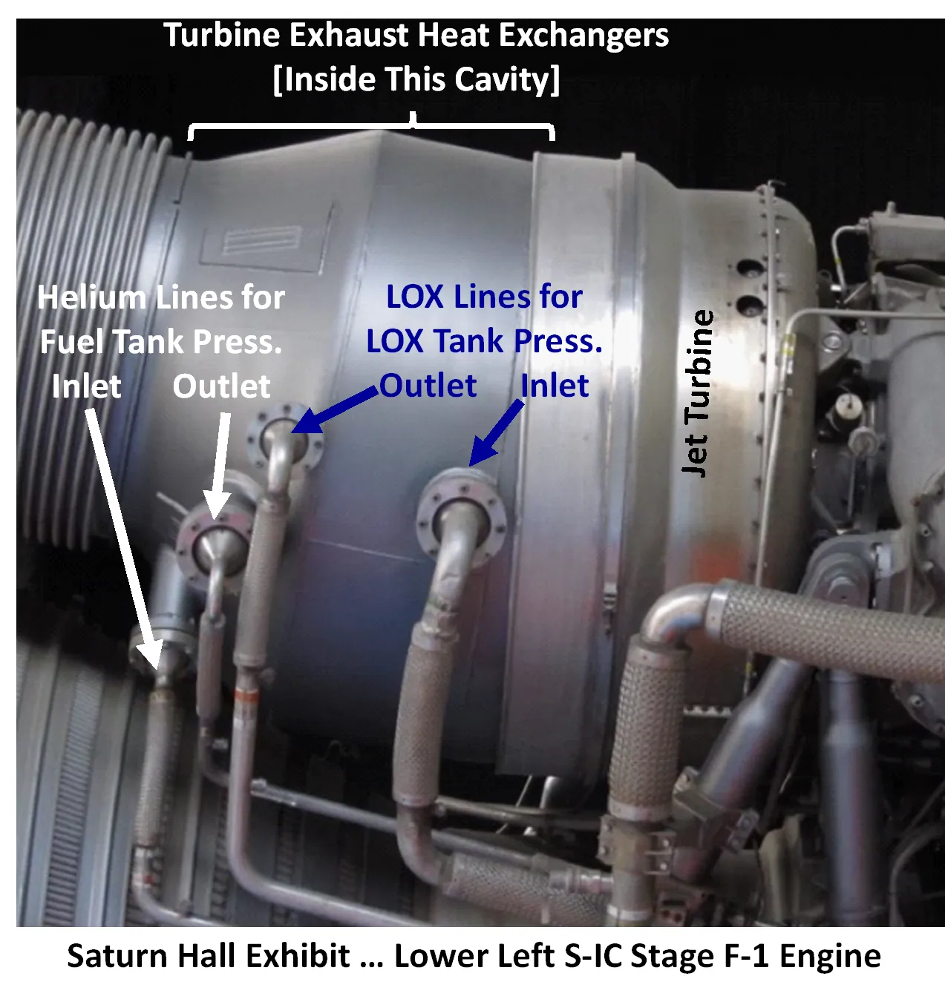Two **Heat Exchangers** were located ***Inside*** the **Turbine Exhaust Cavity** immediately aft of the Jet Turbine. Visualize these heat exchangers as two coils of tubing inside the Turbine Exhaust Cavity. The hot **Turbine Exhaust Gas** flowing over the two **Turbine Exhaust Heat Exchangers** heated the gases for pressurizing the Fuel and LOX tanks.

**Helium** gas from cylinders located inside the LOX tank was routed through one of the **Turbine Exhaust Heat Exchangers** where the **Turbine Exhaust** heated and increased the pressure of the helium. This ***pressurized helium*** was then routed back into the top of the FUEL Tank pressurizing it to ~25 PSIA.

**Liquid Oxygen** was directed through the other **Turbine Exhaust** **Heat Exchanger** and the resulting pressurized ***gaseous oxygen*** was routed into the top of the LOX Tank pressurizing it to ~20 PSIA.

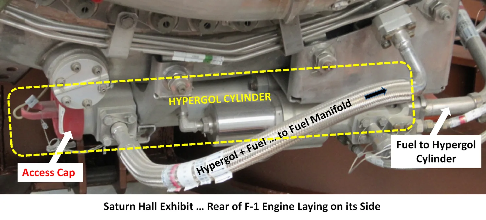During prelaunch operations, a sealed ***Igniter*** ***Cartridge*** containing a **Hypergolic Fluid** was inserted into the **Hypergol Cylinder** located on top of the F-1 Engine. The engine turbo pumps were started and the fuel and oxidizer valves were opened spraying Fuel and Oxygen into the engine bell. When the fuel line pressure reached ~300 psi, the ***Igniter Cartridge*** burst open and sprayed the **hypergolic** fluid into the F-1 Engine. The hypergolic fluid burned spontaneously when it contacted the Oxygen in the Engine Bell thereby igniting the engine.

> *The **hypergolic fluid** was a mixture of 85% tri-ethyl-borane and 15% tri-ethyl-aluminum.*

The *four outboard* engines of the **S-IC** and **S-II** **Stages** were swiveled \[***gimbaled***\] for Pitch, Yaw, and/or Roll attitude control.

- 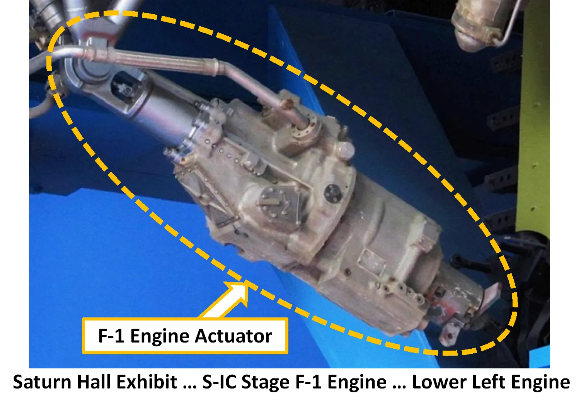*Pitch (longitudinal axis moved up and down)*

- *Yaw (longitudinal axis moved side to side)*

- *Roll (moves around the longitudinal axis).*

Two **Hydraulic Actuators** attached to each of the **S-IC** outboard engines were controlled by the **IU** computer system that *<u>could</u>* *gimbal* these engines within a 5 degree circle. The center engine was fixed and did not gimbal.

> *During the Apollo Missions, the F-1 Engines generally ‘gimbaled’ a maximum of ~1.5 degrees during the period of **maximum aerodynamic pressure** **\[Max Q\]** occurring about 70 seconds after launch. Engine movement of 0.5 degree or less was typical for the remainder of the flight.*

The S-IC Fuel \[kerosene\] was used as the **F-1 Engine Hydraulic Actuator** fluid and the Fuel Tank pressure was sufficient so that neither a separate actuator hydraulic pump nor a separate hydraulic fluid nor a hydraulic fluid reservoir were required thereby reducing system complexity and saving weight.

The engines, fins, and fairings were mounted to the **Thrust Structure** that comprised the lower “corrugated” 19 feet of the S-IC Stage. The thrust structure directed the forces from the five engine attachment points outward and upward through the outer skin of the booster. There were no internal beams, etc. within the tanks or interstages; all upward forces passed through the skin!

> *The S-IC Thrust Structure was the heaviest structural element of the Saturn V weighing ~24 tons; this does not include the five S-IC engines that all total weighed another 45 tons.*

The primary structures of the three Saturn V Stages were made from various aluminum alloys. The tank areas were formed from solid aluminum plate with milled patterns on their inner surfaces for strength. The Fuel and Oxidizer <u>tanks</u> had to withstand the thrusting forces pushing the rocket upward *plus* the pressure within the tanks \[called hoop stress\]. So, the tank walls were made of heavier aluminum structure \[~1.5 inches thick in some areas\] than the interstage and intertank sections.

> *These structural differences are easily seen on the S-IC Stage in the Saturn Hall. The lower smooth portion of the Stage is the Fuel Tank \[marked with the large **USA**\] and the upper smooth section is the Liquid Oxygen Tank. The corrugated sections forming the thrust structure, intertank, and interstage sections of the stage don’t have to withstand internal pressures so the structure of these segments is lighter weight aluminum that is corrugated for strength.*

The 43 foot high S-IC Fuel Tank consists of a cylindrical center section and two ellipsoidal shaped end domes. The domed ends extend downward into the thrust structure \[above the engines\] and upward into the intertank region. The corrugated section above the Fuel Tank is the **Intertank** region and the smooth region above that is the **LOX Tank**. The cylindrical LOX Tank is 64 feet high with ellipsoidal domes extending into the **Intertank** and **Forward Skirt** areas.

> *The <u>cylindrical</u> tank sections were made from ~11 feet \[high\] by ~26 feet \[wide\] aluminum plates that were milled to the desired thicknesses and inside pattern. These plates were formed into curved sections and assembled into the tanks at the manufacturing site. The curved sections were assembled using up to 30 very precise passes of an Argon Tungsten-Inert-Gas \[TIG\] welding process conducted under strictly controlled temperature and humidity conditions.*

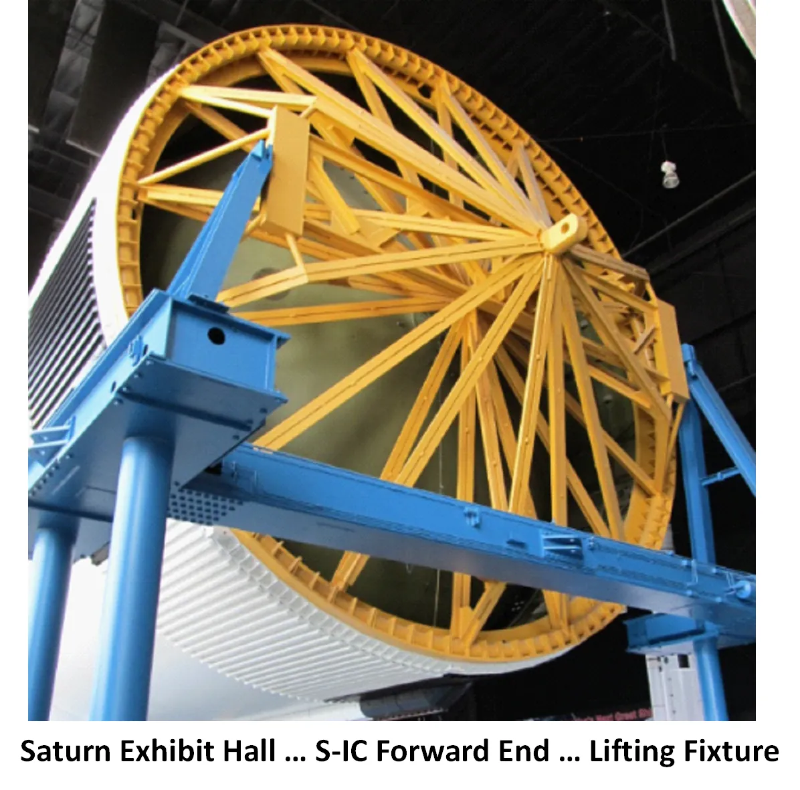The **Forward Skirt** makes up the top 10 feet \[corrugated\] of the S-IC Stage. Most of the S-IC Stage electronics (controls, telemetry, antennas, and the electrical interface to the Instrument Unit) are located in the Forward Skirt.

> *In the Saturn Hall, the S-IC lifting structure (yellow) is attached to the Forward Skirt. This structure is used to support the stage while on the transporter and to lift the stage from the transporter onto the launch pad. The lifting structure is then removed in preparation for installing the S-II Interstage atop the S-IC.*

Two minutes after launch, the S-IC center engine is shut down to minimize the acceleration \[“G”\] loading on the crew; *1G = pull of gravity at Earth’s surface*. At 2.5 minutes after launch the four outboard engines are shut down and the vehicle is ~40 miles high \[mission dependent\] and traveling ~5000 miles per hour. The crew experiences ~3.6 G’s at center engine cutoff and ~3.8 G’s at outboard engine cutoff. This would be the highest G load the crew would feel during the Saturn Boost periods.

> *The G loading during Boost was kept below 4 G’s to insure that the Astronauts’ response times would be satisfactory in the event of a **manual abort** condition during S-IC Burn. At 4 G’s an astronaut’s arm weighs 4X normal and will be much slower at hitting the Abort or taking other actions than would an Astronaut’s arm at 1 G.*
>
> *During Earth atmosphere re-entry, the Moon returning Astronauts experienced about 6.5 G’s.*

**<u>S-IC Stage & S-II Interstage Separation</u>**

***High speed 16mm <u>film</u> cameras recorded the S-IC/S-II Interstage separation sequences on the first two Saturn V flights. After the Interstage separation, the cameras were ejected and parachuted to Earth for recovery; the camera capsule contained radio and flashing light locators plus shark repellant. The photos shown here are from one of these cameras. The actual film footage is available on several Internet sites. An Internet search for “S-II Interstage Separation” will return several motion and still images.***

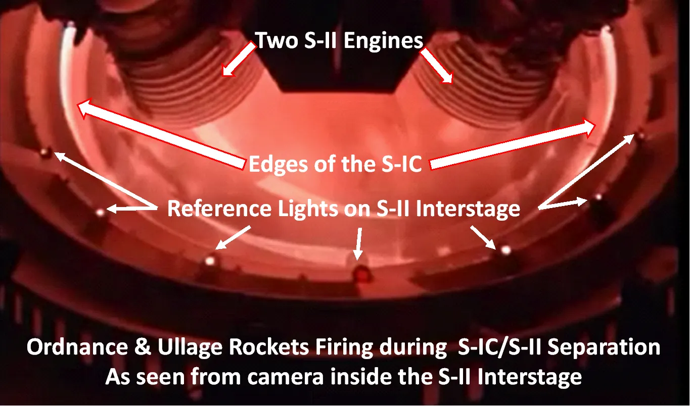The Saturn stages were held together with **Tension Straps**. An explosive charge was wrapped around the interface between the stages and around the inner surface of these Tension Straps. Following S-IC engines cutoff the IU Computer commanded stage separation by firing the explosive charges severing the tension straps. At the same time, eight **Retrorockets** located inside the four fairings at the base of the fins on the S-IC aft section were fired to <u>slow</u> the S-IC Stage slightly forcing it to separate from the S-II Stage. Each retrorocket produced 88,600 pounds of thrust for 0.7 seconds.

The “Ordnance & Ullage” photograph above is from a movie camera in the S-II Interstage that is looking back at the separating S-IC. The small white crescents near the S-IC edges show the S-IC just beginning to separate. The reddish glow is from the Ullage Rocket firings. Prior to the beginning of the S-IC separation, the image is black except for the seven small Reference Lights.

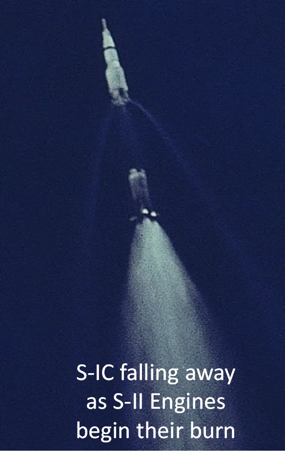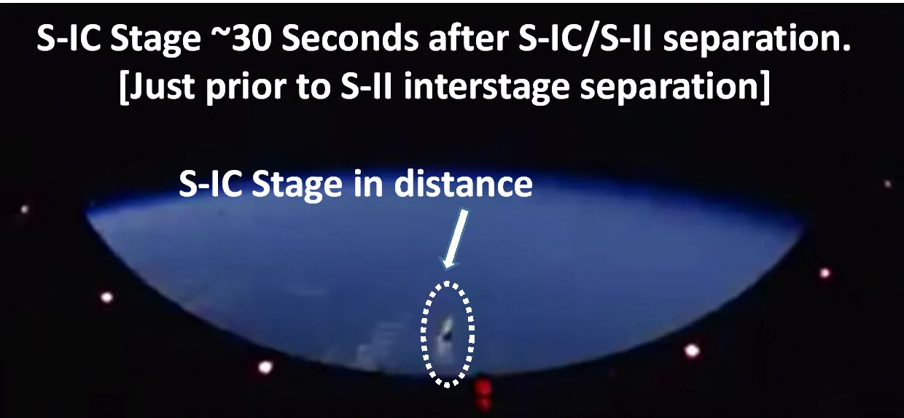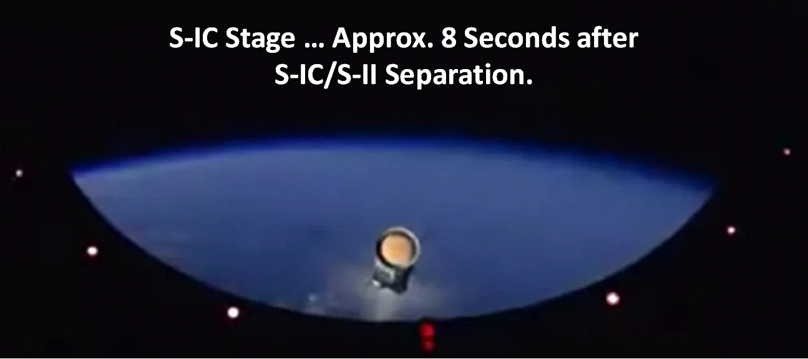The **S-II Interstage** located between the S-IC and S-II stages contained eight solid **Ullage Rockets** equally spaced around the periphery of the Interstage. The Ullage Rockets were fired in conjunction with the S-IC Separation Ordnance and S-IC Retro Rockets. Each S-II Ullage Rocket produced 22,500 pounds of thrust for 4 seconds slightly accelerating the S-II away from the S-IC and seating the S-II propellants in the tanks for the S-II main engines start.

> *The ”S-IC Falling Away” photo is NASA S69-39958 (16 July 1969) --- A 70mm Airborne Lightweight Optical Tracking System (ALOTS) camera mounted in a pod on a cargo door of a U.S. Air Force EC-135N aircraft photographed this event during the Apollo 11 launch.*
>
> *The photograph of the “S-IC Falling Away” can be seen at Internet site: <https://spaceflight.nasa.gov/gallery/images/apollo/apollo11/html/s69_39958.html>*

After separation, the S-IC **momentum** continued carrying it up to nearly 70 miles high on a ~parabolic trajectory and then crashing in pieces into the Atlantic about 350 miles from Cape Kennedy; it was not recovered.

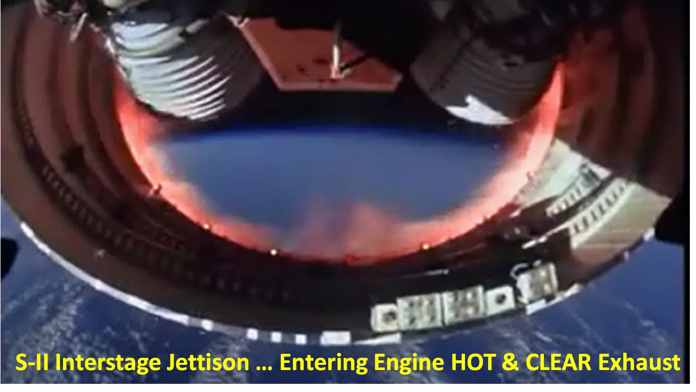The **S-II Interstage** \[33 feet in diameter and 18 feet high\] is not included in the Saturn Hall Exhibit. It extended from the base of the S-II to beyond the ends of the S-II engines. The S-II Interstage was fabricated at North American Aviation’s Tulsa, OK plant.

The **S-II Interstage** was jettisoned 30 seconds after S-IC Stage separation in a maneuver called **Dual Plane Separation**. There was only 3 Feet between the S-II Interstage wall and the bell ends of the outer four S-II engines. The uncertainty regarding S-IC motion during separation required employing Dual Plane Separation.

Jettisoning the S-II Interstage got rid of ~9,700 Pounds of weight.

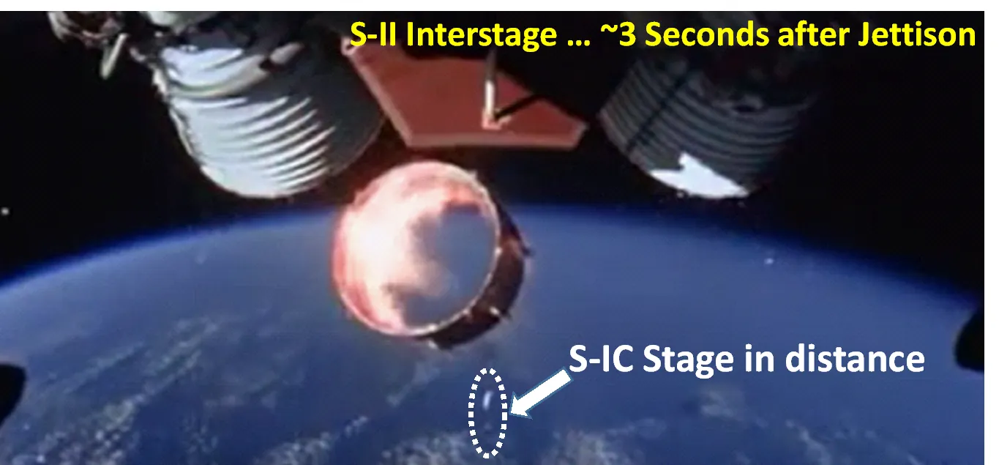

*The S-II Interstage Separation video is a favorite film sequence for science fiction movies!*

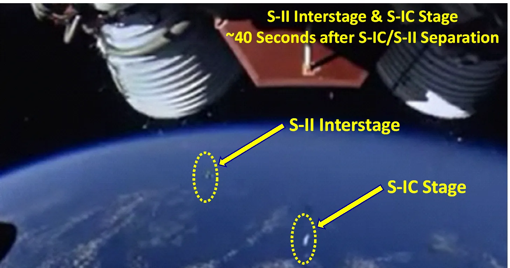The photograph below shows the positions of the S-IC Stage and the S-II Interstage just prior to the film camera’s ejection from the base of the S-II Stage.

**<u>S-II Stage</u>**

The **S-II Stage** was 33 Ft in diameter and 82 Ft Long and operated outside the earth’s atmosphere so it did not include fins or fairings. The S-II was built by North American Aviation Space Division at Seal Beach, California.

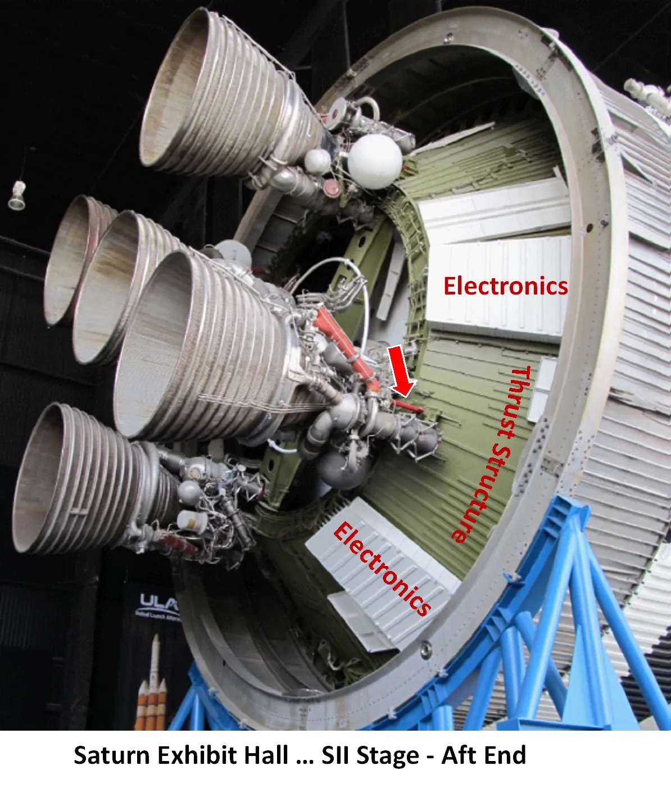The S-II stage in the Saturn Hall was designated **S-II Facilities/Dynamic \[S-II-F/D\].** The “Facilities” designation applied to its use for the Stacking Tests on the **Launch Umbilical Tower \[LUT\]** at KSC and the “Dynamics” designation applied to its use in the **Structural Dynamic Tests** at MSFC.

*In January of 1966 the **S-II Static Test Firing Stage \[S-II-T\]** was re-designated **S-II-T/D** with plans that it be used for S-II Static Firing tests at the **Mississippi Test Facility \[MTF\]** **and** for the **Structural Dynamic Tests** at MSFC. However, in May of 1966 the S-II-T/D Stage was accidentally blown up in a pressurization test … some days are better than others in the rocket business!*

The S-II stage was powered by ***Five*** **J-2 Engines**. As for the S-IC, the IU computer system gimbaled the four outer S-II engines for attitude control; the center engine was fixed and did not gimbal.

> *The J-2 Engine actuators were embedded close to the engines and are difficult to see and are not visible in the photo. For reference, the red arrow points to a ‘red’ actuator push-rod.*

The J-2 Engine is 11 feet high with a ~6 ½ feet diameter engine bell and weighs ~3500 pounds (1¾ Tons).

> *The J-2 Engine weighs 1 ¾ Tons whereas the F-1 Engine weighs 9 Tons.*

The five J-2 Engines were mounted to the S-II **Thrust Structure** that routed the engine thrust forces to the outer skin of the stage. The lower dome of the LOX tank extended into the volume above the thrust structure.

The J-2 Fuel was **Liquid Hydrogen \[LH2\]** and the Oxidizer was **Liquid Oxygen \[LOX\]**. The engine burned 530 pounds of propellant per second and produced 225,000 pounds of thrust.

> ***Specific Impulse** defines a rocket engine efficiency; the higher the impulse the more efficient the engine. DIVIDE the pounds of thrust the engine produces BY the pounds/second of propellant the engine consumes and the answer gives the **Specific Impulse** measured in **Seconds**:*
>
> *The J-2 Specific Impulse is <u>424 Seconds</u>.*
>
> *The F-1 Specific Impulse is <u>260 Seconds</u>.*
>
> *So, the J-2 is about 1.6 times as efficient as the F-1.*

The density of Liquid Oxygen is about 9.5 pounds per gallon while Liquid Hydrogen is about 0.6 pounds per gallon. This large density difference required two separate turbo-pumps on the J-2 Engine. The LOX pump was driven by a 2,200 Horsepower turbine turning 8,600 revolutions per minute. The lower density of the hydrogen required a 7,800 Horsepower turbine turning at a much higher 27,000 RPM.

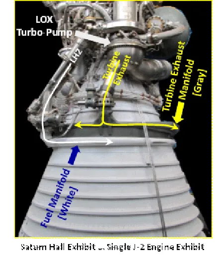Like the F-1 Engine, the J-2 Engine used **Regenerative Cooling** where the LH2 Fuel was pumped into the **Fuel Manifold** located mid-way down the engine bell. LH2 from the Fuel Manifold entered tubes that formed the walls of the engine bell and flowed down to the end of the bell and then back up through alternate tubes to the top of the engine where the hydrogen (now in the gaseous state) was injected into the engine for combustion.

Liquid Oxygen from the LOX Turbo-Pump was fed into the engine for combustion. A portion of the LOX was tapped off and fed through a heat exchanger located in the exhaust of the LOX Turbo-Pump thereby converting the *Liquid Oxygen* to ***Gaseous Oxygen*** that was fed back into the top of the LOX tank for tank pressurization.

The same **Gas Generator** drove both turbo-pumps. The hot gas from the Gas Generator first drove the **Hydrogen Turbine**. The ***Exhaust*** from the **Hydrogen Turbine** was then used to drive the **Oxygen Turbine**. The Oxygen Turbine ***Exhaust*** was then fed to the **Turbine Exhaust Gas Manifold** surrounding the engine and into openings inside the engine bell thereby insuring that all <u>thrust</u> occurred through the engine reducing the possibility of “***thrust offsets***”.

The J-2 Engine was started using a **Spark Igniter** to ignite the Hydrogen and Oxygen as they mixed in the engine. **Spark Igniter** is rocket science ‘speak’ for a very ‘expensive spark plug’.

> ***Liquid Oxygen** at **-273ºF** is extremely cold by any measure but **Liquid Hydrogen** at **-423ºF** is one of the most difficult cryogenic materials to handle. Oxygen freezes solid when exposed to Liquid Hydrogen. The solid oxygen and hydrogen combination produces an explosive with an estimated yield greater than that of TNT.*

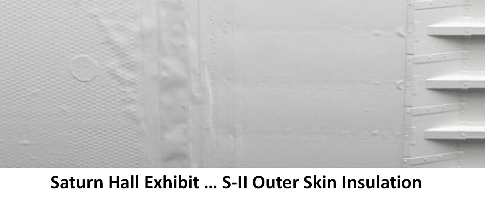

The outer surface of the S-II stage in the Saturn Hall has a “waffled” appearance. This surface is covered with a phenolic honeycomb filled with a super-insulation material to minimize Liquid Hydrogen vaporization. The hydrogen had to be kept liquid in the tanks and several alternate insulating materials were considered.

> *Balsa Wood was considered for insulation but was discarded when it was determined that most of the Balsa produced in Central America would be needed to meet the requirements of all of the S-II & S-IVB Stages.*

The 22 Ft high by 33 Ft diameter Liquid Oxygen tank is located in the bottom ~1/3 of the S-II Stage. The tank can be envisioned as being made of a pair of 11 Ft high by 16.5 Ft diameter ellipsoidal domes. The lower dome of the tank extended downward in the region above the **Thrust Structure**. The top dome of the LOX Tank provided a **Common Bulkhead** with the bottom of the Liquid Hydrogen Tank. The center of the Common Bulkhead structure consisted of a phenolic honeycomb material that acted as structure and insulator between the two tanks. Using the Common Bulkhead instead of separate upper LOX Tank and lower LH2 Tank domes saved ~4 Tons of S-II weight and shortened the stage length by ~10 feet!

The LH2 Tank was 56 Ft high, was cylindrical, and with an ellipsoidal dome at the top. The top dome extended upward into the 11½ Ft high **Forward Skirt**. The top of the LH2/LOX Common Bulkhead formed the lower segment of the LH2 Tank extending upward into the tank.

> *During the early stage testing, Liquid Hydrogen was not without hazards. Hydrogen is easily ignited and burns with a clear, almost invisible, flame. Hydrogen leaks were not uncommon and people working around the tanks tell stories of being burned by a hydrogen flame that they could not see. The resolution was to wave a broom in front of you while walking around the LH2 tanks. If the broom caught fire then there was a burning hydrogen leak so you maneuvered around that area. Today a head-to-toe flameproof outfit and a special infrared viewer would likely be required to go near a tank full of liquid hydrogen. Problems were resolved more simply in the 1960’s!*

The S-II Stage burned for about 6½ minutes (395 seconds) and boosted the vehicle to 115 miles altitude and 15,300 miles per hour. During the S-II burn the crew experienced a maximum of ~1.7G’s at the time of S-II Center Engine Cutoff.

After the S-II engines shut down, the S-II and S-IVB Stages were separated using explosive charges around the base of the S-IVB stage in a manner similar to that described for S-IC/S-II separation. Retrorockets on the truncated cone shaped S-II/S-IVB Interstage were fired to decelerate and separate the S-II from the S-IVB. A pair of Solid Ullage Rockets on the base of the S-IVB Stage were simultaneously fired to slightly accelerate the stage thereby seating the propellants in the tanks for starting the S-IVB engine.

After S-II/S-IVB separation, the S-II fell into the Atlantic Ocean approximately 2,200 miles from the Cape. The exact Atlantic impact location depended on the specific mission trajectory.

> *On one mission, the crew reported “high frequency” vibrations during the S-IVB stage burns. During Mission Control questioning about the vibrations, the crew was asked what the S-II/S-IVB Stage separation felt like. Their answer was it felt like a “**Train Wreck**”. Mission Control then asked what the S-IC/S-II Stage separation felt like. Their answer was it felt like a “**<u>Large</u> Train Wreck**”. On subsequent flights the crews often commented “here comes the train wreck” just prior to S-IC/S-II stage separation.*

***<u>S-IVB Stage Separation Photo</u>:***

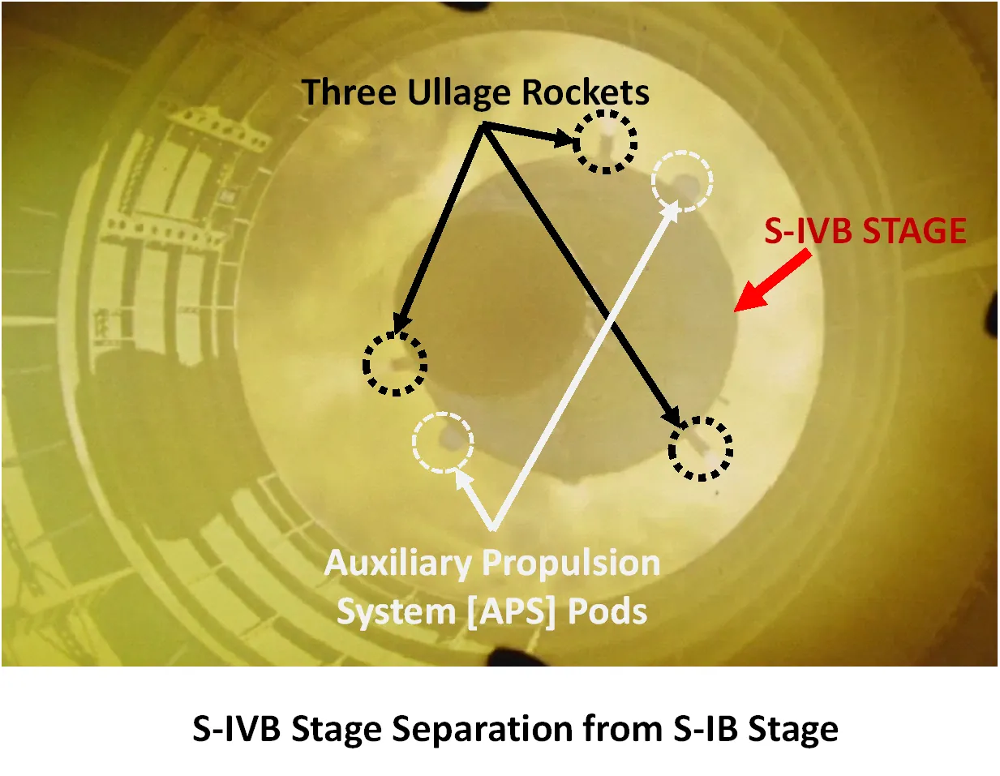*There were no films of the S-IVB separation from the S-II Stage. Any films that you see of an S-IVB Separation are from Saturn IB flights as in the photo at the right. It is easily verified that these are taken from S-IB flights \[e.g., AS-202\] by the number of “**Ullage Rockets**” on the aft end of the S-IVB Stage. The **Saturn IB** S-IVB Stages used **three** Ullage Rockets equally spaced around the base of the stage as shown in the photo.*

*The **Saturn V** S-IVB Stages used **two Ullage Rockets** located on opposite sides of the stage aft end \[not to be confused with the two **Auxiliary Propulsion Modules** on each side of the aft end of the stage\].*

*The S-IVB Ullage Rockets described above were used for S-IVB **Stage** separation on the Saturn IB and the S-II/S-IVB separation on the Saturn V were **Solid Rocket Motors**.*

**\**

**<u>S-IVB Stage</u>**

The **S-IVB Stage** was 22 Ft in diameter, 59 Ft high, contained a ***single*** **J-2 Engine**, and was built by Douglas Aircraft Company at Huntington Beach, California.

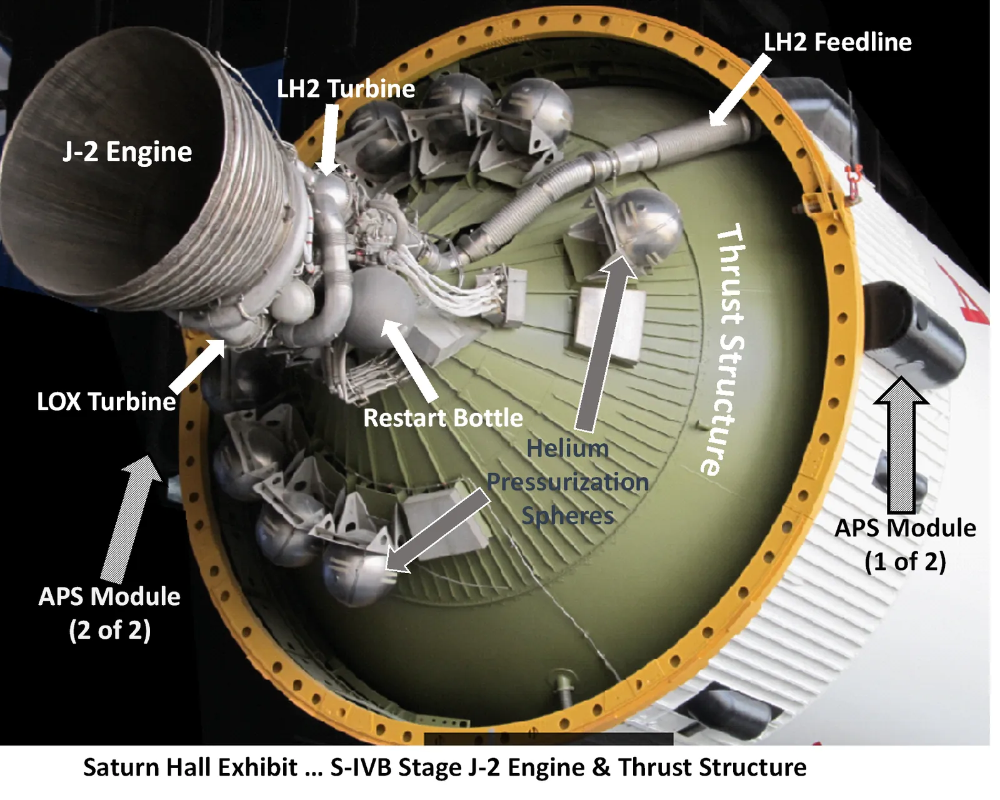Like the S-II Stage, the S-IVB J-2 Engine used LH2 for the fuel and LOX for the oxidizer. The primary difference between S-IVB and S-II engines was that the <u>S-IVB J-2 Engine could be restarted</u>; the Moon missions required two S-IVB Engine Burns.

The S-IC and S-II stages had four outboard engines that were gimbaled for Pitch, Yaw, and Roll attitude control. However, gimbaling the *Single* S-IVB Engine could Pitch and Yaw the vehicle but could not Roll the vehicle. The S-IVB **Auxiliary Propulsion System** **\[APS\]** contained **thrusters** that provided the Roll control during the two J-2 Engine burns. The IU computer system generated the control signals necessary to gimbal the J-2 Engine and/or fire the APS Thrusters.

During coasting (non-engine burn) periods, the **APS** Roll, Pitch, and Yaw Thrusters were used to provide all attitude control. The two **APS Modules** were located on opposite sides of the S-IVB aft end.

The **APS Thrusters** used two ***hypergolic*** propellants that burned instantly when mixed in the engine nozzles; no igniter was needed to fire the thrusters.

> ***Hypergolic Oxidizer** was Nitrogen Tetroxide (N2O4)*

***Hypergolic Fuel** was Monomethyl Hydrazine (CH3N2H3).*

The IU computer system fired the APS engines in short bursts by opening and closing the valves that routed the hypergolic fluids to the APS engine nozzles where the fluids ignited on contact with each other producing a pulse of thrust. There were three 150 Pound thrust engines in <u>each</u> APS module. By selective pairing of the commands to fire the thrusters, the IU computer system generated the desired Roll, Pitch, and/or Yaw motion.

The APS module also contained two 70 Pound thrust **Ullage Engines** that faced rearward and provided the acceleration needed to seat the S-IVB propellants (LH2 and LOX) in preparation for the second S-IVB Engine start and for S-IVB/IU maneuvers during and following Spacecraft separation.

**S-IVB … First Burn & Parking Orbit**

After S-II Separation, the S-IVB Engine burned for about 2¾ minutes boosting the vehicle to ~118 miles altitude and an orbital velocity of 17,500 miles per hour. This burn circularized the orbit and attempted to correct errors accumulated during the S-IC and S-II burns. This first S-IVB Engine cutoff occurred approximately 12 minutes after liftoff. The crew experienced approximately 0.7G acceleration just prior to the first S-IVB burn cutoff.

At first S-IVB burn cutoff, the vehicle entered the **Orbital Coast Phase** that varied for each mission lasting from 1½ to 6 hours \[typically 3 to 4 hours\]. The 6 hour upper limit was imposed by the S-IVB/IU Battery Lifetimes. During orbital coast, the S-IVB, Instrument Unit, and Spacecraft were checked and IU Flight Program updates were commanded from Mission Control if required.

The S-IVB LOX Tank was pressurized from **8 Helium Storage Spheres** located inside the LH2 tanks. During the S-IVB engine burns, the helium was heated and expanded through the engine heat exchanger to provide LOX Tank pressurization.

During S-IC and S-II Stage burn periods, the S-IVB LH2 Fuel Tank was pressurized by the LH2 boil off within the tank. Liquid Hydrogen vaporizes at -423 ºF so the LH2 boil off was more than sufficient to keep the tank pressurized. During engine burns, pressurized Gaseous Hydrogen was bled from the engine Heat Exchanger and piped back into the top of the LH2 tank to provide the extra pressurization needed during engine burn periods.

While in **Earth Parking Orbit** a portion of the LH2 boil off was vented overboard through two S-IVB **propulsive vents** located near the forward end of the stage. This venting provided just enough thrust to keep the fuel and oxidizer propellants seated in their tanks as would be needed for S-IVB Engine restart.

The potential of several hours in the parking orbit required highly insulated S-IVB tanks. To meet this requirement, the S-IVB LH2 and LOX Tanks were insulated on the inside using large foam blocks. This was opposite to the S-II Stage that was insulated on the outer surface.

Before the start of the second S-IVB Engine burn, LOX and LH2 were circulated through their respective paths to the engine and then back into the respective tanks in a process called ***chilldown.*** This pre-cooled the piping, pumps, valves, etc. in preparation for the engine restart. Chilldown was necessary to minimize the thermal shock of the super cold liquid \[cryogenic\] propellants on the various system components. Similarly, the electric pumps that pumped the respective cryogenic fluids for the chilldown process were actually located inside the LH2 and LOX tanks.

The S-IVB Stage contained several **Spheres** containing **Helium** for pressurizing the tanks for the J-2 Engine restart operations. Some of the spheres were located on the exterior of the **Thrust Structure** and others were inside the LH2 tank.

***S-IVB Second Burn & Translunar Coast** **periods are described following the Instrument Unit write-ups.***

**<u>Instrument Unit \[IU\]</u>**

The **Instrument Unit \[IU\]** was 22 feet in diameter, 3 Feet high, and positioned atop the S-IVB Stage and below the SLA. The IU has been referred to as the Saturn V “***Brain***” since it controlled the Saturn V operations from launch until IU battery depletion at 10 to 12 hours after launch.

The IU was manufactured by **IBM** in Huntsville. Two of the IBM buildings are now part of the University of Alabama in Huntsville.

*The structure of the Instrument Unit on display in the USSRC Saturn Hall is from the Saturn V Structural Test Vehicle \[~1967\]. The cables, components, and cold plates on the Saturn Hall IU were taken from early Saturn I-B and Saturn V IU test and/or lab models. The placement of the components on the IU closely resemble that of IU-508 \[the Apollo 13 IU\].*

***<u>IU Structure</u>***

The IU was constructed from three 120 degree sections joined with **Splice Plates** forming the 22 foot diameter ring. The IU interior was divided into **24** **“Panels”** \[*Re: IU Overall Structure Figure*\]. Each Panel was ~3 Feet square.

Several IU components were mounted directly to the IU Structure but most were mounted on ~2½ foot square **Thermal Conditioning Panels \[Cold Plates\]** for temperature control.

The **Cable Tray,** made from aluminum tubing, was located above the Panels and extended around the full circumference of the IU. Cabling was attached to the Cable Tray for routing between components. An **Environmental Conditioning Duct** mounted within the Cable Tray frame extended the full IU circumference. During on-the-pad operations, Ground Equipment supplied conditioned air through this Duct and into the enclosed volume of the IU, the S-IVB forward interstage, and the SLA. The conditioned air was changed to ***gaseous nitrogen*** during fueling operations to provide an inert atmosphere to minimize the likelihood of fire or explosion in these enclosed volumes.

The IU Structure Wall was ~1 inch thick and consisted of an inner 0.020 inch and an outer 0.030 inch thick aluminum sheet with a 1 inch thick ***Aluminum Honeycomb Core*** sandwiched between the two sheets. The outer and inner aluminum sheets were **bonded** \[**glued**\] to the honeycomb core ... *yes, the IU structure was glued together!*

The outer IU surface was covered with a thin layer of cork for insulation. As the vehicle passed through the atmosphere, the IU outer surface got quite hot. The cork outer covering acted as an insulator and somewhat as an ablative barrier; the surface would scorch but not burn off.

The ***honeycomb structure*** provided acoustical insulation, had low thermal conductivity, and was not subject to distortion from temperature changes. The IU Aluminum Structure weighed only 450 pounds but it supported ~3500 pounds of IU equipment, and ~100,000 pounds \[~50 tons\] of SLA and Spacecraft located <u>above</u> the IU.

> *The IU Structure Cross Section figure shows the honeycomb core and a **Vibration Control Pad** that was bonded to the IU outer surface **<u>only</u>** at the ST-124 Guidance Platform panel. Several internal ST-124 components were found to be resonant at the low frequency \[~5 Hz\] vibrations generated by the S-IC Stage Engines. The added weight of the lead shavings embedded in the 1 inch thick by ~3 foot square two-part epoxy **Vibration Control Pad** reduced the amplitudes of these frequencies at the ST-124 Platform \[**Panel 21**\].*

**<u>IU Electrical System</u>**

The IU Electrical System was powered by **28 Volt 350 Ampere-Hour Silver-Zinc Batteries**. The batteries were charged and installed in the IU ~24 hours prior to launch. *Power Transfer* from Ground Power to IU Battery Power occurred at ~50 seconds prior to launch.

***Silver-Zinc Batteries** had ~40% greater capacity per pound and a wider operating temperature range than other 1960’s batteries.*

Four batteries were used on the first three Saturn V flights \[the **Research & Development \[R&D\]** Flights\].

The remaining **Operational** flight IUs used three **<u>primary</u>** power batteries. The <u>average</u> current drawn from the three batteries was 18, 24, and 34 Amperes, respectively. Battery \#3 \[34 Amperes\] supplied primary power for the Guidance, Navigation, & Control System. When Battery \#3 discharged the primary IU mission ended; generally 11 to 12 hours after launch.

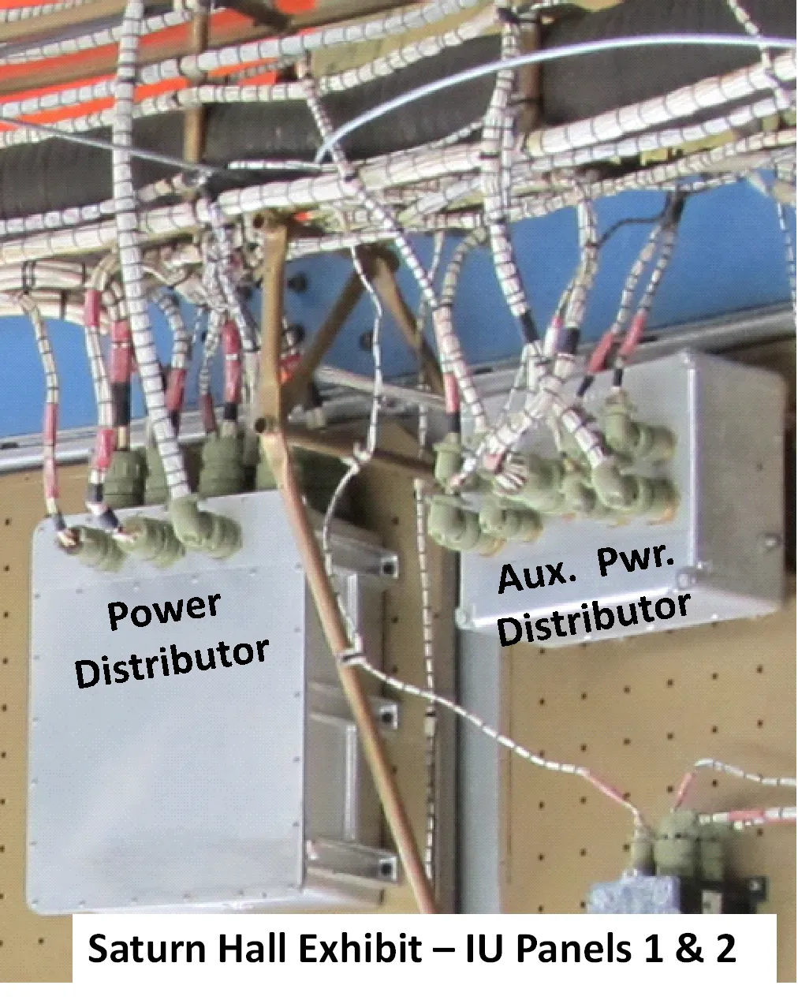For Apollo Missions 13 through 17, a fourth battery was added to power <u>only</u> the ***IU S-Band Transponder and Transmitter***. This allowed the IU S-Band radio signal to be received by the Earth ground stations until the S-IVB/IU Lunar Impact occurred ~80 hours after launch; *when the S-Band signal stopped the S-IVB/IU had hit the Moon!*

The 28 Volt Battery outputs were supplied to a series of **Distributors** where ***electromechanical relays*** then routed the 28 Volt power to the various IU components.

> *Power solid state devices of the 1960’s were not generally reliable enough for NASA applications so relays were used in the Distributors.*

Power Transfer switches in the **Power Distributor** transferred from ‘Ground’ power to ‘IU Battery’ power at ~50 seconds before launch. The **Power Distributor** provided primary distribution of Battery power in the IU and routed 28 Volts to several high power consuming components. Two **Auxiliary Power Distributors** further subdivided the primary 28 Volt power and routed it to various medium power consuming IU components.

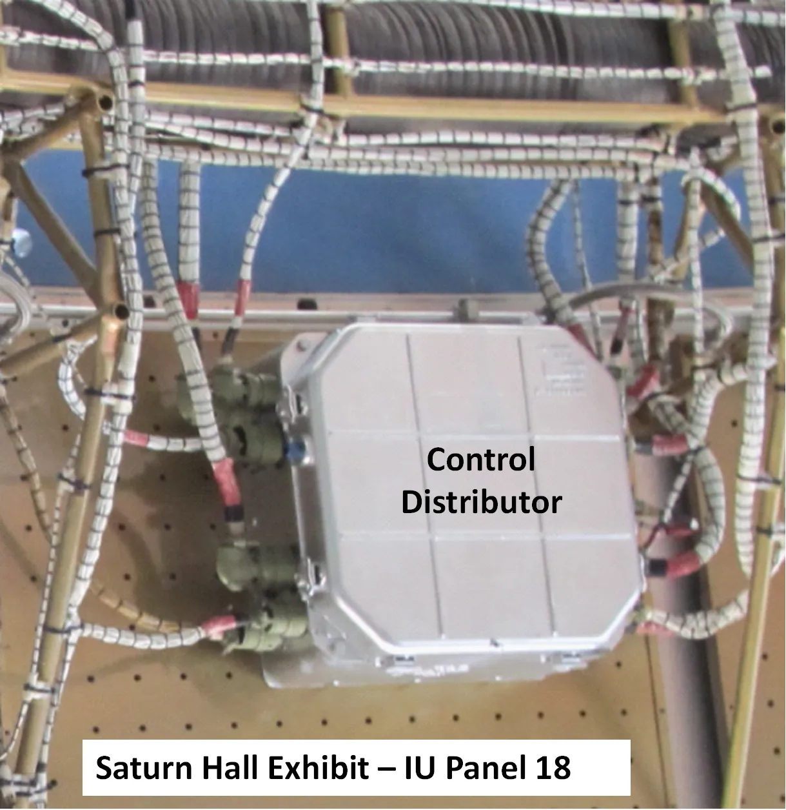

The ***Control Distributor*** served as an auxiliary power distributor for low power components and provided ‘logical’ operations for various Guidance System components on IU **Panels 21** and **22**. The IU also contained a ***Measuring Distributor*** and an ***EDS Distributor*** that have the same “tic-tac-toe” pattern on their top surfaces.

> *The **Distributors** contained plug boards and over 100 small relays. The control signals for the relays and wiring for the relay contacts were routed to connector pins on the Distributor housing and/or to plug boards within the Distributor. This arrangement allowed equipment additions or deletions with minimum changes to the IU equipment layout. Often only a cable pin connection and/or a plug board change within a **Distributor** was needed to add or remove equipment connections.*

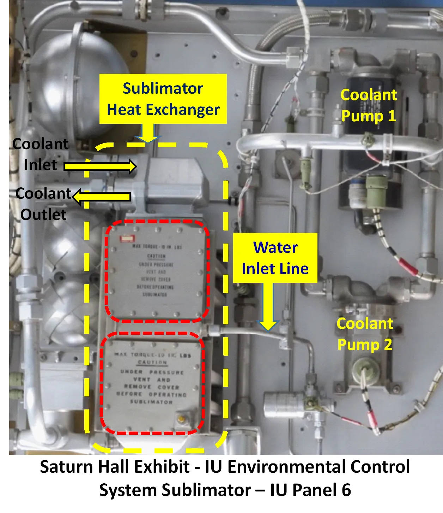***<u>IU Environmental Control System \[ECS\]</u>***

The **ECS** provided temperature control for components in the Instrument Unit and in the forward skirt of the S-IVB Stage. **Liquid** **Coolant** was circulated through **Thermal Conditioning Panels \[Cold Plates\]** mounted on 15 of the 24 IU panels and through a similar number of Cold Plates mounted in the S-IVB forward skirt. The **Coolant** was circulated through passages ***inside*** the Digital Computer \[LVDC & LVDA\], the Analog Computer \[FCC\], and the Guidance Platform \[ST-124\] so these four items were not mounted on Cold Plates.

> 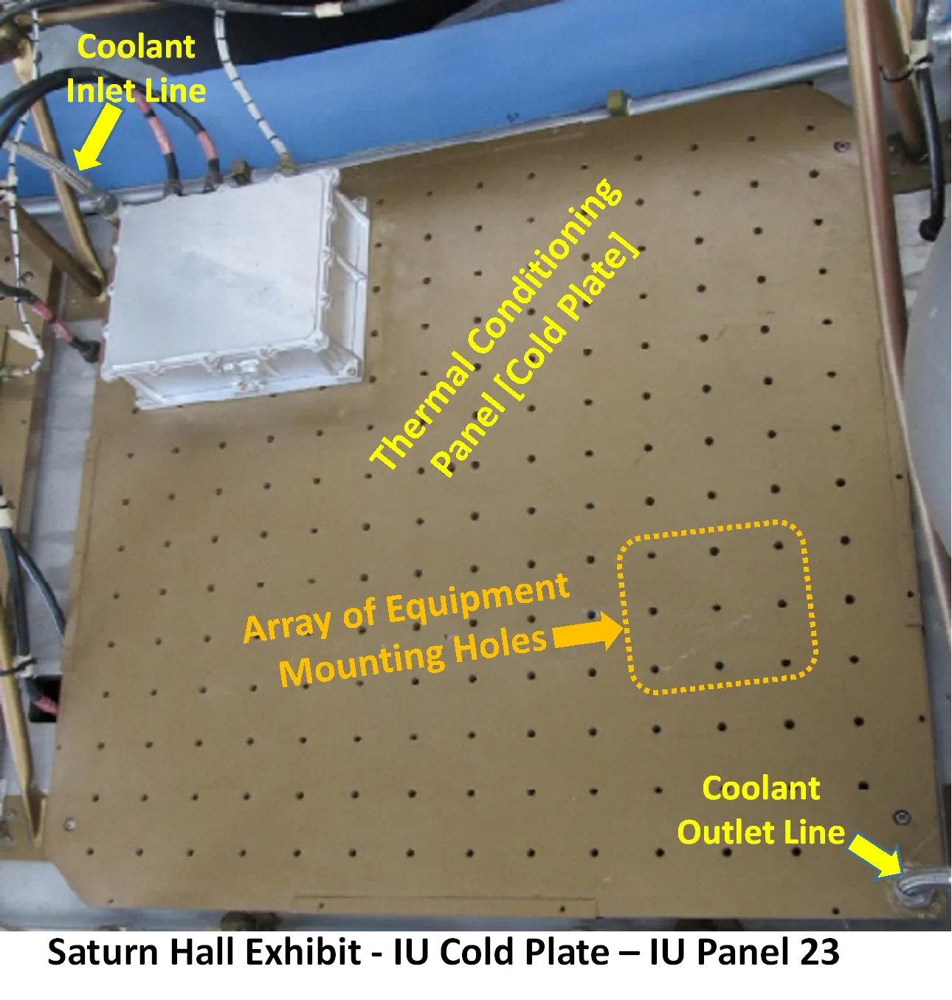*The original **ECS coolant** was a **Water-Methanol** mixture; Methanol is wood alcohol. The Water-Methanol \[unexpectedly\] outgassed hydrogen that collected inside the IU computer causing logic circuit failures. The Water-Methanol coolant was replaced with the **Synthetic Oil** ‘Flocool’ that was proven NOT to outgas hydrogen.*

Each **Cold Plate** contained an array of threaded ***Equipment Mounting Holes*** for attaching components. Each Cold Plate could absorb ~420 watts from the attached components into the coolant. The **IU Heat Exchanger \[Sublimator\]** then rejected the heat absorbed by the coolant. The **Sublimator** is outlined in yellow dashes in the ECS \[**Panel 6**\] figure above. The Sublimator vent covers \[outlined in red dashes\] were removed before flight to provide the vent area for Sublimator operation.

**IU Environmental Control System Sublimator**

The **Sublimator** \[**Panel 6**\] rejected heat from the coolant by the process of “<u>Sublimation</u>” wherein heat absorbed by <u>water ice</u> coverts the ice directly to <u>water vapor</u> that is vented into space.

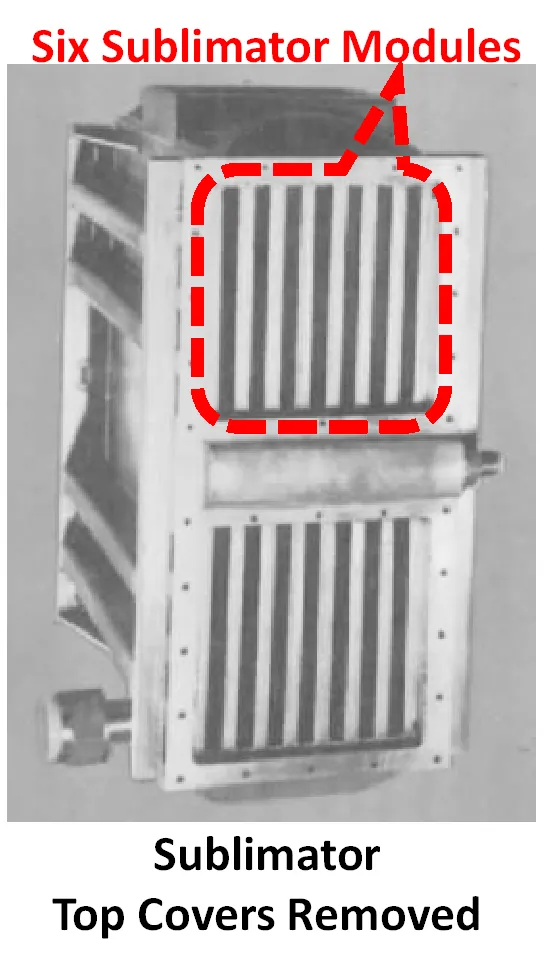*The liquid coolant flowed in a closed path through the <u>innermost</u> passage of each of twelve Sublimator **modules**. A water filled jacket <u>surrounded</u> each coolant path. The <u>outer structure</u> of the water jacket was made from **porous** “**sintered nickel**” \[see definition below\].*

*At 180 Seconds after liftoff as the Saturn V reached the outer atmosphere, water was allowed to fill the Sublimator module water passages \[see figure\]. The water ‘seeped’ through the tiny openings in the porous “sintered” nickel plates of the modules. The water turned to **ice** at the surface where it reached the vacuum of space. These small “ice plugs” absorbed heat from the coolant turning the ice surfaces exposed to space directly to water vapor \[**sublimation**\]. This small device could dissipate ~9000 watts \[30,700 BTU/Hour\] of heat.*

*After Sublimator “turn-on” at 180 seconds, the IU Computer Flight Program sensed the coolant temperature every 300 seconds. If the coolant temperature was above 60°F the IU computer \[via a Switch Selector command\] opened the water valve allowing water from the ECS **Water Accumulator** to fill the Sublimator modules and begin the cooling process. If the coolant temperature was below 50°F, the Flight Program closed the water valve to stop the cooling process. This process generally maintained the ECS coolant temperature between the limits of ~45°F and ~68°F.*

> ***NOTE:** During EVAs, the Astronauts are cooled by coolant circulating through tubing in their “long underwear”. The accumulated heat is then removed from the coolant by a small <u>Sublimator</u> located on their EVA Suit backpack.*

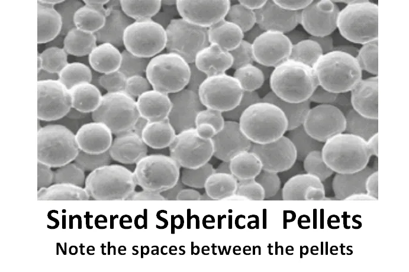

> *“**Sintered**” metals are made from very small spherical pellets that are pressed together at temperatures and pressures sufficient to make the pellets stick together but not sufficient to liquefy the metal. This produces a porous material that liquids can “seep” through. Such material is commonly used for metal bushings to allow oil to flow onto a supported and rotating shaft. Similarly, by choice of the pellet size, sintered material can form filters for extremely small particles.*

***<u>IU Measurement, Telemetry, and Radio Frequency Systems</u>***

The IU **Measurement, Telemetry, and Radio Frequency** **\[MT&RF\]** Systems measured on-board parameters, encoded, and transmitted it to the ground. The transmitted data was used for ***real-time*** monitoring during Manufacture, Pre-Launch, and In-Flight Mission Control operations and for ***post-flight analyses*** of systems performance and for resolution of inflight problems.

> *The Saturn complexity required computer controlled checkout facilities at the launch site and at the manufacturing and test facilities for the three Rocket Stages and the Instrument Unit. Each stage and the IU Measurement and Telemetry **\[M&T\]** Systems transmitted the same “in-flight” measurement data to the automated checkout facilities during stage manufacture and prelaunch activities. This multi-purpose design of these systems contributed directly to the successful construction, launch, and mission success of the Saturn Launch Vehicles.*
>
> *Measurements handled by the M&T Systems included: temperatures, pressures, flow rates, voltages, currents, equipment status, inertial guidance data, vibration, computer data, etc.*

The first three Saturn V’s were designated **Research & Development \[R&D\]** vehicles and ~350 measurements were transmitted from the IU; similar numbers of measurements were transmitted via the MT&RF systems of the other stages. The remaining Saturn V’s were designated **Operational** vehicles and ~150 measurements were transmitted from the IUs on these flights.

The measurements originated from transducers and other sources located throughout the IU and from control related measurements from the three rocket stages of the Saturn V. Transducer outputs varied widely depending on the transducer type and on the signal being measured. **Measuring Racks** converted the transducer outputs to signal levels within the 0 to 5 Volts required for compatibility with the telemetry system.

The scaled measurements from the **Measuring Racks** and any measurements not requiring scaling were ‘usually’ sent to a **Measuring Distributor** for routing to additional telemetry system components for transmission to the ground during flight and/or to the ground checkout facilities during manufacture and pre-launch.

The majority of the IU measurements were transmitted through **Pulse Code Modulated \[PCM\]** systems. **Multiplexers** sampled the PCM destined measurements one after the other for a fraction of a second each. The Multiplexer then converted each sampled ‘*analog voltage’* measurement to a *’10 bit* *digital value’* and combined these samples into a serial data stream of 10 bit values. Synchronization signals were added to the serial data stream to allow the ground personnel to extract individual measurements and timing information from the stream.

> *Refer to **Appendix B** for an example of a 10-bit digital value vs an analog value and the necessary calibrations and conversions used to derive the actual value of the transmitted parameter.*

Some measurements could *<u>not</u>* be sent through a PCM system because sampling would destroy the needed frequency information in these signals. These measurements were transmitted in an analog fashion \[no sampling\] to preserve the complete fidelity of the “raw” measurements. Vibration and flow rate measurements were signal types where frequency information had to be preserved. Other telemetry methods were also used.

Components called **Telemeters** modulated the various signals \[sampled or analog\] onto **Frequency Modulated \[FM\]** subcarrier signals for transmission to the ground.

Several different **Radio Frequency** **\[RF\]** systems were used to transmit the measurement data to the ground stations. The following are examples of the RF types used on the **Operational** IUs:

> PCM was transmitted on a Very-High Frequency \[**VHF**\] System at ~245 MHz.
>
> Analog signals were transmitted on a **VHF** System at ~250 MHz.
>
> **Command and Communications** System transmitted PCM telemetry data at ~2280 MHz \[S-Band frequency\].

***<u>IU Command and Communication System</u>***

The IU **Command and Communications System \[CCS\]** was a modified version of the ***Unified S-Band Systems*** used on the Apollo Command and Lunar Modules, e.g., the IU CCS did not use ***Voice*** capability. The CCS had both Transmit \[**Downlink**\] and Receive \[**Uplink**\] capabilities. The **CCS** Electronics \[**Panel 24**\] included a ***Transponder***, ***Transmitter \[Power Amplifier\]***, and ***Coaxial Switch***.

IU PCM telemetry was transmitted over the CCS Downlink.

The **Manned Spaceflight Network** \[**MSFN**\] Ground Stations transmitted coded signals to the CCS via the Uplink. The CCS responded by transmitting a coded response to the Ground Station via the Downlink. Operating in this coordinated Uplink/Downlink manner aided the Ground Stations in pointing their antennas at the IU and provided range and velocity tracking data of the vehicle.

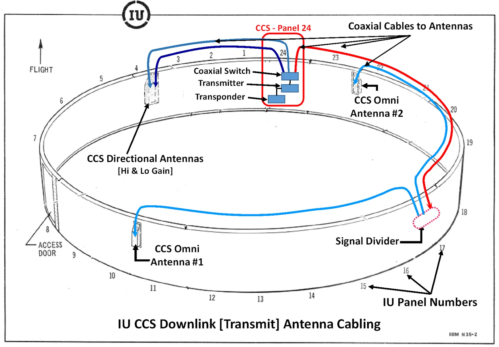The IU received Mission Control commands transmitted to the **CCS Transponder** through the IU **Omni-Directional *Receiving* Antennas**. The Ground Transmitter power levels made High and Low Gain Directional ***Receiving*** Antennas unnecessary. The **CCS Transponder** received then routed the uplinked commands to the **Command Decoder** \[**Panel 18**\] for decoding and forwarding to the IU Computer for execution.

The IU Computer selected the ***Coaxial Switch*** position to route the CCS *Transmitted* \[Downlink\] signal through **EITHER** the two ***Omni-Directional Antennas***, **OR** the ***Lo-Gain Directional Antenna***, **OR** the ***Hi-Gain Directional Antenna*** for transmission to the Ground Stations.

The CCS **Lo-Gain** and **High-Gain Directional Antennas** provided strong signal levels at the Ground Station receivers. However, use of either of these two antennas required IU active control of the vehicle attitude to keep the antennas pointed at the Earth. It was always possible that various maneuvers would prevent pointing these antennas toward the Earth. The two **Omni-Directional** ***Transmit*** **Antennas** were located on opposite sides of the IU and allowed reception by the ground stations regardless of the S-IVB/IU attitude. The signal level received at the ground stations from the ***Omni-Directional Antennas*** would be lower than from the ***Directional Antennas*** but the signal from the ***Omni-Directional Antennas*** could “usually” be received regardless of the vehicle attitude.

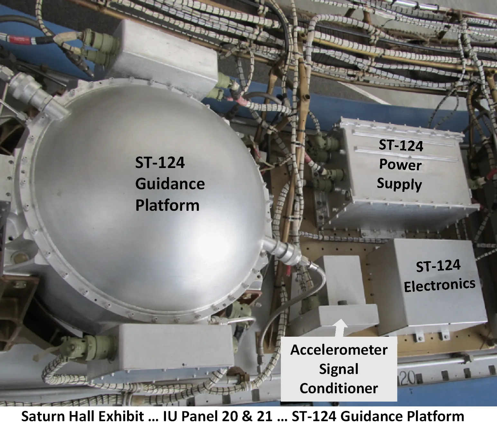***<u>IU ST-124 Guidance Platform</u>***

The **ST-124** **Guidance Platform** \[**Panel 21**\] measured the vehicle acceleration and attitude. The ST-124 Power Supply, Electronics, and Accelerometer Signal Conditioner components supporting these ST-124 operations were mounted on **Panel 20**.

The ST-124 contained three **gimbals:** inner, middle, and outer gimbals. The “inner gimbal” contained three Gyroscopes and three Accelerometers. The three Gyroscopes operated to keep the “inner gimbal” fixed at its reference position throughout the flight. The vehicle was attached to the “outer gimbal”. The three gimbal arrangement allowed the vehicle to move about the fixed position of the “inner gimbal”. Electromechanical Resolvers mounted on the pivot points of the three gimbals provided vehicle attitude \[angle\] reference information to the IU Computer System. During boost phases, the IU Computer System read the Resolver and Accelerometer outputs 25 times per second to determine the vehicle attitude, velocity, and position in space for use in the Computer Flight Program Navigation, Guidance, and Control calculations.

***<u>IU Computer System</u>***

The Instrument Unit Computer System used a ***Digital Computer*** and an ***Analog Computer***. The **Launch Vehicle Digital Computer \[LVDC\]** and the **Launch Vehicle Data Adapter \[LVDA\]** comprised the ***Digital Computer*** and the **Flight Control Computer \[FCC\]** comprised the ***Analog Computer***. These primary components of the IU Computer System were located at IU **Panels 16, 17, 18, and 19**.

> 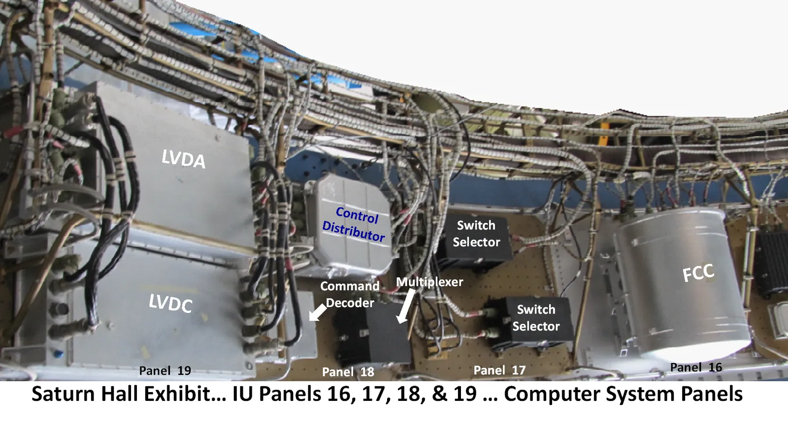 *See **Appendix A** for a brief comparison of **Digital** and **Analog**.*

The **LVDC Flight Program,** stored in the **LVDC Memory** and executed by the **LVDC Processor**, controlled nearly all aspects of the **Saturn V** mission. The **LVDA** served as the input/output \[**I/O**\] interface between the **LVDC**, the **FCC**, other IU components, certain components on the three Saturn V stages, and the Apollo Spacecraft.

***IU Computer System … Launch Vehicle Digital Computer \[LVDC\]***

The **LVDC** contained ***<u>two</u>*** **16,384 word** ***Ferrite Core Memories***. Each computer **word** was ***<u>28 bits</u>*** long (see notes below). Each 16,384 word memory was constructed from four 4,096 word memory ***modules***. Each memory module contained **14** **core planes.** Each core plane contained 8,192 ***ferrite cores***: each core stored one “***bit***” of memory.

> *A **ferrite core** is a ~1/32 inch diameter “donut” shaped piece of ferromagnetic material with wires going through the donut hole. An electric current pulse is passed through certain of the wires to magnetize \[‘write’\] the core or to ‘read’ the content of the core. A core is magnetized in one direction \[e.g., clockwise\] to represent a ‘one bit’ and in the other direction \[e.g., counter-clockwise\] to represent a ‘zero bit’. When a word was read from the memory, it de-magnetized the cores that stored that word so the LVDC electronics would automatically rewrite the word back into those cores following each read action ... called a **destructive readout** memory.*
>
> *The **LVDC** **memory** was **non-volatile**, that is, it retained its content \[the cores stay magnetized\] when power was removed from the computer.*

*\*

> *The number of “bits” per word \[the **word size**\] in computer memories and processors is ‘**usually**’ based on a power of 2, for example, 8 bits, 16 bits, 32 bits, 64 bits, etc.*
>
> *A “Power of 2 Number” is a number that can be obtained by multiplying 2 by itself, for example:*
>
> *2x2 = **4** … 2x2x2 = **8** … 2x2x2x2 = **16** … 2x2x2x2x2 = **32***
>
> *Thus, **4**, **8**, **16**, **32**, etc. are **Powers of 2**.*

*But, the LVDC **28 bit** word size is NOT a power of 2. So, why did the LVDC use <u>a non-power of two</u> word size?*

> *The longest <u>data</u> word required for any LVDC calculation was 26 bits and this provided the basis for selecting the word size. Two additional bits \[called parity bits\] were added to allow the system to determine if a word read from memory or used in computations was valid.*
>
> *Some form of magnetic material was about the only choice for a space borne memory in the 1960’s and the ferrite core memory was chosen for the LVDC. The LVDC core memory was assembled by hand and included complex read/write circuitry. Every added bit doubles the number of cores in a memory so every added bit doubles the size and increases the cost of the memory. Furthermore, every added bit increased the UNRELIABILITY of the memory because it significantly increased the number of component parts that were needed to create the memory. For these reasons, the LVDC memory was sized at 28 bits instead of a ‘power of 2’ 32 bits!*

For reliability purposes, both **16,384 word** memories contained and executed an identical Saturn V Flight Program. The outputs from the two memories were ***compared*** at each operation; both memories should always get the same result. If the results were not the same, the program would enter a “reasonableness test” subroutine and determine which of the two results to use for that point in the flight. The more reasonable of the two results would then be used and the program execution would continue.

> *There were only a handful of non-compares during <u>all</u> of the Saturn flights!*

During the boost phases, the LVDC Flight Program executed an average of **~8,700 instructions per second**.

As the LVDC & LVDA were being developed in the mid-1960s, integrated circuits were just coming into being and were NOT used in these devices. The technology used for the LVDC/LVDA was that being used in the IBM/360 Computers of the time period but the packaging and programming was different for the Saturn application.

The digital logic circuits were constructed using **Hybrid Modules**. <u>Present day</u> integrated circuits can contain a ***couple billion transistors*** on a single ¾ inch square silicon chip. One <u>1960’s</u> LVDC/LVDA **Hybrid Module** measured 0.3 inches square and contained from ***2 to 9 transistors***. The entire LVDC contained ~40,000 transistors on 73 **Logic Pages.** Up to 70 Hybrid Modules could be used on a **Logic Page**. So, the LVDC Processor was made from several thousand Hybrid Modules instead of being contained on several integrated circuit modules.

> *The US had landed on the moon before the first Intel 4004 4-bit microprocessor was marketed in 1971.*
>
> *One LVDC/LVDA Hybrid Module **transistor** measured 0.025 inches square. In 2020, approximately **18 million** transistors from common integrated circuits of the day will fit in the area of **one** IU LVDC/LVDA transistor!*

The LVDC weighed ~80 pounds, measured 31 by 13 by 13 inches, consumed ~100 watts, and used liquid coolant circulated through its structure to prevent overheating of the circuits.

***IU Computer System … Launch Vehicle Data Adapter \[LVDA\]***

The **LVDA** was the ***interface*** device for the LVDC providing the means for the “digital LVDC” to communicate with both “digital” and “non-digital” elements of the Saturn V systems. The LVDA converted “variously formatted” input signals into the digital format for use by the LVDC. In turn, the LVDA converted the LVDC digital output signals to the “various formats” needed by other equipment in the IU and Saturn V Stages.

> *Examples of functions performed by the LVDA:*
>
> *521,000 bit per second serial interface with the LVDC*
>
> *Buffering of LVDC data for transmission to the IU Telemetry System*
>
> *Transmission of Guidance data from the LVDC to the Analog Flight Control Computer*
>
> *Analog-to-digital and digital-to-analog signal conversions*
>
> *Interfaces to the Ground Support Computer during manufacturing and prelaunch checkout*
>
> *Generate the Real-Time clock*
>
> *AC power supply for Inertial Guidance System attitude resolvers*
>
> *Five DC power supplies powered both the LVDC and LVDA.*

The LVDA weighed ~200 pounds, measured 32 by 16 by 15 inches, consumed ~200 watts, and had liquid coolant circulated through its structure to prevent overheating.

***IU Computer System … Flight Control Computer \[FCC\]***

The **FCC** was an expanded version the Analog Control Computer that had been used on the Titan II Air Force Ballistic Missile. The same overall mechanical design and the internal circuit board layouts were adopted for the Saturn design to retain the inherent reliability of the Titan Missile flight proven design; the FCC barrel shape was derived from its placement inside the Titan Missile. There were direct connections from the FCC to each Engine Actuator servo-mechanism on the S-IC, S-II, and S-IVB Stages and to the APS Thrusters on the S-IVB Stage.

The FCC weighed ~120 pounds, measured 28 inches long and ~18 inches in diameter, and consumed ~150 watts. Liquid coolant was circulated through its structure to prevent overheating on the first four Saturn flights but was stopped thereafter after it was shown not to be required.

***IU Computer System… Switch Selectors***

The LVDC Flight Program commanded various On/Off operations for the IU and the Saturn Stages using four **Switch Selectors**; one in the IU and one in each of the three Saturn stages. All four Switch Selectors connected to the LVDA over 22 parallel wires. The LVDC Flight Program sent coded commands over these wires \[one at a time\] to (1) select the desired Switch Selector, (2) identify the one of 112 possible outputs to be activated from the Switch Selector, (3) verify that the correct command was received by the correct Switch Selector, and then (4) execute the command. The LVDC could output one Switch Selector command every 0.1 seconds.

> *The LVDC/LVDA commands to the Switch Selectors used a redundant coding and verification scheme. If the first command did not work properly then the LVDC/LVDA would resend the **complement** of the first command. In this manner a failed bit or broken wire would **not** keep the commands from reaching and being executed by the desired Switch Selector.*
>
> ***Complement** = exchanges the one bits for zero bits and vice-versa.*

Upon execution, the Switch Selector output 28 Volts for 65 milliseconds \[65 thousandths of a second\] on <u>the</u> commanded output line. A Distributor in the IU or Stage would then route the Switch Selector output signal to the desired destination. In most cases, the Switch Selector 65 millisecond signal would latch \[turn-on\] a relay in the Distributor to keep the signal active until a subsequent Switch Selector command was sent to unlatch \[turn-off\] the relay.

***IU Computer … LVDC Flight Program***

**LVDC Assembler** code was used to program the LVDC Flight Program and operated with only **18 instructions**. Each “low-level” instruction performed one action and performed it in a precisely defined amount of time. Controlling the Saturn was a “***Real-Time***” computer application requiring these precisely timed events.

> *For example, a delay in executing a PC or cell phone operation is of little consequence to the user whereas timing delays in firing the ordnance to separate Saturn stages or in starting or stopping engines could have had catastrophic Apollo Mission results.*

The Flight Program, stored in the **LVDC Memory** and executed by the **LVDC Processor**, controlled nearly all aspects of the Saturn V mission. The Flight Program controlled the **Event Sequencing** \[*on and off* *commands*\] for the IU and the three stages using the Switch Selectors as described above.

The **LVDC Flight Program** performed the **Navigation** and **Guidance** functions. The **FCC** \[the *Analog Computer*\] performed the **Control** functions through its interfaces with the S-IC, S-II, and S-IVB Engine Actuator Servo Mechanisms and the S-IVB APS system thrusters.

> ***Navigation, Guidance & Control \[NG&C\]*** *… Following is a simplified NG&C <u>definition</u> followed by a greatly simplified <u>description</u> of the NG&C LVDC & FCC operations:*
>
> ***Navigation**: Where am I versus where should I be?*
>
> ***Guidance**: What is the best way to get from where I am to where I should be?*
>
> ***Control**: Steer the engines and/or fire thrusters to get me from where I am to where I should be!*

There were two **NG&C** modes during the Saturn V boost periods: **Time-Tilt** **Guidance** and **Iterative Guidance:**

**Time-Tilt Guidance \[Open-Loop Guidance\]**

During the <u>S-IC Stage burn</u> the vehicle traveling through the atmosphere passed through the speed of sound and maximum aerodynamic pressure at about 60 and 70 seconds after launch, respectively. The sheer size of the vehicle and the aerodynamic loading on the vehicle during these periods required careful control of the vehicle path through the atmosphere. During this period, the LVDC Flight Program directed the vehicle using a predetermined profile based on the time from liftoff; quick maneuvers during this time could have had catastrophic results! Maneuvers during this period <u>were executed for the time intervals shown below</u>:

*Yaw* Maneuver to clear the launch tower … 2 to 10 seconds after liftoff

*Roll* Maneuver to orient vehicle & antenna pointing … 12 to 32 seconds after liftoff

*Pitch* Maneuver directing toward orbit insertion … 12 seconds to 2 min 38 sec after liftoff.

**Iterative Guidance \[Closed-Loop Guidance\]**

Beginning with the <u>S-II Burn and during both S-IVB Burns</u>, the NG&C operations were based on the vehicle measured parameters derived from the ST-124 Platform and not on a predetermined profile. The vehicle was out of the atmosphere so large external forces on the vehicle during these periods would have been highly unlikely.

The LVDC memory contained a stored profile \[location, velocity, and heading, based on time from launch\] for the trajectory to be followed. During boost the LVDC continually \[25 times per second\] determined the vehicle position, speed, and direction derived from the **ST-124 Platform** Accelerometers and the Gimbal Angle readouts. Every ~1.5 seconds, the LVDC Flight Program **Navigation** routine compared the computed position, speed, and direction \[the Where am I?\] with the stored trajectory position, speed, and direction \[the Where should I be?\] and passed the difference in these parameters \[the Navigation error\] to the LVDC Flight Program <u>Guidance</u> routine.

The LVDC Flight Program **Guidance** routine then determined the “most efficient flight path” to take over the next ~1.5 seconds to reach the <u>desired</u> position, speed, and direction” and passed this “guidance error” to the Control function.

The **Control** function was executed by the Flight Control Computer \[FCC\]. The “error” determined by the LVDC Flight Program *Guidance* routine was passed from the LVDC through the LVDA to the FCC. The FCC continually tracked vehicle **roll, pitch,** and **yaw <u>motion</u>** using a set of **Control Rate Gyroscopes** \[different from the ST-124 Gyroscopes\]. The FCC then compared the LVDC “guidance error” signal with the Control Rate Gyroscope information and generated correction signals to the respective engine(s) servos and/or thruster(s) on the active stage.

During orbital periods, the frequency that the platform parameters were read and the frequency of the navigation and guidance calculations were reduced because things just don’t happen as fast during orbital coast periods.

> *During boost periods, the NG&C operations repeated every one and a half to two seconds resulting in somewhat intermittent engine movements. These engine movements moved the vehicle as expected but also excited “flexure modes” in the vehicle structure. These “jerky” motions led the Astronauts to describe the feel during S-IC Stage boost as “like riding a train on a really bad track”!*

During the **Earth Orbit Coast** and **Translunar Coast** periods, Mission Control could use the IU **Command and Communications System** to send commands to the IU to update the LVDC Flight Program, provide Navigation updates, and/or initiate discrete S-IVB or IU actions or maneuvers during the non-boost \[coast\] periods of flight.

**<u>S-IVB Second Burn and Trans-Lunar Injection \[TLI\]</u>**

**Special Notes:**

> *In the following: **XX:YY GET** = **XX** Hours and **YY** Minutes **G**round **E**lapsed **T**ime. This is the time since liftoff and varies for each mission. The example times given here are from the **Apollo 13 mission**.*
>
> ***At Trans-Lunar Injection the <u>vehicle</u> consisted of the S-IVB, IU, SLA, and Spacecraft.***

When the vehicle’s position in the **Earth Parking Orbit** intersected the <u>PLANE</u> of the moon’s orbit about the Earth \[approximately\], the S-IVB engine was restarted and burned for about 6 minutes accelerating the vehicle to **Earth Escape Velocity \[24,500 miles per hour\]** and boosting it to approximately **200 miles altitude** and directing it into the Moon’s orbit plane. During this second S-IVB burn the crew experienced a maximum of ~1.4G’s just prior to S-IVB engine cutoff. **Trans-Lunar Injection** was defined as 10 seconds after the second S-IVB burn cutoff at ~2:42 GET.

> ***Note:** The two ‘hypergolic’ Ullage Rockets on the S-IVB Auxiliary Propulsion System were used to provide the small acceleration for the S-IVB J-2 Engine <u>Second Burn</u> start sequence.*

**<u>S-IVB/IU/Spacecraft Separation</u>**

Approximately 15 minutes after S-IVB second burn cutoff, the Apollo Command and Service Module **\[CSM\]** separated and moved away from the S-IVB/IU. Simultaneously, four **Spacecraft Lunar Module Adapter (SLA)** panels were jettisoned \[~3:06 GET\]. The SLA tapered from the 22 Foot Instrument Unit diameter to the 11 Foot Apollo Service Module diameter. The Lunar Module \[LM\] was located inside the SLA; the LM legs were folded so it would fit inside the SLA. The jettisoning of the SLA panels exposed the Lunar Module Ascent Stage to space with the Descent Stage still attached to the remaining lower ~1/3 of the SLA. The CSM turned around and flew back to dock with the LM Ascent Stage docking port at ~3:09 GET. The docking adapter in the apex of the Apollo Command Module mated with the docking port atop the Lunar Module Ascent Stage. Command Module to Lunar Module docking latches were set and cables were connected by the crew. Docked together, the Command Module, Service Module, and Lunar Module \[CSM/LM\] separated from the S-IVB/IU at 4:01 GET and continued toward the moon. *The <u>Command</u> and <u>Service Modules</u> remained attached until just prior to re-entry into the Earth’s atmosphere \[~30 minutes before splashdown\].*

Following their separation, the S-IVB/IU and Spacecraft would follow the same path to the moon. Without any further velocity change, there would be a high probability that the momentum of the S-IVB/IU would cause it to actually run into the Spacecraft before they reached the Moon. The **Evasive Maneuver** was used to prevent this.

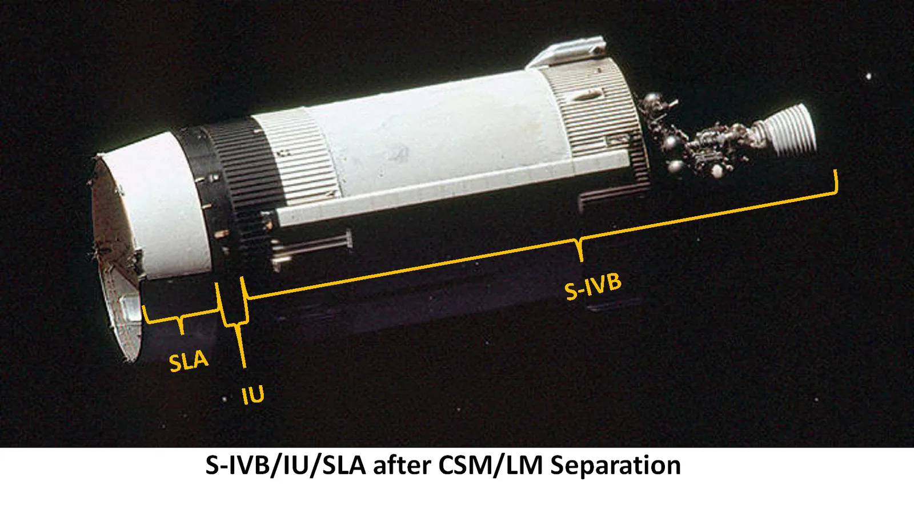At 4:09 GET, shortly after the CSM/LM separation from the S-IVB/SLA, the S-IVB/IU maneuvered to the **Evasive Maneuver** attitude. Then at 4:18 GET the S-IVB **APS Ullage Rockets** were fired for ~60 seconds to slow the S-IVB/IU slightly (~6 miles per hour) to insure that the S-IVB/IU would never impact or come close to the Apollo Spacecraft. The CSM executed a similar Reaction Control System burn to slightly increase the CSM speed further insuring the Spacecraft and the S-IVB/IU would never impact each other.

**<u>S-IVB/IU Post Separation Operations</u>**

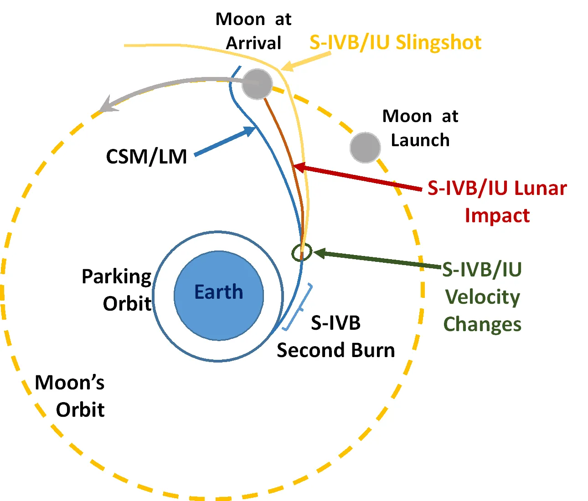After separation from the S-IVB/IU, the CSM/LM continued on a trajectory past the leading edge and ~100 miles above the Moon about 70 to 80 hours after launch \[GET\]; the actual time to reach the Moon was mission dependent.

After Spacecraft separation and the **Evasive Maneuver**, the S-IVB/IU executed a series of **mission dependent** maneuvers to either put the S-IVB/IU into **Solar Orbit** or target the S-IVB/IU to **Impact the Moon**. Examples of various trajectories are shown at the right.

> ***Why Solar Orbit?** Without any added velocity changes, the S-IVB/IU would follow a trajectory past the leading edge of the moon and ultimately into a very high and very elliptical Earth orbit. This orbit could potentially interfere with future moon missions. Placing the S-IVB/IU into Solar Orbit simply got rid of a very large piece of “space junk”.*
>
> ***Why Lunar Impact?** An Apollo **Science Objective** was to evaluate the Moon’s interior and determine if the moon contained a molten core similar to the earth. Astronauts from Apollo 12 and subsequent landings placed Seismometers on the moon to measure moon quakes. On Apollo Missions 13 thru 17, the trajectory was adjusted so that each **S-IVB/IU** would impact the moon. Traveling **~5700 miles per hour** and weighing **~30,000 Pounds***, *the S-IVB/IU impact was equivalent to ~ 11 tons of TNT and produced 2½ to 3 hour lunar vibrations \[moonquakes\] that would be sensed by the Seismometers and telemetered to Earth for analysis.*

After the **Evasive Maneuver**, the S-IVB/IU was maneuvered to an almost retrograde attitude and from 4:20 GET to 4:40 GET *\[**Apollo 13** times\]* several ***Thrusting Actions*** were executed to slow the S-IVB/IU and place it onto the desired trajectory for either **Solar Orbit** or **Lunar Impact**. These thrusting actions included: (1) pumping unused LOX through the engine \[engine is not ignited\] producing ~800 Pounds of thrust for ~48 Seconds, (2) opening ***LH2 Propulsive Vents***, and (3) venting the ***Helium Spheres***. At 6:00 GET, the **APS Ullage Thrusters** were fired for 217 seconds.

> *These thrusting actions slowed the **Apollo 13** S-IVB/IU about 50 miles per hour leading to <u>Lunar Impact</u>.*

The chart below shows the velocity changes required for an S-IVB/IU Earth-Moon Escape \[Solar Orbit\] or a Lunar Impact. If the velocity change was too small \[\< ~12 MPH\] or too large \[\> ~83 MPH\], then the S-IVB/IU would go into a very high and very elliptical Earth Orbit \[**Earth Capture**\]. Although traveling over 10,000 miles per hour only relatively small velocity changes were needed for an S-IVB/IU Solar Orbit \[**Earth-Moon Escape** by Apollo 11\], a High Earth Orbit \[**Earth Capture** by Apollo 12\], or a **Lunar Impact** by Apollo13. Only a few tens of miles per hour velocity change resulted in dramatically different S-IVB/IU trajectories*.*

**Apollo 11 S-IVB/IU** was put into a **Solar Orbit** estimated to be 95.0 by 83.5 million miles \[from the sun\] with a 342 day period.

**Apollo 12 S-IVB/IU** failed to go into **Solar Orbit** and instead went into a highly elliptical **Earth Orbit** estimated to be 550,000 miles by 140,000 miles \[from the Earth\] with a 43 day period. This was in November, 1970.

> ***Apollo 12 S-IVB/IU** remained in the Earth Orbit until 1972 and during one of the orbits possibly came close enough to the Moon to be “slingshot” into Solar Orbit.*
>
> ***Apollo 12 S-IVB/IU** then remained in Solar Orbit for about 31 years. In ~2002 the S-IVB/IU came close enough to the Earth-Sun gravity balance point \[the LaGrange L1 Point\] to be captured by the Earth and pulled back into an Earth Orbit that was similar in size to the original \[1972\] highly elliptical orbit. However, the Earth and/or Moon gravitational effects continually changed the orbital dimensions during each pass about the Earth. After ~14 orbits of the Earth, the S-IVB/IU came close enough to the Moon to be once again “thrown” into Solar Orbit.*
>
> *JPL estimates that the Apollo 12 S-IVB/IU will return to Earth orbit again in about 40 years and continue these Earth-Sun-Earth-Sun-… orbital cycles for the next several thousand years before ultimately hitting the Earth or the Moon!*

**Apollo 13 S-IVB/IU** impacted the Moon about 40 miles from the target point*.* Instrument Unit Battery number 4 powered only the IU CCS Transponder and Transmitter to Lunar Impact. At 77Hr 38Min 41Sec GET, the IU CCS signal stopped indicating that the stage had hit the moon.

> *At 19Hr 30Min GET as the Apollo 13 S-IVB Stage batteries depleted, one of the S-IVB APS engines began firing until depletion of the APS oxidizer. The remaining APS fuel continued escaping \[but not burning\] through the engine. These thrusts further reduced the velocity resulting in the S-IVB/IU impacting the Moon about 86 miles from the Apollo 12 seismometer. The Lunar Impact vibrations reached the seismometer 30 seconds after impact and lasted for 3 hours and 20 minutes. An impact roughly equivalent to the explosion of 11 tons of TNT!*

**<u>S-IVB/IU Lunar Impact … What was learned?</u>**

The following information is from NASA Website:

> **https://www.nasa.gov/topics/moonmars/features/lunar_core.html**

In ~2011, a team of researchers from Marshall Space Flight Center; Arizona State University; the University of California at Santa Cruz; and the ‘Institut de Physique du Globe de Paris’ re-evaluated the extensive data gathered from the four **Apollo Lunar Surface Experiment Package** \[ALSEP\] **Seismometers** deployed between 1969 and 1972 by Apollo Missions 12 and 14 through 16. ALSEP data was transmitted to Earth until 1977 when ALSEP was shut down due to NASA budget cuts.

> *“We applied tried and true methodologies from terrestrial seismology to this legacy data set to present the first-ever direct detection of the moon's core," said Renee Weber, lead researcher and space scientist at NASA's Marshall Space Flight Center in Huntsville, Ala.*

The team's findings suggest that the moon possesses a solid, iron-rich inner core with a radius of nearly 150 miles and a fluid, primarily liquid-iron outer core with a radius of roughly 205 miles. Where it differs from Earth is a partially molten boundary layer around the core estimated to have a radius of nearly 300 miles. The research indicates the core contains a small percentage of light elements such as sulfur, echoing new seismology research on Earth that suggests the presence of light elements -- such as sulfur and oxygen -- in a layer around the Earth’s core.

**End of Narrative**

**SATURN AND APOLLO REFERENCES**

- The Earth-Capture, Earth-Moon-Escape (Solar Orbit), and Lunar Impact ***velocity comparison plot*** was constructed from data contained in the Boeing Trajectory Reports for the Apollo 11, 12, and 13 Missions to compare successful and unsuccessful Slingshot missions and Lunar Impact Missions.

- **<u>Stages to Saturn</u> by Roger E. Bilstein.** NASA History Office. NASA Publication SP:4206 originally published in 1980.

  - Technological history of the Saturn Launch Vehicles. Detailed history of the Saturn program including nuts-and-bolts discussions of the development and manufacturing of the individual stages.

  - Viewable at “http://history.nasa.gov/SP-4206/sp4206.htm”

  - Available from Government Printing Office and from Amazon

  <!-- -->

  - **<u>Apollo by the Numbers – A Statistical Reference</u> by Richard W. Orloff,** NASA History Division.

> Published by Ross & Perry, Inc., Washington D.C. Published 2001

- Mission overview plus detailed reference material for all Apollo missions.

- PDF available on Internet and available at Amazon.

<!-- -->

- **<u>SATURN</u> by Alan Laurie.** Apogee Books, Burlington Ontario, Canada. Published 2005

  - Manufacturing and Test Information for the Saturn Stages for each Apollo and Skylab mission and individual test stages. Includes CD-ROM of test firings of several stages.

  - Available from Amazon and by special order from Barnes & Noble and Books-A-Million

- **<u>The Saturn V F-1 Engine</u> by Anthony Young.** Praxis Publishing, Ltd, Chichester, UK. Published 2009.

  - Detailed technical development information for the F-1 Engine used on the Saturn V S-IC first stage.

  - Available from Amazon, Barnes & Noble, Books-A-Million, and Springer.

  <!-- -->

  - **<u>Carrying the Fire</u> by Michael Collins.** Farrar, Strauss, & Giroux, New York. Originally published 1974.

    - Personal history and recollections by Apollo 11 Command Module Pilot Michael Collins. Excellent writer and observer make this *<u>a most interesting and enjoyable read</u>*. Collins flew on Gemini 10 and Apollo 11 and was director of the Smithsonian Air & Space Museum from 1971 to 1978.

    - Available from Amazon, Barnes & Noble and Books-A-Million

  - **<u>Liftoff, America’s Adventure in Space</u> by Michael Collins.** Grove Press, New York. Published 1988.

    - Overview of America’s Space Programs from 1946 until 1986.

    - Available from Amazon and possibly Barnes & Noble.

**Appendix A: <u>Digital & Analog Computers</u>**

The **Instrument Unit Computer System** used a **Digital** and an **Analog** Computer.

**Digital computers** operate using the **binary** numbering system using two numbers: ***zero*** and ***one***. So, binary numbers are represented by a series of ones and zeroes. Each one or zero is called a “bit”. “Bit” is the contraction for **B**inary dig**IT**. In an electronic circuit, zero volts might represent a zero bit and 5 volts might represent a one bit. A defining parameter of a digital system is the number of “bits” that it can process. The **LVDC** is a **28 bit** computer!

> *For example, in a simple “four bit” system the **decimal number 1310** would be represented by the **binary number 11012** where each bit position represents a power of 2.*
>
> *For this example **11012** = **1**x23+**1**x22+**0**x21+**1**x20 = **8**+**4**+**0**+**1** = **1310**.*

**Analog computers** use parameters such as electrical voltage and/or current representations of the quantities involved in the various operations. These parameters must be very accurately controlled to produce meaningful results. Accurate control of the parameters is made difficult by such things as varying power system inputs, changes in temperature, variations in component parameters, and electrical noise in the circuits.

> *For example, an engine actuator position in “degrees” might be controlled by a voltage between a lower and an upper limit. For example, an actuator with a ±5 degree range of motion might use 0 volts for -5 degrees, 14 volts for 0 degrees, and +28 volts for +5 degrees.*

Circuitry to electronically add, subtract, multiply, divide, compare and compute quantities are used in an analog computer. In some cases, circuitry must be *<u>physically rewired</u>* to change a computation or electronic switching must be included to change various parameters; more complex than rewriting code for a digital computer..

**Appendix B: <u>Telemetry System 10-Bit Value Example</u>**

The Saturn PCM telemetry systems sampled the measurement, converted the analog value to a 10-Bit digital value, and transmitted these sampled measurements as a serial stream of bits. The telemetry system Measuring Racks, etc. converted the measured parameter values to voltage levels between 0 and 5 Volts.

> *Example: A 10 bit digital value with all bits set to one would equal 1023 (decimal number). If this represents 5 volts, then each “bit” would equal 5÷1023 = .00488 or ~0.005 volts per bit.*
>
> *So, if the 10 bit digital telemetered value was 1101001100, then:*
>
> *11010011002 = 84410*
>
> *844 \* 0.005 = 4.22 volts.*
>
> *The measured value as transmitted was 4.22 Volts. Remember this voltage was created by the scaling function in the Measuring Rack. The parameter being measured may have been the temperature in ‘degrees F’ so 4.22 volts doesn’t make sense as a temperature! Calibration data for the measurement was then required to convert from the measured value in volts to degrees F.*
>
> *Before each mission, a calibration curve for every measurement was created. These curves had to be referenced to determine the true value of the measured parameter. Numerous Data Reduction Computer Programs were written to apply the calibration data to each measurement and printout the results in degrees F for use in analyzing the transmitted data. In the 1960’s, there were minimal automated plot capabilities available so most data was printed as a function of time and the results were then plotted by hand.*
>
> **LAST PAGE**
