> **Saturn V**
>
> **Instrument Unit**
>
> **Description**

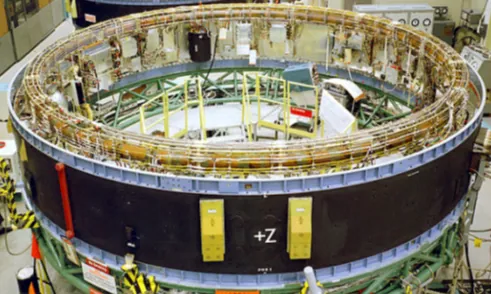

Saturn V Instrument Unit for the Apollo 9 Mission at the IBM Huntsville Manufacturing Site

Prerpared by Luke Talley

USSRC Docent Emeritus

September 15, 2024 Rev 10B**\**

***Personal Note:** It was my privilege to work for IBM in Huntsville, AL on the Saturn Instrument Unit \[IU\] prior to and during the Saturn/Apollo Missions. I worked in the Flight Evaluation Department where, for each mission, we: (1) ) reviewed NASA IU mission objectives and prepared computer analysis programs for each Saturn flight, (2) provided prelaunch and inflight mission support, (3) evaluated the inflight telemetered data, (4) identified inflight problem areas, and then (5) worked with engineering groups to resolve any inflight problems. I am presently a NASA Docent Emeritus volunteer at the Davidson Center Saturn V and Saturn Instrument Unit exhibits at the U.S. Space and Rocket Center. This document contains information that I present during discussions of the Saturn Instrument Unit exhibit plus some personal recollections.*

*Regards,*

*Luke Talley*

**===========================**

***Many of the values quoted herein are representative of typical Saturn vehicles and/or are mission dependent. The book “Statistical Reference” by Orloff listed in the References section at the end of the document is an excellent source of vehicle and mission specific quantities.***

**===========================**

**<u>Apollo/Saturn V</u> … <u>Space Vehicle Overview & Terminology</u>**

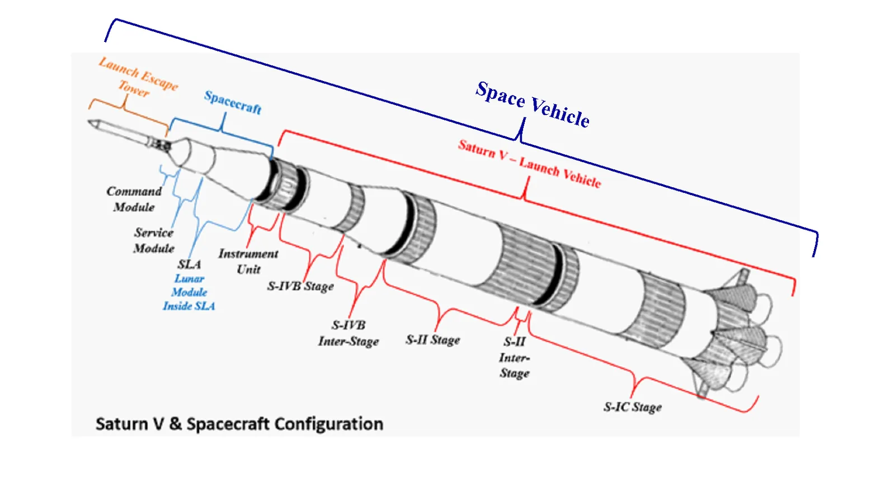

The *Apollo/Saturn V **Space Vehicle*** consisted of the ***Saturn V Launch Vehicle**,* the ***Spacecraft***, and the ***Launch Escape Tower***.

The ***Saturn V Launch Vehicle*** consisted of three Rocket Stages (**S-IC**, **S-II**, and **S-IVB**), the **Instrument Unit** **\[IU\]**, the **S-II Interstage** and the **S-IVB Interstage.**

The entire ***Space Vehicle*** was 363 feet tall. The ***Saturn V Launch Vehicle*** \[S-IC through IU\] was 281 feet tall. The ***Spacecraft*** plus ***Launch Escape Tower*** was 82 feet tall.

**Marshall Space Flight Center (MSFC)** located in Huntsville, AL was responsible for the management of the **Launch Vehicle** design, development, and manufacture.

The ***Spacecraft*** consisted of the ***Command Module (CM)***, ***Service Module (SM)***, ***Lunar Module (LM)***, and the ***Spacecraft Lunar Module Adapter (SLA)***. The ***Lunar Module (LM)*** was located inside the SLA during launch.

The **Johnson Space Center (JSC)** located in Houston, TX was responsible for the management of the design, development, and manufacture of the ***Spacecraft*** and ***Launch Escape Tower***.

**==================================**

**This document outlines the evolution of the Saturn 1 Instrument Unit followed by a more complete description of the Saturn V Instrument Unit used for the Apollo Missions.**

**==================================**

**Saturn I Block II *Version 1* Instrument Unit**

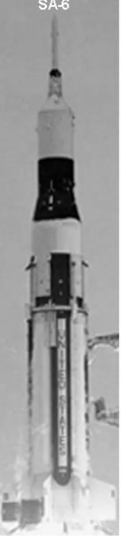The **Saturn I** Launch Vehicle consisted of an **S-I** first stage and an **S-IV** second stage. Saturn I vehicles designated SA-5, SA-6, and SA-7 used a **<u>Block II Version 1 Instrument Unit</u>** that was designed by and manufactured at Marshall Space Flight Center. This structure was 12 feet 10 inches in diameter and 4 feet 11 inches high and weighed 5,654 pounds. It contained a central 70 Inch diameter vertical tube with four 40 Inch diameter tubes extending radially to the external skin. The central and four radial tubes were temperature and pressure controlled and contained most of the guidance and control, power, instrumentation, and telemetry equipment for the launch vehicle.

The ***<u>Active</u> Guidance Package*** contained an Analog Computer and an ST-90S Guidance Platform (type used on Jupiter missile) that guided the vehicle through the **S-I** Stage burn.

<figure>
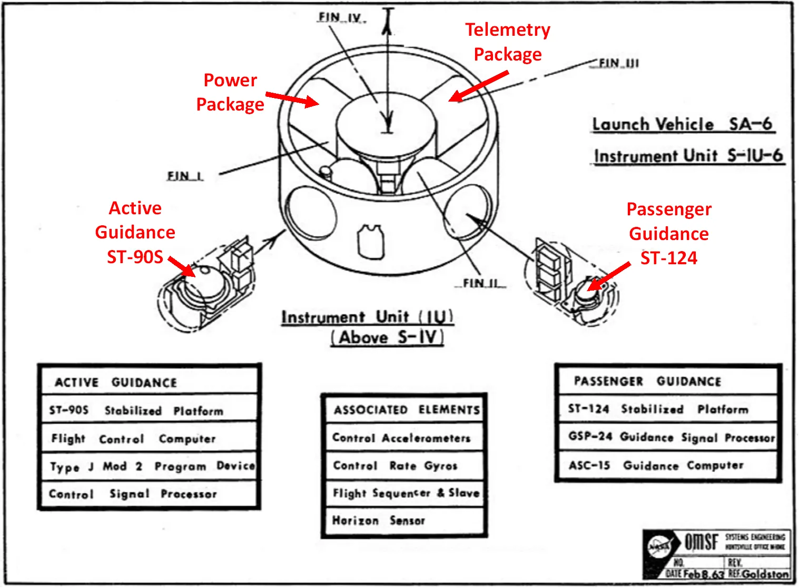
<figcaption>
<strong>Saturn 1 – SA-6</strong>
</figcaption>
</figure>

The ***<u>Passenger</u> Guidance Package*** contained an **ASC-15 Digital Computer** and an **ST-124 Guidance Platform** that guided the vehicle during the **S-IV** Stage burn.

**Saturn I Block II Version 1 Instrument Unit on SA-5, SA-6, & SA-7**

https://commons.wikimedia.org/wiki/File:SA-6_InstrumentUnit_19790076698.jpg

*The IBM Developed and Manufactured ASC-15 Digital Computer had been used on the Air force Titan II Missile and became the forerunner of the Launch Vehicle Digital Computer (LVDC) that would be used on the future Saturn IB and Saturn V Instrument Units. The Bendix Corporation Navigation and Control Division ST-124-M3 Guidance Platform would also be used on the future Saturn IB and Saturn V Instrument Units.*

*The ST-124 Guidance Platform had evolved from the ST-80 and ST-90 platforms used on the U.S. Army Redstone and Jupiter missiles.*

**Saturn 1 Block II *Version 2* Instrument Unit**

The **<u>Block II *Version 2* Instrument Unit</u>** also designed and manufactured by Marshall Space Flight Center was flown on Saturn I vehicles SA-8, SA-9, and SA-10. This was a 12 foot 10 inch diameter 2 foot 10 inch high structure that was not pressurized and was markedly lighter than the *Version 1* Instrument Unit. The equipment was arranged on panels around the inner circumference of the Instrument Unit structure. The ***ASC-15 Digital Computer*** and ***ST-124 Guidance Platform*** were used for both the first \[Saturn I\] <u>and</u> second \[Saturn S-IV\] Stage burns of the Saturn I flights employing the ***Version 2*** Instrument Units.

The photograph below shows a ***Version 2*** Instrument Unit being assembled in the MSFC Building 4705 “Manufacturing Engineering Laboratory Missile Assembly Building”.

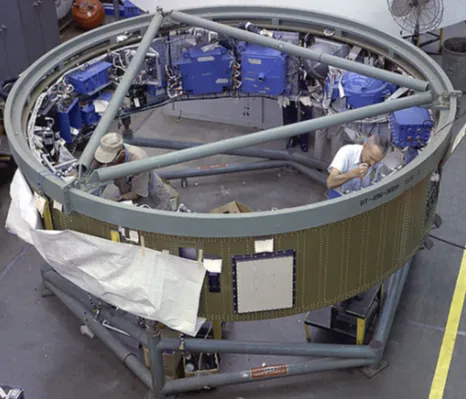

**ASC-15 Computer**

**ST-124**

**Block II Version 2 Instrument Unit @ MSFC Building 4705**

https://commons.wikimedia.org/wiki/File:Saturn_V_Instrument_Unit\_(MSFC-6412716).jpg

**=== <u>Saturn V Instrument Unit</u> ===**

**NOTE:** *Many of the images and descriptions herein refer to the Instrument Unit exhibit in the Davidson Center at the U.S. Space and Rocket Center in Huntsville, AL. The components and their locations on that Instrument Unit exhibit closely resemble Instrument Unit S-IU-508 that was used on the Apollo 13 Mission.*

***<u>IBM Instrument Unit Facility</u>***

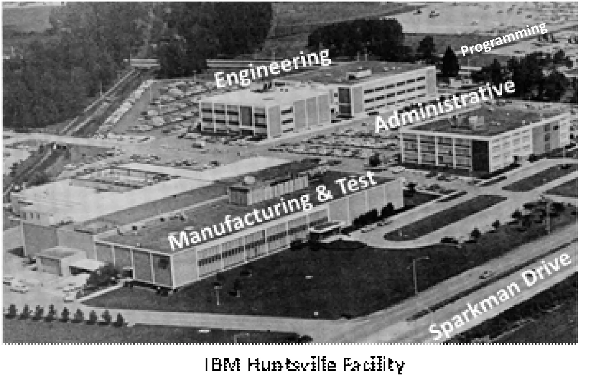

The Saturn I **Block II *Version 2* Instrument Unit \[IU\]** design concept having the equipment mounted around the internal periphery of the structure was adopted for the ***Version 3* Instrument Units** used on the Saturn 1B and Saturn V Launch Vehicles. The Saturn IB and V IUs were similar in component content and placement with the *major* differences being: the interfaces for the eight Saturn IB first stage engines versus the five S-IC first stage engines on the Saturn V, the S-II second stage on the Saturn V only, control system components, and the Command and Communication System used only on the Saturn V Instrument Units.

The Saturn IB and Saturn V Instrument Units were designed by MSFC and manufactured by the **IBM Corporation** at the IBM facility at 150 Sparkman Drive in Huntsville, AL. MSFC and IBM worked together to maintain and upgrade the design of the IU for the Apollo and Skylab programs. The main IBM facility was housed in the four buildings described below. At times some of the ~2,300 IBM employees were located in ~10 Buildings throughout Huntsville.

The **Administrative Building** \[Building 1\] contained the personnel and business offices, the facility main conference room, and the cafeteria. *This is now the **Shelbie King Hall** of the University of Alabama at Huntsville*

The **Manufacturing and Test** **Building** \[Building 2\] contained the control rooms, Ground Support Equipment, and RCA 110-A main-frame computers for testing the Saturn IB and Saturn V Instrument Units in the right-most front non-windowed section of the building. The left-most windowed section contained offices for the test and manufacturing personnel and for the NASA Resident Manager. Immediately behind the front portion was the IU final assembly and test area; the photo on the following page shows an Instrument Unit inside the assembly and test area. The rear sections of the building contained component labs, parts storage, tools, etc.

The **Programming Building** \[Building 4\] located across Technology Drive from the Engineering Building contained offices of the software personnel that managed and wrote the Flight Program for the IU Computer System.

The **Engineering Building** \[Building 5\] contained engineering personnel offices, the facility library, and conference rooms. The first floor of the right half of the building contained the facility main-frame computer, the Simulation Laboratory and the Telemetry Ground Station. The Simulation Laboratory included a computation facility consisting of IBM 360/45 and GE 235 main-frame digital computers, an IBM 1800 Data Acquisition and Control System computer, and two MILGO analog computers. These all worked in concert to simulate the Saturn flight environment for and collect data from IU computer system hardware and software during development and test of the Saturn IB and Saturn V IU Flight Programs. *This building is now the **Olin King Hall** of the University of Alabama at Huntsville*

**The 3 foot high 22 foot diameter *Instrument Unit* has been called the “*Brain*” of Saturn since it controlled the Saturn Launch Vehicle operations from launch until IU primary battery depletion 11 to 12 hours after launch.**

***<u>Instrument Unit \[IU\] Structure</u>***

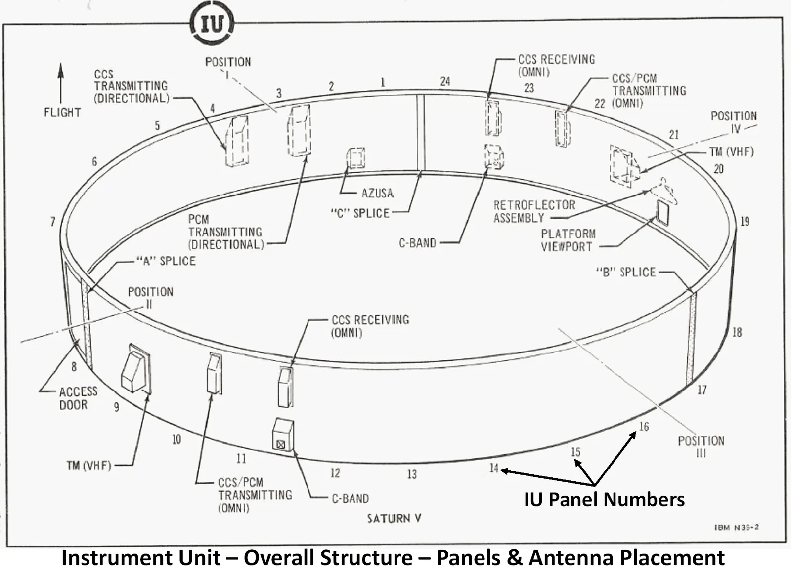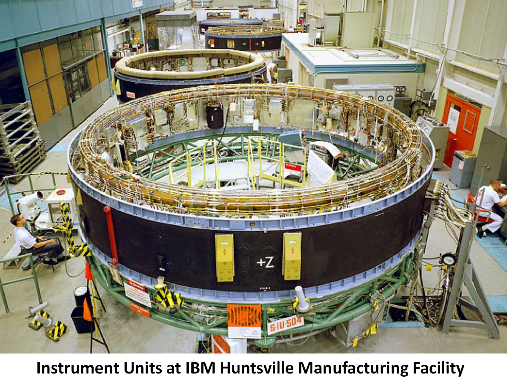The IU Structure was built from three 120 degree segments joined with **Splice Plates** to form the 22 foot diameter ring. The IU interior was divided into **24** **Panels** \[*Re: IU Overall Structure Figure below*\] with each Panel ~3 feet square. Most IU components were mounted on **Thermal Conditioning Panels** which were ~2½ feet square. Several components mounted directly to the IU Structure.

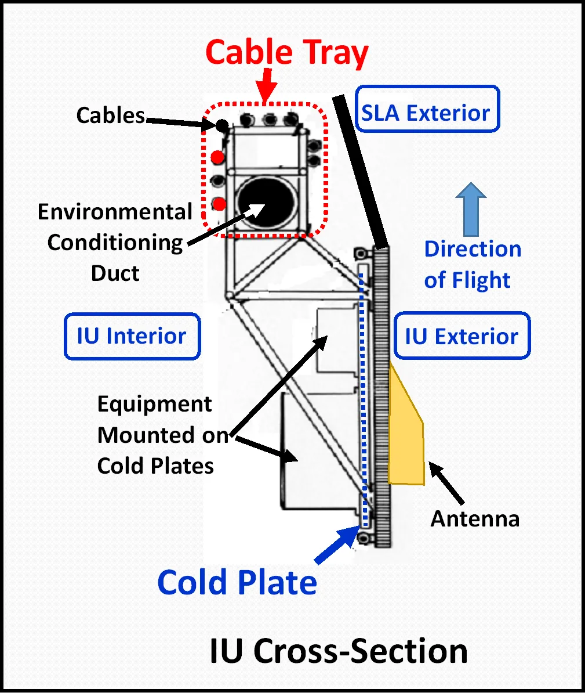

The **Cable Tray,** made from aluminum tubing, was located above the Panels and extended the full circumference of the IU. Cabling was attached to the Cable Tray for routing between components on the various panels.

An **Environmental Conditioning Duct** was mounted within the Cable Tray frame. During on-the-pad operations, Ground Support Equipment (GSE) supplied ***conditioned air*** through this Duct and into the enclosed volume of the S-IVB forward section, the IU, and the SLA. The ***conditioned air*** was changed to ***nitrogen*** during fueling operations to provide an inert atmosphere to prevent any fire or explosion in the enclosed volume.

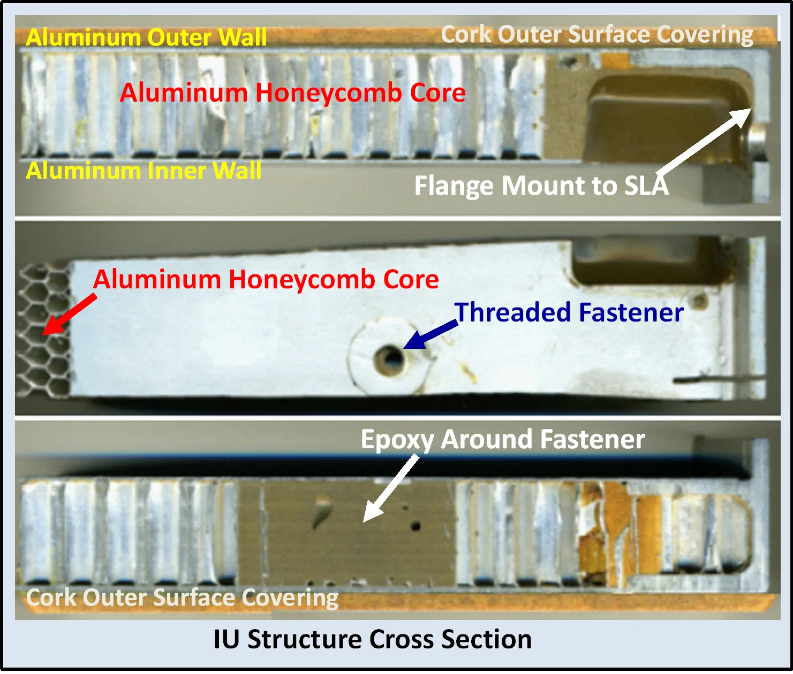The IU Structure Wall was ~1 inch thick consisting of an inner 0.020 inch and an outer 0.030 inch thick aluminum sheet with an aluminum honeycomb core sandwiched between these two sheets. The outer and inner aluminum sheets were **bonded** \[**glued**\] to the 1 inch thick ***Aluminum Honeycomb Core*** ... *YES, the IU was glued together!*

The ***Honeycomb Structure*** provided acoustical insulation, low thermal conductivity, and was not subject to distortion from temperature changes. The IU structure weighed only 450 pounds but it supported ~3,500 pounds of IU equipment plus ~95,000 pounds of SLA and Spacecraft located <u>above</u> the IU. At the 3.5 G’s acceleration just before S-IC center engine cutoff, the lightweight IU structure was supporting 332,500 pounds of SLA and Spacecraft!

The outer IU surface was covered with a thin layer of cork for insulation. As the vehicle passed through the atmosphere, the IU outer surface heated to ~200°F. The cork outer covering acted as an insulator and somewhat as an ablative barrier, that is, the cork surface would scorch but not burn away.

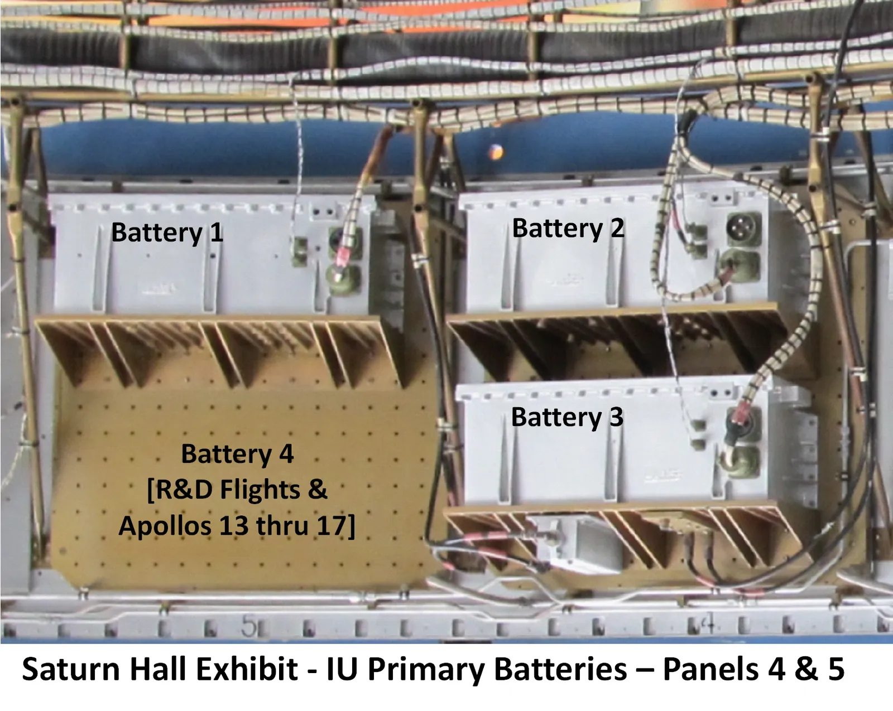**<u>IU Electrical System</u>**

The IU Electrical System was powered by **28 Volt 350 Ampere-Hour *Alkaline-Silver-Zinc Batteries***. The batteries were installed about 24 hours prior to launch.

> **Ampere-Hour** *– A measure of battery capacity. If the battery supplied 25 Amperes, it would last approx. 350÷25 = 14 hours.*
>
> ***Alkaline-Silver-Zinc** batteries stored more energy per pound and operated over a wider temperature range than did the lead-acid or nickel-cadmium batteries of the 1960’s.*

The first 3 Saturn V flights were ***Research & Development*** \[R&D\] Flights and used **four** IU batteries; **three** ***<u>primary</u>*** batteries and a **fourth** to power the added measuring, telemetering, and transmitting components used on the highly instrumented R&D flights.

The subsequent ***Operational*** Flights used **three** ***<u>primary</u>*** batteries providing <u>average</u> currents each of 18, 24, and 34 Amperes, respectively. The third battery \[highest current\] powered the Guidance & Control System and when Battery \#3 discharged the primary IU mission essentially ended; generally about 11 to 12 hours after launch.

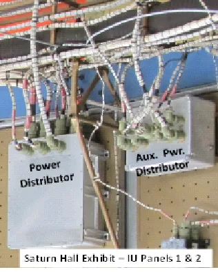A **fourth** IU battery was added for Apollo missions 13 through 17 to power <u>only</u> the ***IU S-Band Transponder and Transmitter*** allowing Earth ground stations to receive the IU S-Band \[2,282 mHz\] signal until the S-IVB/IU impacted the Moon about 80 hours after launch. These impact times were later used in the analyses of the ‘moon-quake’ responses from seismometers left on the Moon by astronauts on Apollos 12 and 14 through 16. The IUs on Apollo missions 11 and 12 also included a fourth battery as a test for tracking the IU S-Band signal to lunar distance.

The primary battery output was routed to a series of **Distributors** and from there was routed using ***Electromechanical Relays*** to the various IU components.

The **Power Distributor** \[**IU Panel 2**\] connected the batteries to the main IU power busses and to several high power consuming components. The **Power Distributor** also contained the ***Power Transfer Switches*** that transferred the IU 28 volt power from the Ground Support Equipment to the internal IU batteries at ~50 seconds prior to launch.

Two **Auxiliary Power Distributors** \[**IU Panels 1 & 9**\] further subdivided the power from the main busses and routed it to various IU components.

The ***Control Distributor*** \[**IU Panel 18**\] served as an auxiliary power distributor for several lower power consuming components and provided logical decision making functions for Guidance System components. The IU also contained the ***Measuring Distributor*** \[**IU Panel 10**\] and the ***EDS Distributor*** \[**IU Panel 14**\] that look the same as the Control Distributor. You can identify the Distributors by the “tic-tac-toe” pattern on their top surfaces.

Each **Distributor** contained plug boards and well over 100 small relays. Wiring for the relays were routed to the Distributor connector pins and/or to distribution plug boards within the Distributor. This relay and plug board design facilitated additions or deletions of IU Equipment as mission requirements changed.

***<u>IU Environmental Control System \[ECS\]</u>***

The IU **ECS** provided temperature control for electronic components in the Instrument Unit and in the forward skirt of the S-IVB Stage. **Liquid** **Coolant** was circulated through **Thermal Conditioning Panels \[Cold Plates\]** mounted on 15 of the 24 IU panels and through 16 Cold Plates in the S-IVB Stage forward skirt. The **Coolant** was circulated through passages ***inside*** the IU Digital Computer \[LVDC & LVDA\], the Analog Computer \[FCC\], and the Guidance Platform \[ST-124\] so these four items were not mounted on Cold Plates.

> 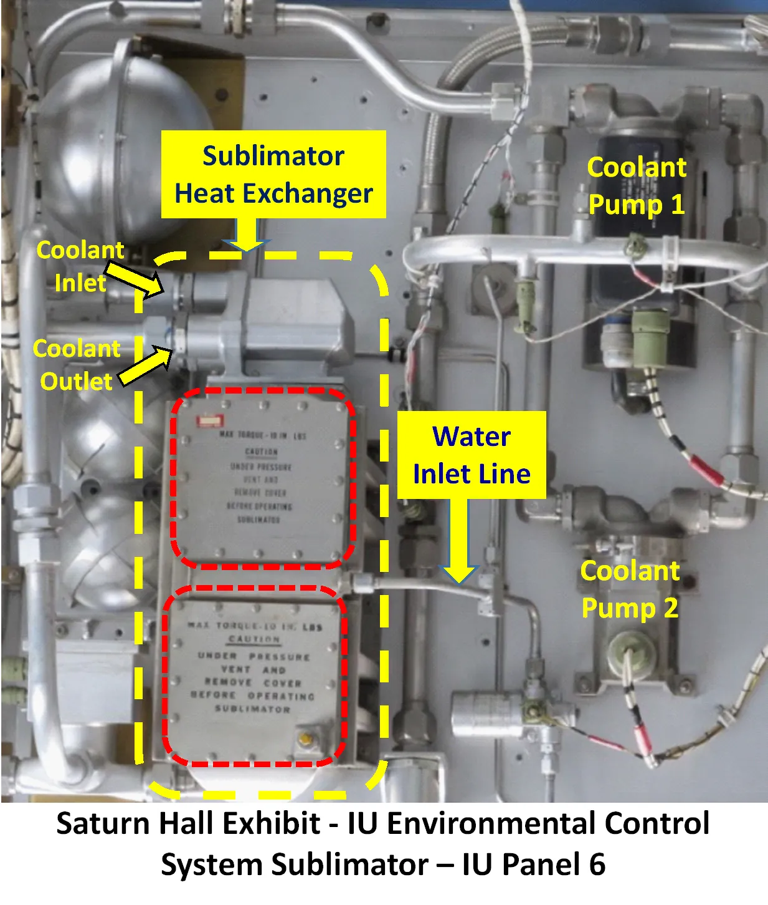*The original **40% Water - 60% Methanol** \[**W/M**\] **ECS Coolant** unexpectedly outgassed hydrogen that accumulated inside the IU Digital Computer causing circuit failures. The **W/M Coolant** was then replaced with a synthetic oil based coolant **Oronite “Flocool”** that was proven NOT to outgas hydrogen.*

Each **Cold Plate** contained 196 threaded ***Equipment Mounting Holes*** for attaching IU components. The coolant flowing in each Cold Plate could absorb up to 420 watts of heat from the attached components. The heat absorbed by the coolant was rejected by the **IU Heat Exchanger \[Sublimator\]** outlined in yellow dashes in the IU **Panel 6** figure at the right. The top covers \[outlined in red\] were removed before flight to allow venting for the **Sublimator** operation.

**Environmental Control System *Sublimator***

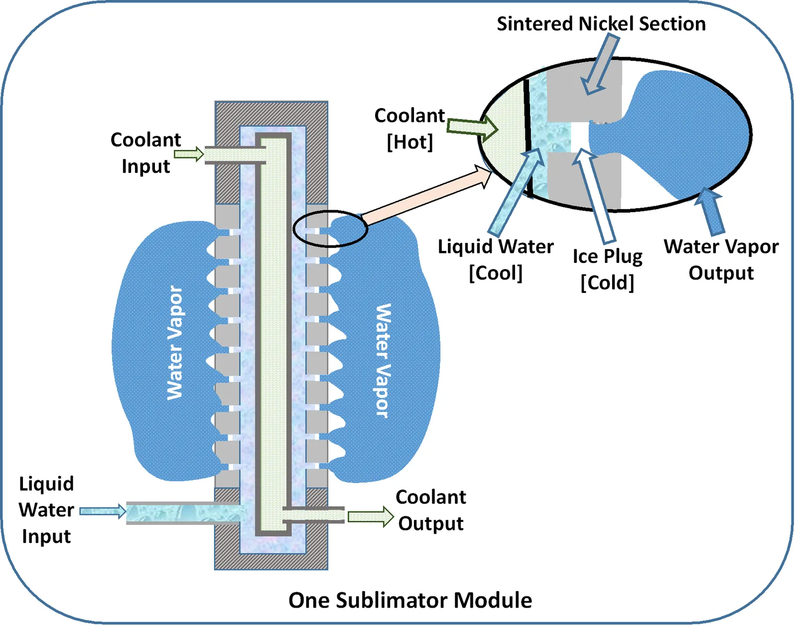The **Sublimator** contained twelve internal **modules.** The ECS ***liquid coolant*** flowed continuously in a closed path through the center of each module. Surrounding the coolant path was a separate <u>water</u> ‘jacket’. The outer surface of the water jacket was made of **porous** “**sintered nickel**” and was exposed to space.

> ***Sintered:** Tiny metal pellets pressed together at temperatures and pressures making the pellets ‘stick’ together but not melt.*

The **Sublimator** only operated ***out of the atmosphere.*** So, at 180 seconds into the flight *\[~70 miles high\],* the computer opened the water valve filling the **Sublimator** water jackets from the **ECS Water Accumulator** \[**Panel 3**\]. The water within the water jackets gradually seeped through the tiny voids in the **sintered nickel** forming small plugs of “ice” where the water reached the outer surface and became exposed to the vacuum of space.

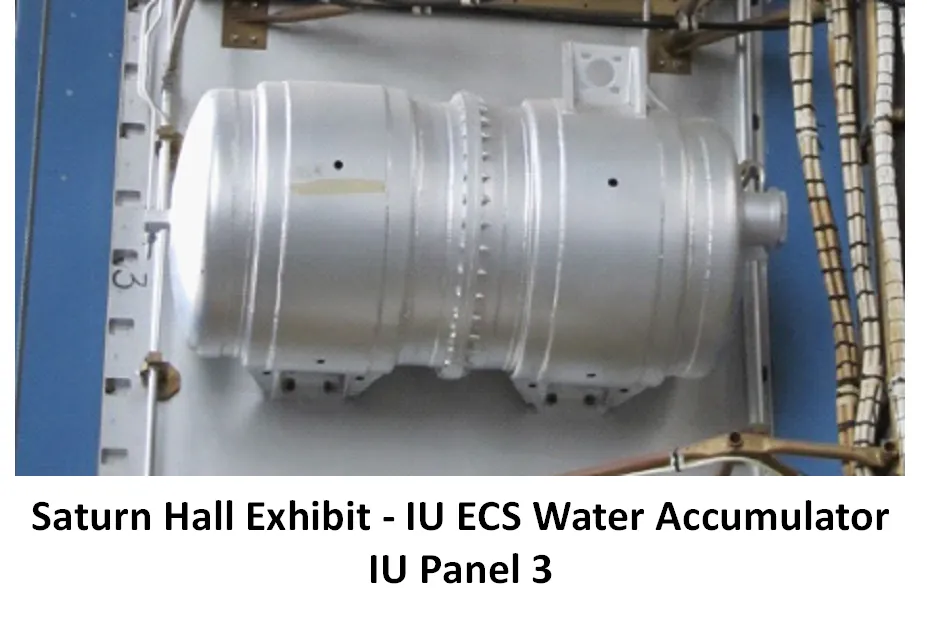Heat was drawn from the coolant into the “ice cooled” sintered metal. The plugs of ice in the sintered metal absorbed this heat causing the ice plugs to change ***directly*** from <u>solid ice</u> to <u>water vapor</u> \[**Sublimation**\]. The relatively small **Sublimator** could remove up to 9,000 watts \[30,700 BTU/Hour\] of heat from the coolant.

> ***Sublimation:** A <u>Phase Change</u> wherein solid ice absorbs heat and changes <u>directly</u> to a vapor without passing through the liquid phase, i.e., the ice does not melt before vaporizing. Same concept in which evaporation of our perspiration cools us.*

The LVDC Flight Program commanded the first water valve <u>opening</u> at 180 seconds after liftoff. **Every 300 seconds thereafter**, the LVDC Flight Program sampled the outputs from two **Thermal Switches** \[**IU Panel 6**\] that sensed the ECS coolant temperature. Based on the ON and/or OFF status of the two switches at the sample times, the Flight Program either opened, closed, or did not change the water valve position thereby starting, stopping, or not changing the rate of cooling, respectively. The low temperature switch closed at coolant temperatures at or <u>below</u> ~**59°F** and the high temperature switch closed at coolant temperatures at or <u>above</u> **~60°F**.

The On/Off cycling of water to the **Sublimator** generally maintained the coolant temperature between 52°F and 62°F. The specified coolant lower and upper temperature limits were 45°F and 68°F, respectively.

***IU ECS Sublimator operation on the Apollo 12 Mission Example Follows:***

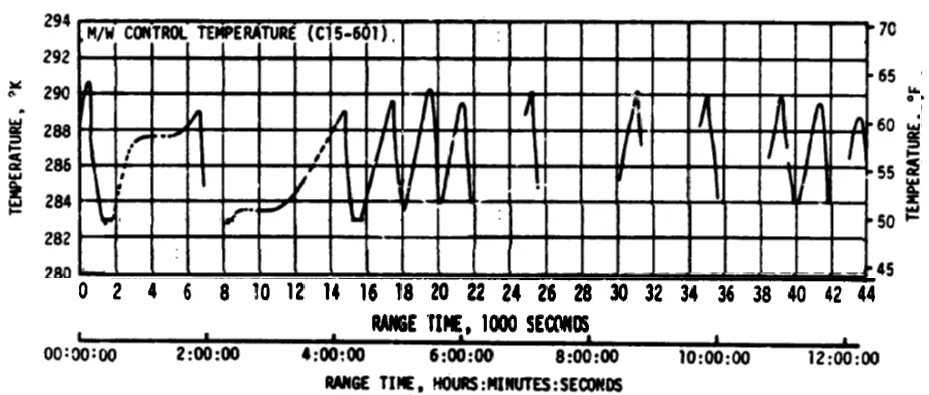*The figure below is a plot of the Instrument Unit ECS Coolant temperature from the **MSFC Saturn AS-507 Flight Evaluation Report for the Apollo 12 Mission*** *and will be the subject of the following discussion.*

*The lower temperature of 50°F was the lower limit of the telemetered measurement. The gaps in the temperature plots are due to periods when the vehicle was out of view of any ground tracking station.*

> ***Personal Note:** This graph was plotted by hand from telemetered data during post-flight ECS analyses for inclusion in the Flight Evaluation Report. The data plot and grid lines were inked by hand and the secretaries then, based on our penciled in labeling, typed the legends and numbers on “sticky back” clear film then cut and pasted the numbers and labels onto the figure. That’s how it was done in 1970 … no PCs, EXCEL, desktop printers, etc.!*

*The initial coolant temperature rise to ~63°F occurred during flight though the atmosphere and prior to the IU computer opening the Sublimator Water Valve at **180** seconds Ground Elapsed Time \[GET\]. Once the valve was opened and water filled the Sublimator, the coolant temperature began to decrease. The first Flight Program sampling of the thermal switches at **480** seconds indicated that the temperature was still above the 60°F thermal switch set point so the water valve remained open and Sublimator cooling continued. When the thermal switches were next sampled at **780** seconds, the ~55°F coolant temperature was less than the 59°F thermal switch set point so the Flight Program closed the water valve stopping the cooling.*

*The time required for the Sublimator to start or stop cooling following the water valve opening or closing, respectively, differed slightly for every Sublimator. These time delays were influenced by the density of the Sublimator sintered metal pellets, the IU and S-IVB systems heat loads, the sunlight on the vehicle, the ambient pressure within the S-IVB/IU/SLA volume, and the water temperature as it entered the Sublimator.*

*The Apollo 12 IU Sublimator rate of cooling averaged about 1 kW at the water valve opening at 180 seconds GET. The rate of cooling began increasing at about 500 seconds \[8 min 15 sec\] GET and averaged about 5 kW from 550 seconds \[9 min 10 sec\] GET until the water valve closure at 780 seconds \[13 min\] GET. Some water and ice remained in the Sublimator so the cooling continued at a decreasing rate to about 3kW at 1,200 seconds \[20 minutes GET\]. The decreased cooling rate soon allowed the coolant temperature to begin increasing again only to level off while the vehicle was in the Earth’s shadow. The vehicle returned to sunlight at about 1Hr 30Min \[~5,000 seconds\] GET and the coolant temperature again began to increase. This relatively slow temperature cycling of the coolant continued for the nearly two Earth orbits and until the start of the 6 minute Translunar S-IVB Burn at 2Hr 47Min \[10,020 Sec\] GET. Following Translunar Burn, the vehicle was in constant sunlight.*

*The CSM separated from the S-IVB/IU at 3Hr 18Min \[11,880 sec\] GET allowing sunlight to reach parts of the IU interior and cause the coolant temperature to begin increasing. At 4Hr 12Min \[15,120 sec\] GET the CSM & LM \[docked together\] separated from the S-IVB/IU. At 4Hr 36Min \[16,560 sec\] GET the S-IVB/IU maneuver to the “Slingshot” attitude allowed direct sunlight to strike about 1/3 of the IU Panels centered at **Panel 20**. The sunlight heating of the IU interior caused the frequency of coolant temperature cycles to <u>dramatically</u> increase and continue so until the loss of IU telemetry battery power at 12Hr 13Min \[43,980 sec\] GET.*

**<u>IU Measurement, Telemetry, and Radio Frequency Systems</u>**

The IU **Measurement, Telemetry, and Radio Frequency** **\[MT&RF\]** Systems measured and transmitted on-board parameters for systems monitoring during ***Manufacture***, ***Pre-Launch***, and ***In-Flight*** operations, and for ***post-flight*** analyses.

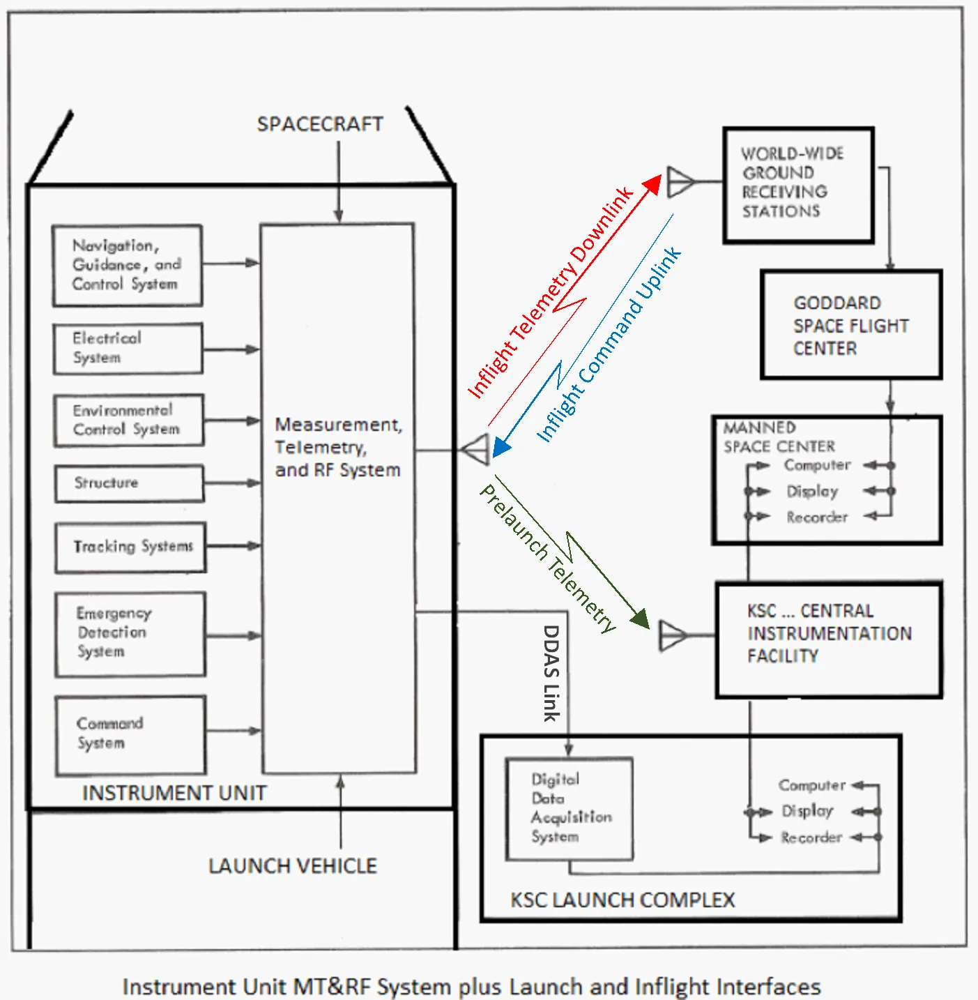

The figure at the right outlines the configuration of the IU **MT&RF System** and its transmitted and hard-wired interfaces used during pre-launch, launch, and inflight.

The complexity of the Saturn Launch Vehicle required computer controlled checkout facilities at the launch site and at the manufacturing and test facilities for the three Saturn V rocket stages and the Instrument Unit.

During manufacturing and pre-launch periods, the **IU** measurements were transmitted to the respective ground support computers and other facilities through the **Digital Data Acquisition System** \[**DDAS**\]. The DDAS to ground support computer interface was a key contributor to the automated checkout of the Saturn vehicle. Without this interface, successful checkout and launch of a vehicle as complex as Saturn would have been impossible.

During the flight, the IU measurements were received by the **Manned Spaceflight Network** \[**MSFN**\] Ground Stations located around the world. **Goddard Space Flight Center** \[**GSFC**\] in Greenbelt, Maryland operated the MSFN Ground Stations and transmitted the received information to the various NASA Centers \[JSC, MSFC, et. al\] for real-time mission operations. The telemetry data tapes were copied by GSFC and sent to the NASA centers and their contractors for post-flight analyses.

The first <u>three</u> Saturn V vehicles were **Research & Development \[R&D\]** flights and each of these transmitted approximately ~350 telemetry measurements from the **Instrument Units**. Similarly, each of the three rocket stages transmitted measurement data over their respective **MT&RF Systems**. The <u>remaining</u> Saturn V vehicles were **Operational** flights on which the number of **IU** measurements was reduced to ~150.

The transmitted IU measurements originated from various transducers, the IU computer, other IU sources, and from flight control related measurements that originated in the three Saturn V rocket stages. Transducer outputs varied widely depending on the transducer type and on the signal being measured. Where necessary, components called **Measuring Racks** converted transducer outputs to the 0 to 5 Volt signal levels required for transmission through the telemetry system. *Examples of the telemetered measurements included: temperatures, pressures, flow rates, voltages, currents, equipment status, inertial guidance data, vibration, computer data, and others.*

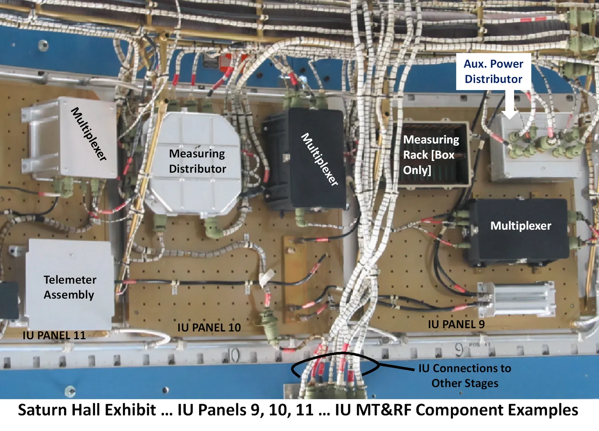

Scaled measurements from the **Measuring Racks** and measurements that did not require scaling were sent to the **Measuring Distributor \[IU Panel 10\]** for routing to telemetry system components and subsequent transmission to the ground during flight or to the ground support checkout facilities during manufacture and pre-launch.

The majority of the IU measurements were sent through a **Pulse Code Modulated \[PCM\]** telemetry system. **Multiplexers** **\[IU Panel 9 and others\]** sampled the PCM destined measurements one after the other for a fraction of a second each. The Multiplexer converted the sampled ‘*analog’* measurement to a *’10 bit* *digital’* value and combined these samples into a long serial data stream of 10 bit values. Synchronization signals were added within this serial data stream to facilitate subsequent extraction of the individual measurements and timing information from the telemetry data stream.

> *Refer to the **Supplemental Information III** section for an example of a 10-bit digital value vs an analog value and the necessary calibrations and conversions used to determine the actual measured value for the transmitted parameter.*

Some measurements could not be telemetered through a PCM system because the sampling would destroy the needed frequency information in these signals. These measurements were transmitted in an analog fashion \[no sampling\] to preserve the fidelity of the “raw” measurements. Vibration and flow rate measurements were signal types for which continuous and frequency information had to be preserved. Other methods of telemetering the measurements were also used.

**Telemeters** **\[e.g., IU Panel 11\]** modulated the various signals \[sampled or analog\] onto **Frequency Modulated \[FM\]** <u>subcarrier</u> signals for transmission to the ground. *Subcarriers allow multiple data channels to be combined onto a single transmitted frequency. For example, two channel stereo signals use a subcarrier for transmission to your radio on a single FM transmitting frequency.*

Several **Radio Frequency** **\[RF\]** systems were used to transmit the measurement data to the ground stations. The following examples are typical of the RF Systems used on the ***Operational*** Instrument Units:

> PCM was transmitted on a Very-High Frequency \[**VHF**\] System at ~245 MHz.
>
> Analog signals were transmitted on a **VHF** System at ~250 MHz.
>
> The S-Band Command and Communications System transmitted PCM telemetry data at ~2,282 MHz.

The ***Research & Development*** Saturn V IUs also telemetered data on a UHF System at ~2,277 MHz.

**<u>IU Command and Communication System \[CCS\]</u>**

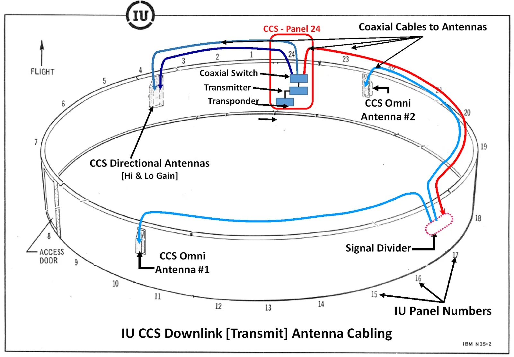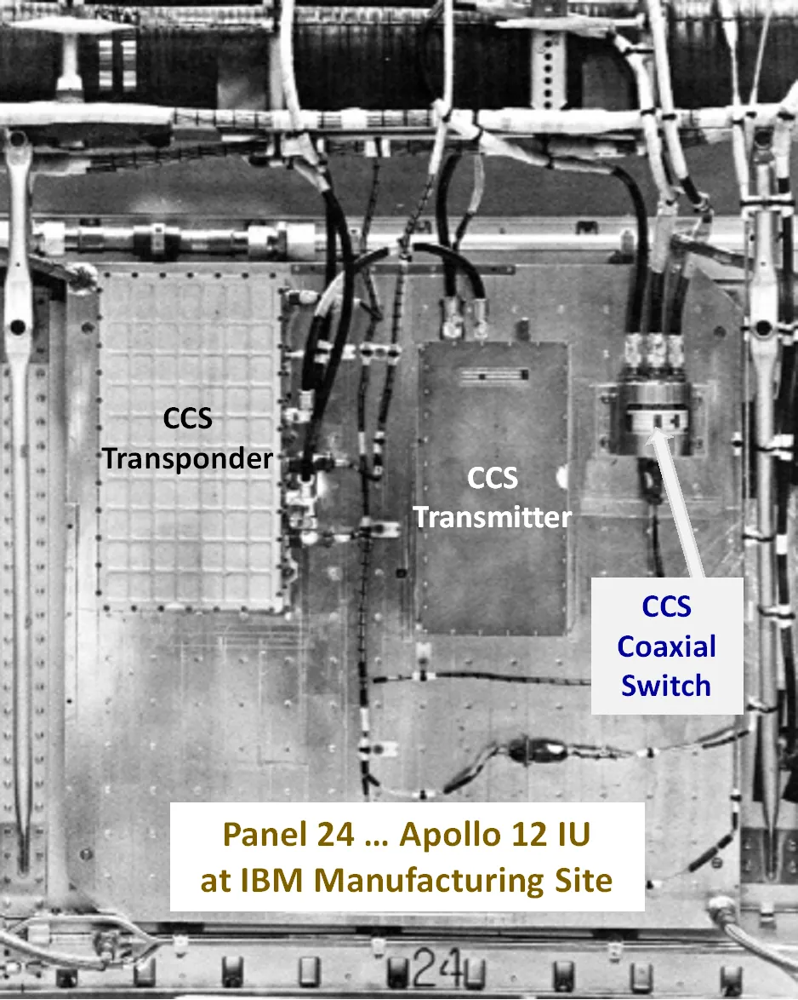The IU **Command and Communications System \[CCS\]** was a <u>modified</u> version of the Apollo ***Unified S-Band Systems*** used on the Command Module \[CM\] and Lunar Module \[LM\]. For example, the IU CCS did not need the ***Voice*** capability required for the spacecraft system.

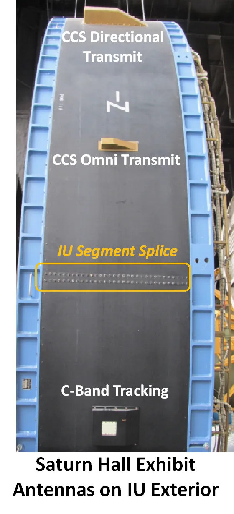

The **CCS Electronics** consisted of a ***Transponder***, ***Transmitter***, and ***Coaxial Switch*** all located on IU **Panel 24**. The **IU Flight Program** controlled the Coaxial Switch position to route the **CCS** ***Transmitted \[Downlink\]*** signal through ***EITHER*** the two ***Omni-Directional Transmit Antennas*** ***OR*** the single ***Lo-Gain Directional Transmit Antenna*** ***OR*** the single ***Hi-Gain Directional Transmit Antenna*.** The Antennas were located on the IU exterior between pairs of interior panels, for example, the Antenna Cabling figure above shows that CCS Omni Antenna \#1 is located between IU **Panels 10 and 11**.

The IU CCS had both transmit (**Downlink**) and receive (**Uplink**) capabilities. **Mission Control** by way of the Manned Space Flight Network ground stations used the CCS ***Uplink*** to transmit commands to the IU Computer \[LVDC\]. These were received through the IU ***Omni-Directional Receiving Antennas*** and forwarded to the CCS Transponder. The ground station transmitter power levels made ‘Low and High-Gain Directional’ CCS <u>Receiving</u> Antennas unnecessary. The CCS Transponder routed the Uplinked commands to the **Command Decoder** \[IU Panel 18\] for decoding and forwarding to the IU Computer for execution. No ground commands were sent during boost periods; things happen too fast during boost for Mission Control to uplink any commands. The CCS ***Downlink*** provided verification responses to Mission Control for these commands.

The CCS Transponder also provided a two-way \[**U*plink*** *and **Downlink**\] **Tracking*** capability. The ground transmitted a coded message to the Transponder via the Uplink. The Transponder then transmitted a coded response to the ground station via the Downlink. The CCS was ***in-lock*** when operating in this coordinated manner. In-lock operation aided in keeping the ground antennas pointed at the IU and provided range and velocity tracking data of the vehicle.

The CCS ***Low-Gain*** and ***High-Gain Directional <u>Transmit</u> Antennas*** provided strong signal levels at the ground station *<u>receivers</u>* but transmitting over either of these two Antennas required active attitude control of the Saturn vehicle to keep the antennas pointed toward the earth. It was always possible that either the flight path or vehicle maneuvers might be required that would not point these Antennas toward the earth. The two ***Omni-Directional Transmit Antennas*** were located on opposite sides of the IU and allowed reception by the ground stations regardless of the S-IVB/IU attitude. The signal level received at the ground station through the Omni Antennas would be lower than that from the Low and High Gain Directional Antennas but the signal could *generally* be received regardless of the vehicle attitude.

**<u>IU C-Band Tracking System</u>**

Two C-Band Transponders \[one each on IU **Panels 12 and 23**\] enabled Mission Control to accurately determine the vehicle **trajectory** during the flight. Mission Control used the C-Band tracking data to determine when and if Navigation Updates to the IU Computer System or other updates were required \[1\] during the orbital coast period prior to the S-IVB Second Burn and \[2\] following the S-IVB second burn.

C-Band Transponders operated in the 5.4 to 5.9 Gigahertz frequency band. They received a coded signal transmitted <u>from</u> ground radar and responded by transmitting a coded response signal <u>to</u> the ground radar. The accurate pointing of the ground radar antennas plus the ‘turnaround’ delay of the uplink and downlink transmissions provided information necessary for the Flight Controllers to accurately determine the vehicle trajectory.

The **C-Band** uplink and downlink interrogation and response signals did not occur simultaneously so the same antenna was used for both uplink and downlink transmissions. Each Transponder had its own Antenna located on the outside IU surface between **Panels 11 and 12** and between **Panels 23 and 24**. Locating the antennas between IU Panels facilitated cabling to the antennas through the IU structure and between pairs of Cold Plates.

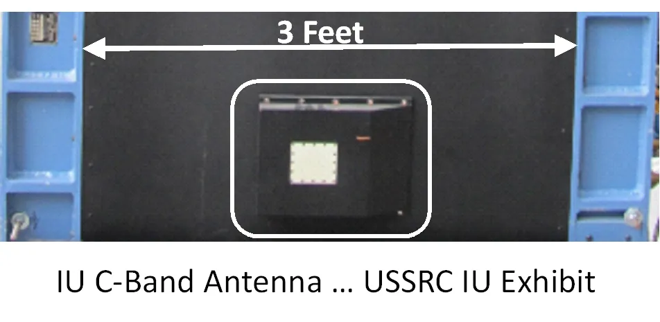

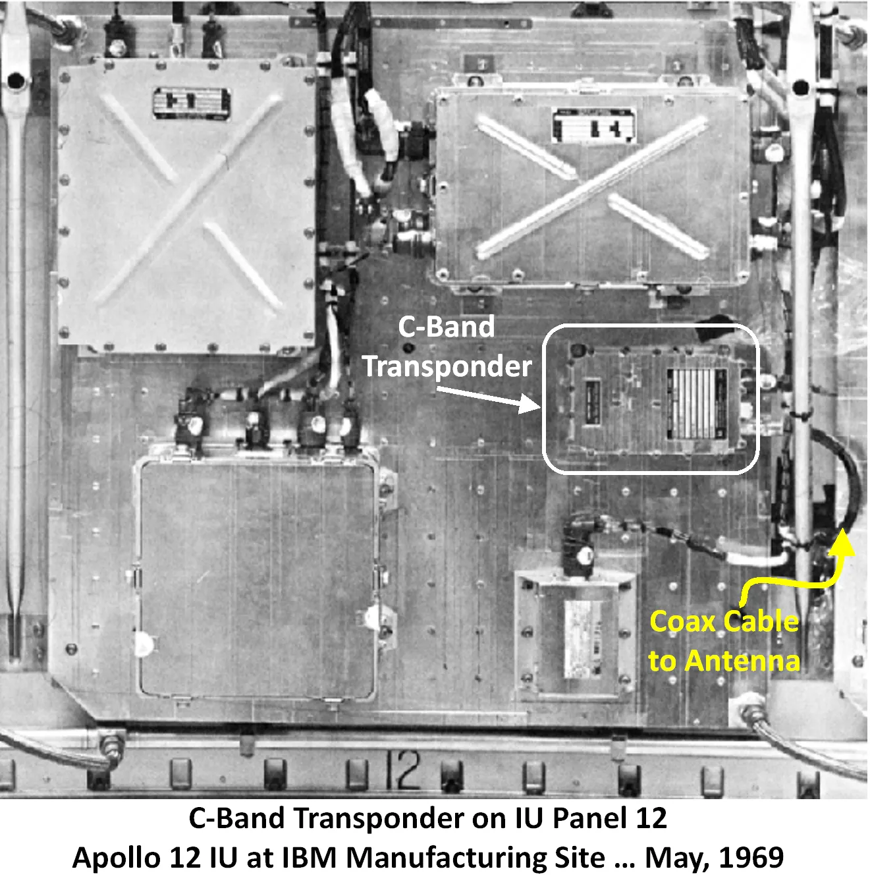

**<u>IU ST-124 Guidance Platform</u>**

The **ST-124-M3** **Guidance Platform** \[IU **Panel 21**\] measured the vehicle <u>acceleration</u> and <u>attitude</u> and provided these measurements to the IU Digital Computer. The Power Supply, Electronics, and Accelerometer Signal Conditioner components supporting the ST-124 operations were located on IU **Panel 20**.

The **ST-124-M3** contained **three** **gimbals**. The “inner gimbal” contained three **Gyroscopes** and three **Accelerometers**. The three **Gyroscopes** maintained the inner gimbal in a fixed reference position that was established ~16 seconds before liftoff. The fixed inner gimbal position provided the reference point about which the vehicle moved. The three **Accelerometers** mounted on the fixed inner gimbal measured the acceleration of the vehicle in the three axes.

> *An Accelerometer is a Gyroscope with a small weight added to its structure. As the vehicle accelerates, the force on this weight causes the Gyroscope to precess. The amount of precession is a measure of vehicle acceleration.*

The two remaining gimbals allowed the vehicle to move about the fixed inner gimbal. **Resolvers** mounted on the gimbal pivot points provided vehicle attitude \[direction\] information to the IU Computer System. During boost periods, the IU Digital Computer **Flight Program** read the resolver and accelerometer outputs 25 times per second and calculated the vehicle attitude and velocity. During orbital and translunar coast periods, the Flight Program read the resolver and accelerometers 10 times per second.

> 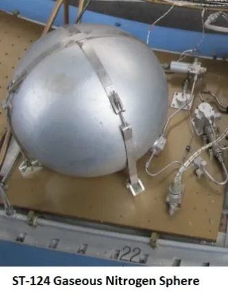*Each Accelerometer output a pulse for every 0.05 G’s of acceleration it sensed in its respective direction; one ‘G’ is the acceleration of gravity on Earth at sea level. The Flight Program summed these pulses to determine the total velocity of the vehicle.*

The ST-124-M3 Gyroscopes and Accelerometers required high accuracy and precision. To minimize bearing friction, the gyroscope wheels were spun in a film of Gaseous Nitrogen \[GN2\] instead of using mechanical bearings. The GN2 Sphere \[**IU Panel 22**\] was pressurized to 3,600 psi at launch and supplied the Nitrogen for this purpose.

> 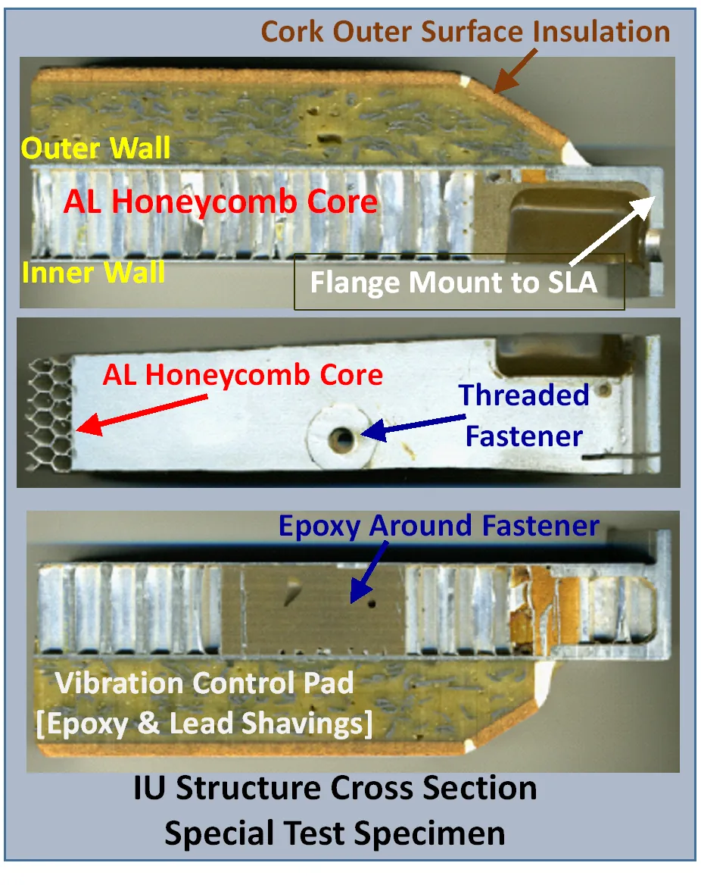
>
> *During the first Saturn IB launches, ST-124 Inner Gimbal components were found to be resonant at the low frequency \[~5 Hertz\] vibrations generated by the rocket engines. Saturn S-IC tests showed that even greater 5 Hz vibrations would be experienced. Iron rods on the outside of the ST-124 panel were used on the first Saturn V but were later replaced with a **Vibration Control Pad***.
>
> *The IU Structure Cross Section figure at the left shows the honeycomb core and a **Vibration Control Pad** that was bonded to the IU outer surface **<u>only</u>** at the ST-124 Guidance Platform panel to resolve this vibration issue. The weight of many lead shavings embedded in the 1 inch thick by ~3 foot square **Vibration Control Pad** made from ‘two-part epoxy glue’ greatly reduced the amplitudes of these low frequency vibrations at the IU ST-124 Platform \[**Panel 21**\].*

***<u>IU Computer System</u>***

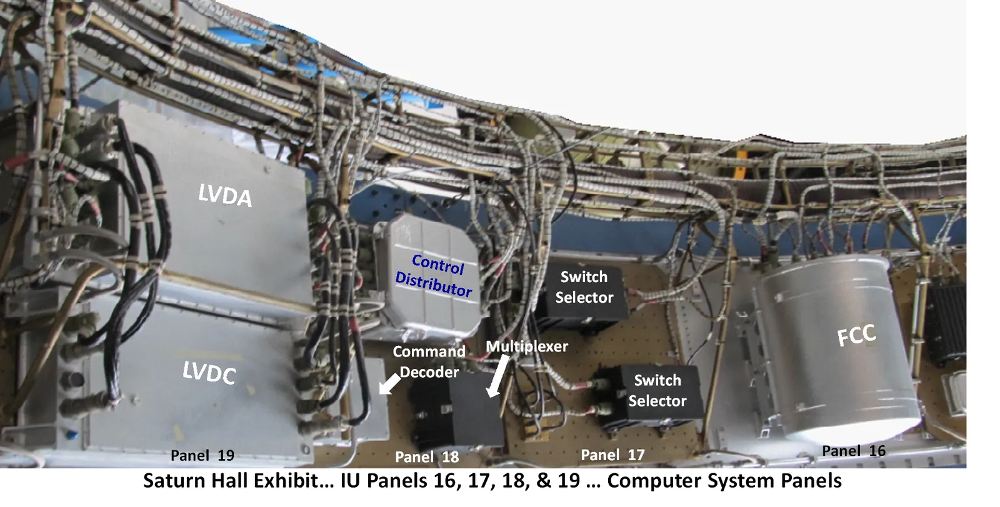The Instrument Unit employed a ***Digital Computer*** and an ***Analog Computer***. This Digital and Analog Computer combination was an outgrowth of the technique used on the U.S. Air Force Titan II missile. The IU ***Digital Computer*** consisted of the **Launch Vehicle Digital Computer \[LVDC\]** and the **Launch Vehicle Data Adapter \[LVDA\]** and the ***Analog Computer*** consisted of the **Flight Control Computer \[FCC\]**. The primary **IU Computer System** components were located on **Panels 16, 17, 18, and 19** as shown in the figure below. *See **Appendix A** for a brief comparison of **Digital** and **Analog**.*

The **LVDC** contained the ***Central Processing Unit \[*CPU*\]*** and the ***Memory***. The **Memory** stored the instructions and data for the **Flight Program** that was executed by the circuitry within the **CPU**. The **LVDA** provided the input/output \[**I/O**\] electronics and timing necessary to interface the LVDC with the **FCC**, other IU components, and components on the three Saturn V rocket stages. The **Flight Program** controlled nearly all aspects of the Saturn V mission.

***IU Computer System … Launch Vehicle Digital Computer \[IU Panel 19\]***

In the 1960’s one of the few reliable choices for a space borne, read-write, random access, non-volatile digital computer memory was the ***Ferrite Core* Memory**.

> *A **Ferrite Core** is a tiny “donut” shaped piece of magnetic material with several wires going through the donut hole.*
>
> *The direction that a pulse of electric current is sent through these wires determines the ‘direction’ that the core will be magnetized. Current flowing in one direction magnetizes the core in the ‘clockwise’ direction while current flowing in the opposite direction will magnetize the core in the ‘counter-clockwise’ direction, e.g., let ‘clockwise’ represent a digital logic <u>one</u> and let ‘counter-clockwise’ represent a digital logic <u>zero</u>’. Similarly, a current pulse is used to read the content of the core memory. Reading a ‘word’ from memory affected the magnetization of the cores storing that word. So, the LVDC electronics had to automatically rewrite the ‘word’ back into the cores following every read action ... called a **destructive readout** memory. However, the LVDC memory was **non-volatile** in that it retained its content \[the cores stayed magnetized\] when power to the LVDC was removed.*

The ***LVDC*** contained ***<u>two</u>*** **16,384 Word** ***Ferrite Core*** Memories. Each *16,384 Word* memory was constructed from ***<u>four</u>** **4,096 Word*** memory <u>modules</u>. Each memory module contained **14** **core *planes*** stacked one on top of the other. Each core plane contained 8,192 ***ferrite cores*** with each <u>core</u> storing one digital “bit” of information. **Twenty-eight *Ferrite Cores*** were required to store one **<u>28 bit</u>** **LVDC Word** so each ***16,384 Word Memory*** contained 458,752 *ferrite cores* \[16,384 words x 28 cores/word = 458,752 cores\].

The number of “bits” per word \[the **word size**\] in present day computer memories and processors is almost always based on a “power of 2”, for example, 8 bits, 16 bits, 32 bits, 64 bits, etc.

*So, why did the LVDC use the ‘**non-power of two**’ 28-bit word?*

The longest ‘data’ word required for an LVDC calculation was 26 bits. Two additional bits \[called parity bits\] were added to allow the system to insure the validity of every word read from memory or used in computations.

> *The **core memory** was <u>assembled by hand</u> and included complex read/write electronic circuitry. To increase the computer **Word** size by <u>one</u> bit, e.g., to change from 27 to 28 bits, <u>doubles</u> the number of cores in the memory and similarly increases the amount of supporting electronics. This increases the complexity and cost of the memory. Furthermore, every added bit significantly increases the **UNRELIABILITY** of the memory because of the increased number of component parts and connections required to construct the memory hardware. Hardware **<u>reliability</u>** was of utmost importance in the Saturn/Apollo program so the LVDC memory was sized for the **<u>required</u>** 28 bit word size instead of a not-needed “power of 2” 32 bit word!*

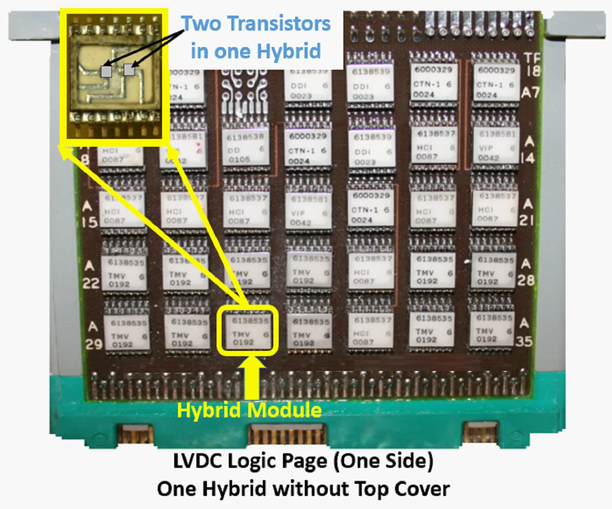For enhanced ***reliability***, the <u>same</u> ***Flight Program*** was stored in and simultaneously executed from the two **16,384 word** memories. LVDC circuitry compared the outputs from the two memories at each instruction execution and if the results read from both memories were not the same, the program would enter a “***Reasonableness Test Subroutine***” and determine which of the two results to use for that point in the flight. The more reasonable of the two results would be used and the program execution would continue ... there was not enough time during boost periods to ask Mission Control for help! *The design proved to be very reliable. There were only a few non-compares experienced during all of the Saturn flights!*

The LVDC and LVDA logic circuits were constructed from **Hybrid Modules** measuring 0.3 inches square and containing from ***2 to 8 transistors***. The LVDC contained **~50,000** transistors on **87** **Logic Pages** with up to **70** **Hybrid Modules** per **Logic Page**. The **LVDC Processor** was built using several thousand Hybrid Modules instead of a few integrated circuit modules as would be the case today.

> ***Hybrid** vs **Integrated**: The **Hybrid Modules** used separate transistors, conductors, resistors, substrates, connectors, and housings. In **Integrated Circuits**, many circuit elements are integrated into a single piece of silicon.*

One ***Hybrid Module** **<u>TRANSISTOR</u>*** measured 0.025 inches on each side. In a typical IBM ***integrated circuit*** in 2019 approximately 18 million transistors would fit in the area of one ***Hybrid Module <u>TRANSISTOR</u>*!**

The **LVDC Processor** multi-phase clock design used a **2.048 megahertz \[mHz\] oscillator** and enabled the **LVDC Flight Program** to execute an average of **~8,700 instructions per second** during the Saturn boost periods.

> ***By comparison**: The Intel 8086 16-bit microprocessor introduced in 1978 contained 29,000 transistors and using a 5 mHz oscillator could execute 330,000 instructions per second. The entire 8086 chip was only 0.23 inches square; slightly smaller than <u>ONE</u> 0.3 inch square LVDC Hybrid Module of the mid-1960s vintage technology.*

The LVDC and LVDA ***structures*** were made from **Magnesium Lithium** alloy that is about 40% lighter than Aluminum. These were the first NASA components made from the ‘Mag-Lith Alloy’. The complete LVDC weighed ~100 pounds, measured 29.5 by 12.5 by 10.5 inches, consumed ~150 watts, and had liquid coolant circulated through parts of its structure to prevent overheating of the electronic modules. The memory modules were located in the rear section of the LVDC with the logic pages in the front section \[see illustrations on the following page\].

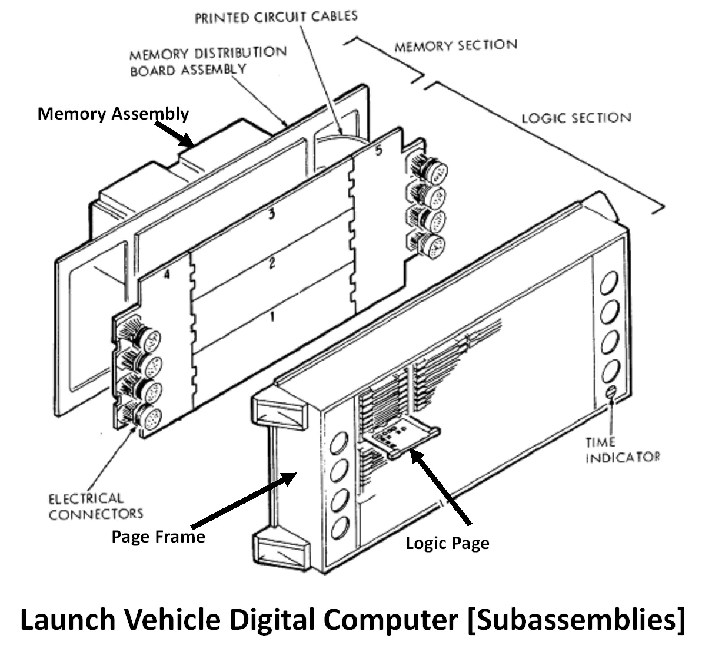

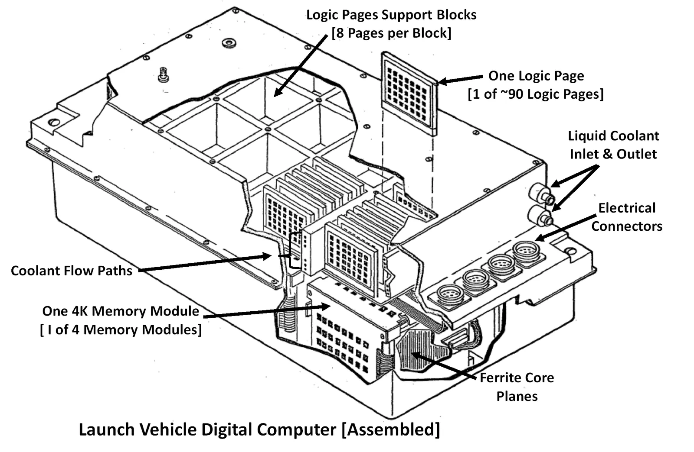

***IU Computer System … Launch Vehicle Data Adapter \[IU Panel 19\]***

The ***Launch Vehicle Data Adapter \[LVDA\]*** provided the means for the “digital LVDC” to communicate with both “digital” and “non-digital” elements of the IU, the other Saturn V stages, and the Spacecraft. The LVDA converted “variously formatted” digital and analog input signals into the digital format required by the LVDC. Likewise, the LVDA converted the LVDC digital output signals to the “various formats” needed by other equipment in the IU, the three Saturn Stages, and the Spacecraft. The LVDA also contained power supplies for both the LVDC and LVDA.

**Functions provided by the LVDA:**

Serial 521,000 bit per second LVDC interface

Buffer and Format LVDC data for transmission to the IU Telemetry System

Transmit Guidance data from the LVDC to the Analog Flight Control Computer

Perform Analog-to-Digital and Digital-to-Analog signal conversions

Ground Support Computer interface during manufacturing and prelaunch checkout

Generate the Real-Time clock

Provide the AC power supply for the Inertial Guidance System attitude resolvers

Provide Five DC power supplies powered both the LVDC and LVDA.

The LVDA weighed ~180 pounds, measured 32 by 16 by 15 inches, and consumed ~300 watts. Like the LVDC, liquid coolant was circulated through its structure to prevent overheating.

***IU Computer System … Flight Control Computer \[IU Panel 16\]***

The **Flight Control Computer \[FCC\]** was derived from a similar **Analog Computer** device used on the US Air Force Titan II Missile. The same overall mechanical configuration and the internal circuit board shapes were adopted for the Saturn design to retain the proven reliability of the Titan Missile manufacture and design. The cylindrical shape of the FCC was derived from its predecessor’s placement inside the Titan Missile. There were direct connections from the FCC to each of the servo-mechanisms on the S-IC, S-II, and S-IVB Engine Actuators and to the APS Thrusters on the S-IVB Stage.

The FCC weighed ~120 pounds, measured 28 inches long and ~18 inches in diameter, and consumed ~150 watts. The ECS liquid coolant was circulated through its structure to prevent overheating during the first 4 Saturn V flights. Thereafter, it was determined that the **FCC** did not require active cooling.

***IU Computer System… Switch Selectors \[IU Panel 17 & One on each Stage\]***

The LVDC **Flight Program** controlled many of the on/off operations for all three Saturn propulsion stages and the Instrument Unit via four **Switch Selectors**; one located in each of the three propulsion stages and one in the IU. The four Switch Selectors were connected in parallel to the LVDA over a 22 wire electrical interface. The LVDC Flight Program sent a series of coded commands over these wires to: (1) Select the desired Switch Selector on the particular Saturn Stage or the IU, (2) Select the specific output from one of 112 possible outputs on the selected Switch Selector, (3) Verify the correct command was received by the correct Switch Selector, and (4) Execute the commanded action.

The LVDC **Flight Program** could issue one Switch Selector command every tenth \[**0.1**\] of a second. The LVDC/LVDA

commands to the Switch Selectors used a redundant coding and verification scheme. If the first command did not

work properly then the LVDC/LVDA would resend the **complement** of the first command. In this manner a failed

bit or broken wire would not keep the commands from reaching and being executed by the desired Switch

Selector.

> ***Complement** = exchanges the ‘one’ bits for ‘zero’ bits and vice-versa ... if the original command was ‘01100111’ then the complement of the command ‘10011000’ would produce the same output.*

Upon receipt of the LVDC ***Execute Signal***, the selected Switch Selector would output a 28 Volt 65 millisecond \[0.065 second\] duration pulse on the addressed <u>one</u> of its 112 output lines. Circuitry in a **Distributor** in the Saturn Stage (or IU) would \[usually\] then route the Switch Selector output signal to the desired destination. In most cases, the Switch Selector output pulse would latch a relay \[within a Distributor\] to the on position until a second Switch Selector command was later sent \[if necessary\] to unlatch the relay and turn-off the signal.

Provisions were made in the IU and in each Stage allowing the Ground Support Equipment to use these same switch selector commands during manufacturing, test, and prelaunch operations.

***IU Computer Software … LVDC Flight Program \[some <u>highly simplified</u> examples\]***

Throughout the 1960’s the development of the digital computer hardware, software, memory, and overall processing power were quite limited compared with today’s \[2020’s\] capabilities. So, the LVDC did not use a traditional **Operating System** \[*there was no ‘Windows for Saturn’*\]. Instead the LVDC Flight Program software operated in a <u>repetitive</u> **Major Loop**. One pass through the **Major Loop** lasted from 1.5 to 2 seconds depending on the phase of the flight. A series of “routine” operations were performed repetitively during each **Major Loop**. ***Twelve*** **Interrupts** each with an assigned **priority** could interrupt the **Major Loop** causing the program to branch to a specific subroutine to process the interrupt. When the interrupt subroutine was complete, the Flight Program returned to the point of interruption in the **Major Loop** and resumed its interrupted operation. If a higher priority interrupt was already being processed, then the lower priority interrupt would have to wait its turn to be processed.

During **Powered Flight**, the “**Priority 1**” interrupt occurred 25 times per second … it occurred 10 times per second during **Non-Powered** **Earth Orbit Coast** or **Translunar Coast** phases of flight. This interrupt initiated the **Minor Loop** which processed the ST-124 Guidance Platform gimbal angles and accelerometer outputs and performed other Navigation, Guidance, and Control \[NG&C} computations.

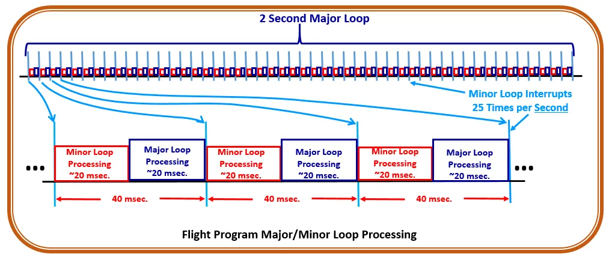A **Minor Loop** interrupt occurred 25 times per second \[every 40 milliseconds … 0.040 seconds\]. **<u>Major Loop</u>** processing would stop whatever it was doing and process the **Minor Loop** subroutine. Almost 20 milliseconds were required to process a **Minor Loop** interrupt so nearly 50% of the **<u>Major Loop</u>** time was used processing **Minor Loop** interrupts. The remaining ~50% of the **<u>Major Loop</u>** time was spent processing routine repetitive operations and responding to and processing any of the remaining 11 interrupts as they occurred.

If an interrupt occurred while another interrupt was being processed, the Flight Program response would depend on the relative Priority assigned to the two interrupts:

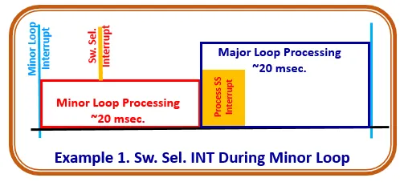***Example 1:** Assume that a Switch Selector Interrupt \[Priority 2\] occurred while a \[Priority 1\] Minor Loop Interrupt was being processed. Since the Minor Loop had a higher priority, the Minor Loop processing would be completed before the Switch Selector Interrupt would be processed. Since the Switch Selector output was required to be issued within 0.1 seconds of the Switch Selector interrupt, the Minor Loop processing time \[0.020 seconds max.\] would not delay the Switch Selector output beyond its 0.1 second requirement.*

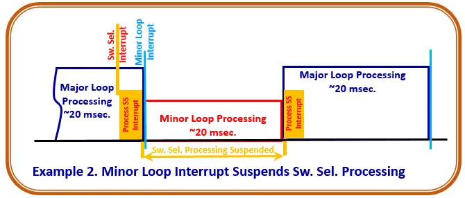***Example 2:** Assume the inverse of example 1, that is, the \[Priority 2\] Switch Selector Interrupt was being processed when a \[Priority 1\] Minor Loop interrupt occurred. Since the Minor Loop interrupt has a higher priority, the processing of the Switch Selector Interrupt would be <u>suspended</u> for the Minor Loop Interrupt to be processed. When the Minor Loop processing finished, the interrupted Switch Selector processing would be completed. And, the Switch Selector command would still be issued within the 0.1 second requirement.*

The **LVDC Flight Program** **‘Computer Language’** was called **LVDC Assembler** and used only **18 instructions**. These were simple “low-level” instructions as contrasted with the complex “high-level” instructions used in a Personal Computer today. Each LVDC instruction performed one action and performed it in a precisely defined amount of time. Control of the Saturn was a “**Real-Time**” computer application in that its events needed to happen precisely timed and in a precise order. These precisely timed “low-level” instructions insured that the LVDC Flight Program would always execute its software routines in accurate and known amounts of time: facts that were extremely significant contributions to the success of every Saturn mission!

*Steering a rocket to a desired point in space uses **Navigation, Guidance & Control \[NG&C\]**:*

1.  ***Navigation**: Where am I versus where should I be?*

2.  ***Guidance**: What is the most efficient way to get from where I am to where I should be?*

3.  ***Control**: Steer the engines and/or fire thrusters to get me from where I am to where I should be!*

The **LVDC Flight Program** performed the **Navigation** and **Guidance** computations every **Major Loop**. Under direction of the **Flight Program,** the **FCC** provided the **Control** function through interfaces with the S-IC, S-II, and S-IVB Engine Actuator servo-mechanisms and with S-IVB Auxiliary Propulsion System \[APS\] thruster interfaces.

<u>Two</u> **NG&C** modes were used during the Saturn V boost periods: **Time-Tilt** **Guidance** and **Iterative Guidance:**

> **Time-Tilt Guidance -- *Open-Loop Guidance*:** During <u>S-IC Stage Burn</u> the vehicle traveled through the atmosphere passing through the speed of sound and maximum aerodynamic pressure at about 60 and 70 seconds after liftoff, respectively. The vehicle size, the aerodynamic loading effects, and the vehicle structural dynamics required extra careful control of the vehicle path during S-IC Burn. During this period, the Flight Program used **Time-Tilt Guidance** to steer the vehicle along a predetermined trajectory based on the time from liftoff. Quick maneuvers during S-IC Burn could have been catastrophic and could have led to breakup of the vehicle!
>
> **Iterative Guidance -- *Closed-Loop Guidance*:** Beginning with the S-II Burn and during both S-IVB Burn periods, the NG&C operations were based on the vehicle measured parameters derived from the ST-124 Guidance Platform and not based on a predetermined timed profile. During these periods, the vehicle was out of the dense atmosphere so aerodynamic forces on the vehicle were no longer an issue.

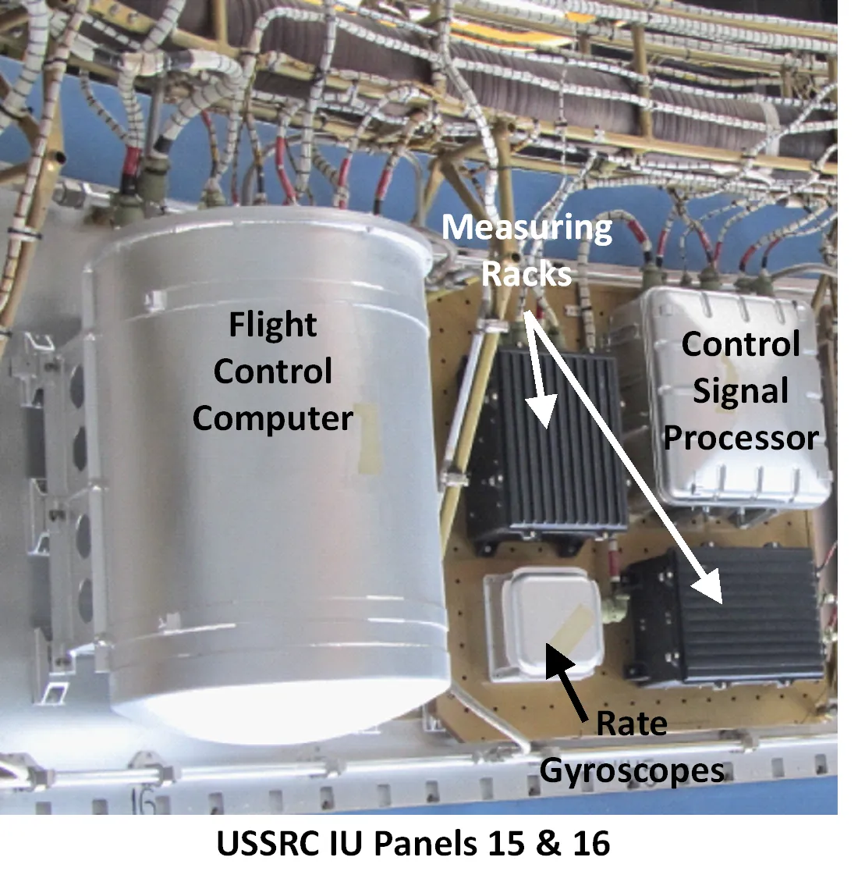The **Navigation** and **Guidance** functions were executed by the **LVDC Flight Program** using the **Iterative Guidance** scheme during S-II and S-IVB Stage boost periods. The **LVDC Memory** contained a stored profile of the desired trajectory \[location, velocity, heading, and time from launch\]. During boost periods the LVDC continually \[25 times per second\] determined the vehicle position based on the elapsed time from liftoff and using the position, speed, and direction derived from the *ST-124 Accelerometer and Gimbal Angle Readouts*. Every **Major Loop** *\[1.5 to 2 seconds\]*, the Flight Program **Navigation** subroutine compared the computed position, speed, and direction \[***Where am I***?\] with the desired \[***Where should I be***?\] trajectory position, speed, and direction stored in memory. The difference in these parameters were then passed to the LVDC Flight Program **Guidance** subroutine. The **Guidance** subroutine then determined the “***most efficient flight path***” to follow over the present **Major Cycle** to reach the desired position, speed, and direction and passed this to the ***Analog*** **Flight Control Computer \[FCC\]** to perform the **Control** function.

The **Control** function \[***Get Me to Where I Should Be***\] was performed by the **FCC** during both **Time-Tilt** and **Iterative Guidance** modes. The **Control/EDS Rate Gyroscopes** **\[IU Panel 15\]** continually measured the vehicle angular rates about the Roll, Pitch, and Yaw axes. The ‘Rate Gyro’ outputs were processed by the **Control Signal Processor** **\[IU Panel 15\]** and forwarded to the **FCC**. The **FCC** used the **LVDC** computed **Guidance “error”** and the **Rate Gyroscope** readings to generate signals to steer the respective engine(s) and/or fire thruster(s) on the active stage.

> *During boost periods, the NG&C operations repeating every Major Loop resulted in intermittent engine movements. The engine movements steered the vehicle but also caused flexing \[bending modes\] of the vehicle structure particularly during S-IC Burn. These ‘jerky’ vehicle flexures were described by the Astronauts as like riding a train on a bad track!*

The ***Rate Gyroscope*** outputs from the **Control Signal Processor** were also used by the ***Emergency Detection***

***System*** to monitor the vehicle rotation about the Roll, Pitch, and Yaw vehicle axes and to initiate an **Automatic Abort** in the event vehicle rates exceeded the structural limits during S-IC Burn.

> *See **Supplemental Section II** for an Emergency Detection System overview.*

During **Earth Orbit Coast** and **Translunar Coast** periods of flight, Mission Control could use the IU **S-Band Command and Communications System \[CCS\]** to send updates to the IU LVDC Flight Program for NG&C operations and/or to command special maneuvers and/or to command the LVDC Flight Program to issue discrete events through the IU or S-IVB Switch Selectors.

**=====================================================**

**<u>Saturn V Launch \[Overview\]</u>**

The combined S-IVB/IU & Spacecraft were launched into an **Earth Parking Orbit** where the <u>orbit plane</u> was centered on the Earth. **Liftoff** to **Earth Parking Orbit** used S-IC, S-II, and S-IVB stage burns and took about 12 minutes (exact time was mission dependent). The Moon’s orbit is also centered on the Earth but the Moon is in a different <u>plane</u> from that of the Spacecraft/S-IVB/IU **Earth Parking Orbit**.

After about 1½ orbits of the Earth \[mission dependent\] and near the point where the Spacecraft/S-IVB/IU intersected the **plane** of the **Moon’s Orbit**, the S-IVB engine was reignited for an approximately 6.5 minute **Translunar Burn**. The **Translunar Burn** boosted the Spacecraft/S-IVB/IU from the **Earth Parking Orbit** ***plane*** into the **Moon’s Orbit *plane*,** to an altitude of approximately 200 miles, and to **24,500 miles per hour** **\[*Earth Escape Velocity*\]**.

**Translunar Injection** **\[TLI\]** was defined as 10 seconds after the second S-IVB burn cutoff and generally occurred about three hours after launch \[e.g., Apollo 12 = 2 hr 53 min (2:53) GET\]. The flight period following **Translunar Injection** was called ***<u>Translunar Coast</u>***.

**<u>S-IVB/IU Operations during *Translunar Coast*</u>**

> *Ground Elapsed Times \[GET in Hr:Min\] quoted in **<u>this section</u>** are from the **Apollo 12** mission.*

During **Translunar Coast**, several S-IVB/IU ‘velocity change’ maneuvers were executed and controlled by the IU **LVDC Flight Program** and the IU GN&C System using the S-IVB APS Thrusters. The Flight Program also commanded S-IVB propellant dumps to provide velocity increments for several of these maneuvers. Some maneuvers during this period were common to all missions while others were mission dependent.

**<u>S-IVB/IU Maneuvers for Spacecraft Separation</u>**

A few seconds after **Translunar Injection \[2:53 GET\]** the IU Flight Program fired the S-IVB APS Thrusters to maneuver the Spacecraft/S-IVB/IU to the **local horizontal** attitude for communication purposes and spent about 15 minutes conducting several S-IVB safing operations (venting pressure spheres, reducing tank pressures, etc.).

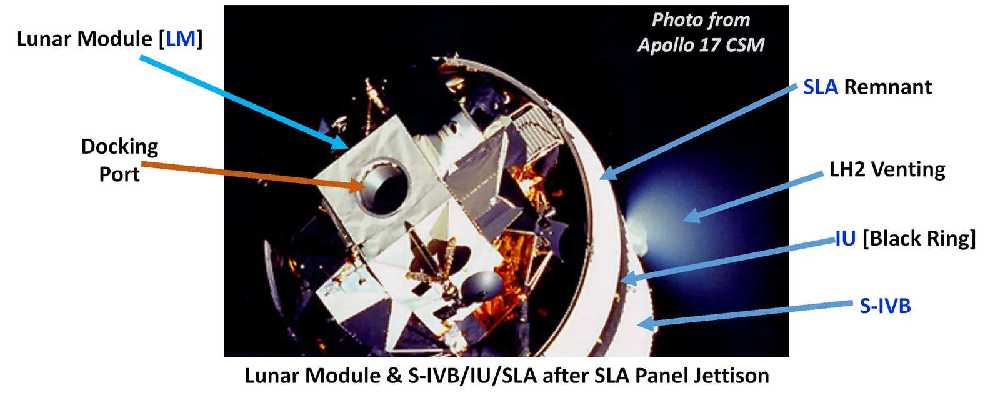

The LVDC Flight Program maneuvered the vehicle to the **Transposition, Docking, and Extraction** \[**TD&E**\] attitude at **3:08 GET** and held this attitude until final Spacecraft \[**CSM/LM**\] separation an hour later. This attitude provided sunlight illumination of the LM as required for CSM docking.

At **3:18 GET** the CSM separated from the S-IVB/IU/SLA. Simultaneously, four SLA panels were ejected leaving the LM still attached to the lower ~1/3 SLA Remnant and the S-IVB/IU. This left the LM Ascent Stage open to space and in the sunlight as shown in the above figure. The CSM moved 75 to 100 feet away, turned around to face the S-IVB/IU/LM, returned, and docked with the LM at **3:27 GET**.

> *A **Docking Adapter** at the apex of the Command Module mated with the **Docking Port** atop the Lunar Module Ascent Stage. The CM to LM docking mechanism provided a tunnel for the Astronauts to move between the CM and LM.*

The Apollo 12 CSM and LM docked together \[**CSM/LM**\] separated from the S-IVB/IU/SLA at **4:13 GET** and headed for the Moon. At about **83 hours GET**, the CSM/LM went into Lunar Orbit **96 miles** above the ‘leading edge’ of the Moon.

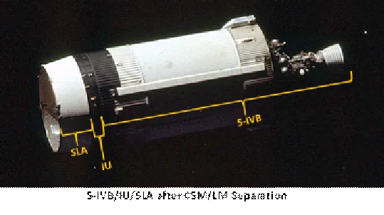*At **TLI*** **\[2:53 GET\]***, the S-IVB/IU **momentum** \[mass times its velocity\] made it highly probable that without further maneuvers the S-IVB/IU would collide with the CSM/LM prior to reaching the Moon! The **Evasive Maneuver** would be a <u>safety</u> measure to insure such a collision would never happen.*

At **4:20 GET**, the IU Flight Program maneuvered the S-IVB/IU to the **Evasive Maneuver Attitude** and executed the **Evasive Maneuver.** This was a two minute firing of the S-IVB APS Thrusters and slowed the S-IVB/IU about 5 to 8 miles per hour. In similar fashion, the CSM fired its RCS thrusters to speed up the CSM/LM by a similar amount. These slight velocity changes insured that the distance between the CSM/LM and S-IVB/IU would continually increase as they continued toward the Moon so that they would never collide!

**<u>S-IVB/IU Post Spacecraft Separation Operations</u>**

After separating from the S-IVB/IU, the CSM/LM continued on a trajectory passing 80 to 100 miles above the ‘***leading edge***’ of the Moon. The CSM/LM would reach this point at ~80 hours GET. A*ctual distances and times were mission dependent.*

Following execution of the **Evasive Maneuver**, the IU executed <u>mission dependent</u> maneuvers to ***EITHER*** put the S-IVB/IU into **Solar Orbit *OR*** target the S-IVB/IU to **Impact the Moon**. Examples of the various translunar trajectories are shown at the right.

***Why Solar Orbit?** Without any additional velocity changes after the Evasive Maneuver, the S-IVB/IU would follow a trajectory past the ‘**leading edge**’ of the moon and ultimately into a very large elliptical Earth orbit. This orbit would be in the plane of the moon’s orbit and could potentially interfere with future Moon missions. Placing the S-IVB/IU into orbit about the Sun \[Solar Orbit\] simply got rid of a very large piece of “space junk” and eliminated a potential threat to future missions.*

***Why Lunar Impact?** An Apollo **Science Objective** was to evaluate the Moon’s interior and determine if the moon contained a molten core similar to the earth. Beginning with Apollo 12, the Astronauts placed Seismometers on the Moon to measure moonquakes; part of the Apollo Lunar Surface Experiment Package \[ALSEP\]. On Apollo 13 and subsequent missions, the S-IVB/IU trajectory was adjusted so that the S-IVB/IU would impact the moon. The S-IVB/IU speed of ~5700 miles per hour and a weight of ~35,000 Pounds produced impacts equivalent to ~11 tons of TNT and produced **moonquakes** that would be sensed by the Seismometers and telemetered to Earth for analysis.*

**<u>S-IVB/IU Slingshot Maneuvers for a Solar Orbit</u>**

> *Ground Elapsed Times \[GET\] in <u>this section</u> are examples from the **Apollo <u>12</u>** mission.*

On five early Saturn V missions \[Apollo 12 and prior\], the S-IVB/IU was placed into Solar Orbit. This was accomplished following the **Evasive Maneuver** by slowing the S-IVB/IU between ~56 and ~82 miles per hour. This slowing forced the S-IVB/IU to pass within 2,000 miles of the Moon’s ‘***trailing edge***’. The Moon’s orbital velocity about the Earth coupled with the Moon’s gravitational pull on the S-IVB/IU would “throw” \[**Slingshot**\] the S-IVB/IU into an orbit about the Sun \[**Solar Orbit**\].

The S-IVB/IU was maneuvered to the **Slingshot Attitude** at **4:36 GET** and the vehicle was then slowed by dumping propellants \[LOX and LH2\], venting helium bottles, and firing the S-IVB Stage APS Ullage Thrusters. LOX was dumped through the engine \[engine was not ignited\] and the LH2 Tank was vented through two S-IVB **propulsive** vents at the front of the stage. These events constituted the **Slingshot Maneuver** and took about one hour to complete \[**4:48 to 5:29 GET**\]. The IU commanded the propellant dump operations through the S-IVB Switch Selector either directly from the stored LVDC Flight Program or as commanded by Mission Control via the IU CCS uplink for execution by the LVDC/LVDA.

**<u>S-IVB/IU Maneuvers for a Lunar Impact</u>**

> *Ground Elapsed Times \[GET\] in <u>this section</u> are examples from the **Apollo <u>13</u>** mission.*

**Apollo Lunar Surface Experiment Packages** \[**ALSEP**\] left on the Moon by crews of Apollos 12 and 14 through 17 contained Seismometers to measure Moonquakes. It was decided to impact the S-IVB/IU from Apollos 13 through 17 on the Moon and use the Seismometer responses to evaluate the Moon’s interior. Slowing the S-IVB/IU between ~12 and ~55 miles per hour would result in a Lunar Impact trajectory.

The S-IVB/IU was maneuvered to the **Lunar Impact Maneuver Attitude** at **4:27 GET** and was slowed by dumping

LOX through the engine \[not ignited\], venting LH2 through the S-IVB propulsive vents, venting helium bottles, and firing the APS Ullage Thrusters. These events constituted the **Lunar Impact Maneuver** and took about 1½ hours to complete \[**4:34 to 6:03 GET**\]. The IU commanded the propellant dump operations through the S-IVB Switch Selector either directly from the stored LVDC Flight Program or as commanded by Mission Control via the IU CCS uplink for execution by the LVDC/LVDA. The ‘~11 tons of TNT’ kinetic energy of the S-IVB/IU impact resulted in Moonquakes lasting 2.5 to 3 hours.

| Mission Number | S-IVB/IU Lunar Impact Time Hr:Min:Sec |
|----------------|---------------------------------------|
| Apollo 13      | 77:56:37 GET …14 Apr 1970             |
| Apollo 14      | 82:37:52 GET …4 Feb 1971              |
| Apollo 15      | 79:24:41 GET …29 Jul 1971             |
| Apollo 16      | 75:08:04 GET …19 Apr 1972             |
| Apollo 17      | 86:59:40 GET …10 Dec 1972             |

For the **Lunar Impact** missions, an extra IU battery was added to power only the **IU CCS Transponder** and **Transmitter**. Loss of the CCS Transponder signal at **Lunar Impact** provided the time of impact for comparison with the ALSEP Seismometer measurements. Ground Elapsed Times of the Lunar Impacts are listed in the table below:

**<u>S-IVB/IU Velocity Changes for the Solar Orbit and Lunar Impact Maneuvers</u>**

Following the **Evasive Maneuver**, the S-IVB/IU was maneuvered to an almost retrograde attitude and the S-IVB ***Thrusting Actions*** previously noted were executed to slow the S-IVB/IU and, depending on the mission, place it on a **Solar Orbit** or on a **Lunar Impact** trajectory.

The following chart shows the velocity changes required for an S-IVB/IU ***Earth-Moon Escape*** \[*Solar Orbit*\] or a **Lunar Impact**. Although the S-IVB/IU was traveling at ~10,000 miles per hour at the times of the velocity changes, relatively small velocity changes produced dramatically different results:

1)  ~82 Miles per Hour … S-IVB/IU Earth-Moon Escape \[Solar Orbit … Apollo 11\]

2)  ~87 Miles per Hour … High Earth Orbit \[Earth Capture … Apollo 12\]

> \(3\) ~48 Miles per Hour … Lunar Impact \[Apollo13\].

Too small \[\< ~12 MPH\] or too large \[\> ~83 MPH\] a velocity change would place the S-IVB/IU in a very high and very elliptical Earth Orbit \[**Earth Capture**\].

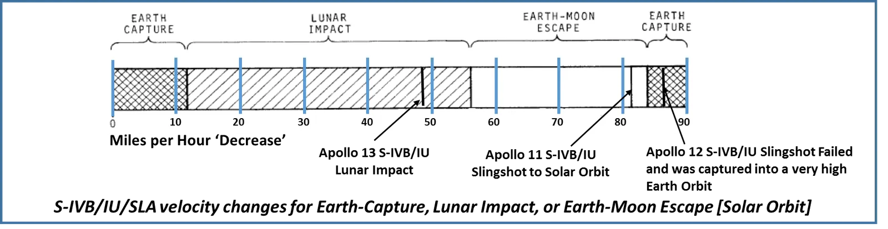

**Apollo 11 S-IVB/IU** was put into a **Solar Orbit** estimated to be 95.0 by 83.5 million miles with a 342 day period.

> *Earth’s orbit about the sun measures 91.4 by 94.5 million miles with a 365¼ day period.*

**Apollo 12 S-IVB/IU** failed \[initially\] to go into **Solar Orbit** and went into a highly elliptical **Earth Orbit** estimated to be 550,000 miles by 140,000 miles with a 43 day period. This was in November 1970.

> ***Apollo 12 S-IVB/IU** remained in the* highly elliptical *Earth Orbit for about 2 years \[until 1972\] and, according to one theory, during one of the orbits came close enough to the Earth-Sun gravity balance point \[LaGrange L1 Point\] to be pulled by the Sun into Solar Orbit.*
>
> 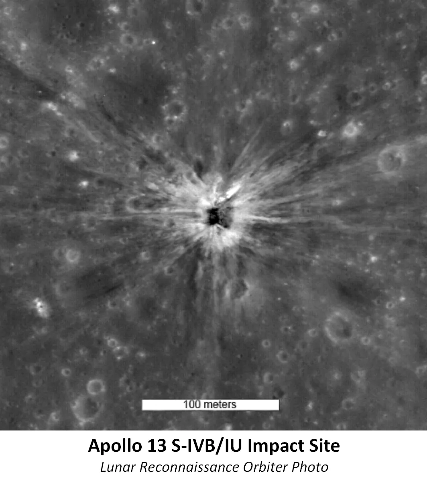***Apollo 12 S-IVB/IU** remained in Solar Orbit for ~31 years and in 2002 came close enough to the Earth-Sun gravity balance point \[LaGrange L1 Point again\] to be pulled by Earth’s gravity into a highly elliptical Earth Orbit. Each S-IVB/IU orbit of the Earth changed in size and shape due to Earth and/or Moon gravitational effects. On the 14th orbit of the Earth, the S-IVB/IU got close enough to the Moon to again be “slingshot” into Solar Orbit. JPL estimates that the Apollo 12 S-IVB/IU will return to Earth orbit again in about 40 years and repeat these Sun-Earth-Sun orbit transfers every ~40 years for 1,000 to 2,000 years before finally hitting the Earth or the Moon! “Google” **J002E3***, *the space junk number for the Apollo 12 S-IVB/IU.*
>
> ***Apollo 13 S-IVB/IU** impacted the Moon about 40 miles from its target point. When the IU CCS Transponder stopped at 77Hr 38Min 41Sec GET, the Apollo 13 S-IVB/IU had hit the moon. The impact vibrations reached the Seismometer 30 seconds after impact and lasted for about 3 hours and 20 minutes.*

**<u>S-IVB/IU *Communications Attitude Maneuver* and IU End of Life</u>**

After completion of either the **Slingshot** ***OR*** **Lunar Impact** **<u>maneuvers</u>**, the IU Flight Program maneuvered the S-IVB/IU to the **Communications Attitude** \[**5:36 GET** **on Apollo 12**\] and maintained this attitude using the S-IVB APS Thrusters to keep the IU & S-IVB antennas pointed at the Earth insuring telemetry and/or command system reception. This attitude was maintained until the final discharge of the IU Battery powering the NG&C System that generally occurred between 11 and 12 hours after launch when active control of the S-IVB/IU ended.

**====== Supplemental Information I ======**

**<u>S-IVB/IU Lunar Impacts … What was learned?</u>**

> *The following information is from NASA Website: **https://www.nasa.gov/topics/moonmars/features/lunar_core.html***

In ~2011, a team of researchers from Marshall Space Flight Center, Arizona State University, the University of California at Santa Cruz, and the ‘Institut de Physique du Globe de Paris’ re-evaluated the extensive data gathered from the four **Apollo Lunar Surface Experiment Package** \[**ALSEP**\] **Passive Seismic Experiment Seismometers.** These ALSEP stations were deployed by the Apollo 12 and 14 through 16 Astronauts between 1969 and 1972 and transmitted lunar seismic activity information until late-1977 when the ALSEP stations were all powered off because of NASA budget cuts.

> *"We applied tried and true methodologies from terrestrial seismology to this legacy data set to present the first-ever direct detection of the moon's core," said Renee Weber, lead researcher and space scientist at NASA's Marshall Space Flight Center.*

The team's findings suggest that the Moon possesses a solid, iron-rich inner core with a radius of ~150 miles and a fluid, primarily liquid-iron outer core with a radius of ~205 miles. Where it differs from Earth is a partially molten boundary layer around the core estimated to have a radius of nearly 300 miles.

> *The Moon’s radius is approximately 1080 miles.*

The research indicates that the core contains a small percentage of light elements such as sulfur, echoing new seismology research on Earth that suggests the presence of light elements in a layer around the Earth’s core.

> **================================**

**====== Supplemental Information II ======**

**Emergency Detection System \[Overview\]**

The incredible success of the Saturn IB and Saturn V Launch Vehicles resulted in little general knowledge of the **Emergency Detection System** **\[EDS\]**. Following is an overview of the Emergency Detection System as implemented in the ***Instrument Unit***.

> *Crew safety was a primary concern for the Apollo/Saturn program so the Saturn and Spacecraft designs incorporated highly reliable circuitry and comprehensive crew training and procedures to cope with potential emergency situations. The Instrument Unit contained hardware and decision logic necessary to sense and initiate an <u>automatic abort</u> during the Saturn S-IC stage burn and to provide indications to the crew for potential <u>manual abort</u> during the remainder of the operations of the Saturn stages.*

During the S-IC Stage Burn \[the first ~2.5 minutes of flight\], the loss of thrust from two engines and/or excessive angular rates about one or more Roll, Pitch, and/or Yaw axes would have been catastrophic requiring an automatic abort of the mission.

The ***Instrument Unit*** **Emergency Detection System \[EDS\]** was designed to detect the following conditions and initiate the **Automatic Abort** sequence:

1.  ***Loss of thrust** on two S-IC Engines meant that the vehicle would fall back to Earth.*

2.  *An excessive **overrate** condition in any or all axes that could cause structural break-up of the vehicle.*

**EDS** was a Mission Critical function so the sensors, electronics, and circuitry were all ***triple redundant***.

> ***Triple Redundant**: There were three of everything \[sensors, wires, electronics, relays, etc.\] needed to detect and respond to these Abort conditions. The three sets of electronic circuits were voted two out of three. If two of the three \[or three of the three\] circuits activated, then the abort occurred. If only one circuit said abort, then no abort occurred but the IU EDS Logic would illuminate an engine out or overrate indicator light in the Command Module.*

**Automatic Abort Condition 1:** **Loss of thrust from any Two S-IC Engines prior to S-IC Center Engine Cutoff**

**Three Thrust-OK Switches** located on the **Fuel Manifold** of **each** of the five S-IC Stage Engines monitored the fuel pressures. Each Thrust-OK Switch was connected via three independent sets of wiring to three independent sets of logic \[triple redundant circuitry\] inside the **EDS Distributor** on **IU Panel 14**. These switches would activate if the fuel manifold pressure dropped below ~90% of nominal meaning that the engine had lost thrust.

> *Activation of any **two or all three** Thrust-OK Switches on **ONE** S-IC Engine would cause the IU EDS Circuitry to illuminate the respective **S-IC Engine Out** indicator on the Command Module EDS Console but would <u>not</u> initiate an abort.*
>
> *Activation of **<u>any two or all three</u>** Thrust-OK Switches on **TWO** S-IC Engines prior to S-IC Center Engine cutoff <u>would</u> initiate an **Automatic Abort.** The loss of the two engines did not have to happen simultaneously. One engine out only illuminated the CM indicator but a second S-IC engine out would initiate an **Automatic Abort**.*

**Automatic Abort Condition 2:** **Angular Overrate conditions during S-IC Stage Burn of <u>any or all</u> of the following:**

1.  *4 degrees per second in Pitch*

2.  *4 degrees per second in Yaw*

3.  *20 degrees per second in Roll.*

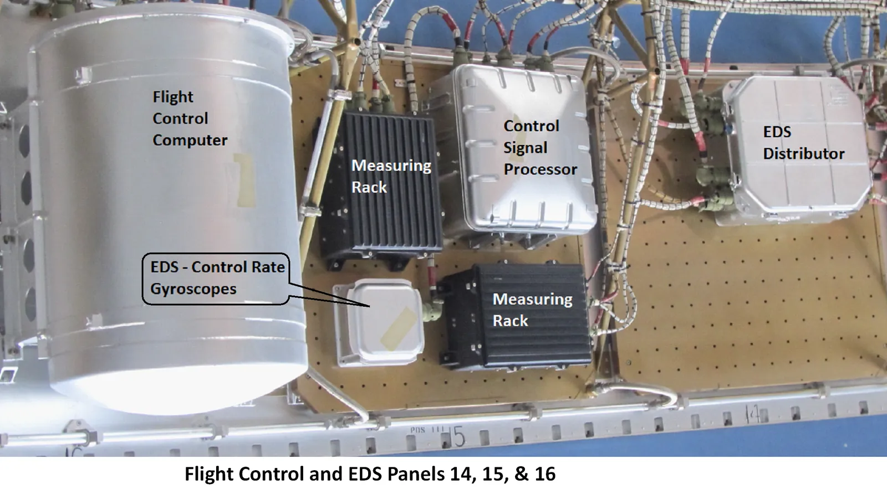The **Control/EDS Rate Gyro** package \[**IU Panel 15**\] contained **nine** **Rate Gyroscopes**; **three** gyroscopes in each of the Roll, Pitch, and Yaw axes. The **Rate Gyros** measured how fast the vehicle was rotating (‘angular rate’) about each of the three vehicle axes. The **Control Signal Processor** \[**IU Panel 15**\] processed these Gyro outputs and forwarded them to the ***Flight Control Computer*** for routine ***Control*** operations.

Accompanying the Three Rate Gyros were three sets of electronics and three sets of decision logic for each vehicle axis \[triple redundancy again\].

> *If, **during S-IC Stage Burn**, the angular rate measured by **One** Rate Gyro exceeded the abort limits, the **Control Signal Processor** would send an axis overrate signal to the **EDS Distributor** \[**IU Panel 14**\] for forwarding to light an indicator on the Command Module EDS Panel.*
>
> *If, **during S-IC Stage Burn**, **Two or Three** **Rate Gyros** in the **same axis** exceeded the respective angular rotation abort limit, then logic in the **EDS Distributor** would initiate an **Automatic Abort.***

Even if the Saturn V didn’t explode as a result of the failure, it was imperative that the Command Module be separated from and quickly thrusted away from the failing Saturn because **Range Safety** would then command the ***explosive*** destruction of the Saturn.

> *The fully fueled Saturn V contained 5.6 million pounds of volatile propellants \[Kerosene, Liquid Oxygen, and Liquid Hydrogen\]. An explosion of a fully fueled Saturn V would have been equivalent to nearly 400 tons of TNT and would produce a 1,000 to 1,200 foot diameter fireball. The primary threat to the crew would not have been the fireball itself but the overpressure of the resulting <u>shock wave</u> could crush the spacecraft so a rapid escape of the Command Module and Crew from the rocket was imperative.*

If an abort occurred during first stage \[S-IC\] burn, the **Launch Escape Tower \[LET\]** atop the Command Module would provide the means for quick escape of the Command Module from the failed rocket. The **LET** 147,000 pound thrust solid rocket motor firing for ~8 seconds would quickly pull the Command Module several thousand feet away from the Saturn. The Command Module would then separate from the **LET** and parachute to a safe Atlantic Ocean landing.

> *The **Launch Escape Tower** 147,000 pound thrust rocket engine was almost twice the thrust of the Redstone Rocket that launched Alan Shepard into space in 1961.*

***The Crew, determining that something was bad wrong, could <u>at any time</u> initiate a Manual Abort by hitting the large red ABORT button on the EDS Panel of the Command Module Main Display Console.***

**Manual Abort Conditions:** At S-IC Cutoff \[~2.5 minutes into the flight\], the Command Module Pilot would change the Command Module Main Display Console **EDS Switch** setting from **AUTO** to **OFF**. After this, the IU EDS logic would remain functional but would only illuminate indicators on the Command Module EDS Panel; the Crew would thereafter decide whether or not to manually initiate an Abort.

In normal flights, the **Launch Escape Tower** was jettisoned early in the S-II Stage Burn at about 3:10 GET.

*The following is a **very brief summary** of potential abort conditions AFTER the S-IC Burn. For a complete EDS description search the Internet for “Saturn V Flight Manual” where the EDS is described more fully in Section 3.*

After the jettison of the **Launch Escape Tower**, the manner in which an abort would proceed depended on the elapsed time of the flight and the potential danger to the crew. Abort conditions after **LET** jettison to about halfway through the first S-IVB Stage Burn \[~10 minutes GET\] would use the Service Module \[SM\] Reaction Control System \[RCS\] thrusters to propel the Command Module and crew to a safe distance from the Saturn. If the Saturn was in danger of exploding, the SM Main Engine could be used to propel the Command Module more quickly from the Saturn. The SM RCS thrusters would then be used to orient the CSM to a retrograde attitude and the SM Main Engine would be used to slow the CM targeting it for a landing at a specific location in the Atlantic. The SM would be jettisoned and the Command Module GN&C would use Command Module thrusters for attitude control during descent followed by the CM parachuting into the Atlantic.

After about 10 minutes into the flight, the SM Main Engine would be used to ‘abort to a contingency orbit’ followed by a crew controlled CM/SM separation and subsequent CM re-entry and parachuting to the Atlantic.

**=================================**

**\**

**=== Supplemental Information III ===**

***<u>Decimal vs Digital … Ones – Zeroes – Bits – Bytes – Words \[Brief Overview\]</u>***

We humans have ten fingers so we use ‘ten’ as the ***base*** for our everyday “***decimal***” world having the ten ‘digits’ **0** through **9**. The “***binary***” \[***digital***\] world of the computer operates as though it had only ‘two’ fingers and expressing its numbers using only the two ‘digits’ **0** and **1**. Our everyday “***decimal***” numbers must be converted to their “***binary***” equivalent to be used by the digital computer. Conversely, we must often convert the computer’s “binary” numbers to their “decimal” equivalents to make sense of them.

Decimal numbers are called “**base 10**” numbers meaning each digit represents a ***power of 10***. Binary numbers are called “**base 2**” numbers meaning each digit represents a ***power of 2***.

> *The ‘**power**’ term means how many times to multiply the base number times itself:*
>
> *‘**10** to the **power** of **3**’ = **103** which means 10x10x10 = **1,000**.*
>
> *‘**2** to the **power** of **3**’ = **23** which means 2x2x2 = **8**.*

<table>
<colgroup>
<col />
</colgroup>
<thead>
<tr>
<th>
<strong>7</strong> x 100 = 7 x 1 = 7

<strong>4</strong> x 101 = <strong>4</strong> x 10 = 40

<strong>3</strong> x 102 = <strong>3</strong> x 100 = 300

<strong>6</strong> x 103 = <strong>6</strong> x 1,000 = 6,000

<strong>9</strong> x 104 = <strong>9</strong> x 10,000 = 90,000

<strong>TOTAL</strong> = 96,347
</th>
</tr>
</thead>
<tbody>
</tbody>
</table>

Consider decimal number **96,347** where the **7** is **<u>digit number</u>** ***zero***, 4 is digit number ***one***, and so on until the **9** is digit number ***four***. The **<u>digit number</u>** represents the ‘***power of 10***’ and the **<u>digit value</u>** becomes the multiplier of that power of ten. **96,347** can be viewed as the <u>sum</u> of the digits <u>times</u> their respective power of ten:

> ***Math note:* Any Number** raised to the zero power is one, for example:
>
> 100 = 1, 20 = 1, 60 = 1, etc.

<table>
<colgroup>
<col />
</colgroup>
<thead>
<tr>
<th>
<strong>1</strong> x 20 = 1 x 1 = 1

<strong>0</strong> x 21 = <strong>0</strong> x 2 = 0

<strong>0</strong> x 22 = <strong>0</strong> x 4 = 0

<strong>1</strong> x 23 = <strong>1</strong> x 8 = 8

<strong>0</strong> x 24 = <strong>0</strong> x 16 = 0

<strong>1</strong> x 25 = <strong>1</strong> x 32 = 32

<strong>1</strong> x 26 = <strong>1</strong> x 64 = 64

<strong>TOTAL = 105</strong>
</th>
</tr>
</thead>
<tbody>
</tbody>
</table>

In a similar manner, the following converts a ***<u>binary number to a decimal number:</u>***

In the binary number **<u>1101001</u>** each 1 or 0 is called a ‘binary digit’ or ‘**bit**’ which is a contraction of **b**inary dig**it**. The rightmost ‘one’ is ***digit <u>number</u>* *zero*** \[the **20** bit\] and the leftmost ‘one’ is digit number ***six*** \[the **26** bit\]. The ‘rightmost’ digit \[the **20** bit\] is the ‘low order bit’ and marks the starting point for this conversion procedure. *Remembering that 20 = 1.*

*So, the <u>binary number</u> **<u>1101001</u>** is equal to the <u>decimal number</u> **105.***

The following procedure converts a ***<u>decimal number to a binary number</u>*** as might be necessary to convert a decimal number for use in a computer. The procedure uses the fact that dividing any ***<u>odd</u>*** decimal number by ‘2’ always results in a ***remainder*** of ‘1’ and dividing any ***<u>even</u>*** number by 2 always results in a ***remainder*** of ‘0’. The ‘1’ and ‘0’ ***remainders*** in the following sequence of divisions by ‘2’ provides the <u>binary</u> equivalent of the original decimal number 105:

105 ÷ 2 = 52 with a remainder of **1** … First remainder is the value of the ‘low order bit’ \[rightmost bit\].

52 ÷ 2 = 26 with a remainder of **0**

26 ÷ 2 = 13 with a remainder of **0**

13 ÷ 2 = 6 with a remainder of **1** RESULTING BINARY NUMBER IS: **<u>1101001</u>**.

6 ÷ 2 = 3 with a remainder of **0**

3 ÷ 2 = 1 with a remainder of **1**

1 ÷ 2 = **<u>0</u>** with a remainder of **1** … Remainder when Quotient is ‘**0**’ is the ‘high order bit \[leftmost bit\].

Digital machines typically use an 8-Bit basis for describing their size, etc. These 8-Bit binary ‘chunks’ are called **BYTES**. Multiple BYTES are combined into **WORDS**. The number of BYTES per WORD depends on the size and capability of the computing device. Personal computers of today commonly use 32-Bits \[4 BYTES\] or 64 Bits \[8 BYTES\] per WORD. Larger word sizes are used in “Mainframe Computers”. On the other hand, your washing machine may use 4-Bit or ½ BYTE computations; a ½ BYTE is called a NIBBLE.

*Some early mainframe computers used 9-Bit BYTES combined into 36 Bit WORDS ... uncommon today.*

**=================================**

**=== Supplemental Information IV ===**

***<u>Data Analyses of IU Telemetry … Some Examples of 1960’s Methods</u>***

> ***The following are some personal recollections working at IBM in Huntsville analyzing telemetry data from the Instrument Units during the Saturn/Apollo flights.***
>
> ***Today \[2020’s\] we take our PCs and tablets with their spreadsheets, word processors, graphics, and print capabilities for granted. During the Saturn/Apollo days, none of these were available. The MSFC Computer Lab had a limited capacity to plot telemetry data so most of our analyses and graphics presentations were generated by hand.***

Telemetry data transmitted from the Saturn stages and IU was received by the MSFN Ground Stations and recorded on 1 inch wide 14 inch diameter reels of Instrumentation Magnetic Tape. Each tape contained 14 tracks of recorded data modulated onto subcarriers. Copies of these tapes were sent to the various NASA Centers and Saturn Stage and IU contractors for analysis.

At the IBM site, the large tape reels were mounted on an Instrumentation Recorder in the Telemetry Ground Station where the data was demodulated and stripped from the tapes. Some of the data was in an analog format and would be output as ‘squiggly lines’ \[‘rocket science’ terminology\] on a continuous 12 inch wide and up to 475 foot long light sensitive paper ‘strip chart’. A corresponding trace of the timing information for the data tracks would also be plotted on the strip chart. These ‘light beam oscillograph’ strip chart recorders or, as we called them, ‘light pen recorders’ could record frequencies to 2,500 Hz whereas ‘pen and ink’ strip chart recorders of the day were limited to maximum frequencies of ~100 Hz. Very sensitive galvanometers deflected a small mirror that reflected an intense ‘bluish’ light beam onto the light sensitive paper to create the trace. These devices could plot as many as 36 side-by-side very narrow traces. Typically 6 traces or less of varying maximum amplitudes would be simultaneously plotted on a single strip chart allowing the analyst to directly correlate the timing of various events. The analyst/engineer would review the data traces, calibrate the magnitude of the signals, and compute the times for points of interest on the chart.

For complex frequency measurements such as vibration, the signal from the tape would first be passed through bandpass filters and then plotted to display only the specific frequencies of interest. These filtered traces and the original complex waveform plus the timing trace provided excellent tools for analyses of various structural responses during boost flight periods.

> ***Strip Chart data analysis example:** A ‘flowmeter’ inside the tubing supplying water to the IU ECS Sublimator contained a small rotating turbine that produced a sine wave signal as its ‘analog’ telemetry measurement. One cycle of the sine wave indicated a specific ‘amount’ of water had passed through the flowmeter and the distance between peaks of the wave indicated the ‘time’ for that amount of water to pass; flow rate = **amount** divided by **time**. When the water valve was opened, the flowmeter turned very fast as the water filled the Sublimator. For the analyst to measure the intervals between the peaks of this varying frequency ‘sine wave’ required that the light pen strip chart recorder plot the data on the continuous paper roll moving at 120 inches per second. At this speed, the paper would shoot about 10 feet across the room before falling to the floor. After gathering up this large paper ‘mess’, the analyst would painstakingly count the large number of sine wave peaks on many feet of strip chart paper. In the 1960’s the ECS engineer spent many hours computing the flow rates using this chart and then calculating the heat dissipated by the Sublimator as a function of time in flight.*

The majority of the IU measurements were sampled and telemetered over Pulse Code Modulated \[PCM\] channels. The IU onboard telemetry system converted each sampled signal into its 10-bit digital equivalent. These 10-bit ‘words’ were placed end-to-end with synchronization codes added between each word. The ‘string’ of digital words was then modulated onto FM subcarriers and then onto FM carriers for transmission to the ground. The Ground Stations received, demodulated, and recorded the PCM channels on Instrumentation Tapes. Copies of these tapes were then distributed to NASA facilities and NASA contractors for post-flight analyses. At the IBM IU site, the data channels were stripped from the tapes in the Telemetry Ground Station and passed to the IBM 1800 Computer that decoded the PCM data stream and located the synchronization codes marking the telemetry frame starting points. The 1800 Computer wrote the decoded data onto digital tapes for subsequent processing by the IBM main-frame computer. IBM main-frame computer data reduction programs then processed the digital tapes, formatting, and printing the data for use by the various analysts, engineers, and programmers. In the 1960’s there were no automated plot capabilities at the IBM site so the users plotted the processed PCM data by hand on graph paper.

> ***Personal Note:** Prior to the first Saturn V flight the various IBM engineering and software departments had specified numerous data reduction programs to run against the flight telemetry. The morning after receiving the first Saturn V flight tapes, the IBM computer center sent out urgent messages for us to come to the computer center immediately. We all feared some major problem with the telemetry tapes but just the opposite was true! The computer room was filled with boxes of 11 by 17 inch computer printout stacked on every available shelf, table, and floor space. We all got a first-hand lesson on just how much data the IU Telemetry System could generate. Many of our data reduction requests were rewritten before the next Saturn V flight.*

The data reduction computer programs converted the 10-bit digital telemetry words to their decimal equivalents and used calibration data to convert each measured value to its correct magnitude and units \[e.g., voltage, current, pressure, temperature, etc.\] and printed each measured value with the corresponding flight time for each measured value. This worked very well except when there was a telemetry dropout. During such periods another and more tedious method was used: the dreaded “**Octal Dump**”.

Each PCM measurement was transmitted as a 10-bit digital word and these words were grouped into Frames of several hundred words each for transmission to the ground. Analyzing data printouts of 300 words each consisting of ten binary ‘ones’ and ‘zeroes’ would have been next to impossible. A method for printing the telemetry frames in the sequence that they were transmitted was needed. It was decided to use **Octal** numbers for this purpose since there is a direct conversion from binary “bits” to their “Octal” equivalent and vice-versa.

> **Octal \[Base 8\] Arithmetic** uses digits 0 through 7. So ‘7 to the Base 8’ or ‘78’ is represented by the <u>three</u> binary digits ‘111’. Since each Base 8 digit can be represented by three binary digits, the 10-bit telemetry word could be represented by three Base 8 digits plus a single high order ‘1’ or ‘0’ bit depending on the magnitude of the word.
>
> Ten Bit Binary = \[1 0 0 0 1 1 1 0 1 0\]2 \< As telemetered in binary

Octal Equivalent = \[1 0 7 2 \]8 \< As printed on the Octal Dump

Decimal Equivalent = \[ 570 \]10 \< The Decimal Equivalent

> **NOTE**: Remember, each **Octal** digit represents 3 **Binary** bits, e.g., 28 = 010, 78 = 111

The ability to convert Octal data directly to Binary and vice-versa made the **Octal Dump** an easier way to view ‘raw’ telemetry data than a string of ten binary ‘ones’ and ‘zeroes’. Each 10-bit telemetry word required <u>four</u> Octal digits where the single high order Octal digit would be either only a ‘0’ or a ‘1’.

The 10-bit word size set the maximum for any telemetered value and determined the respective measurement precision. For example, if all 10-bits were ‘ones’ then the Octal equivalent would be 17778 which is the decimal equivalent of 102310. If a measured quantity was to be 1010 volts, then each binary digit would represent \[1010/102310\] or ~0.0098 volts.

An **Octal Dump** printout was divided into Frames of 30 rows of 30 columns of octal numbers with each number being either a measured parameter or a synchronization code \[frame sync\]. If a dropout corrupted the frame sync, then the data reduction programs could not process the frame of data even though some data in the frame may be valid. There were some measurements that remained at a constant \[or near constant\] value and could be used to indicate potential valid data during a dropout period. We’d make a template from a sheet of paper with cutouts over the rows and columns where the constant values were located in a frame. Slots were also cutout for the specific measured values that we were looking for. The ‘many’ pages of Octal Dump printout would be unfolded on the floor down a hallway. The template would be then be slid over each page. When the numbers showing in the ‘constant’ entry slots were valid, then our desired measurements octal value may also be valid so their value and time in the frame would be written down. This would be repeated over and over and then the octal numbers would be converted to decimal, adjusted using the measurement’s calibration chart, and written down with the time for the measurement. Finally, the data would be plotted on graph paper for analysis. So, data analyses were often tedious and challenging in the 1960’s but we certainly got a very good fundamental understanding of the workings of the system.

The LVDC/LVDA computer words were telemetered as 40-bit words consisting of 26 bits of data, 13 bits of identifier and time, and one parity bit. The 10-bit PCM telemetry system telemetered each 40-bit Computer Word as four 10-bit telemetry words. The LVDC/LVDA telemetry was stripped from the Instrumentation Tape and fed to the IBM 1800 Computer. The IBM 1800 computer decoded the data stream and located the codes marking each telemetry frame starting point. The IBM 1800 would then read and process the data in groups of four 10-bit telemetry words. The four telemetry 10-bit words were combined and the parity bit was checked. If parity was OK the process continued but if not OK then the 40 bit word was marked invalid and the process repeated for the next 40-bits. The 13 bit identifiers were checked to determine which LVDC/LVDA data word and the 26 bits of data and identification information were written onto a digital tape for subsequent data processing on the IBM main-frame computer.

**======================**

**SATURN AND APOLLO REFERENCES**

- **<u>Apollo by the Numbers – A Statistical Reference</u> by Richard W. Orloff,** NASA History Division. Published by Ross & Perry, Inc., Washington D.C. Published 2001.

  - Mission overview plus detailed reference material for all Apollo missions.

  - PDF available on Internet and available at Amazon.

<!-- -->

- **<u>Stages to Saturn</u> by Roger E. Bilstein.** NASA History Office Publication SP:4206. Originally published in 1980.

  - Detailed history of the Saturn program including nuts-and-bolts discussions of the development and manufacturing of the individual stages.

  - Viewable at “http://history.nasa.gov/SP-4206/sp4206.htm”

  - Available from Government Printing Office and from Amazon

<!-- -->

- **<u>SATURN</u> by Alan Laurie.** Apogee Books, Burlington Ontario, Canada. Published 2005

  - Manufacturing and Test Information for the Saturn test and flight stages for Apollo and Skylab missions. Includes CD-ROM of test firings of several stages.

  - Available from Amazon and by special order from Barnes & Noble and Books-A-Million

- **<u>The Saturn V F-1 Engine</u> by Anthony Young.** Praxis Publishing, Ltd, Chichester, UK. Published 2009.

  - Detailed technical development information for the F-1 Engine used on the Saturn V S-IC first stage.

  - Available from Amazon, Barnes & Noble, Books-A-Million, and Springer.

  <!-- -->

  - **<u>Carrying the Fire</u> by Michael Collins. Excellent Book!** Farrar, Strauss, & Giroux, New York, 1974.

    - Personal history and recollections by Apollo 11 Command Module Pilot Michael Collins. Collins flew on Gemini 10 and Apollo 11 and was director of the Smithsonian Air & Space Museum 1971 to 1978.

    - Available from Amazon, Barnes & Noble and Books-A-Million

  - **<u>Liftoff, America’s Adventure in Space</u> by Michael Collins.** Grove Press, New York. Published 1988.

    - Overview of America’s Space Programs from 1946 until 1986.

    - Available from Amazon and possibly Barnes & Noble.

**=== LAST PAGE ===**
