**The Continuing Saga**

**of the**

**Apollo 12**

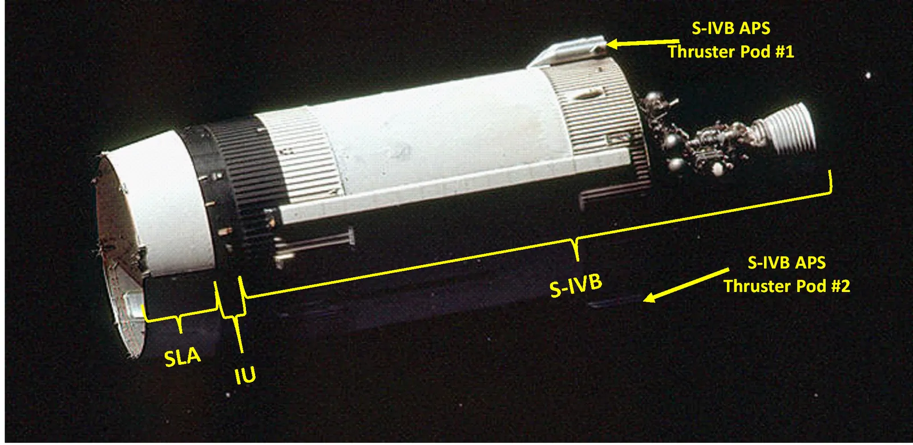**Saturn S-IVB/IU**

Prepared by Luke Talley

USSRC Docent Emeritus

September 15, 2024 Rev 10B***\***

***Personal Note:** It was my privilege to have worked for IBM in Huntsville on the Saturn Instrument Unit \[IU\]. I worked in the Flight Evaluation Department where our jobs for each mission were to: (1) provide prelaunch and inflight mission support, (2) evaluate the inflight telemetered data, (3) identify inflight problems, (4) work with the various engineering organizations to resolve inflight problems, and (5) review mission objectives affecting the IU and prepare computer analysis programs for upcoming Saturn flights.*

*I am currently \[2024\] a U.S. Space and Rocket Center \[USSRC\] NASA Docent Emeritus volunteer where I often give tours of the Saturn V and Saturn Instrument Unit exhibits in the Davidson Center.*

*Following the separation of the Spacecraft \[CSM/LM\] from the Saturn S-IVB third stage and Instrument Unit on the Apollo 12 Mission, the S-IVB/IU was to have been put into orbit about the Sun \[a Solar Orbit\]. Instead, the S-IVB/IU went into a large elliptical orbit around the Earth. About a year later the S-IVB/IU finally went into Solar Orbit. Then, some 30 years later, it came back into Earth Orbit for almost two years and then went back into Solar Orbit. What’s next for this piece of Space Junk? This document describes the causes of these unusual events and includes predictions for its future.*

*Regards,*

*Luke Talley*

***The material in this document is in three parts:***

- ***Part 1 describes the flight of the Saturn V Third Stage \[S-IVB\] and Instrument Unit \[IU\] following their separation from the Apollo 12 Spacecraft.***

- ***Part 2 includes several Appendices containing supplemental information for persons interested in additional technical facts.***

<!-- -->

- ***Superscripts \[e.g., {A1}\] in the write-ups refer to the document Appendix Number containing added technical information.***

<!-- -->

- ***Part 3 lists several technical and/or general information references for the Apollo 12 S-IVB/IU trajectories and for the Apollo/Saturn missions and hardware.***

***Many of the numbers quoted herein are representative of a typical Saturn vehicle and/or Apollo mission. Precise vehicle and mission particular numbers \[burn times, thrusts, ranges, velocities, timings, etc.\] vary depending on the specific launch vehicle, spacecraft, launch dates, and mission objectives. Specific mission related parameters may be found in the book titled <u>Apollo by the Numbers – A Statistical Reference</u>* *listed on the last page of this document.***

**<u>Apollo/Saturn Space Vehicle Overview</u>**

The ***Apollo/Saturn*** ***Space Vehicle*** consisted of the **Saturn V Launch Vehicle** and the **Spacecraft**.

The ***Saturn V Launch Vehicle*** consisted of:

- **Three Rocket Propulsion Stages:**

> ***First Stage \[S-IC\]***
>
> ***Second Stage \[S-II\]***
>
> ***Third Stage \[S-IVB\]***

- **Two Interstages**

> ***S-IC-to-S-II Interstage***
>
> ***S-II-to-S-IVB Interstage***

- **One *Instrument Unit \[IU\]***

***Marshall Spaceflight Center \[MSFC\]** in Huntsville, AL managed the development and production of the **Saturn V Launch Vehicle**.*

The **Spacecraft** consisted of:

> ***Command Module \[CM\]***
>
> ***Service Module \[SM\]***
>
> ***Lunar Module \[LM\]***
>
> ***Spacecraft Lunar Module Adapter \[SLA\]***
>
> ***Launch Escape System \[LES\]***.

The ***SLA*** was atop the **IU** *and the **LM** was located inside the **SLA** during Launch.* The ***SM*** was located atop the ***SLA*** and the ***CM*** atop the ***SM***.

> *The three Astronauts spent most of their time in the **Command Module**. Two Astronauts were in the **Lunar Module** during the Lunar Landing while one Astronaut remained in the Command Module in Lunar Orbit.*

*The **CM** and **SM** remained joined together as the **Command and Service Module** **\[CSM\]** until just prior to Earth re-entry. The **SM** was jettisoned prior to re-entry and only the **CM** with the Astronauts aboard returned to Earth.*

The ***Launch Escape System \[LES\]*** solid rocket motor would have pulled the ***CM*** free of the ***Saturn V*** in the event of an abort during the ***S-IC Stage*** burn. Luckily this never happened! The **LES** was jettisoned during the **S-II Stage** burn.

> *The **Johnson Space Center \[JSC\]** in Houston managed the development, production, and inflight operations of the **Spacecraft** \[**SLA**, **CM**, **SM**, **LM**, and **LES**\].*

The complete ***Space Vehicle*** was 363 feet long consisting of the 281 foot long ***Saturn V Launch Vehicle*** and the 82 foot long ***Spacecraft***.

**<u>Apollo 12 Mission Overview</u>**

The Apollo 12 second Manned Lunar Landing Mission was launched on November 14, 1969. This was a ***Type “H”*** ***Mission*** meaning it was to **“*make a precision landing near the Surveyor III Spacecraft with up to two days stay on the Moon and two moonwalks*”**.

- *The Lunar Module landed 600 feet from Surveyor III.*

- 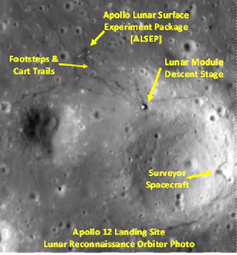*On the Moon for 31 hours 31 minutes 12 seconds.*

- *Two Moonwalks:*

  - *\#1 lasted 3 hours 56 minutes 3 seconds.*

  - *\#2 lasted 3 hours 49 minutes 15 seconds.*

The moonwalks included a visit to the Surveyor III that had been on the Moon since April, 1967. Apollo 12 was the first crew to deploy the **Apollo Lunar Surface Experiments Package \[ALSEP\]**. The ALSEP transmitted scientific information to the Earth about the Moon’s environment for the next 10 years.

Apollo 12 did not include a Lunar Rover. The crew transported their exploration equipment, cameras, etc. using a *high-tech cart*. The figure at the right shows the cart paths, astronauts’ footprints, and significant equipment locations.

> The Apollo 12 Lunar Landing Mission was a success in every way. However, the astronauts had some **“***unusual moments”* getting to and returning from the Moon.

The Saturn V Third Stage and Instrument Unit \[**S-IVB/IU**\] used to launch Apollo 12 to the Moon ***continues*** to have *more than a few **“Unusual Moments”*** of its own.

***==== These S-IVB/IU “Unusual Moments” are the subject of the following ====***

**<u>Apollo 12 Launch and Lightning Strike</u>**

“*Twas a dark and stormy morning*” at **Kennedy Space Center \[KSC\]** on November 14, 1969 when Apollo 12 was launched into a ***rainstorm*** at 11:22 AM EST:

> *Apollo/Saturn **Mission Rule 1-404** stated: “the vehicle will not be launched where its path will carry it through a cumulonimbus (**thunderstorm**) cloud formation”.*

Weather radar and other measurements indicated that, although the cloud bases were only 800 to 1000 feet above the ground, there had been no lightning near KSC, and there were *no **thunderstorm** cloud formations* in the KSC area … the launch took place on schedule and in the ***rainstorm***.

At 36.5 seconds after launch and at 6000 feet altitude **lightning** struck the **Command and Service Module \[CSM\]** causing loss of all ‘alternating current’ power in the Command and Service Modules. A second lightning strike at 52 seconds caused the CM guidance platform to shut down. With electrical power that was automatically supplied by the CM re-entry batteries, the CM ***Caution and Warning*** indicator panels displayed many system alerts. Power from the re-entry batteries enabled the crew to successfully repower all of the CM systems that had been shut-down by the lightning strike.

Fortunately, during the lightning strike, the Saturn V was under control of the IU Computer System. Since the electronics equipment in the IU and in the three Saturn Rocket Stages was shielded by the outer metal skin of the Launch Vehicle, the IU and the S-IC Stage continued operating normally during and after the lightning strikes. The continued automated operation of the Saturn Instrument Unit gave the Astronauts time to repower the CSM systems and have the spacecraft operating normally by the time the Saturn S-IVB Stage engine cutoff at orbital insertion ~12 minutes after launch.

> *An in depth report of the “**Apollo 12 Lightning Incident**” can be found at Internet site:*
>
> *https://spaceflight.nasa.gov/outreach/SignificantIncidents/assets/analysis-of-apollo-12-lightning-incident.pdf*

**<u>Earth Orbit Phase</u>**

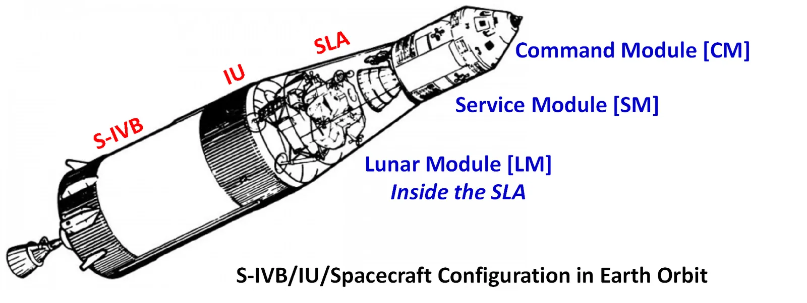The Saturn V was not powerful enough to launch the Spacecraft directly from the KSC Launch Pad to the Moon. Therefore, the Apollo missions were first launched into an approximately 115 mile high Earth orbit using burns of the Saturn V first, second, and third stages. The first and second stages were discarded after their respective burns; both ended up in pieces in the Atlantic Ocean and were not recovered. The S-IVB and IU remained connected to the Spacecraft and orbited the Earth for approximately an orbit and a half. During this orbital coast period, the S-IVB, IU, and CSM were checked to insure they were OK to continue to the Moon. During this period, Mission Control could, if necessary, transmit commands to update Navigation or other IU and/or S-IVB parameters using the **IU Command and Communications System \[IU CCS\]**.

**<u>Translunar Burn</u>**

The <u>Launch to Orbit</u> placed the **S-IVB/IU & Spacecraft** into an <u>Orbit Plane</u> that was different from the <u>Plane</u> of the <u>Moon’s Orbit</u> about the Earth. The vehicle coasted in its initial Earth Orbit until the vehicle intersected the plane of the Moon’s Orbit about the Earth. Near this intersection the S-IVB Engine was restarted for an approximately 6 minute S-IVB **Translunar Burn**. During the **Translunar Burn**, the vehicle was accelerated to 24,500 miles per hour and transferred from the Earth Orbit plane into the Moon’s Orbit plane. **Translunar Injection \[TLI\]**, defined as 10 seconds after S-IVB second burn cutoff, occurred at 2 hours 53 minutes 4 seconds after launch.

> ***Note:** Times from launch \[liftoff\] will be given as **Ground Elapsed Time \[GET\]**:*
>
> *For example, 2 hours 53 minutes 4 seconds GET = 2:53:04 GET*

**<u>Translunar Coast - Spacecraft Separation</u>**

After **Translunar Injection** the CSM separated and moved away from the S-IVB/IU/SLA. As the CSM moved away, four panels surrounding the upper ~2/3 of the SLA were jettisoned. Jettisoning the SLA panels provided the CSM access to the **Lunar Module \[LM\]** that remained attached to the lower ~1/3 of the SLA \[the **SLA Remnant**\].

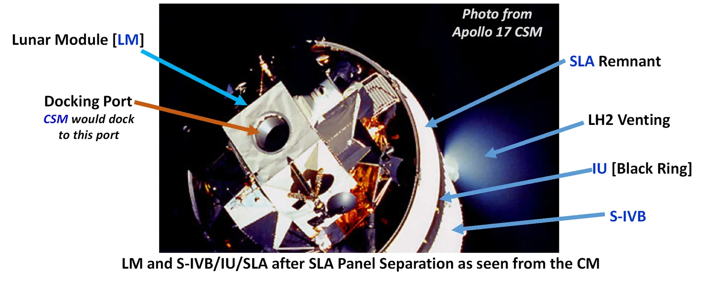The CSM separated, moved away, then turned around and flew back to the S-IVB/IU/SLA/LM.

A **Docking Adapter** located at the CM **‘*pointy tip’*** \[*a rocket science technical term*\] mated with the **Docking Port** on top of the LM. After the CM docked with the LM the crew threw a switch in the CM to separate the LM from the **S-IVB/IU/SLA Remnant**. The docked together **CSM/LM** separated from the **S-IVB/IU/SLA** at 4:13:00 GET.

**<u>\
</u>**

**<u>Translunar Coast - Evasive Maneuver</u>**

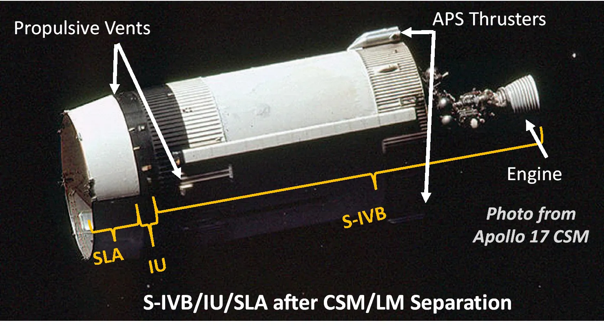

After separation, the CSM/LM and the S-IVB/IU executed **Evasive Maneuvers**. These were small velocity changes to insure that the CSM/LM and S-IVB/IU would never impact each other. Firings of the **Service Module** **Reaction Control System** thrusters ‘sped up’ the CSM about ***2 miles per hour***. Firings of the **S-IVB Auxiliary Propulsion System \[APS\]** **Ullage** thrusters ‘slowed’ the S-IVB/IU about ***7 miles per hour***.

> *These small **Evasive Maneuver** velocity changes occurred about 3800 miles above the Earth. With over 200,000 miles to go to reach the moon these velocity changes insured that the distance between the CSM/LM and S-IVB/IU would continually increase. Without this maneuver there was a distinct possibility that the momentum of the S-IVB/IU would cause it to catch up with and run into the CSM/LM before they reached the moon. So, the **Evasive Maneuver** was a safety measure.*

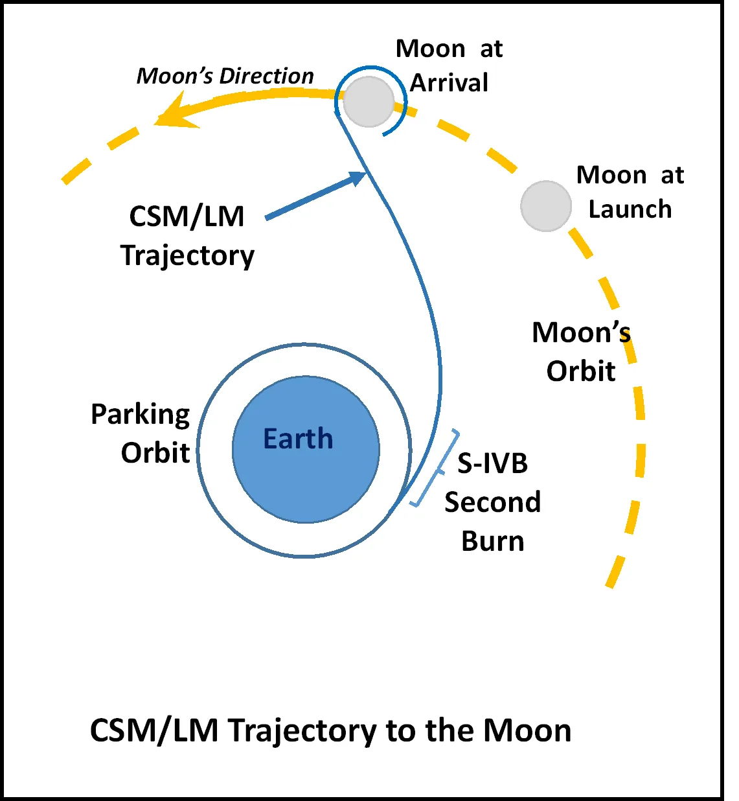**<u>Translunar Coast – CSM/LM Trajectory to the Moon</u>**

At **~83 hours GET** the Apollo 12 **CSM/LM** passed ~**90 miles** above the ***leading edge*** of the Moon. A **6 minute burn** of the **Service Module Propulsion System** **\[SPS\]** engine placed the CSM/LM into an orbit **75 miles** above the Moon.

> *Time from **S-IVB Translunar Burn** Cutoff to the CSM Lunar Orbit Insertion burn was 80 Hours 32 Minutes \[~3.3 Days\].*

With no additional velocity changes following the ***Evasive Maneuver***, the S-IVB/IU ***would have*** followed the CSM/LM past the leading edge of the Moon and on into a highly elliptical orbit about the Earth.

**<u>Translunar Coast - *Slingshot Maneuver \[Planned\]*</u>**

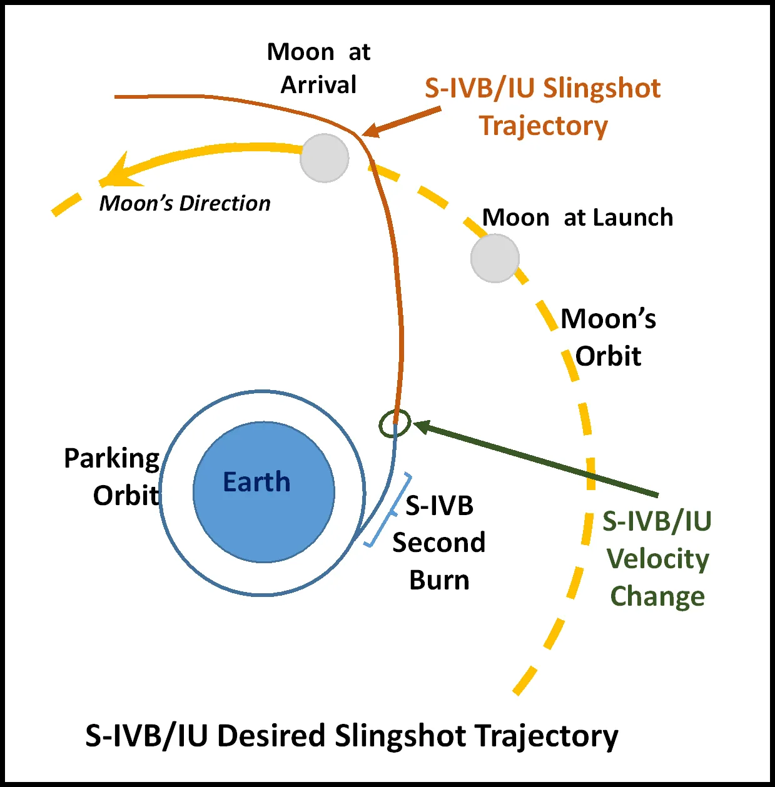

**Mission Plans** were to place the Apollo 12 S-IVB/IU into orbit about the **Sun \[Solar Orbit\]**. After the CSM/LM separation at 4:13:00 GET, the S-IVB/IU was to be **SLOWED{A1}** sufficiently to cause it to pass within 2000 miles of the Moon’s ***Trailing Edge***. Preprogrammed IU Computer System commands fired the **S-IVB APS Ullage Thrusters** and propulsive venting of the propellant tanks were used to **SLOW** the S-IVB/IU. As the S-IVB/IU passed within 2000 miles of the Moon’s trailing edge, the Moon’s gravity and orbital velocity about the Earth would then **SLINGSHOT{A2}** the S-IVB/IU into Solar Orbit.

**<u>Translunar Coast –*Slingshot Maneuver \[Unsuccessful\]*</u> {A3}**

The IU Computer and Guidance System data continually calculated the vehicle location, speed, and direction of travel. These onboard calculated parameters were telemetered to the ground for Mission Control monitoring of the flight trajectory. The **IU C-Band Tracking System** was normally used to cross-check the IU onboard computed parameters at **Translunar Injection**. However, on this mission, data from a ground C-Band Radar Site was not available during this period so Mission Control used the IU onboard computed velocity and the IU S-Band tracking data:

- ***These comparisons indicated that the S-IVB/IU was traveling <u>faster</u> than it actually was.***

Because of this indicated over speed, Mission Control transmitted commands to the IU Computer to fire the S-IVB APS Ullage Thrusters for an **additional** **4 minutes** to **SLOW** the S-IVB/IU an additional ***~23 miles per hour***.

- *Post-flight analyses of the ground C-Band Radar tracking data showed that the S-IVB/IU was actually moving **<u>slower</u>** than indicated by the IU onboard computed velocity.*

<!-- -->

- ***As a result, the 4 minute Ullage firing <u>slowed the S-IVB/IU too much</u> and it missed the Moon by about 3500 miles instead of the desired 2000 miles!***

The actions to slow the S-IVB/IU were completed at 5 hours 33 minutes GET; about 70 hours before the S-IVB/IU would reach the Moon’s vicinity. The velocity changes were relatively small when considering that the S-IVB/IU was traveling about ***10,000 miles per hour*** at the time of the velocity changes. The comments and chart below illustrate that velocity changes of less than 1 % produced significantly different end results:

> The Apollo 12 S-IVB/IU was slowed a total of **~85 miles per hour** causing the vehicle to go into an **Earth Orbit** \[**Earth Capture**\] instead of a **Solar Orbit \[Earth-Moon Escape\]**.

- 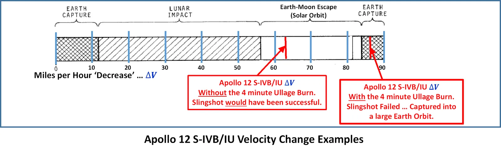**The figure below shows that without the added 4 minute Ullage Burn the S-IVB/IU would have gone into Solar Orbit as had been desired. *∆V= velocity change.***

- **NOTE: Appendices 3, and 4 provide additional information regarding the delta velocities used for the Translunar Coast Maneuvers for Apollos 11, 12, and 13.**

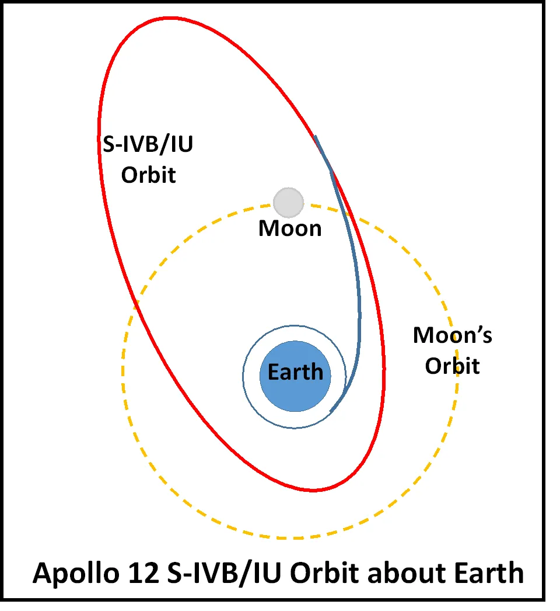**<u>Apollo 12 S-IVB/IU in Earth Orbit instead of Solar Orbit</u>**

Slowing the Apollo 12 S-IVB/IU **85 miles per hour** caused it to pass about 3500 miles from the ***trailing edge*** of the Moon at ~86 hours GET. Instead of being **Slingshot** into **Solar Orbit**, the S-IVB/IU went into a large unstable elliptical orbit around the Earth. estimated to be initially ~*101,350 miles by ~535,522 miles and taking ~42 days to make one orbit\*:*

> **\* https://www.nasa.gov/mission_pages/apollo/missions/apollo12**

The Apollo 12 S-IVB/IU was estimated to have reached the highest point \[apogee\] above the Earth \[~535,000 miles\] about 20 days after launch. Over the next two years, near encounters with the Moon and Earth continually altered the shape and size of the S-IVB/IU ***Earth Orbit***.

> ***<u>Another Bit of Apollo 12 Strangeness</u>***
>
> *During the 20 days that it took for the S-IVB/IU to reach the highest point in its Earth Orbit \[apogee\], the Apollo 12 crew explored the Moon and returned to Earth. When the Command Module impacted the Pacific Ocean a 16 mm film camera at the right hand rendezvous window fell from its bracket and struck Astronaut Alan Bean above the right eye leaving him unconscious for a few seconds and with a cut that required six stitches.*

**<u>Apollo 12 S-IVB/IU Goes Into Solar Orbit</u>**

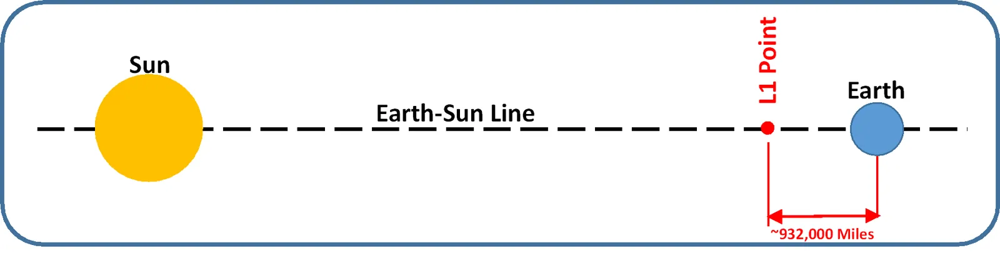There is a point in space on the **Earth-Sun Line**, about 932,000 miles from the Earth toward the Sun. At this point, the pull of the Earth’s gravity toward the Earth equals the pull of the Sun’s gravity toward the Sun. This is called the **LaGrange L1 Point {A5}**. Mathematically **L1** is a point but its effect is felt in the region of space surrounding the point.

**Dr. Paul Chodas** of the Near-Earth Object Program Office at NASA's Jet Propulsion Laboratory, Pasadena, California estimated that after nine or ten Earth orbits the S-IVB/IU likely passed near the **LaGrange L1 Point** and ***<u>was pulled into Solar Orbit by the Sun’s Gravity in March 1971</u>***.

- ***It was thought that once in Solar Orbit the Apollo 12 S-IVB/IU would not be heard from again.***

**<u>\
</u>**

**<u>Apollo 12 S-IVB/IU *Returns* to Earth Orbit</u>**

On **September 3, 2002** amateur astronomer **Bill Yeung** of California saw a small white object that he thought was an asteroid. Yeung reported this sighting and professional astronomers began to study it. The object was assigned “space junk” number **J002E3**. Continued analyses showed that J002E3 was entering **Earth Orbit**.

> ***Unknown object entering Earth Orbit from space … UFO enthusiasts got excited!***

Astronomers at the **University of Arizona** and **MIT** found that the object’s spectral characteristics \[light reflected from the object\] indicated black paint, white paint, and aluminum; not the usual asteroid coatings. Within a few weeks **JPL** scientists determined that **J002E3** was most likely the **Apollo 12 S-IVB/IU**.

- ***The S-IVB/IU had remained in Solar Orbit for ~31 years and had now returned to Earth Orbit. This was the first object <u>known</u> to have done this!***

The size and period of the S-IVB/IU Solar Orbit were not precisely known for several reasons:

1.  It was not known exactly how the S-IVB/IU escaped Earth Orbit and entered Solar Orbit in 1971.

2.  Repeated observations of J002E3 showed continuing path perturbations consistent with solar radiation on an object the size of the S-IVB/IU.

3.  The solar radiation affects vary with position around the Sun so these would have continually perturbed the S-IVB/IU Solar Orbits over the 31 year period.

The S-IVB/IU orbited (slightly) closer to the Sun than does the Earth, so the S-IVB/IU orbited the Sun faster than the Earth. **Dr. Chodas of JPL \[A6, A7}** estimated that the S-IVB/IU had orbited the Sun about 33 times while the Earth had orbited the Sun 31 times so the orbits of the S-IVB/IU and Earth about the Sun were out of phase with each other. The **Solar Radiation** effects and other gravitational perturbations likely continually altered the shapes of the S-IVB/IU solar orbits. In April 2002, the S-IVB/IU passed near the Earth-Sun **LaGrange L1 Point** such that the Earth’s gravity pulled it <u>out</u> of Solar Orbit and <u>into</u> Earth Orbit \[i.e., it was captured by the Earth\]. Additional information is available on the internet at:

> ***Dr. Chodas 2002 J002E3 article at: https://www.jpl.nasa.gov/news/news.php?feature=812***

***Dr. Chodas JPL Simulation of the J002E3 Earth orbits during 2002/2003 may be viewed at website:***

> ***https://cneos.jpl.nasa.gov/doc/j002e3/***

Following are snapshots of the **S-IVB/IU** \[**J002E3**\] orbits about the Earth taken from the **JPL Simulation**. The *animated* simulation illustrates very well the effects of the Earth and Moon on the orbits of the S-IVB/IU.

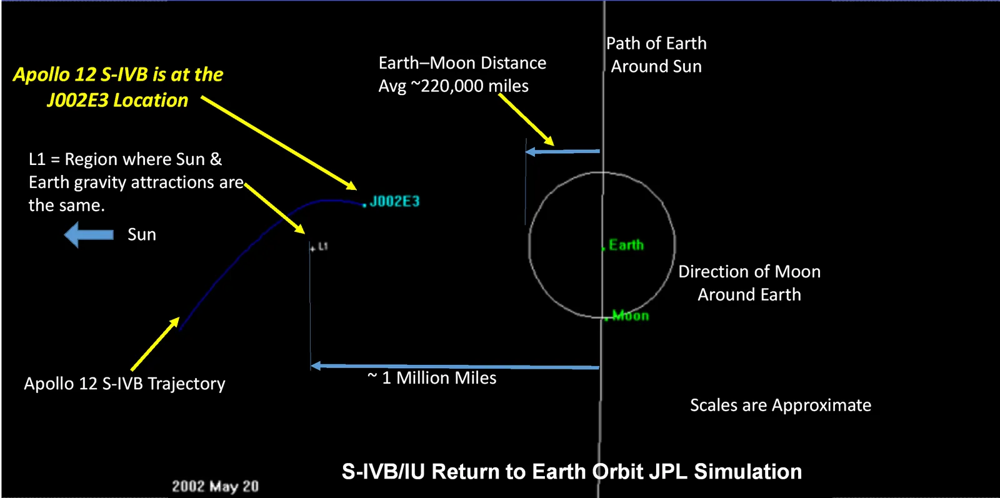The first figure outlines the content of the following three figures. **Days Elapsed** and the number of **Lunar Orbits** are measured from the estimated time **J002E3** entered the **LaGrange L1 Region**.

The figures are viewed from above the Earth. Since the Earth is moving around the Sun, the actual orbit paths in space are more complicated than shown.

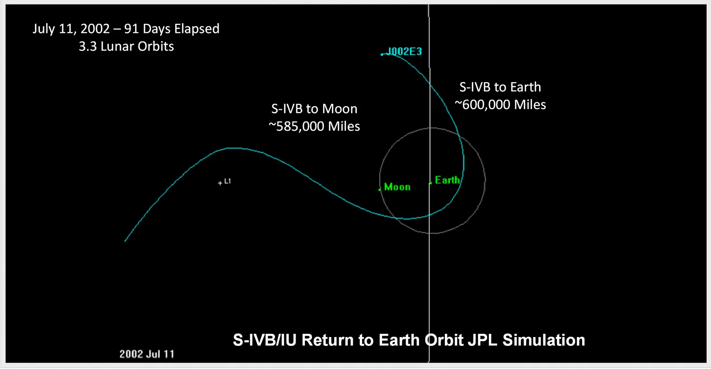The second figure shows the object’s path passing near the **LaGrange L1 Point** and being pulled into Earth Orbit. The position of the object, Moon, and Earth is shown for the date noted at the bottom of the figure. The **JPL Animation** shows the Moon orbiting the Earth and illustrates how the shapes of the J002E3 orbits continually changed due to Earth and Moon gravitational effects.

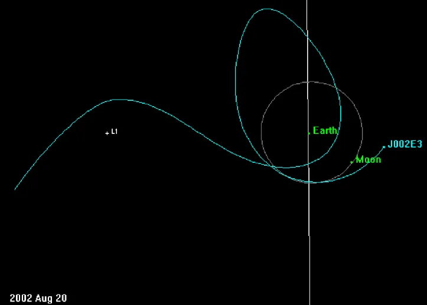

**S-IVB/IU Return to Earth Orbit JPL Simulation**

**First Orbit of Earth**

The third figure shows J0023 as it completed its first complete orbit of the Earth. The J002E3 ‘near’ encounters with the Earth and Moon on the first pass resulted in the ‘egg’ shaped trajectory. The distances between J002E3 and the Earth and/or the Moon on succeeding passes resulted in different shaped orbital paths.

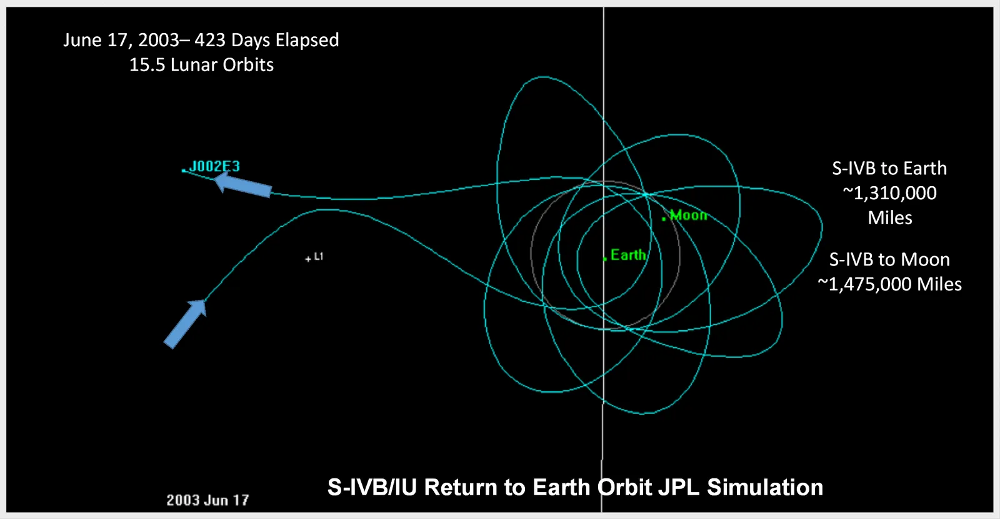

The fourth figure shows the chaotic J002E3 orbits during the 423 days that it was orbiting Earth. Note how the shapes of the various orbits changed as J002E3 came close to the Earth and/or the Moon on the various orbits.

**S-IVB/IU Return to Earth Orbit JPL Simulation**

**Return to Solar Orbit**

> After about seven orbits of the Earth, the S-IVB/IU came close enough to the Moon to be ***Slingshot*** **back into** **Solar Orbit**.

**<u>Apollo 12 S-IVB/IU – What Next?</u>**

**The Apollo 12 S-IVB/IU departed Earth Orbit for the second time in mid-June 2003**!

**Dr. Steven Chesley** of JPL has stated that there “*is no possibility of an impact for several decades. In the years ahead J002E3 may be recaptured, but the first opportunity for this will not be until the mid-2040s*”.

**Dr. Chodas** of JPL has stated: “***In several thousand years, the object will likely end its travels by hitting the Moon or Earth***”!

**End of the Apollo 12 S-IVB/IU Story … Or is it?**

**== Another Rocket Stage Returns from Solar Orbit! ==**

In September, 2020 an object was detected by astronomers searching for near-Earth asteroids using the NASA-funded [**Pan-STARRS1**](https://panstarrs.stsci.edu/) survey by the Haleakala Observatory telescope on Maui. After numerous observations and spectral analyses, Dr. Chodas \[noted previously\] and others confirmed on December 1, 2020 that the object was not an asteroid but was the Centaur upper stage of the Atlas-Centaur rocket used to launch the **Surveyor 2 Spacecraft** in 1966. The Surveyor 2 Moon landing was unsuccessful and the spacecraft crashed into the Moon due to a thruster malfunction during a midcourse correction. After separating from the Surveyor 2 during launch, the Centaur stage was placed on a Slingshot trajectory past the Moon and into a Solar Orbit.

The Centaur passed near the LaGrange L2 point \[Ref: Appendix 5A for LaGrange Point definitions\] and was pulled into Earth orbit on November 8, 2020. It passed within 31,000 miles of the Earth and will continue in a large elliptical orbit passing within about 140,000 miles of Earth on February 2, 2021. The Centaur will exit Earth’s influence via the LaGrange L1 point and return to Solar Orbit on March 7, 2021. Dr. Chodas predicts that the object will return again in ~36 years and has likely been ‘here’ before!

The Space Junk number for the object is **SO 2020**. Internet searches for SO 2020 or Surveyor 2 will give links to more information on this topic. The SO 2020 Wikipedia site has an animated simulation of the object orbiting Earth.

**Sounds like the Earth’s going to have space junk visits for years to come!**

**=== Appendices ===**

**These Appendices contain additional technical information regarding normal and unusual events surrounding the continuing flight of the Apollo 12 S-IVB/IU. Charts showing the relatively small velocity differences between Lunar Impact, Solar Orbit, and Earth Orbit trajectories are included. The methods used to slow the S-IVB/IU are described and additional LaGrange Point information is included.**

**The quoted numbers are typical of the Apollo/Saturn missions. Precise vehicle and mission particular numbers \[burn times, thrusts, velocities, timings, etc.\] vary depending on the specific missions and the mission objectives.**

**Trajectory and velocity curves taken from MSFC Flight Evaluation Reports and from Boeing Trajectory Reports are included for Apollo 11 and 12 missions to compare a successful with an unsuccessful Slingshot mission.**

**Appendix 1 … Slowing the Apollo 12 S-IVB/IU for Slingshot to Solar Orbit**

After CSM/LM separation, the S-IVB/IU was **SLOWED** to cause it to pass within ~2000 miles of the Moon’s ***Trailing Edge*** and subsequently be **SLINGSHOT** into Solar Orbit. **Three S-IVB/IU *Thrusting* Maneuvers** were preprogrammed in the IU Flight Program for use following Spacecraft separation. An added S-IVB Ullage Thruster burn was uplinked from Mission Control through the IU CCS Command System to the IU Flight Program.

**The IU Computer preprogrammed Maneuvers were:**

**Evasive Maneuver:** Following CSM/LM Spacecraft separation from the S-IVB/IU, the **SIVB Ullage Thrusters** were fired for ~3 minutes, slowing the S-IVB/IU about 7 miles per hour, and insuring that it would never impact the CSM/LM. The Spacecraft executed a similar maneuver slightly increasing its speed and further insuring that their paths would never cross.

**Slingshot Maneuver:** Several **S-IVB “thrusting” actions** were used for this maneuver:

1.  The S-IVB Liquid Hydrogen \[LH2\] Tank **Continuous \[Propulsive\] Vents** were opened at ~4:36:00 GET. These vents were located on opposite sides of the S-IVB forward skirt and pointed aft. When opened they produced a small slowly decaying thrust as the remaining LH2 was vented overboard.

- *This continuous Liquid Hydrogen venting slowed the S-IVB/IU ~7 miles per hour.*

2.  The contents of the **S-IVB Liquid Oxygen \[LOX\]** tank was next pumped through the engine for about 1 minute. This **LOX Dump** produced a vapor cloud estimated to be about 20 miles in diameter.

- *The LOX Dump slowed the S-IVB/IU ~23 miles per hour.*

3.  The **S-IVB APS Ullage Thrusters** were fired twice. The first firing was pre-programmed in the IU Computer Flight Program and the second was commanded from Mission Control:

- *The **preprogrammed** 5 minute APS Ullage Thruster firing slowed the S-IVB/IU ~26 miles per hour.*

- *The **commanded** 4 ½ minute APS Ullage Thruster firing slowed the S-IVB/IU ~24 miles per hour.*

> **Communications Attitude Maneuver**: After the Slingshot Maneuver, the S-IVB/IU was maneuvered in attitude only \[no thrusting actions\] to insure that the IU Directional Antennas were pointing at the Ground Tracking Stations. This attitude was then actively maintained by the IU Computer System until the IU Batteries depleted at 11 to 12 hours after launch.

**Appendix 2 … S-IVB/IU Slingshot Maneuver \[Apollo 11 Example\]**

The correct term for **Slingshot Maneuver** is **Gravity Assist Maneuver** and the following is a simplified explanation. The S-IVB/IU was launched from Earth so <u>it was already orbiting the Sun at the speed that the Earth orbits the Sun</u>, that is, ~66,600 miles per hour. None of the actions during launch or translunar coast had much effect on this inherent velocity around the Sun. Also note that the closer an object orbits the Sun, the faster its orbital speed around the Sun.

As an S-IVB/IU passed within 2000 miles of the Moon’s **trailing edge**, the Moon’s gravity, the Moon’s orbital speed about the Earth, and the S-IVB/IU direction of travel acted to <u>increase</u> the velocity of the S-IVB/IU. This velocity increase \[speed & direction\] “pushed” the S-IVB/IU into a **Solar Orbit** slightly nearer the Earth-Sun distance, for example:

- Earth averages 93 million miles from the Sun and orbits the Sun at ~66,600 miles per hour

- **<u>Apollo 11</u> S-IVB/IU** averaged 89 million miles from the Sun and orbited at ~68,100 miles per hour

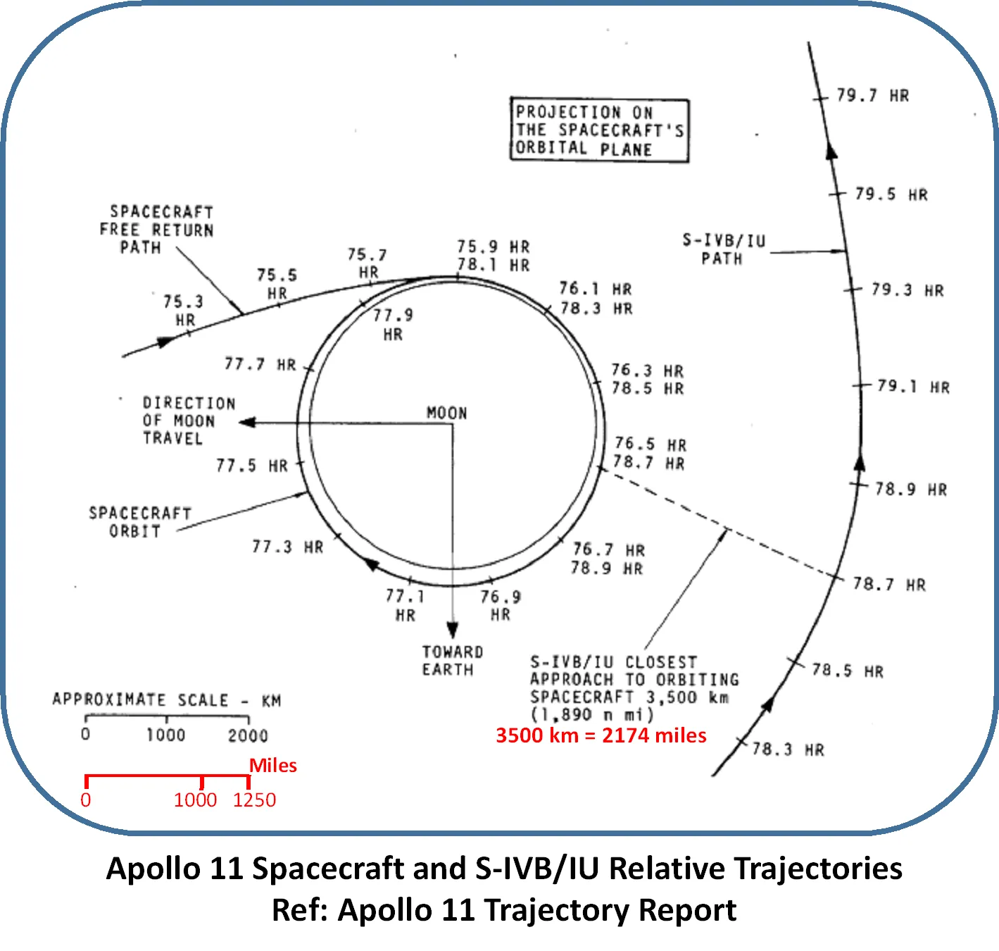

The figure at the right shows the trajectory of the **Apollo 11 Spacecraft** and the **<u>successful</u> Slingshot** trajectory of the **S-IVB/IU** in the vicinity of the Moon. The figure shows how the Moon’s gravity and motion altered the path of the **S-IVB/IU** as it passed near the Moon.

***The tick marks \[e.g., XX.X HR\] are the number of Hours from Launch for the respective item.***

By the time the S-IVB/IU reached its closest point to the Moon at 78.7 Hours, the Apollo 11 Spacecraft had already completed about 1½ orbits of the Moon.

Ref: Apollo/Saturn V Postflight Trajectory – AS-506 … Oct. 6, 1969

Doc: D5-15560-6 … Boeing Company, Space Division

**\**

**Appendix 3 … S-IVB/IU Slingshot & Lunar Impact Maneuvers Compared**

The chart below shows the velocity changes for the **Apollo 11, 12, and 13 S-IVB/IU**. At the time of the velocity changes, the S-IVB/IU was traveling ~10,000 miles per hour. The chart shows that small S-IVB/IU velocity changes have dramatically different results:

- Slow the S-IVB/IU less than ~12 miles per hour and it will follow the Spacecraft past the *<u>leading edge</u>* of the Moon and enter a large **orbit about the Earth** \[**EARTH CAPTURE**\].

<!-- -->

- Slow the S-IVB/IU between ~12 and ~57 miles per hour and it will **impact** the Moon \[**LUNAR IMPACT**\].

- Slow the S-IVB/IU between ~58 and ~82 miles per hour and it will be **Slingshot** into Solar Orbit \[**EARTH-MOON ESCAPE**\].

- Slow the S-IVB/IU more than ~82 miles per hour and it will pass too far from the *<u>trailing edge</u>* of the Moon and enter a large **orbit about the Earth** \[**EARTH CAPTURE**\] <u>instead</u> of going into **Solar Orbit**.

> *The above chart with the Apollo 11 data point was taken from the MSFC “Saturn V Launch Vehicle Flight Evaluation Report AS-506 Apollo 11 Mission” located at:*
>
> ***<https://archive.org/details/nasa_techdoc_19900066485>.***
>
> *The Apollo 12 and 13 data points were taken from the respective AS-507 and AS-508 MSFC Flight Evaluation and Trajectory Reports. These reports are available from several sources on the Internet. For example, search for ‘AS-507 Flight Evaluation Report’.*

**\**

**Appendix 4 … Apollo 11 & 12 Slingshot Trajectory Velocities**

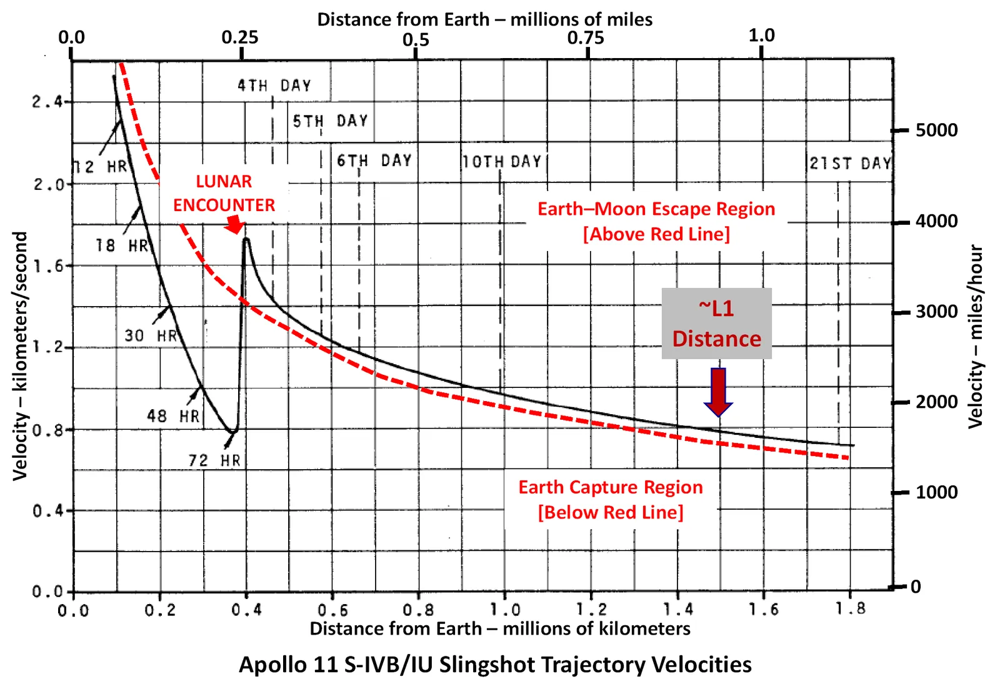**<u>Apollo 11 Slingshot Velocities</u>**

Ref: Apollo/Saturn V Postflight Trajectory – AS-506 … Oct. 6, 1969

Doc: D5-15560-6 … Boeing Company, Space Division

For a successful **Slingshot** to Solar Orbit, the S-IVB/IU had to pass within ~2000 miles of the Moon’s trailing edge to gain sufficient **gravity assist** to achieve a Solar Orbit. The S-IVB/IU and Spacecraft were traveling 24,500 miles per hour at S-IVB second burn cutoff. However, the vehicles were still in the Earth’s gravitational field and were slowing rapidly. At the time of the Slingshot Maneuver \[~5 Hours GET\] the **Apollo 11 S-IVB/IU** had slowed to ~10,000 miles per hour. The figure at the right shows the **Apollo 11 S-IVB/IU** velocity as it traveled outbound from Earth. As the vehicle approached the Moon, the Moon’s gravitational effect sharply increased the S-IVB/IU velocity during the period labeled **Lunar Encounter** about 72 hours after launch.

Following the Lunar Encounter, the vehicle velocity began to decrease again due primarily to the Earth’s gravitational influence. Beyond the **LaGrange L1 Point** distance (~932,000 miles from Earth), the vehicle was effectively orbiting the Sun; the Earth-Moon effects were minimal after that.

The **dashed red line** in the figure is the demarcation of velocities between escaping to Solar Orbit and remaining in an Earth Orbit. The Moon’s gravity assist gained during the **Lunar Encounter** increased the **Apollo 11 S-IVB/IU** velocity **above** the dashed red line and into the **Earth-Moon Escape Region** of the curve thereby assuring that it would go into Solar Orbit.

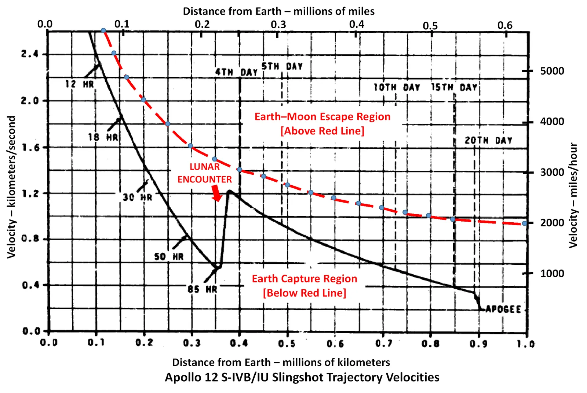**<u>Apollo 12 Slingshot Velocities</u>**

Ref: Saturn V Launch Vehicle Flight Evaluation Report – AS-507

Apollo 12 Mission … January 30, 1970

MSFC Saturn Flight Evaluation Working Group

The velocity history of the **Apollo 12 S-IVB/IU** shows why it’s Slingshot was unsuccessful. The extra Ullage Burn slowed the S-IVB/IU too much causing it to pass too far from the Moon at the **Lunar Encounter.** As a result it **<u>did not</u>** gain sufficient Moon gravity assist velocity to put it above the dashed red line and into the **Earth-Moon Escape Region**. As a result, the **Apollo 12 S-IVB/IU** went into a large ~42 day orbit around the Earth reaching its highest point ~550,000 miles above Earth \[**Apogee**\] ~20 days after launch.

**\
Appendix 5A … LaGrange Points**

LaGrange points are located relative to any two large orbiting bodies in space; mathematically they are **points** but their effects cover **regions** in space. The five **LaGrange Points** about the Earth-Sun system are numbered **L1** through **L5** in the figure:

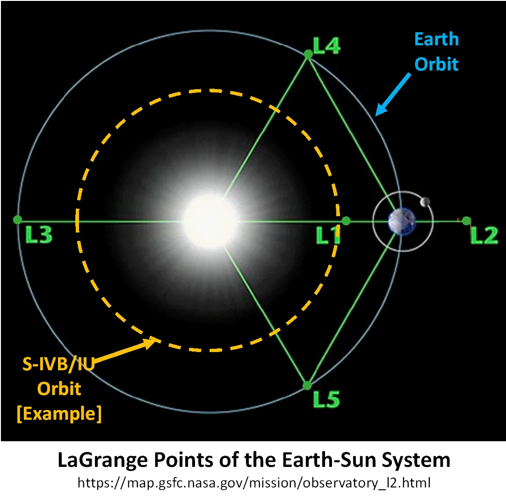

- **L1** is on the Earth-Sun line ~932,000 miles from Earth toward the Sun. At this point the Sun and Earth gravities are equal pulling in **opposite** directions.

- **L2** is on the Earth-Sun line ~932,000 miles from Earth opposite the Sun’s direction. At this point the Sun and Earth gravities are equal and pull in the **same** direction.

- **L3** is on the Earth-Sun line but opposite the Sun from Earth. L3 is of little practical use except in science fiction movies as the location of **Planet X** that is always hidden from Earth by the Sun.

- **L4** and **L5** form the apex of two equilateral triangles with the Sun and Earth at their other two vertices.

LaGrange Points are not simply mathematical peculiarities*.* Satellites are presently orbiting L1 and L2 *meaning they <u>are orbiting points in space instead of a planet</u>.* Orbits about the L1 and L2 points are unstable and require that the orbiting satellites execute periodic corrective \[thrusting\] actions. A sun observing satellite at L1 can always see the Sun. Similarly deep space observing satellites orbiting the L2 Point can always look into deep space \[never toward the Sun\]. Furthermore, since the L1 and L2 Points orbit the Sun in lock step with the Earth, satellites orbiting these points can always see and, therefore can always communicate with Earth

Points L4 and L5 require two very large orbiting masses to have much relevance. For example, it has been observed that small interplanetary debris has accumulated near the L4 and L5 points of the Jupiter-Sun system.

***Appendix 5B … LaGrange L2 Point and the James Webb Telescope***

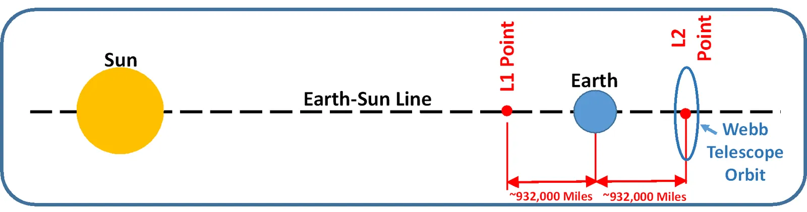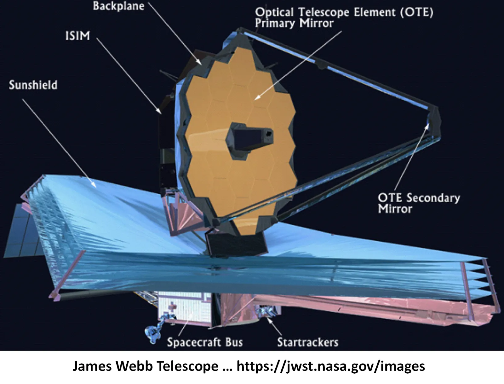*The **James Webb Telescope** orbits the LaGrange L2 Point in an orbit **<u>perpendicular</u>** to the Earth-Sun line called a **Halo Orbit**. This orbit allows the super sensitive Far-Infrared Telescope to always point toward deep space and <u>never</u> toward the Sun, Earth, or Moon. Conversely, its communications antenna will always point toward the Earth.*

*The Webb Telescope Halo Orbit measures ~930,000 by ~230,000 miles and takes about six months to complete one orbit. The orbit is unstable and requires a small corrective boost every ~23 days to remain in orbit.*

> *Webb Telescope Launch & Deployment video* … https://www.youtube.com/watch?v=v6ihVeEoUdo

**Appendix 6: September 20, 2002 comments regarding J002E3**

**\[J002E3 is the Apollo 12 S-IVB/IU *Space Junk* number\]**

**Dr. Steve Chesley and Dr. Paul Chodas\
NASA's JPL Near-Earth Object Program Office**

**The following text is from website:**

[**https://cneos.jpl.nasa.gov/news/news134.html**](https://cneos.jpl.nasa.gov/news/news134.html)

*The object, named **J002E3**, was discovered Sept. 3 by Canadian amateur astronomer Bill Yeung, observing from El Centro, Calif. More precise orbital calculations made possible from a second week of positional observations have nearly ruled out any chance the object will hit the Moon or enter Earth's atmosphere before it departs Earth orbit, Chodas said. Calculations made about a week after the discovery left higher impact possibilities, but now the chances of impact are less than 1 percent at either the Moon or Earth, and a third week of observations will likely push the odds to zero. The object is too small to be considered hazardous, in any case.\
\
More than 100 measurements of the object's position have now been reported from more than a dozen amateur astronomers, said JPL's Dr. Steven Chesley. The two weeks of movement tracked by those observations make up about a sixth of one orbit around Earth. Scientists can extrapolate the object's path for years into the future and years into the past from that short arc. "The observations coming in are from a loosely organized network of dedicated amateur observers. Their data have been vital in determining this object's past and future paths," Chesley said.\
\
The object escaped from Earth orbit in March 1971, Chodas said. That fits its most likely identity as the third stage of the Saturn rocket that took Apollo 12 astronauts to the Moon in November 1969. The 18-meter-long (60-foot-long) third stage was last seen in an elongated 43-day orbit around Earth, not much different from J002E3's current orbit. It probably completed nine or 10 Earth orbits, then swung far enough toward the Sun to be pulled into a Sun-centered orbit, he said. The transition happened through a special "portal" located at the L1 Lagrangian point, where the gravitational pulls of the Sun and Earth are approximately equal.\
\
Analysis this week by researchers from the University of Arizona, Tucson, and the Massachusetts Institute of Technology, Cambridge, suggests that J002E3's surface is white paint rather than more asteroid-like material. If it is not from the Apollo 12 rocket, some less likely possibilities are one of the four 7-meter-long (22-foot-long) panels that enclosed lunar modules from six Apollo missions or rocket stages from Soviet or U.S. unmanned lunar missions. Those are less likely because they seem too small to match the object's observed brightness, and they are not known to have been left in orbits that could have escaped Earth. Additional observations in coming weeks may pin down the identification.\
\
After J002E3 escaped Earth's gravity in 1971, it raced Earth in circles around the Sun, but it had an inner lane, so it completed 33 solar orbits in the time it took Earth to complete 31. In 1986, the object lapped Earth on the inside, too far away to be snagged by Earth's gravity. This year, it was about to lap Earth again but passed too close to the L1 portal and Earth captured it.\
\
The transition between Earth-centered dynamics and Sun-centered dynamics has been understood theoretically for years and has been used for designing orbits of some spacecraft, but this is the first time a capture into Earth orbit has been confirmed, Chodas said. Comet Shoemaker-Levy 9, which struck Jupiter in 1994, made this kind of transition into Jupiter's orbit several decades earlier. NASA's Genesis spacecraft, currently collecting samples of solar-wind material near the **L1 point**, will use a similar maneuver for a low-energy return to Earth with the samples in 2004.\
\
Earth won't have seen the last of J002E3 when this peripatetic bit of space junk escapes after its sixth orbit in mid-2003. It will shift from solar orbit to Earth orbit again in decades ahead. "This type of orbit can't last very long," Chodas said. "That's one reason it would be very unlikely to find an asteroid with an orbit like this." Within several thousand years, the object will likely end its travels by hitting the Moon or Earth. That is not cause for concern, though. Five rocket stages like the Apollo 12 third stage were crashed into the Moon intentionally as part of seismic research, and several others harmlessly disintegrated when they re-entered Earth's atmosphere.\
\
Images of J002E3's calculated path are available at [http://neo.jpl.nasa.gov](http://neo.jpl.nasa.gov/).\
\
JPL, a division of the California Institute of Technology in Pasadena, manages the Near-Earth Object Program for NASA's Office of Space Science, Washington, D.C.*

**Appendix 7: Updated J002E3 JPL Comments … October 11, 2002:**

**Dr. Steve Chesley and Dr. Paul Chodas\
NASA's JPL Near-Earth Object Program Office**

**The following text is from website:**

> **http://www.spaceref.com/news/viewpr.html?pid=9497**

*We have new results since our September 19 report on the distant Earth satellite J002E3. Evidence continues to accumulate that J002E3 is the lost S-IVB third stage from the Saturn V rocket used to launch the Apollo 12 lunar landing mission in November 1969.*

*J002E3 passed into the daytime morning sky around Sept. 24, and a week later amateur astronomers Richard Fredrick and Vance Morgan at Powell Observatory in Kansas recovered the object after it had crossed into the evening sky. However, their measurements did not match the predicted position unless we added a gentle push from solar radiation pressure to our acceleration model. As more observations were reported over the next few days, it became clear, not only that radiation pressure was detectable in the motion of the body, confirming that J002E3 is a man-made object, but also that the size of this acceleration matches very well with what we would expect for an S-IVB.*

*With the quality of our orbital solution improving, we decided to look to see if this relatively bright object had been detected by other telescopes before its discovery in the first week of September. Indeed, using the SkyMorph online search system, we found a single trail from the fast-moving object on an image taken by the NEAT-Palomar NEO survey on June 16, 2002. After we notified him of the detection, Reiner Stoss of DANEOPS \[<http://earn.dlr.de/daneops/>\] immediately measured the precise position for us.*

*The new precovery data extended the arc of observations from 35 days to 114 days, dramatically improving our ability to determine the past and future paths of this object and to measure the acceleration of solar radiation pressure. At our last report we had only 15 days of observations and there was greater uncertainty about what the future held for J002E3. We were not sure how long it would remain in the Earth's vicinity, although it appeared likely to escape next June. We could not even rule out the possibility of a collision with the Earth or Moon over the next year. It is now certain that J002E3 will depart the Earth-Moon system in June 2003 and that there is no possibility of an impact for several decades. In the years ahead J002E3 may be recaptured, but the first opportunity for this will not be until the mid-2040s.*

*Looking into the past, we are still unable to connect the motion of J002E3 with the last know position of the Apollo 12 S-IVB. One reason is that the solar radiation pressure is not constant in time, but rather changes with its position around the sun; to precisely account for this effect we need to know the pole of rotation. Furthermore, if J002E3 is the Apollo 12 S-IVB then that stage spent more than a year in a highly chaotic orbit around the Earth. So far these two factors have combined to prevent us from predicting the position of J002E3 with sufficient precision to definitively link these two objects. Nonetheless, we are hopeful that with continued observations, and with the possibility of additional observations, this link can be conclusively established before J002E3 slips back into solar orbit next summer.*

**===================================================**

**=== REFERENCES ===**

**References 1: Apollo & Saturn Number Designations**

***<u>Apollo Mission Number</u>:** The most commonly used Apollo/Saturn flight reference, e.g., Apollo 4, Apollo 11, Apollo 13, etc. Some were unmanned test missions and others were manned missions.*

***<u>Space Vehicle</u>:** The entire vehicle including the **Saturn V Launch Vehicle** and the **Spacecraft** \[Ref: Page 3\].*

> ***Apollo/Saturn V Space Vehicles:** Designated with the **AS-5xx** prefix: AS-501 thru AS-512.*
>
> ***Apollo/Saturn IB Space Vehicles** were designated with the **AS-2xx** prefix: AS-201, etc.*

***<u>Launch Vehicle</u>:** **Saturn Launch Vehicle** references generally used the **Saturn/Apollo \[SA-xxx\]** prefix \[Ref: Page 3\].*

> ***Saturn V Launch Vehicles:** Designated with the **Saturn/Apollo-5xx** prefix: e.g., SA-501 thru SA-512.*
>
> ***Saturn IB Launch Vehicles:** Designated with the **Saturn/Apollo-2xx** prefix: e.g., SA-201, 206, 207, 208.*
>
> *Note the subtle difference between the <u>Space Vehicle</u> and the <u>Launch Vehicle</u> designations.*

*Website [**https://history.nasa.gov/SP-4029/Apollo_18-10_Designations.htm**](https://history.nasa.gov/SP-4029/Apollo_18-10_Designations.htm) contains a more complete set of the Saturn Launch Vehicle and Apollo Spacecraft designations.*

***<u>Skylab Missions</u>:** Four Mission Numbers were used for Skylab:*

***Skylab** … The unmanned Skylab Space Station was launched into Earth orbit using the **S-IC and S-II Stages** of the Saturn V originally designated for the cancelled Apollo 20 Mission. In place of the S-IVB third stage was the Skylab Space Station. Skylab was constructed from what would have been a Saturn S-IB Second Stage \[S-IVB-212\]. The crew living quarters were constructed inside what would have been the S-IVB-212 Liquid Hydrogen Tank.*

***Skylab 1, Skylab 2, & Skylab 3:** These were the three manned Skylab missions. These Apollo CSM Spacecraft were launched by Saturn IB Launch Vehicles: SA-206, SA-207, and SA-208, respectively.*

**\**

**References 2: Apollo & Saturn Reference Materials**

- **<u>SATURN & APOLLO REFERENCES</u>**

- **Stages to Saturn** by Roger E. Bilstein. NASA History Office, Publication SP-4206. Original date 1980.

  - Technological history of the development and manufacturing of each Saturn Launch Vehicle stage.

  - Viewable at <http://history.nasa.gov/SP-4206/sp4206.htm>. **Good History & Technical Reference!**

- **Saturn V Flight Manuals** … NASA MSFC-MAN-503 and MSFC-MAN-507.

  - Marshall Space Flight Center Manuals for the AS-503 & AS-507 Saturn V Launch Vehicles. Gives detailed technical discussion of each booster stage used for the AS-503 & AS-507 configurations.

  - AS-503 \[Apollo 8\] Manual Viewable at “history.nasa.gov/ap08fj/pdf/sa503-flightmanual.pdf”.

  - AS-507 \[Apollo 12\] Manual Viewable at “history.nasa.gov/ap12fj/pdf/a12_sa507-flightmanual.pdf”.

- **SATURN** by Alan Laurie. Apogee Books, Burlington Ontario, Canada. Published 2005.

  - **Excellent technical reference for the Saturn Booster test and flight stages!**

- **The Saturn V F-1 Engine** by Anthony Young. Praxis Publishing, Ltd, Chichester, UK. Published 2009.

  - Detailed technical development information for the F-1 Engine used on the Saturn V S-IC first stage.

<!-- -->

- **Apollo by the Numbers – A Statistical Reference** by Richard W. Orloff of NASA History Division. Ross & Perry, Inc., Washington D.C. Published 2001.

<!-- -->

- **Excellent descriptive and detailed statistical reference for all manned Apollo missions!**

<!-- -->

- **Carrying the Fire** by Michael Collins. Farrar, Strauss, & Giroux, New York. Originally published 1974.

<!-- -->

- Personal history and recollections of Apollo 11 Command Module Pilot Astronaut Michael Collins.

- **Excellent writer and observer make this a most interesting and enjoyable read.**

<!-- -->

- **Liftoff, America’s Adventure in Space** by Michael Collins. Grove Press, New York. Published 1988.

<!-- -->

- Overview of America’s Space Programs from 1946 until 1986.

**<u>SPECIAL TOPIC</u>**

- **Project MARS … A Technical Tale** by Wernher von Braun. Apogee Books, Burlington, Ontario, Canada. Published 2006.

  - Von Braun’s late 1940’s vision of what a mission to Mars might be like. Contains technical information that makes for very interesting comparisons with today’s technology. Adds a note of science fiction when human like beings are found living underground on Mars.

**=== LAST PAGE===**
