**Apollo 12 Saturn Instrument Unit**

**S-Band Communications Loss**

**During Translunar Coast**

***Example of the Post-Flight analyses of an In-Flight problem***

**Prepared by Luke Talley**

**USSRC Docent Emeritus**

**September 15, 2024 Rev 10B**

**===========================**

*<u>**Personal Note:**</u>*

*It was my privilege to work on the Saturn Instrument Unit \[IU\]. I worked in the IBM IU Flight Evaluation Department where for each mission we: (1) provided prelaunch and inflight mission support, (2) evaluated the inflight telemetered data, (3) identified inflight problems, (4) worked with engineering groups to resolve inflight problems, and (5) reviewed mission objectives affecting the IU and prepared necessary computer analysis programs for upcoming Saturn flights. I am presently \[2024\] a U.S. Space and Rocket Center NASA Docent Emeritus volunteer at the Saturn V and Saturn Instrument Unit exhibits in the Davidson Center.*

*This is a <u>technical overview</u> of the post-flight analyses of failures of the Instrument Unit Command and Communications System \[CCS\] during the Apollo 12 Mission. About 5½ hours into the mission, signals transmitted over particular CCS Antennas stopped being received by the ground stations. Then, about 7½ hours into the mission, Mission Control commands transmitted to the IU stopped being received by the onboard CCS electronics.*

*The analyses and resolution of the inflight problems were conducted “1970’s Style”. We had a few computer based tools but most of the effort was a bunch of engineers and technicians applying their knowledge, background, and ‘hunches’ toward resolving the problem at hand. Speaking of ‘at hand’ our received telemetered data was presented to us as a lot of numbers on many sheets of printout which we plotted ‘by hand’ \[some examples are included\]. The corrective measures implemented to prevent similar failures on the Apollo 13 through 17 Missions are outlined.*

*Many of the quoted numbers are representative of a typical Saturn vehicle and/or mission. Some numbers \[burn times, ranges, velocities, timings, etc.\] were specific mission dependent. The book <u>Apollo by the Numbers – A Statistical Reference</u> by Orloff listed in the References section at the end of this document is an excellent source of precise vehicle and mission specific quantities.*

*Regards,*

*Luke Talley*

**===========================**

**\**

**Apollo/Saturn Designations**

**These Saturn V Launch Vehicle and Spacecraft acronyms are used throughout this document.**

The **Apollo/Saturn** **Space Vehicle** was 363 feet long consisting of the 281 foot long **Saturn V Launch Vehicle** and the 82 foot long **Spacecraft**.

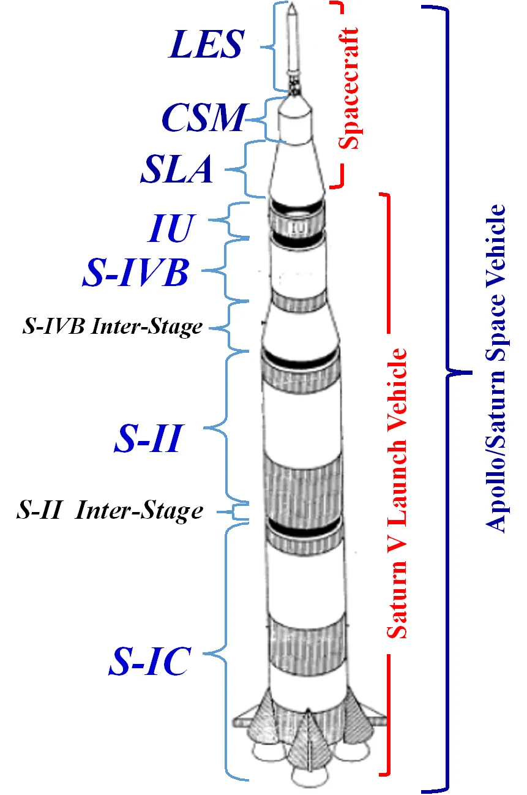

The **Saturn V Launch Vehicle** consisted of three **propulsion stages** \[**S-IC**, **S-II**, and **S-IVB\]**, two **interstages** \[**S-IC to S-II and S-II to S-IVB**\], and one **Instrument Unit** \[**IU**\].

**Marshall Spaceflight Center \[MSFC\]** in Huntsville managed the development and production of the **Saturn V Launch Vehicle**.

The **Spacecraft** consisted of the **Command Module \[CM\]**, **Service Module \[SM\]**, **Lunar Module \[LM\]**, **Spacecraft Lunar Module Adapter \[SLA\]**, and the **Launch Escape System \[LES\]**.

The SLA with the LM located inside sat atop the IU. The SM sat atop the SLA with the CM atop the SM.

The **Command and Service Module** remained together as the **CSM** until just prior to Earth’s atmospheric re-entry at mission’s end. The SM was jettisoned just prior to re-entry and only the CM with the Astronauts onboard returned to Earth.

The three Astronauts spent most of their time in the Command Module. Two Astronauts were aboard the Lunar Module during the Lunar Landing while one Astronaut remained in the Command Module in Lunar Orbit.

The LES atop the CM included a conical protection cover over the CM. If an abort had occurred during the S-IC Stage burn, the LES solid rocket motor would have fired and pulled the CM free of the Saturn V. Afterwards, the LES would have been jettisoned followed by the CM parachuting into the Atlantic. Luckily this never happened and during all flights the LES and its conical protective CM cover were jettisoned early in the S-II Stage burn.

**Johnson Space Center \[JSC\]** in Houston managed the development, production, and inflight operations of the ***Spacecraft*** \[CM, SM, LM, and the LES\]. **Mission Control** at JSC provided primary control of the mission once the vehicle cleared the Launch Tower and played an important role in the following discussions.

***Apollo/Saturn <u>Number</u> Designations***

*The Apollo/Saturn flights are most commonly referenced by their **Apollo Mission Number**, for example Apollo 4, Apollo 11, Apollo 13, etc. Following are examples of some other, and sometimes confusing, numbering schemes that are often found in technical references.*

***Apollo/Saturn Space Vehicle:** The entire vehicle including the Saturn V Launch Vehicle, the Spacecraft, and the Launch Escape Tower.*

> *The **Apollo/Saturn V Space Vehicles** used the **AS-5xx** prefix: AS-501 through AS-512.*
>
> *The **Apollo/Saturn IB Space Vehicles** used the **AS-2xx** prefix: AS-201, AS-202, etc.*

***Launch Vehicle:** The **Saturn V Launch Vehicles** sometimes used a **Saturn/Apollo \[SA-5xx\]** prefix, e.g., SA-501 through SA-512. Note the subtle difference between the <u>Space Vehicle</u> and the <u>Launch Vehicle</u> designations, **AS** vs **SA** prefixes, respectively. The “SA” prefix was used less often than the more common “AS” prefix.*

> *The Apollo 12 Saturn Launch Vehicle was designated SA-507. The S-IC and S-II Stages were assigned numbers S-IC-7 and S-II-7. Since S-IVBs and IUs were used on Saturn IB and Saturn V Launch Vehicles, they were designated using their respective Launch Vehicle identifiers. For Apollo 12 these were S-IVB-507 and S-IU-507.*

*The Saturn IB Launch Vehicles were designated with the **SA-2xx** prefix, e.g., SA-201.*

***Apollo Mission Number \[ApolloX**\] was the most commonly used reference:*

> *Apollo 1 … Saturn IB \[AS-204\] CM destroyed in on-pad fire. Was to have been the first manned test of the Apollo CM. Saturn IB AS-204 was later used on the Apollo 5 mission.*
>
> *Apollo 2 & 3 … Numbers NOT used due to program redirection after the Apollo 1 fire*
>
> *Apollo 4 … Saturn V \[AS-501\] First Saturn V & unmanned CSM qualification mission*
>
> *Apollo 5 … Saturn IB \[AS-204\] Unmanned test of Lunar Module in Earth orbit*
>
> *Apollo 6 … Saturn V \[AS-502\] Final Saturn V & unmanned CSM qualification mission*
>
> *Apollo 7 … Saturn IB \[AS-205\] First manned test of CSM in Earth orbit*
>
> *Apollo 8 … Saturn V \[AS-503\] Manned CSM flight to Lunar orbit*
>
> *Apollo 9 … Saturn V \[AS-504\] Manned CSM/LM flight to qualify LM in Lunar orbit*
>
> *Apollo 10 … Saturn V \[AS-505\] Manned CSM/LM flight to “rehearse” Lunar landing*
>
> *Apollo 11 … Saturn V \[AS-506\] Manned CSM/LM for First Lunar landing*
>
> *Apollo 12 … Saturn V \[AS-507\] Manned CSM/LM for Second Lunar landing*
>
> *Apollo 13 … Saturn V \[AS-508\] Manned CSM/LM aborted Lunar landing mission.*
>
> *Apollo 14 thru 17 … Saturn V \[AS-509 thru AS-512\] Manned CSM/LM Lunar landings.*

*NASA Website [**https://history.nasa.gov/SP-4029/Apollo_18-10_Designations.htm**](https://history.nasa.gov/SP-4029/Apollo_18-10_Designations.htm) contains a more complete set of the designations as they related to the Saturn Launch Vehicles and Apollo Spacecraft.*

**Background Information**

> ***NOTE**: Guests at the Space and Rocket Center often ask if the Instrument Unit \[IU\] remains attached to the S-IVB Stage or are the two separated at some point late in the mission. The Instrument Unit is mounted on top of the S-IVB Stage on the Launch Pad within the VAB at Kennedy Space Center and remain so attached thereafter. There are no provisions for their inflight separation. In the following, “S-IVB/IU” implies this attached configuration.*

Following their separation from the spacecraft on the Apollo 11 and 12 missions, the S-IVB and Instrument Unit \[S-IVB/IU\] were placed on a trajectory past the trailing edge of the Moon. Passing within ~2,000 miles of the Moon, the “**Gravity Assist**” of the Moon’s gravitational attraction and the Moon’s orbital velocity about the Earth would “**Slingshot**” the S-IVB/IU into orbit about the Sun \[**Solar Orbits**\].

A Mission Objective of the Apollo 11 and 12 S-IVB/IU post separation mission was to demonstrate that the Earth Ground Stations could successfully receive the **IU Command and Communications System \[CCS\]** signals from the Earth-Moon distance.

> *The **CCS** transmitted in the **S-Band** **\[2,200 megahertz\]** Radio Frequency range.*

These CCS tests were conducted in preparation for purposefully crashing the Apollo 13 thru 17 S-IVB/IUs into the Moon. Seismometers left on the Moon by the Astronauts beginning with Apollo 12 would sense the S-IVB/IU lunar impacts and transmit the seismic data to Earth for scientific investigations into the composition of the Moon’s interior \[Reference Appendix 1\]. An extra **Battery** was included on the IU for Apollo Missions 11 through 17 to power only the IU CCS Transponders and Transmitters for the **~80 hours** required to track the S-IVB/IU to the Earth-Moon distance. So, when the **IU S-Band CCS** systems quit transmitting, the S-IVB/IU would have impacted the Moon.

> ***However**, several hours after the Spacecraft separated from the S-IVB/IU on <u>both</u> the Apollo 11 and Apollo 12 missions, the Ground Stations ceased receiving the IU S-Band transmitted signals; these signal losses occurred long before the S-IVB/IUs would have ever reached the Earth-Moon distance**.***

This document includes some technical details of the investigation into the cause of the Apollo 12 IU S-Band signal losses and the corrective action that resulted in the successful track to Lunar Impact of the IU S-Band CCS signals on subsequent Apollo missions. A brief outline of the Apollo 11 CCS problem is included for completeness.

**Apollo 11/AS-506 IU S-Band Loss Summary**

The Apollo 11/AS-506 mission S-IC, S-II, and S-IVB stage burns to Earth Orbit and the S-IVB **Translunar Burn** were all normal with **Translunar Injection \[TLI\]** occurring at ***2:50:13 GET***.

**2:50:13 GET = 2 Hours 50 Minutes 13 Seconds Ground Elapsed Time \[Time from Launch\]**

The subsequent ***Spacecraft Separation***, ***Evasive***, ***Slingshot***, and ***Communication Maneuvers*** all proceeded normally.

At **8:24 GET** \[8 Hours 24 Minutes\] the Ground Stations began receiving erratic **S-Band** signals transmitted through the IU **High-Gain Directional Transmit Antenna**.

At **9:23 GET** Mission Control commanded the IU Computer to switch to the **Omni-Directional Transmit Antennas** which restored reception of the **S-Band** signal by the Ground Stations. A subsequent command to switch to the **Low-Gain Directional Transmit Antenna** again resulted in IU **S-Band** signal loss at the Ground Station.

At **9:35 GET** Mission Control commanded the IU Computer to switch back to the **Omni-Directional Transmit Antennas** again restoring the S-Band signals at the Ground Station.

At **9:46 GET** the Ground Stations experienced complete loss of the **S-Band** signal from the IU and it was ***never*** recovered thereafter regardless of the selected antenna.

> *This S-Band signal loss prevented meeting the **Mission Objective of tracking the Apollo 11 IU S-Band Signal to Lunar Distance.***

Post-flight analyses of the Apollo 11 IU telemetry data and several IBM lab tests indicated that the IU **S-Band Coaxial Switch** was the possible cause of the S-Band issues. Since the **Coaxial Switch** was common to all three CCS Antennas and the lab tests had shown (1) that the switch was sensitive to the vibration levels experienced during the Saturn V launch and (2) that leaks in the hermetically sealed switch housing could lead to electrical arcs within the switch producing signal attenuations and dropouts similar to those seen during the flight.

> *The Coaxial Switch used on the Apollo 11 IU and earlier flights was a derivative of a switch used on the Air Force B-52 Bomber.*

A newly designed and qualified **Coaxial Switch** was to fly on the Apollo 12 and subsequent Instrument Units so no further actions were taken.

**Apollo 12/AS-507 Saturn V Mission Overview**

**<u>Launch to Orbit</u>**

The Apollo 12/AS-507 launch to orbit <u>was to be</u> similar to the Apollo 11 mission. However, Apollo 12 was launched into a rain storm and was *struck by lightning* at 36.5 and again at 52 seconds after launch. As a result of the lightning strikes, the Service Module fuel cells disconnected causing loss of AC power to the Command Module accompanied by many Command Module Caution and Warning alarms.

At the time of the lightning strikes, the Saturn booster was being controlled by the Instrument Unit \[IU\] Computer System. Except for brief interruptions of telemetry downlink transmissions, the IU and the rocket stages were unaffected by the strikes and the Saturn V continued to operate normally. The Astronauts were able to restore Command Module AC power and luckily there was no permanent damage to the Command Module.

In spite of the lightning strikes, the Saturn S-IC, S-II, and S-IVB stages launched the S-IVB/IU and Spacecraft into the planned Earth orbit. While coasting for about 1½ Earth orbits, the S-IVB/IU, Spacecraft, and Astronauts were checked to insure they were ready to proceed to the Moon. During this coasting period, Mission Control transmitted updates to the IU Computer System via the IU **S-Band CCS**.

**<u>Translunar Burn</u>**

When the vehicle position in Earth orbit intersected \[approximately\] the plane of the Moon’s orbit, the **S-IVB Engine** was reignited to boost the S-IVB/IU and Spacecraft out of its Earth orbit plane and into the plane of the Moon’s orbit about the Earth. The S-IVB **Translunar** **Burn** increased the vehicle velocity to ~24,500 miles per hour. **Translunar Injection \[TLI\]** occurred ten seconds after S-IVB engine second burn cutoff at ***2:53:14 GET***.

> ***2:53:14 GET = 2 Hours 53 Minutes 14 Seconds Ground Elapsed Time \[Time from Launch\]***

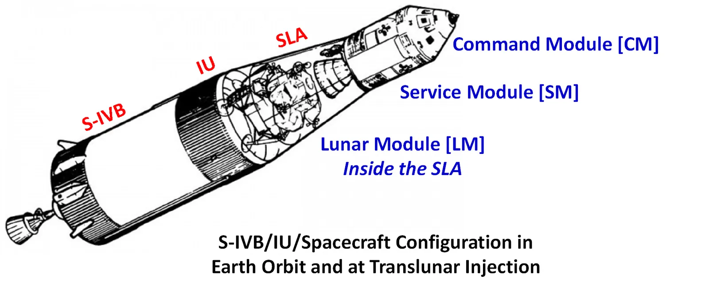

**<u>CSM Separation and LM Docking</u>**

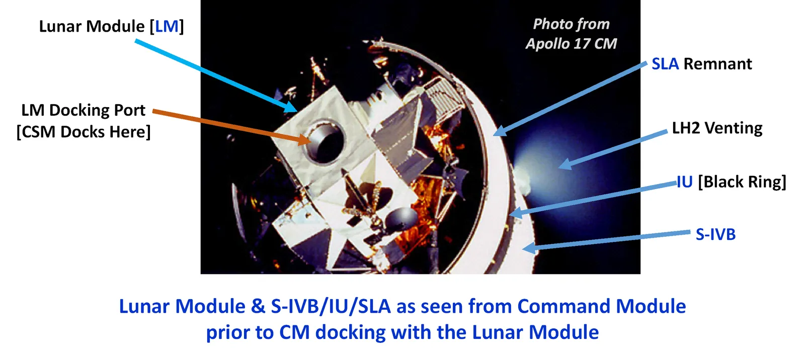At **3:08:05 GET** the IU Computer System maneuvered the vehicle to the **Transposition, Docking, & Extraction \[TD&E\]** attitude necessary to place sunlight on areas needed for Astronaut viewing during docking with the LM. The CSM separated from the S-IVB/IU/SLA at **3:18:05 GET** and, using the **SM Reaction Control System \[RCS\]** thrusters, the CSM moved away from the S-IVB/IU/SLA. As the CSM separated and moved away, four **SLA Panels** comprising the upper ~2/3 of the SLA structure were jettisoned into space. The LM remained attached to the lower ~1/3 of the SLA \[**SLA Remnant**\] with the upper part of the LM \[**LM Ascent Stage**\] extending forward.

The CSM moved about 100 feet away, turned around, and returned to dock with the LM. A **Docking Port** on top of the LM Ascent Stage mated with a docking adapter on the apex of the CM. The CSM docked with the LM at **3:26:53 GET**.

**<u>CSM/LM Separation from S-IVB/IU and the Evasive Maneuver</u>**

The CSM and LM docked together then separated from the S-IVB/IU/SLA at **4:13:00 GET**.

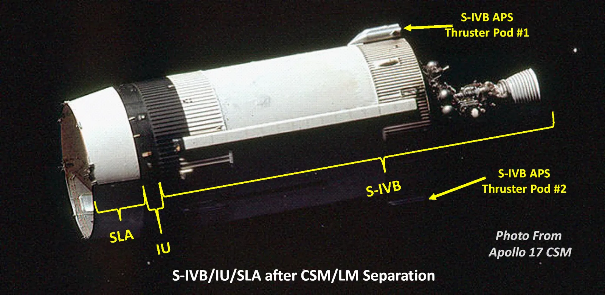

> *Hereafter **S-IVB/IU** implies **S-IVB/IU** includes the lower 1/3 of the **SLA.***

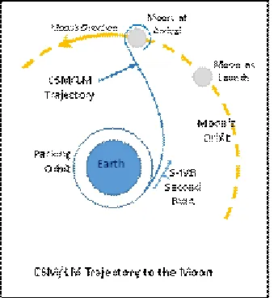Without further velocity changes the S-IVB/IU would follow the Spacecraft past the ***“Leading Edge”*** of the Moon. However, there was also a finite probability that the S-IVB/IU would later ‘collide with’ the Spacecraft. To insure that such a collision would not occur, at **4:28:01 GET** the IU Flight Program executed the **Evasive Maneuver** by firing the **S-IVB APS Thrusters** for 80 seconds to ***slow*** the S-IVB/IU ~**7 miles per hour**. Simultaneously the CSM fired the **SM** **Reaction Control System** thrusters to ***increase*** the CSM/LM velocity **~2 miles per hour**.

> *These small velocity changes resulted in ever increasing distances between the CSM/LM and the S-IVB/IU insuring that the S-IVB/IU would never impact the CSM/LM.*

**<u>S-IVB/IU Slingshot Maneuver</u>**

Following the **Evasive Maneuver**, the IU Flight Program executed the **Slingshot Maneuver** beginning at **4:36:00 GET**. This maneuver further **slowed** the S-IVB/IU to cause it to follow a trajectory past the “***trailing edge***” of the Moon. If the S-IVB/IU passed within 2,000 miles of the Moon’s “trailing edge”, the combination of the Moon’s gravitational attraction and its orbital velocity about the Earth would “**Slingshot**” the S-IVB/IU into a **Solar Orbit** slightly nearer the Sun than that of the Earth.

The S-IVB/IU was further slowed for the Slingshot Maneuver by venting the remaining S-IVB Liquid Oxygen, Liquid Hydrogen, and Helium Tanks followed by a 5-minute burn of the S-IVB APS Thrusters ending at **5:33:43 GET**.

***<u>IU S-Band \[CCS\] Transmitting Antennas \[Overview\]</u>***

> ***NOTE:** This brief IU CCS Antennas description is needed for the following discussion.*

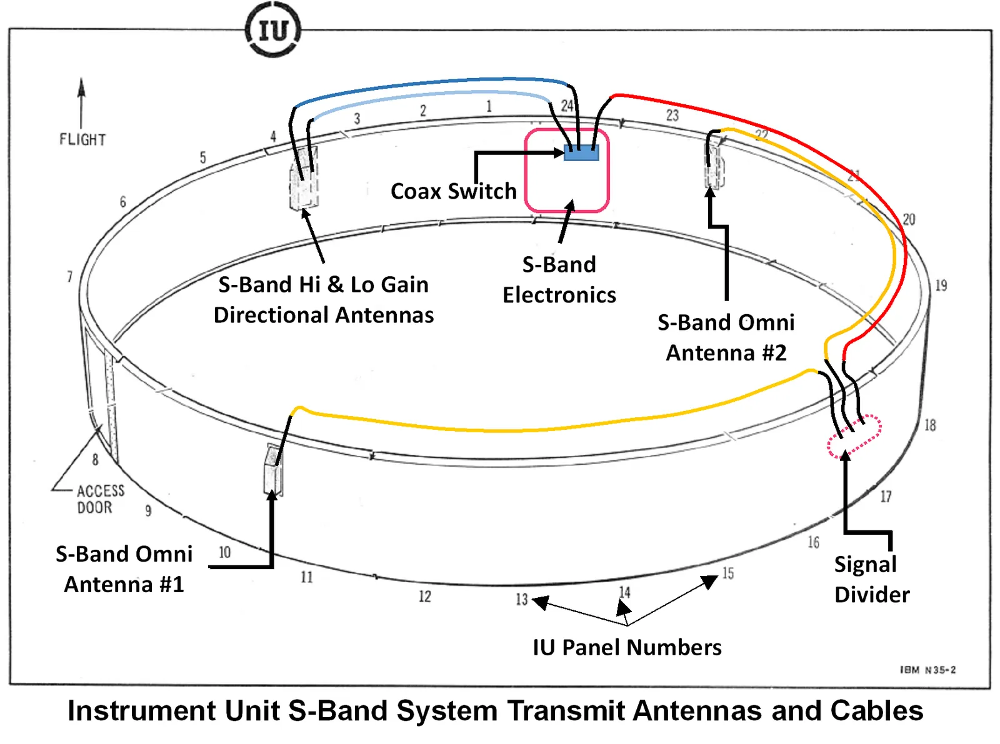The Instrument Unit **S-Band \[~2,200 MHz\]** System had **four <u>Transmit</u> antennas** mounted on the outer IU periphery: a **Low-Gain Directional**, a **High-Gain Directional**, and **two Omni-Directional** antennas.

The High-Gain and Low-Gain Directional Transmit Antennas were in the same housing. The two Omni-Directional Transmit Antennas were located on opposite sides of the IU \[See figure at right\].

Flexible and semi-rigid coaxial cables connected the S-Band Electronics, Coaxial Switch, Signal Divider, and Antennas via the transmit antenna cabling paths shown in the above figure.

**<u>Loss of the S-Band Downlink Signal</u>**

At **5:18:25 GET** while venting the S-IVB Helium Tanks during the *Slingshot Maneuver*, the Goldstone California Ground Station stopped receiving the **IU S-Band** signal. The IU was transmitting through the **S-Band <u>Omni-Directional</u> Transmit Antennas** at the time of the signal loss.

> **IMPORTANT NOTE 1:** *At **5:25:00 GET** Mission Control sent commands to the IU Computer System to switch to the **<u>Low-Gain Directional</u> Transmit Antenna** resulting in the IU S-Band signal again being received by the Ground Stations.*

**<u>S-IVB/IU Velocity Over-Speed</u>**

The **IU <u>C-Band</u> \[~5,000 MHz\] Transponder** provided Mission Control with accurate S-IVB/IU tracking data. Mission Control compared the *<u>C-Band measured</u>* S-IVB/IU velocity and position with the Instrument Unit onboard *<u>computed</u>* velocity and position. If the C-Band *Measured* and the IU *Computed* parameters differed more than pre-specified limits, Mission Control would transmit **Update** commands to the IU Computer System to correct the necessary parameter(s).

At **Translunar Injection** the **C-Band Ground Radar** data was corrupted or otherwise unavailable so Mission Control had <u>only</u> the IU computed velocity. The IU computed velocity data indicated that the vehicle was traveling faster than expected \[an ***over-speed***\]. Because of the **over-speed** indication, Mission Control determined that an additional <u>4½ minute</u> retrograde **S-IVB APS Ullage Thruster** burn was needed to slow the S-IVB/IU an additional <u>25 miles per hour</u> to insure that it would achieve Solar Orbit. Mission Control transmitted the necessary commands to the IU Computer and the S-IVB APS burn was executed from **5:29:13** to **5:33:43 GET.**

**<u>S-IVB/IU Communications Attitude</u>**

At **5:36:37 GET** the IU Flight Program controlled firing the S-IVB APS Thrusters to maneuver the S-IVB/IU to the **Communications Attitude**. While the IU System Batteries lasted, the IU Computer System used the S-IVB APS Thrusters to maintain the **Communications Attitude** keeping the **IU S-Band <u>Low-Gain</u>** and **<u>High-Gain</u> *<u>Directional</u>* Transmit Antennas** pointed toward the Earth.

**<u>Attempts to Recover Omni-Directional Transmit Antenna Operation</u>**

On **five** separate occasions between **5:40:00 and 7:00:00 GET**, Mission Control sent commands to the IU Computer to switch to the **Omni-Directional Transmit Antennas**. Each time the **Omni-Directional Transmit Antennas** were selected, the IU S-Band signal ceased being received by the Ground Stations. After each failed attempt to receive signals transmitted through the **Omni Directional Antennas**, Mission Control commanded the IU back to the **Low-Gain Directional Antenna** and the Ground Stations again began receiving the S-Band signal.

> **IMPORTANT NOTE 2:** *At **7:00:00 GET** Mission Control stopped any further operations using the IU S-Band <u>Omni-Directional Transmit</u> Antennas.*
>
> **IMPORTANT NOTE 3:** *At **7:27:07 GET,** the Instrument Unit stopped <u>receiving</u> any **S-Band <u>Uplink</u> Signals** **<u>from</u>** the Ground Stations thereby preventing Mission Control from sending any further commands to the IU Computer System. The **S-Band Uplink Signals** were received through the **IU S-Band <u>Receiving</u> Antennas** that were different from the **Transmitting Antennas**.*

**<u>Final Loss of the IU S-Band Downlink Signals</u>**

The IU Computer System maneuvered the vehicle to the **Communications Attitude** at **5:37 GET** where it remained until the **IU Primary 28 Volt System Batteries** discharged below their operating voltages at approximately **12 Hours GET.** After loss of battery power the IU Computer System could no longer maintain attitude control of the S-IVB/IU and the vehicle would ultimately develop a random tumbling motion. This tumbling made it <u>necessary</u> for the S-Band System to transmit through the **Omni-Directional Transmit Antennas** for the remainder of the flight to the Moon’s vicinity.

> *Solar radiation pressure on the S-IVB/IU, Earth and Moon gravitational effects, and occasional random and uncontrolled S-IVB Thruster firings caused by the decaying S-IVB and IU battery voltage effects on the thruster control electronics all contributed to the tumbling of the S-IVB/IU.*

When IU Primary Battery Voltages decayed below the level necessary to hold the **Coaxial Switch** in either the **High-Gain** or **Low-Gain Transmit Antenna** positions, the **Coaxial Switch** was spring loaded to automatically revert to the **Omni-Directional Transmit Antenna** position.

> **IMPORTANT NOTE 4:** *At **12:10 GET** the IU Primary Battery Voltage had decayed sufficiently to prevent the **Coaxial Switch** from being electrically held in either the **Lo-Gain** or the **High-Gain** **Directional Transmit Antenna** position. At that time, the **Coaxial Switch** automatically returned to the **Omni-Directional Transmit Antenna** position. All S-Band transmissions through the **Omni-Directional Transmit Antenna** had previously failed at **5:18:25 GET** so this resulted in the **<u>final loss of the S-Band signal</u>** from the Apollo 12 S-IVB/IU.*

***This final loss of the S-Band signal prevented meeting the Mission Objective of tracking the Apollo 12 IU S-Band Signal to Lunar Distance!***

**Analyses of Apollo 12 IU S-Band Signal Loss**

**<u>IU S-Band Command and Communication System \[CCS\] Overview</u>**

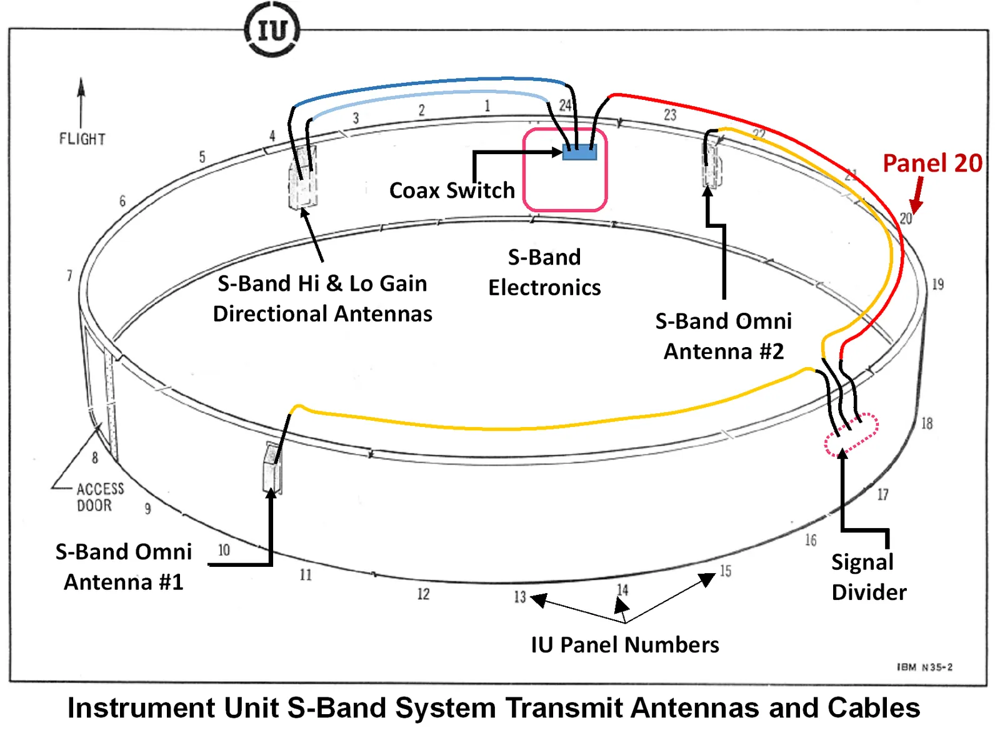The IU interior circumference was divided into 24 **Panels** each measuring ~3 feet square and numbered 1 through 24 as shown in the figure at the right. The **S-Band Transponder**, **Transmitter**, and **Coaxial Switch** were located on **IU Panel 24**. Flexible RG-214 RF coaxial cables interconnected these three components. Flexible RG-214 and semi-rigid Foamflex FX 12-50 coaxial cables connected the **Coaxial Switch** to the Components and Antennas listed below:

> Two **Omni-Directional Transmit Antennas,**
>
> One **Low-Gain Directional Transmit Antenna,**
>
> One **High-gain Directional Transmit Antenna,**
>
> One **Transmit Signal Divider,**
>
> Two **Omni-Directional Receive Antennas,**
>
> One **Receive Signal Combiner.**

The ***S-Band Transponder*** processed data from the IU Systems and forwarded this data as a low level \[0.5 watt\] modulated signal to the **S-Band Transmitter** for transmission to the Ground Stations as a 20 watt 2,200 megahertz \[MHz\] radio frequency \[**RF**\] signal. The **S-Band Transmitter RF** **Output** signal connected to the ***single input*** terminal of the **Coaxial Switch**. Each of the Coaxial Switch ***three output*** terminals connected to one of the <u>transmit</u> antenna types. The IU Computer could command the **Coaxial Switch** to connect the **Transmitter RF Output** signal to <u>either</u> the **Low-Gain Directional Antenna** <u>or</u> the **High-Gain Directional Antenna**. If the IU Computer did **not** select either the Low-Gain or the High-Gain Antenna, then the Coaxial Switch would automatically connect the **Transmitter** to the **Omni-Directional Transmit Antennas**. *When the battery supplying the IU Computer depleted, the **Coaxial Switch** automatically switched the S-Band transmitter to the **Omni-Directional Transmit Antennas** \[Important to the following\].*

The S-Band Transponder <u>received</u> coded signals transmitted **from** the Ground Stations via the ***S-Band Uplink*** through the two **Omni-Directional** ***<u>Receive</u>*** Antennas. The Transponder then transmitted coded responses to the Ground Stations over the ***S-Band Downlink*** using the Coaxial Switch selected ***<u>Transmit</u>*** Antenna(s). The Ground Stations used this two-way process to maintain reliable communication with the IU S-Band System.

***Commands*** from Mission Control through the Ground Stations to the IU Computer System were also transmitted using this S–Band Uplink/Downlink arrangement. The IU S-Band Transponder received and forwarded these Mission Control Uplinked Commands to the IU **Command Decoder** \[IU Panel 18\] for decoding and transmission to the IU Computer System.

All **Antennas** were located on the outer IU surface such that their cables passed through the IU Structure between pairs of ECS Thermal Conditioning Panels. The **S-Band Transmit** **Antennas** were located as follows:

**High-Gain** and **Low-Gain Directional <u>Transmit</u> Antennas** … Between Panels 3 and 4

Both the **Low-Gain** and **High-Gain Directional Transmit Antennas** were housed under the same cover located at **<u>Saturn Vehicle Position I</u>**. Each antenna was connected to the **Coaxial Switch** through separate cabling. These two highly directional antennas required that the IU Flight Program using the Navigation, Guidance, and Control \[NG&C\] System keep **Position I** pointed toward the Earth for their signals to be received by the Ground Stations.

**Omni-Directional <u>Transmit</u> Antenna \#1** … Between Panels 10 and 11

**Omni-Directional <u>Transmit</u> Antenna \#2** … Between Panels 22 and 23

The two **Omni-Directional Transmit Antennas** were connected via rigid Foamflex cabling to the **Coaxial Switch** through a **Signal Divider** located on IU **Panel 17**. The **Signal Divider** location insured that the cable <u>lengths</u> from Transmitter to Divider and Divider to each Antenna were equal thereby insuring that both Omni Antennas transmitted equal signal levels. The signal levels received at the Ground Stations from the **Omni-Directional Transmit Antennas** were lower than those from either the **Low-Gain** or **High-Gain Directional Transmit Antennas**. However, the **Omni-Directional Transmit Antenna** pattern did not require IU Computer NG&C control of the vehicle for antenna pointing.

The two **Omni-Directional *Receive* Antennas** received commands transmitted to the IU Computer System by Mission Control through the various Ground Stations around the world. These Antennas were located on the IU as follows:

> **Omni-Directional *Receive* Antenna \#1** … Between Panels 11 and 12

**Omni-Directional *Receive* Antenna \#2** … Between Panels 23 and 24.

The two **Omni-Directional *Receive* Antennas** were connected via Foamflex cabling to the **Signal Combiner** \[**Panel 17**\] that combined and fed these signals to the input terminal on the **S-Band Transponder**.

**<u>Need for Quick Resolution of the S-Band Signal Loss</u>**

The loss of the IU S-Band signals on Apollo Missions 11 and 12 prevented demonstrating tracking the S-Band signals to the Moon’s distance in preparation for Apollos 13 thru 17 S-IVB/IU Lunar Impact Missions. Apollo 12 was launched on November 14, 1969 and Apollo 13 was scheduled for launch in April 1970 so it was imperative that the Apollo 12 IU S-Band problems be resolved and a fix designed and installed quickly. Furthermore, the Apollo 13 rollout to the pad would occur in mid-December, 1969 so whatever changes were required to resolve the IU S-Band problems would have to be incorporated with the IU ‘on the launch pad’!

**<u>Initial Estimates of the Cause of the S-Band Signal Loss</u>**

IBM Mission Engineering personnel monitoring the Apollo 12 IU inflight performance at the MSFC Huntsville Operations Support Center \[HOSC\] noted that video from the Command Module during Spacecraft separation from the S-IVB/IU showed brilliant sunlight shining on part of the Instrument Unit interior. The IU specifications stated that sunlight would not impinge on the IU interior so no means were in place to protect IU equipment from direct sunlight heating. Based on the video, *<u>solar heating</u>* of IU equipment was proposed as the potential cause of the IU S-Band signal loss.

It could take a week or so for the Ground Station data tapes to reach Huntsville from the Goddard Spaceflight Center \[GSFC\]. In the meantime, meetings at IBM addressed potential causes of the S-Band failure. Because of the potential for equipment overheating due to direct sunlight, IBM Engineering and Software groups developed a ‘Sun Angle’ computer program to calculate where sunlight would strike the IU interior during the S-IVB/IU maneuvers following Spacecraft separation. Once the data tapes arrived in Huntsville, this computer program used the onboard IU NG&C data coupled with solar ephemeral data to determine the sunlit IU Panels and the angles of the sun striking these panels.

**<u>S-IVB/IU Sun Angle Estimates</u>**

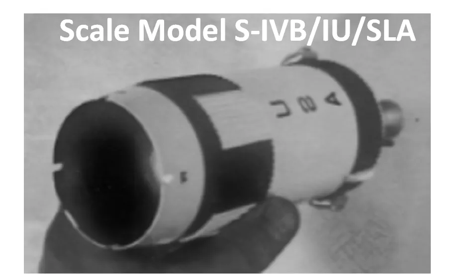While awaiting the flight data tapes, the IBM Flight Evaluation Department used a ‘Revell’ Saturn V plastic 1:96 scale model and the results from hand calculated Sun Angle estimates to visualize which parts of the IU received the most direct sunlight. Labeling the panels and then illuminating and viewing the model illustrated that sunlight did reach the inside of the IU during the **Evasive**, **Slingshot**, and **Communications Maneuver** attitudes.

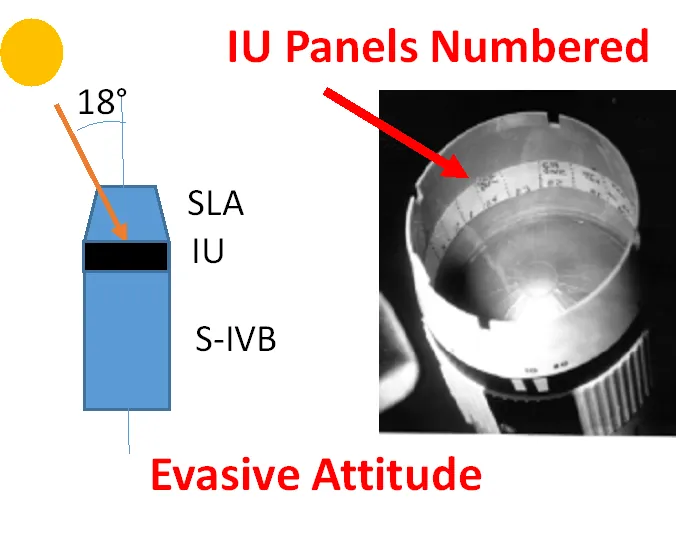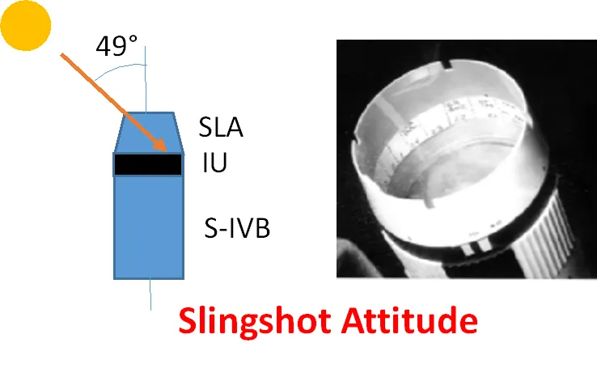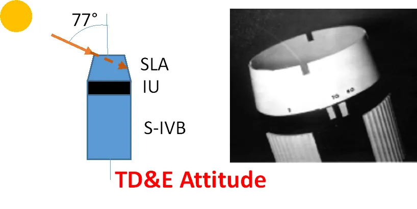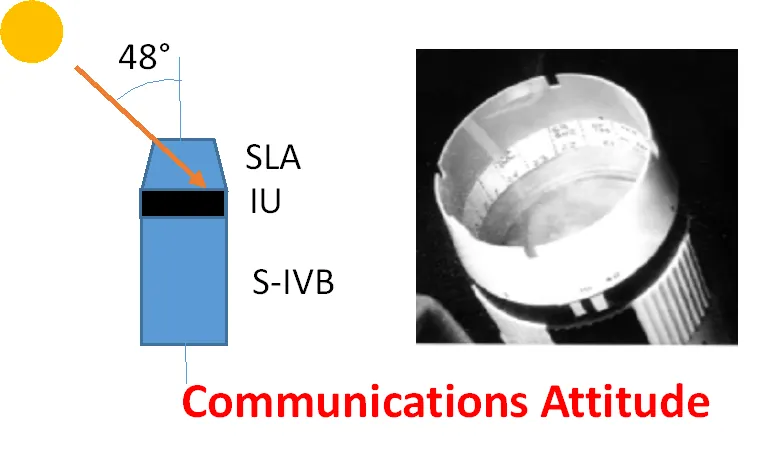

**Scale Model Used to Visualize Sun Impingement on the Instrument Unit**

**<u>Calculated S-IVB/IU Sun Angles</u>**

When IBM received the Apollo 12 flight data tapes, the Sun Angle Computer Program was used to compute the actual inflight Sun Angles on the Instrument Unit. These agreed well with the hand calculated values. The computer program calculated Sun Angle results are shown in the following drawings with the illuminated areas of the IU for each of the Translunar S-IVB/IU Maneuver Attitudes.

The Sun Angle on the IU consisted of a **Vertical Component** and a **Horizontal Component**:

1.  The **Vertical Component** determined **IF** any of the IU interior was in sunlight

2.  If the interior was in sunlight, the **Horizontal Component** then determined **WHICH** IU Panels were illuminated.

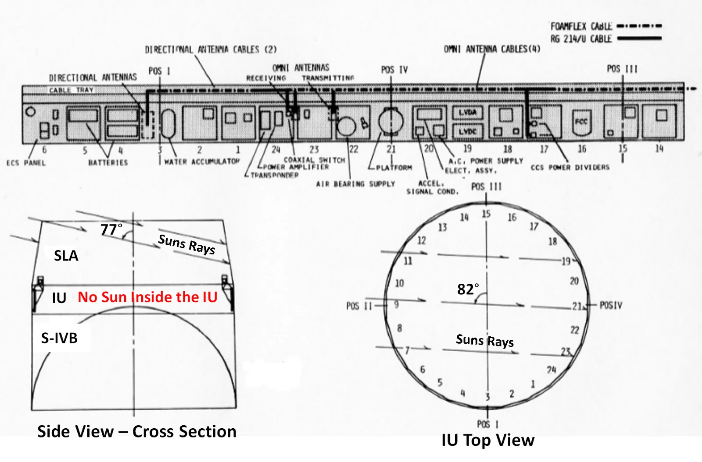***<u>TD&E Maneuver Attitude:</u>***

Vertical Component = 77°

Horizontal Component = 82°.

At this attitude, the 77° Vertical Component of the Sun Angle places the entire IU in the shadow of the SLA remnant so the Horizontal Component doesn’t come into play in this case.

The figure at the right shows that the entire IU interior was in the shadow of the SLA. No sunlit components in the IU.

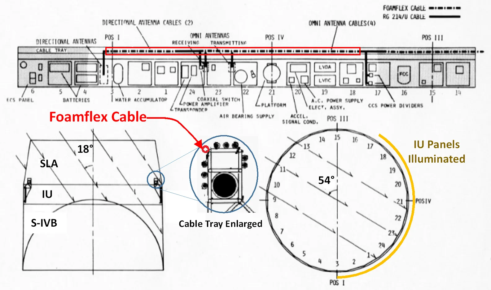***<u>Evasive Maneuver Attitude 4:20 to 4:36 GET:</u>***

Vertical Component = 18°

Horizontal Component = 54°.

The 18° Vertical Sun Angle Component directed sunlight into the IU. The 54° Horizontal Sun Angle Component placed nearly half the IU Panels in sunlight. Note the counterclockwise Panel numbering showing that Panels 3 to 1 and 24 to 17 were in the sunlight.

The Foamflex Coaxial cables were all located on the inner part of the Cable Tray thereby placing these cables in more direct sunlight than the IU Panels below the Cable Tray. In the solar heating calculations it was necessary to consider that the round Foamflex Cables received **1/π (32%)** as much sunlight as would a flat surface.

***<u>Slingshot Maneuver Attitude 4:36 to 5:36 GET:</u>***

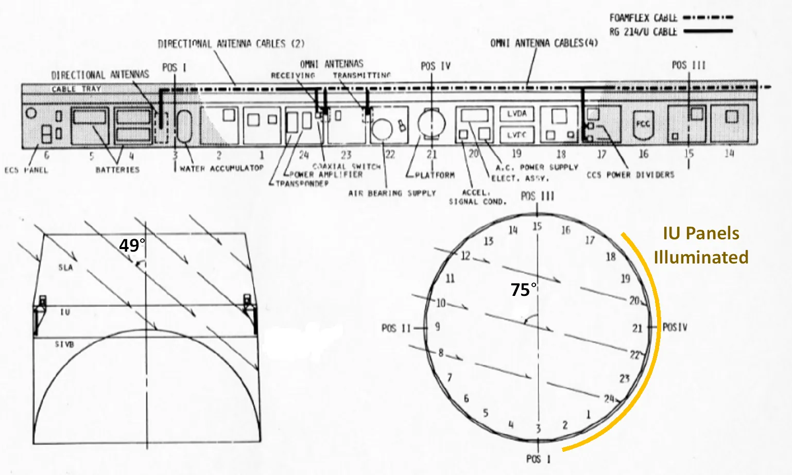

Vertical Component = 49°

Horizontal Component = 75°.

At this attitude, the 49° Vertical Sun Angle Component continued to direct sunlight on the IU interior. The 75° Horizontal Component then placed about 40% of the IU Panels in sunlight.

At **5:20 GET**, one hour *after* the start of the Evasive Attitude, the S-Band Downlink failure occurred while transmitting over the Omni-Directional Transmit Antennas.

> ***Note:** At **5:20 GET**, the IU had been in sunlight for approximately one hour when the first S-Band Downlink failure occurred.*

***<u>Communications Maneuver Attitude 5:36 to 12:10 GET:</u>***

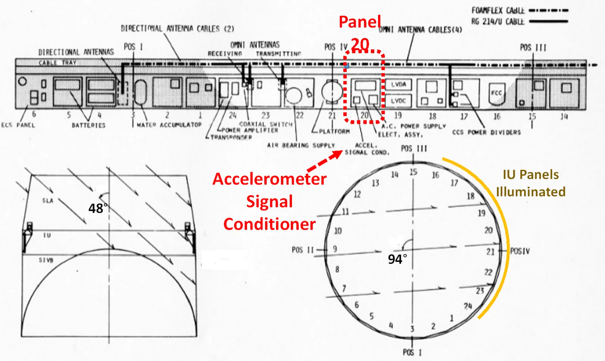

Vertical Component = 48°

Horizontal Component = 94°.

At this attitude, the 48° Vertical Sun Angle Component continued to direct sunlight on the IU interior. The 94° Horizontal Component placed about 38% of the IU Panels in sunlight.

At **7:27 GET** the Mission Control commands **to** the IU stopped being received over the S-Band **Omni-Directional *Receive* Antennas**. The Foamflex Cables to these antennas were only slightly offset from those to the **Omni-Directional *Transmit* Antennas** so sunlight was now impinging on the ***Receive*** Antenna cabling also. The Receive antennas did <u>not</u> have Low or High-Gain Directional Antennas so once the Omni ***Receive*** Antenna failed there was no means for receiving any uplink communications.

> *The above four IU Sun Angle drawings were from the IBM “February 25, 1970 S-IU-507 Flight Evaluation Bulletin No. 1” detailing the S-Band Problem and the recommended fix.*

**<u>Detailed Temperature Analyses into the Cause of the S-Band Signal Loss</u>**

Telemetered measurements from equipment located between panels 17 and 23 were analyzed for indications of increased temperatures. The three previous figures showed that panels 20 through 22 were near the center of the Horizontal Component of the Sun Angles during the **Evasive**, **Slingshot**, and **Communications** Attitudes. Three **ST-124 Guidance Platform** components on **Panel 20** exhibited significant and unexpected temperature increases while at these three vehicle-to-sun attitudes.

The IU figure below shows that the Foamflex Coaxial (***Transmit***) Cables connecting the **Coaxial Switch to the Signal Divider** and those connecting the **Signal Divider to the Omni-Directional Transmit Antenna \#2** were routed directly above **Panel 20**. These cables were also routed above the neighboring IU Panels that were also receiving significant sunlight.

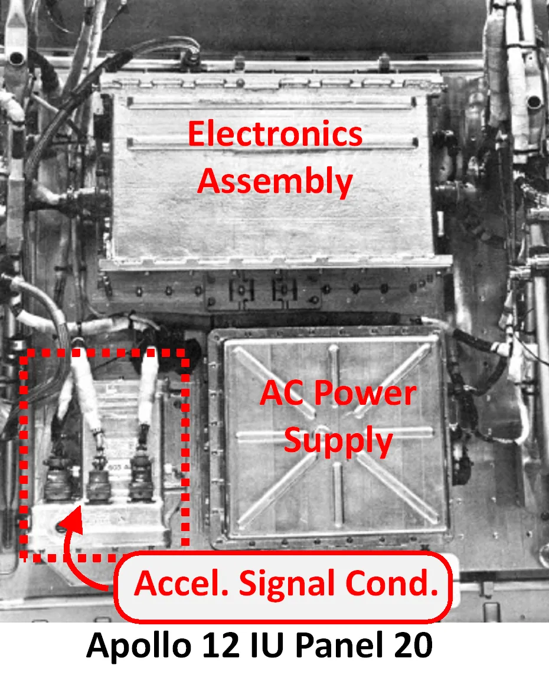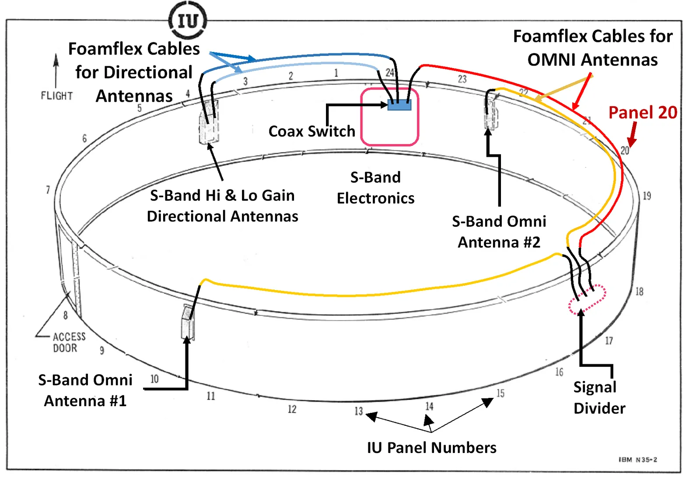

The figure above shows that the **ST-124** electronic components located on **Panel 20** were close to the center of the sunlit section of the IU. Note that the Foamflex cables are above this panel.

> ***Apollo 12 IU Panel 20:** This photo was taken May 8, 1969 at the IBM Huntsville Facility as manufacture of S- IU-507 for the Apollo 12 mission was being completed. These photos were required to document the IU configuration at manufacture completion.*

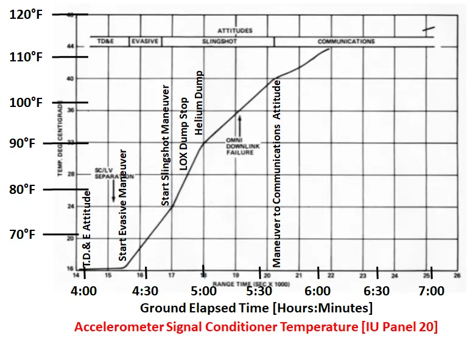The **ST-124** **Accelerometer Signal Conditioner** located on **Panel 20** showed a continual temperature increase from the start of the **Evasive Maneuver** until the final S-Band communications loss. The Signal Conditioner’s location on the panel and the relatively low mass of the component contributed to its rapid rise in temperature.

The other two more massive components on **Panel 20** exhibited a more gradual, but still continual, temperature increase as shown in the chart below.

The chart below also includes a plot of the IU Environmental Control System \[ECS\] ‘**Coolant**’ temperature. The relatively slow rise and fall of the ECS Coolant temperature from launch through the S-IVB Translunar Burn indicated expected operation. The Coolant temperature rose throughout the S-IC Burn until the IU Computer opened the **Sublimator Water Valve** at **181 seconds GET** to begin active cooling. There was then a slow oscillation in coolant temperature as the ECS **Sublimator Cooling** was started and stopped under IU Flight Program control maintaining the temperature within the operational limits of ~45°F to ~65°F.

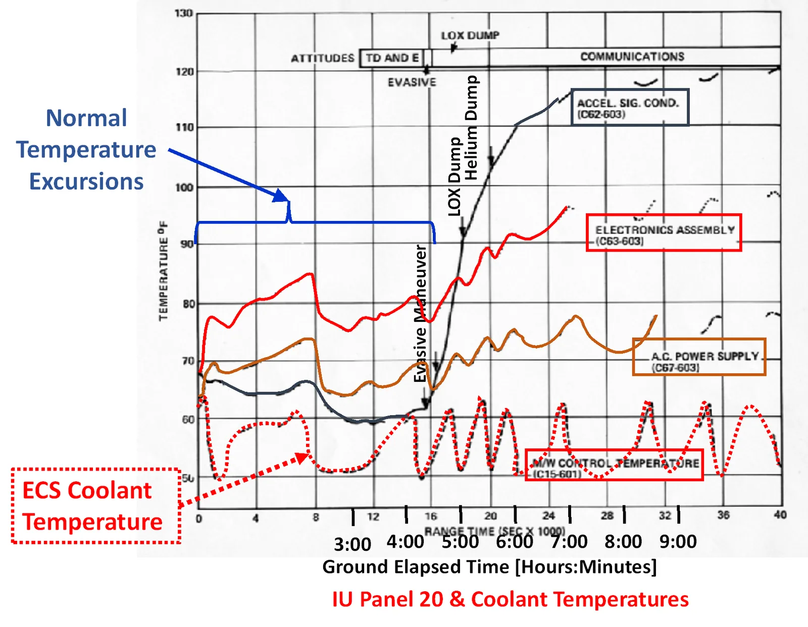

At the start of the **Evasive Maneuver** \[**~4:30 GET**\], the CSM/LM had separated from the S-IVB/IU and sunlight had begun striking the IU interior. After this time, the Coolant temperature oscillations were more frequent than those during boost indicating that a large heat load had been added to the system. The temperatures of the **AC Power Supply** and the **Electronics Assembly** on Panel 20 also began rising but at a slower rate than the **Accelerometer Signal Conditioner** and these also reflected the Coolant temperature oscillations. The rising temperatures of these two components and the rapid Coolant temperature cycling were more direct evidence that the Sun Angle Program predictions were correct and confirmed that sunlight was incident on the IU interior and was centered near Panel 20.

> ***\[Personal Note\] Telemetry Data:** The preceding two temperature graphs are from the IBM “February 25, 1970 S-IU-507 Flight Evaluation Bulletin No. 1”. IBM data reduction programs stripped the data and timing information from the telemetry tapes and printed each data point and its corresponding time. We plotted the data by hand, point by point, on graph paper. I plotted these two graphs in December 1969 to use in our analyses and the publications group later included the hand-drawn charts in the Flight Evaluation Report. Some good ‘engineer’ memories!*

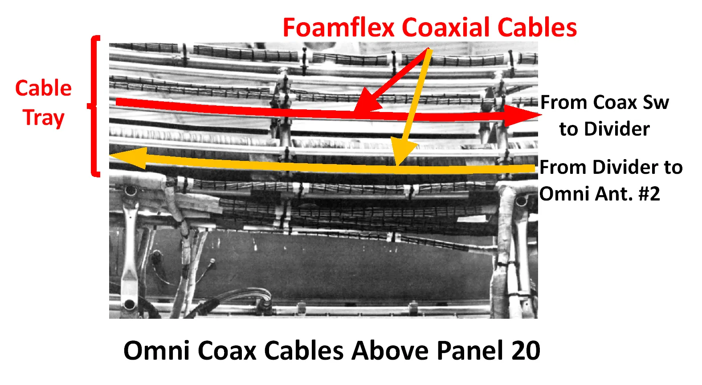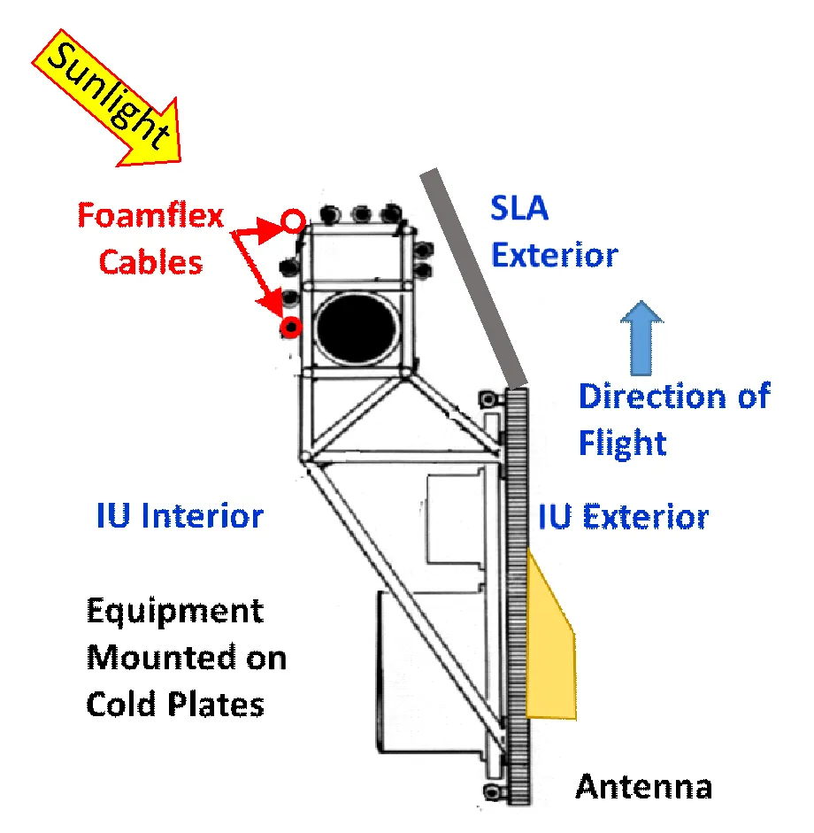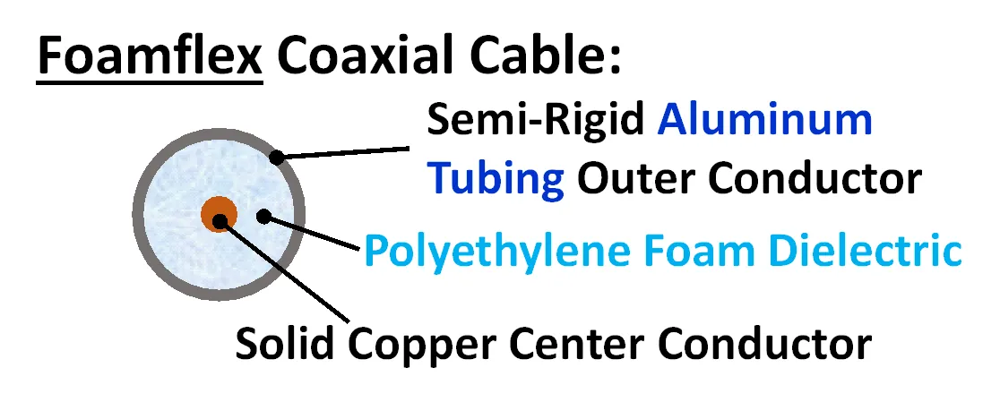The issue under investigation was the failure of the Ground Stations to receive the S-Band signal being transmitted from the IU ***Omni-Directional Transmit Antennas***. The figures below show that the Foamflex coaxial cables from the **Coaxial Switch** to the **Signal Divider** and from the **Signal Divider** to **Omni Antenna \#2** were positioned on the cable tray directly above **Panel 20**. These cable runs continued over several adjacent panels that were also in direct sunlight. The locations of the Foamflex cables on the cable tray would have received maximum sunlight. It was proposed that the sunlight overheated the Foamflex coaxial cables and melted the internal **Polyethylene Foam Dielectric**. The melted dielectric then allowed the center conductor to move about within the ‘aluminum pipe like’ outer conductor and ultimately electrically short circuiting to the outer conductor. The vehicle was in a microgravity environment so it was felt that something had to precipitate a short circuit. IU VHF telemetry showed that an S-IVB thruster firing occurred at the time of the S-Band signal loss. The short pulse of thruster firing likely forced the center conductor to move through the molten dielectric and strike the outer conductor thereby short circuiting the S-Band transmission from the **Omni-Directional Transmit Antennas**.

As shown in the previous IU S-Band Cabling figure, neither the **Low-Gain** nor **High-Gain Directional Antenna Foamflex Cabling** was routed near the IU panels receiving the most direct sunlight. So the S-Band transmission through the **Low-Gain** and **High-Gain Directional Antennas** would not have been affected by the sunlight heating effects.

**<u>Detailed Foamflex Coaxial Cable Testing</u>**

The IU physical layout and the temperature analyses showed that the Foamflex cable between the ***Coaxial Switch*** and the ***Omni-Directional Transmit Antenna*** ***<u>Signal Divider</u>*** was routed across the area of the IU receiving direct sunlight. If this cable failed, *<u>all transmissions</u>* from the **Omni-Directional Transmit Antennas** would stop and that would explain the inflight failure of S-Band signal transmissions through both of the **Omni-Directional Transmit Antennas**.

The next investigation steps were to: (1) determine if the cabling would get hot enough to melt the polyethylene dielectric inside the cables and (2) demonstrate the proposed failure mode in a vacuum chamber experiment.

**<u>Foamflex Dielectric Melting Temperature</u>**

There were no inflight temperature measurements on the IU Foamflex cabling so analytical and empirical methods had to be used to predict the temperatures reached by the cables.

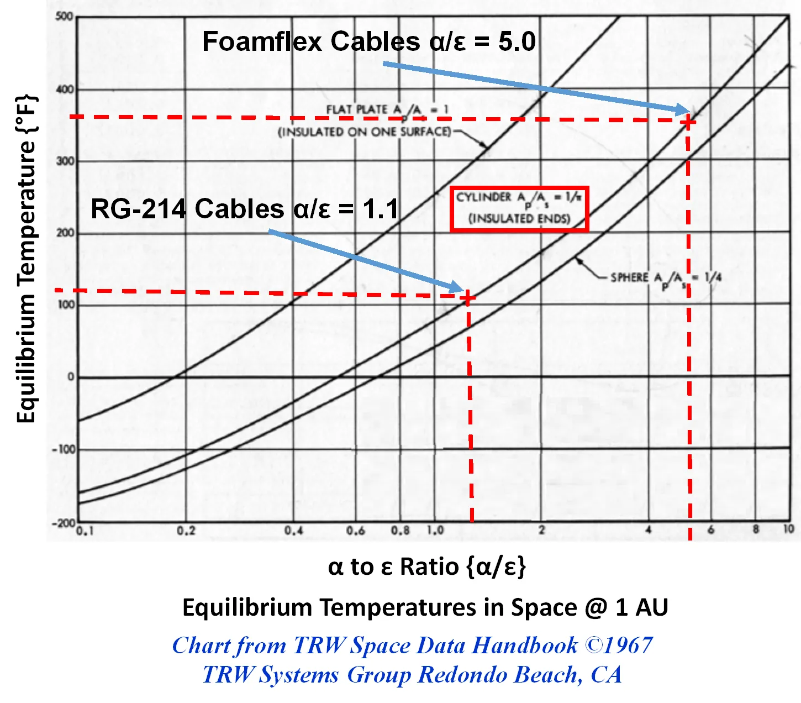An object in the vacuum of space will reach its equilibrium temperature when the heat it absorbs equals the heat it emits \[radiates\]. The object’s material, shape, finish, and color all affect how much heat is ***absorbed*** \[*absorptivity* **α**\] and how much heat is ***emitted*** \[*emissivity* **ε**\]. The ratio **“α/ε”** then determines the equilibrium temperature for the object. On the chart at the right, the center line is for a <u>cylindrical</u> object \[like a cable\] in space, in sunlight, and at the ‘1 AU’ \[Earth to Sun\] distance. Lab tests at IBM showed that the **“α/ε” ratio** of the <u>aluminum</u> Foamflex cable was **5.5** for which the chart shows an equilibrium temperature of ~375° Fahrenheit.

> *Short sections of the more flexible **RG-214** coaxial cable connected the S-Band components to each other and to the Foamflex cables. RG-214 cable was black and, in a vacuum, was the more efficient radiator with an **“α/ε” ratio** of **1.1**. From the chart above, the equilibrium temperature for RG-214 cable was only 115° Fahrenheit and RG-214 was assumed not to be an issue in the Apollo 11 or 12 S-Band signal loss.*

The foamed polyethylene dielectric used in the **Foamflex** cable softened at temperatures near 120°F and became a viscous fluid at around 170°F. So, at an equilibrium temperature of 375°F, the dielectric would be a viscous fluid allowing the center conductor to move and ultimately short circuit to the outer conductor.

**<u>Vacuum Chamber Tests of Foamflex Cable</u>**

One 6 foot long and one 15 foot long Foamflex coaxial cable and two 3 foot long RG-214 coaxial cables were manufactured with connectors on both ends. Heat tape was applied along the length and on ½ the circumference of the cables. An S-Band RF signal was connected to one end of the cable and an RF power meter connected to the opposite end. Temperature sensors were attached to the <u>outside</u> of each cable. The cables were placed in a vacuum chamber and, using the heat tape, the cables were gradually heated at 444 BTU/hr·ft2 which is the rate of the sunlight heating at the Earth-Sun distance.

After about 1.5 hours, the RF signal level on the 6 foot Foamflex cable dropped to near zero. The temperature of the outside of the cable was ~260°F. The vacuum chamber was brought to ambient pressure and the cable removed and x-rayed. The x-ray showed the inner conductor was touching \[shorted to\] the outer conductor for a substantial distance along the cable. The second (longer) Foamflex cable was heated at a slower rate and shorted in about 3.5 hours and at an outer cable surface temperature of ~400 °F. This is similar to the 375 °F equilibrium temperature predicted for the Foamflex cable. So, both cables tested indicated that the Foamflex cables would fail due to melting of the dielectric caused by sunlight heating.

The figures below are X-Rays of the two ends of the 15 foot long Foamflex cable after it failed the Vacuum Chamber Test. The figure on the left shows the center conductor touching the outer conductor for much of the photo. Both photos show that the center conductor was no longer located in the center of the cable as it should have been.

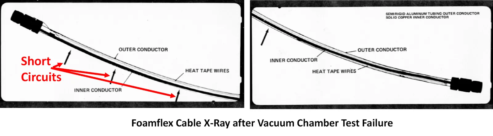

> ***Cable X-Rays:** The cable X-Ray photos were taken from the “January 9, 1970 S-IU-507 Command and Communications System Engineering Evaluation Report” written by the IBM RF Systems Group documenting the coaxial cable testing.*

**<u>Analyses Conclusions</u>**

The conclusion of this investigation was that solar heating of the **Foamflex Coaxial Cabling** supplying the **S-Band Omni-Directional Transmit Antennas** was the most likely cause of the loss of the IU **S-Band** **<u>Downlink</u>** at **5:18 GET**.

The **Omni-Directional Receive Antennas** were also connected to the **Signal Combiner** on **Panel 17** through Foamflex cabling. The Foamflex path from the **Omni-Directional Receive Antennas** to the **Signal Combiner** and then to the **Transponder** followed almost the same Cable Tray paths and would have received essentially the same solar heating as the **Omni-Directional Foamflex Transmit** cabling. So, the conclusion was that the loss of the S-Band ***Uplink*** at **7:27 GET** was also due to solar heating of the ***Receive*** path Foamflex cable(s).

Sun Angle program results for the sunlight impingement on the S-IVB/IU during the Translunar Coast maneuvers on future Apollo missions indicated that sunlight heating similar to that experienced on the Apollo 12 S-IVB/IU would also occur on these future flights.

**<u>Recommended Fix</u>**

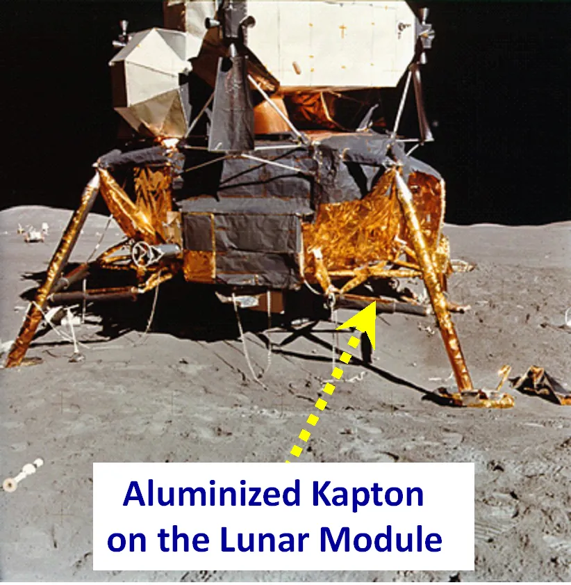The IBM Environmental Control System Engineering recommended fix was to cover the ***IU Cable Trays*** and ***Equipment Panels*** with sun reflecting shrouds made of **Cloth-Backed** **Aluminized Kapton**. This material was selected because it was highly reflective with a low ***“α/ε” ratio*** and is more durable than Mylar. The cloth backing prevented the aluminized backing from contacting electrical circuits, minimized punctures and tearing, and made the material much easier to handle during installation. Panel Shrouds were constructed and installed over the IU Panels. Cable Tray Shrouds were constructed and installed on the Cable Tray above the IU Panels. Construction of the shrouds began in February 1970 and were installed on the Apollo 13 IU \[on the Launchpad\] prior to the Countdown Demonstration Test of March 25, 1970.

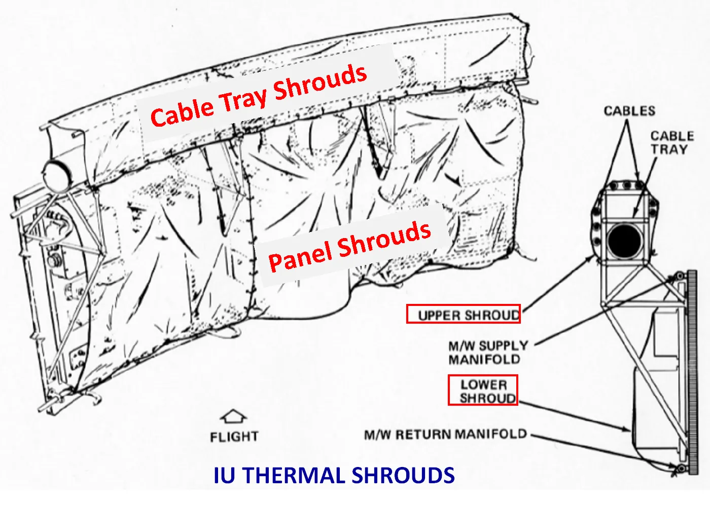*Note: The material was aluminized on the back surface and the Kapton front surface film gives the finished product its gold color.*

**<u>S-IVB/IU Lunar Impact Missions</u>**

The thermal shrouds were installed on the Apollo 13 Instrument Unit and the IU S-Band System transmitted signal was tracked to S-IVB/IU Lunar Impact at **77:56 GET** \[April 15, 1970\].

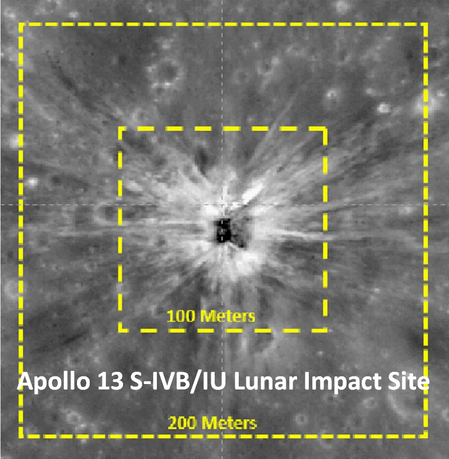At Lunar Impact, the S-IVB/IU weighed 29,599 pounds and was traveling ~5700 miles per hour; a shock equivalent to the explosion of ~11 tons of TNT. The Apollo 13 S-IVB/IU Lunar Impact site photo at the right was taken by the Lunar Reconnaissance Orbiter Spacecraft in ~2010.

Although the Lunar Impact occurred 86 miles from the Apollo 12 Seismometer, the seismometer measured a 3 hour 20 minute moonquake. Also at impact, the Apollo 12 Suprathermal Ion Detector recorded a momentary jump in ion counts that were believed to have been caused by dust particles thrown some 200,000 feet above the moon where they were ionized by sunlight.

**Lunar Reconnaissance Orbiter Photograph**

The shrouds were installed on Apollos 14 through 17 and all IU S-Band Downlinks except Apollo 16 were tracked successfully to Lunar Impact. The downlink signal from <u>Apollo 16</u> S-IVB/IU suddenly stopped at 27 hours into the mission. Since the IU Primary Batteries had long since discharged, no telemetry or other data was available for a detailed analysis of the cause. The IU and NASA RF Systems personnel theorized that the most likely cause was a failure of the CCS Transponder.

**==================== END OF PRIMARY DOCUMENT ========================**

**APPENDIX 1**

**<u>Apollo Lunar Seismic Experiment</u>**

An **Apollo Science Objective** was to determine the composition of the Moon’s interior and to determine if the Moon contained a molten core.

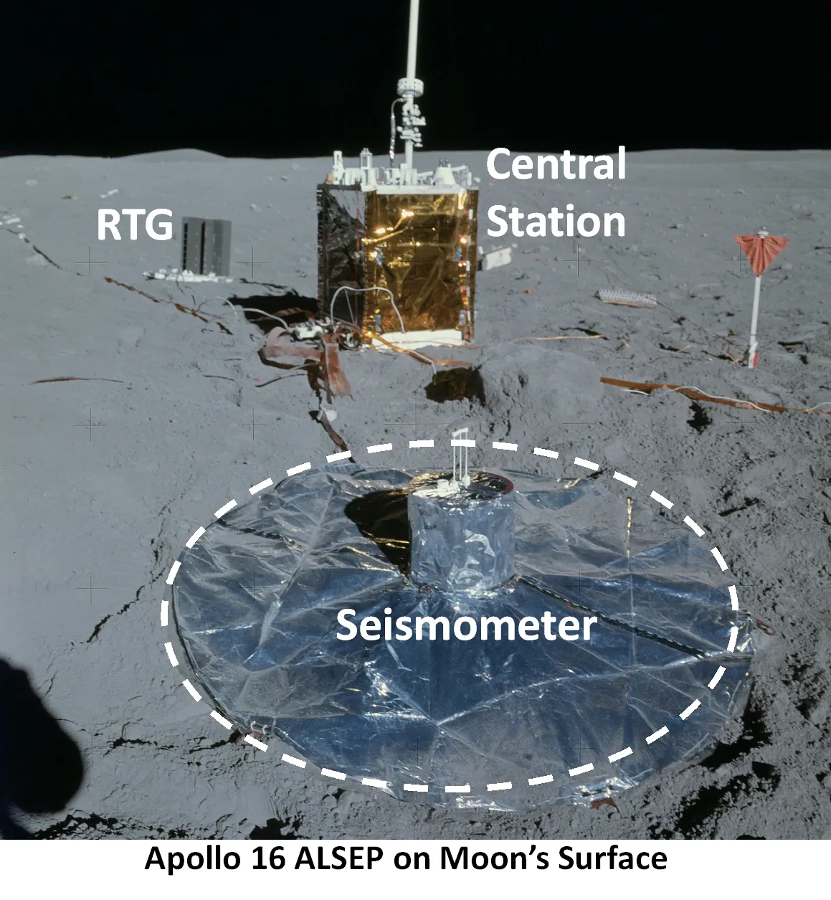

The Astronauts of Apollo Missions 12 and 14 through 17 placed **Apollo Lunar Surface Experiment Packages \[ALSEP\]** on the moon. Each ALSEP contained instruments to measure such parameters as temperature, solar wind, cosmic particles, and ***seismic activity*** \[moonquakes\]. The ALSEPs contained telemetry and radio facilities to transmit the measured data back to Earth for analysis. ALSEPs were powered by **Radioisotope Thermoelectric Generators \[RTGs\]** nuclear power sources capable of operating for several decades. However, **t**he ALSEPs only operated until September 30, 1977 when all ALSEP stations were powered off because of NASA budget cuts.

The S-IVB/IUs from Apollo Missions 13 through 17 were all impacted on the Moon. The <u>ALSEP Seismometer</u> responses to these impacts were used by scientists to evaluate the Moon’s interior. Extra batteries on these Instrument Units powered the S-Band Communications Systems to enable tracking the S-IVB/IU and to determine the precise time of Lunar Impact for use in the analyses of the ALSEP Seismometer data. These S-IVB/IU Lunar Impacts produced ‘Moonquakes’ lasting for 2 to 3 hours.

**APPENDIX 2**

**<u>Moon’s Interior Science from the Lunar Impact Seismic Experiment</u>**

> The following information is from NASA Website: **https://www.nasa.gov/topics/moonmars/features/lunar_core.html**

In ~2011, a team of researchers from Marshall Space Flight Center; Arizona State University; the University of California at Santa Cruz; and the ‘Institut de Physique du Globe de Paris’ re-evaluated the seismic data gathered from four **Apollo Lunar Surface Experiment Package** \[ALSEP\] **Seismometers** that were deployed between 1969 and 1972 and had recorded lunar seismic activity until late 1977.

> *"We applied tried and true methodologies from terrestrial seismology to this legacy data set to present the first-ever direct detection of the moon's core," said Renee Weber, lead researcher and space scientist at NASA's Marshall Space Flight Center.*

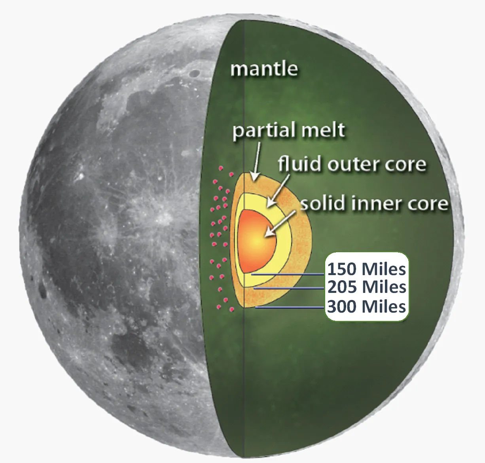The team's findings suggest the moon possesses a solid, iron-rich inner core with a radius of nearly 150 miles and a fluid, primarily liquid-iron outer core with a radius of roughly 205 miles. Where it differs from Earth is a partially molten boundary layer around the core estimated to have a radius of nearly 300 miles. The research indicates that the core contains a small percentage of light elements such as sulfur, echoing new seismology research on Earth suggesting the presence of light elements – e.g., sulfur and oxygen -- in a layer around the Earth’s core.

**APPENDIX 3**

**<u>Apollo 11, 12, & 13 S-IVB/IU Slingshot & Lunar Impact Maneuvers</u>**

The chart below shows the velocity changes for the **Apollo 11** and **12 Slingshot Maneuvers** and the **Apollo 13 S-IVB/IU Lunar Impact Maneuver**. At the time of the velocity changes, the S-IVB/IU was traveling ~10,000 miles per hour. Small velocity changes give dramatically different results, for example:

- Slow the S-IVB/IU less than ~12 miles per hour and it will follow the Spacecraft past the *<u>leading edge</u>* of the Moon and subsequently into a large **orbit about the Earth** \[**EARTH CAPTURE**\].

<!-- -->

- Slow the S-IVB/IU between ~12 and ~57 miles per hour and it will **impact** the Moon \[**LUNAR IMPACT**\].

- Slow the S-IVB/IU between ~58 and ~82 miles per hour and it will be **Slingshot** into Solar Orbit \[**EARTH-MOON ESCAPE**\].

- 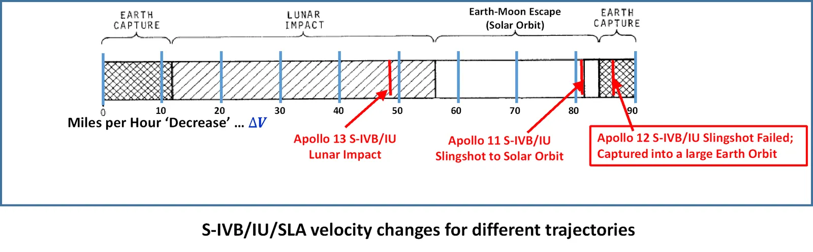Slow the S-IVB/IU more than ~82 miles per hour and it will pass too far from the *<u>trailing edge</u>* of the Moon and will not enter **Solar Orbit** but will instead go into a large **orbit about the Earth** \[**EARTH CAPTURE**\].

> *The above chart with the Apollo 11 data point is from the MSFC “Saturn V Launch Vehicle Flight Evaluation Report AS-506 Apollo 11 Mission”:*
>
> ***<https://archive.org/details/nasa_techdoc_19900066485>.***
>
> *The Apollo 12 and 13 data points were taken from the respective AS-507 and AS-508 MSFC Flight Evaluation and Trajectory Reports. These reports are available on the Internet. For example, search for ‘AS-507 Flight Evaluation Report’.*
>
> ***The Apollo 12 S-IVB/IU missed the Moon ~3,000 miles and did not immediately go into Solar Orbit. The S-IVB/IU did make it into Solar Orbit in 1972 and then in 2002 came back into Earth Orbit and in 2003 returned to Solar Orbit. JPL estimates that this Solar-to-Earth-to-Solar Orbits, etc. will continue about every 40 years for several thousand years when it will ultimately impact either the Earth or the Moon!***
>
> ***An internet search for J002E3 will show articles concerning this very strange flight; J002E3 is the “space junk” number for the Apollo 12 S-IVB/IU.***
>
> **====================================**

**SATURN AND APOLLO REFERENCES**

- The Earth-Capture, Earth-Moon-Escape (Solar Orbit), and Lunar Impact ***velocity comparison plot*** was constructed from data contained in the Boeing Trajectory Reports for the Apollo 11, 12, and 13 Missions to compare successful and unsuccessful Slingshot missions and Lunar Impact Missions.

  - **<u>Apollo by the Numbers – A Statistical Reference</u> by Richard W. Orloff,** NASA History Division.

> Published by Ross & Perry, Inc., Washington D.C. Published 2001

- Mission overview plus detailed references for Saturn & Spacecraft on all Apollo missions.

- PDF available on Internet and book available at Amazon.

<!-- -->

- **<u>Stages to Saturn</u> by Roger E. Bilstein.** NASA History Office. NASA Publication SP:4206 originally published in 1980.

  - Detailed technological history of the Saturn Launch Vehicles including nuts-and-bolts discussions of the development and manufacturing of the individual stages.

  - Viewable at “http://history.nasa.gov/SP-4206/sp4206.htm”

  - Available from Government Printing Office and from Amazon

<!-- -->

- **<u>SATURN</u> by Alan Laurie.** Apogee Books, Burlington Ontario, Canada. Published 2005

  - Manufacturing and Test Information for the Saturn Stages for each Apollo and Skylab mission and individual test stages. Includes CD-ROM of test firings of several stages.

  - Available from Amazon and by special order from Barnes & Noble

- **<u>The Saturn V F-1 Engine</u> by Anthony Young.** Praxis Publishing, Ltd, Chichester, UK. Published 2009.

  - Detailed technical development information for the F-1 Engine used on the Saturn V S-IC first stage.

  - Available from Amazon, Barnes & Noble, and Springer.

  <!-- -->

  - **<u>Carrying the Fire</u> by Michael Collins.** Farrar, Strauss, & Giroux, New York. Originally published 1974.

    - Personal history and recollections by Apollo 11 Command Module Pilot Michael Collins. Excellent writer and observer make this *<u>a most interesting and enjoyable read</u>*. Collins flew on Gemini 10 and Apollo 11 and was director of the Smithsonian Air & Space Museum from 1971 to 1978.

    - Available from Amazon and Barnes & Noble

  - **<u>Liftoff, America’s Adventure in Space</u> by Michael Collins.** Grove Press, New York. Published 1988.

    - Overview of America’s Space Programs from 1946 until 1986.

    - Available from Amazon and possibly Barnes & Noble.

**LAST PAGE**
