**ROCKET PARK TOUR OUTLINE**

The tour should be approximately 30 minutes. Tours are hourly, 10am-4pm daily

Below is a general outline for the tour. It is not required to mention every piece of information in this outline. This outline is also not all-inclusive. You are encouraged to bolster your tours with information which you come across in your own research, or any additional stories/facts which interest you. Guests will appreciate you talking with enthusiasm about your own interests. There is no need to cover every single topic on each of your tours. Instead, tailor your tour for the interest and attention span of your audience.

You are encouraged to tell as many stories as you can during your tour. The history of the space program is full of stories – some funny, some tragic, some inspiring, all interesting. Share these stories with the guests. It will help them connect to the people and events of the space race in a much deeper way than if your tour was nothing more than a recitation of facts. Even a guest who knows a lot about the space program already may learn something new from one of your stories.

- Introduce yourself

- Launch the tour: It may be helpful to set the stage with a brief historical context i.e. the space race, the post-WWII era, etc.

- **<u>SLS pathfinder –</u>** We somewhat ironically begin this tour at the cutting edge

  - **Space Launch System (SLS) Core Stage**

  - **Prototype for testing facilities – is not “Pathfinder” like the orbiter, but a pathfinder.**

  - **4 RS-25 engines, 8.333 minutes to orbit**

  - **Artemis I, 2022 and upcoming Artemis Missions**

- **<u>Now, back to the history</u>**

  - 1950, von Braun and team moved to Redstone Arsenal from Ft. Bliss, TX

  - U.S. Army Ordinance Guided Missile Center (OGMC)

  - 1956 became Army Ballistic Missile Agency (ABMA)

  - 1957-58 International Geophysical Year

  - 1958 NASA Established

  - Within these contexts, the space race is begun

- **<u>Army Redstone</u>**

  - **America’s First Ballistic Missile**

  - Medium Range (200mi)

  - Upgraded V2 systems

  - Old Reliable

- **<u>Jupiter-C/Juno I</u>**

  - **Jupiter-C sounding rocket for long-range testing of warheads**

  - **Redstone 1st stage with solid upper stages (3 on Jupiter-C, and 4 on Juno-I)**

  - **Explorer I, first U.S. Satellite – January 31st, 1958 (Juno-I)**

- **<u>Jupiter</u>**

  - **Evolution of the Redstone family – Intermediate Range Ballistic Missile (1,976mi)**

  - **Never used by Army – changing standards from Department of Defense**

  - **1959 – Used to launch Able and Baker into space. First U.S. Animals to survive spaceflight**

  - **Miss Baker and the Rocket Center**

- **<u>Juno II</u>**

  - **Combination of Jupiter Stage 1 and Juno I upper segment**

  - **Satellite launches, including Pioneer IV, the first U.S. Lunar flyby and first U.S. probe to orbit the sun**

  - **Program transferred to NASA and renamed “Saturn”**

- **<u>Mercury Redstone</u>**

  - **Redstone Missile with Mercury Capsule**

  - **Alan Shepard (Freedom 7) and Gus Grissom (Liberty Bell 7), 1961**

  - **Mercury Redstone on display is MR-1, the “Four Inch Flight”**

  - **Briefly mention the Mercury Atlas, if desired**

- **<u>Saturn I Block II</u>**

  - **Saturn family are no longer missiles with scientific payloads, they are dedicated space exploration vehicles**

  - **“Cluster’s Last Stand” – a Jupiter tank surrounded by 8 Redstone Tanks**

  - **2 Stage rocket – S-I and S-IV**

  - **Replaced by Saturn IB**

- **<u>Saturn V</u>**

  - **Full evolution of the Redstone and Jupiter Families**

  - **Apollo Program, Lunar Landings, Skylab**

- **<u>Space Shuttle</u>**

  - **NASA’s post-Apollo heavy launch system**

  - **ISS**

- **<u>Artemis again –</u>** we cannot hammer home the Artemis program enough

  - **Artemis II – 2025**

  - **Artemis III – Lunar Landing**

  - **Retention of original ideas (Solid Rocket Boosters, RS-25 engines, RL-10 engine)**

**Rocket Park**

This is far more information than you would need in a single tour, but it represents the entirety of the story. You may pick and choose the things that you wish to talk about, remembering the makeup of your audience and that everybody loves a story

**<u>SLS pathfinder</u>**

NASA’s Space Launch System is the most powerful rocket NASA has ever produced, outstripping the Saturn V by almost 1 million pounds of thrust. Many of the components are recycled from the Space Shuttle, such as the RS-25 engines on the bottom of the core stage, and the two solid rocket boosters which flank the core stage. These pieces are assembled in a configuration more like the Saturn V – a multistage, non-reusable rocket. SLS will enable astronauts to travel back to the moon for the first time since 1972, in NASA’s Artemis Program. The successful launch of Artemis I in November of 2022 succeeded in placing the Orion spacecraft into lunar orbit. Artemis II, scheduled for late 2025, will take humans on a lunar flyby. Artemis III will be the first lunar landing since 1972. NASA also has its sights set on deep space as well, planning on using the SLS to put the first astronauts on the surface of Mars.

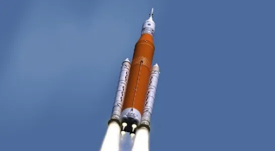

The centerpiece of our new rocket park is a ring from the core stage section of the Space Launch System pathfinder. A pathfinder is a prototype built by NASA for new hardware. These are built to exact height and weight specifications. NASA must test its existing facilities to ensure that existing hardware is compatible with new technology. Note that this is not “Pathfinder”, the name given to our orbiter on display, but **<u>A</u>** pathfinder, a model often made by NASA when developing new technology. The SLS pathfinder was built in North Alabama and used for testing at the Stennis Space Center in Mississippi. Attached to the ring are stand-ins representing the 4 RS-25 engines which power the SLS core stage. These engines, the same type as were utilized on the Space Shuttle, but upgraded for more efficiency and power, produce around 1.67 million pounds of thrust, burning for around 8.33 minutes. Upon launch, these engines are aided by two five-segment solid rocket boosters, which provide an additional 7.13 million pounds of thrust for around the first two minutes of flight. The SLS represents the pinnacle of engineering, but it did not come from nowhere. It stands upon a rich and storied history of engineering and rocketry, of which a significant portion happened right here in Huntsville, AL.

**Historical Background (should be interwoven between the facts about the rockets)**

Dr. Wernher von Braun and key personnel who had been developing the V-2 missile for the Germans in WWII were brought to the United States in 1945-46 under Operation Paperclip. They were first sent to Fort Bliss, Texas, and tasked with improving upon the design of the V-2. Tests were conducted in White Sands, New Mexico. In 1950, the vacant Redstone Arsenal was declared the center of Ordnance Rocket Research and Development. Von Braun and his team were transferred, setting themselves up as the Ordnance Guided Missile Center (OGMC). In June 1950, the Korean War broke out. Ammunition production was resumed at Redstone Arsenal, and OGMC was tasked with the development of a surface-to-surface ballistic missile.

**<u>Army Redstone</u>**

Medium-range ballistic missile (200 miles)

69ft long

78,000lb thrust

1953-1961

The Korean War created an immediate need for the OGMC team under von Braun to produce a weapon. They continued their work on the improvement of the V-2 design at an accelerated pace. Named after the location of its conceptualization and design, the Redstone Missile would be America’s first ballistic missile. Because of the time pressure created by the active conflict, certain compromises were made in design. Originally designed to carry warheads up to 500 miles, the engineers adapted the plan to utilize technology from the existing Navajo missile engine. This facilitated quicker development, but also reduced the range of the missile to 200 miles. A notable later upgrade, the Rocketdyne A-7 engine produced 78,000lbs of thrust, utilizing a fuel of liquid oxygen and a mixture of 75% ethyl alcohol and 25% water.

The first Redstone test flight occurred in August 1953 (around a month after the conclusion of the Korean War). Additional testing meant that the missile was not approved for field operation until 1958. The Redstone saw limited deployment in the field, with only a few divisions stationed in West Germany. In 1956, the OGMC was reorganized. Von Braun and his team became the **Army Ballistic Missile Agency (ABMA).** The ABMA will serve as the centerpiece of the rest of this story until the establishment of NASA.

Around the same time as the Redstone Missile was approved for operation, the ABMA team began work on another missile system, the Pershing. Development proceeded quickly, and the Pershing replaced all Redstone Missiles in the field by 1963. Despite the missile’s operational life of only 5 years, it had a tremendous impact upon the U.S. Space program, serving as the foundation for additional improvements in science, exploration, and space travel. The Redstone missile would be nicknamed “Old Reliable” due to its excellent track record.

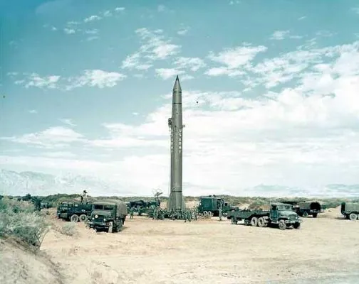

A Redstone missile team set up in field launch configuration

**<u>Jupiter-C</u>**

Sounding Rocket

68ft 7in long

78,000lb thrust

1956-1957

In 1950, many of the world’s leading scientists proposed that 1957-58 be celebrated as an International Geophysical Year (IGY), a period in which scientists from all around the world would collaborate in Earth Science studies. This year was proposed due to a period of maximum solar activity. The IGY was officially announced in 1952, with nations from all over the world eagerly agreeing to participate. Even the Soviet Union, after the death of Stalin in 1953, announced its intent to participate, shepherding in a rare break in the Cold War isolation of scientific exchange between East and West. In 1955, the United States announced that part of their contribution to the IGY would be the launch of small satellites that would orbit the Earth and gather scientific data. Perhaps no one was more excited about this announcement than Dr. von Braun himself. The von Braun team detailed a modified Redstone Missile capable of putting a satellite into Earth’s orbit in a report called Project Orbiter, submitted in 1955. The idea centered around the addition of several small solid-fueled upper stages on top of the Redstone missile. In a devastating blow to von Braun, Project Orbiter was rejected in favor of Project Vanguard, managed by the U.S. Naval Research Laboratory.

This may very well have been the end of the Redstone Missile concept, but in late 1955, the OGMC was authorized to cooperate with the Navy in the development of the intermediate range ballistic missile known as the Jupiter. With the establishment of the Army Ballistic Missile Agency (ABMA) in 1956, von Braun continued this work under a new organizational name. The Jupiter-C, short for Jupiter Composite, even shorter for Jupiter Composite Re-entry Test Vehicle was almost identical to the vehicle proposed in Project Orbiter for the IGY. Rather than launching satellites, however, the Jupiter-C would be used to test pieces of the Jupiter IRBM nosecone, still in development. Because of the desire by the military to complete the Jupiter project as fast as possible, the ABMA naming their sounding rocket Jupiter-C ensured that they would get high priority when launches were scheduled at Cape Canaveral. The first stage of the Jupiter-C was a Redstone Booster, accompanied by three solid-fueled upper stages for separating the nosecones from the booster in preparation for high-speed re-entry. The Jupiter-C was used for three flights, each successfully delivering the nosecone pieces for the Jupiter IRBM into almost an orbit.

This success increased Dr. von Braun’s desire to launch a satellite even more, and he repeatedly asked for permission, being repeatedly denied. The Jupiter-C program was cancelled, and remaining hardware was placed into storage. They might have stayed there forever had it not been for an event which took place on October 4th, 1957.

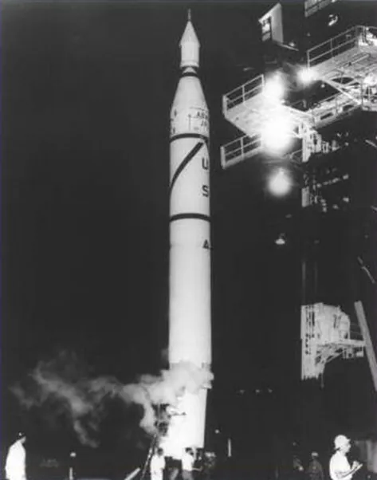

Jupiter-C on launchpad. Note the nose cone piece serving as the payload

**<u>Juno I</u>**

Space Launch Vehicle

68ft 7in long

83,000lb thrust

1958

On October 4th, 1957, the Soviet Union shocked the world by launching the world’s first artificial satellite, Sputnik I, into Earth orbit. “Shocked” may seem like a bit of an exaggeration considering that the International Geophysical Year was not a secret, and both the United States and Soviet Union had declared their intentions to launch a satellite during this time. However, the United States severely underestimated the Soviet Union’s ability in personnel and resources and believed that when the first artificial satellite was launched, it would be launched from the United States. They had selected Project Vanguard, and been lax about the timeline, since there was no perceived pressure. Sputnik I changed everything. No one was more frustrated by the launch of Sputnik I than Dr. von Braun himself, who had flight-ready Jupiter-C systems sitting in warehouses. Had proper authorization been given, the United States may well have launched the first satellite, and that would have been the end of it. Now, the country found itself behind in a competition that they did not even know they were participating in. They had to win at all costs. The space race was on.

By some bizarre stroke of fortune, the Secretary of Defense, Neil McElroy, was visiting ABMA at Redstone Arsenal when the news of Sputnik I’s launch broke. Von Braun loudly declared that if given the go-ahead, the ABMA could have a satellite in orbit within 60 days. His boss, Maj. Gen. John Medaris, convinced him to settle for 90 days instead. The Secretary of Defense returned to Washington to attempt to talk some sense into President Eisenhower, while General Medaris began secretly directing von Braun to prepare the Jupiter-C hardware for the launching of satellites. On November 3, the Soviets made another giant leap forward by launching Sputnik II, which contained a living animal, a dog named Laika (The media nicknamed this one “Muttnik”). The United States was now even further behind in the space race. Rather than continue to put all their eggs in one basket with Project Vanguard, the U.S. decided to keep its options open. Finally, in late November 1957, ABMA was given the go-ahead to prepare for the launch of a satellite. Another event which was fortuitous for ABMA was the December 6th Project Vanguard Test Vehicle 3 (TV3) launch. The booster lifted the Vanguard satellite about 4 feet off the ground before collapsing back to Earth, resulting in a spectacular explosion. The satellite itself, a 6.5-inch sphere, was blown off and landed a short distance away, still faithfully transmitting data (The media nicknamed THIS one “Kaputnik”).

This put ABMA in the fortuitous position of being able to be the first U.S. group to successfully launch a satellite. The ABMA was not alone in this endeavor but was aided by two other groups: The Jet Propulsion Laboratory in California, and the University of Iowa. These three groups and their leading figures are mostly responsible for the success of Explorer I, America’s first satellite.

Jet Propulsion Laboratory – Dr. William Pickering – satellite body and propulsion

University of Iowa – Dr. James van Allen – scientific payload

Army Ballistic Missile Agency – Dr. Wernher von Braun – launch vehicle

Dr. James van Allen, of the University of Iowa was responsible for creating the scientific payload for the satellite. He developed a cosmic ray detector to prove the existence of long-theorized bands of solar radiation which surround the Earth, trapped by its magnetic field. Explorer I would confirm the existence of these bands of radiation, which are named the Van Allen Radiation Belts. Dr. William Pickering and JPL were responsible for building the body of the satellite which the scientific payload would be attached to. ABMA and von Braun provided the launch vehicle, the Jupiter-C. That is, until Pickering, not wanting the launch to be associated with the Jupiter Intermediate Range Ballistic Missile program, suggested that the satellite launching version of the rocket be christened Juno. The Juno I bearing Explorer I was launched on January 31, 1958. ABMA had requested 90 days. They only needed 84.

This naming convention has created an incredible amount of confusion. To review: The Jupiter-C was a sounding rocket used to test nosecones for the upcoming Jupiter IRBM. The Juno I is a similar design with a fourth added solid-fuel upper stage (instead of 3) which is used for the launching of satellites. Both laymen and experts are oft to confuse these names repeatedly, but it is important to remember that both are simply modified Redstone missiles.

The Juno I (the “I” was technically added later to avoid confusion with the Juno II) continued the theme of incremental improvements in the Redstone family of vehicles. It was fueled by liquid oxygen and a new liquid fuel mix, called Hydyne, instead of alcohol. This allowed the Juno I to produce 83,000lbs of thrust. The “Tub” on top of the vehicle contains the upper stages. This would rotate during the process of launch and flight, in order to maintain balance and stability of the payload as it reached orbit. The solid upper stages were very small, and were fired for only about six seconds each, to nudge the payload to the proper positioning. The launch of Explorer I had been a resounding success, but had things gone differently, we might have had a second “Kaputnik” on our hands. Across the final 5 launches of the Juno I, all in 1958, only 2 were successful. Explorer II, Explorer V, and Beacon I were satellites which failed to reach orbit. Explorer III and IV, however, were successful.

<u>What do the numbers mean?</u>

Upon our Jupiter-C in the rocket park, we can observe “UE” printed on the side. This is far from an arbitrary label and is in fact a complex coding system developed by ABMA. The engineers wanted to preserve some secrecy about the number of Redstone boosters being produced. They came up with utilizing the letters in “Huntsville”, their home base, as a numeric code.

H = 1, U = 2, N = 3, T = 4, S = 5, V = 6, I = 7, L = 8, E = 9, X = 0

The rocket on display in our park is dressed up to look identical to the Juno I that launched Explorer I in 1958. It displays the letters “UE”. This indicates that it is Redstone Booster \#29. When looking at pictures from other Jupiter-C or Juno I launches, you can use this same code to see what the Redstone Booster number for that launch was.

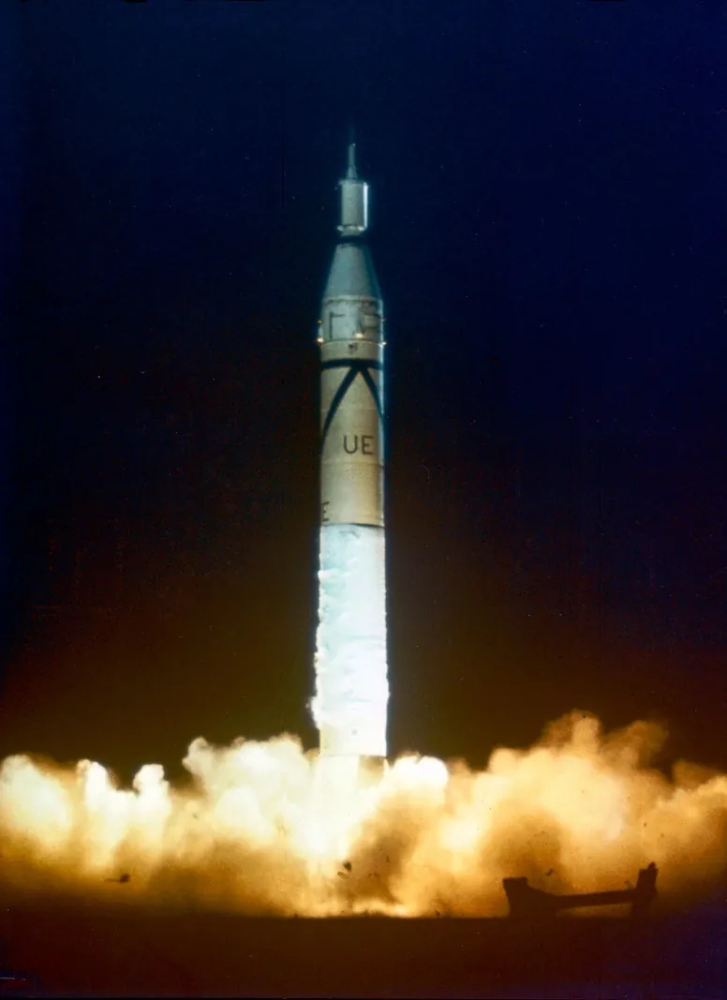

Explorer I (with Redstone \#29 as its first stage booster) launches January 31, 1958

**<u>Jupiter IRBM</u>**

Intermediate Range Ballistic Missile (1,976 miles)

60ft long

150,000lb thrust

1957-1963

The Jupiter Intermediate Range Ballistic Missile represented for the Army Ballistic Missile Agency the next logical leap after the success of the Redstone Medium Range Ballistic Missile. With additional power and a greater range, Jupiter would be an improvement over Redstone. Being assigned to the Jupiter project would also prove beneficial for the ABMA, as the development of the Jupiter-C for testing Jupiter nosecone materials would lead to the eventual success of the Juno I and Explorer I. During the 3 sounding rocket test flights of the Jupiter-C, it was determined that an ablative heat shielding material would be ideal for the Jupiter nosecone. The same principle of Ablative heat shielding would come into play throughout the Mercury, Gemini, and Apollo Programs, as well as continuing to be utilized on the Orion spacecraft for NASA’s Artemis program.

R&D of the Jupiter missile was performed by ABMA until an unfortunate circumstance which pulled the rug out from underneath them. A reorganization of military resources declared that the U.S. Army would be stripped of jurisdiction of all missiles with a range greater than 200 miles. The reasoning for this being that the Army should be focused on “close range” support of ground troops, and not longer-range ballistic missiles. The Jupiter was handed over to the U.S. Air Force, and while it became the United State’s first operational IRBM, the Air Force largely ignored it in favor of the Thor IRBM, which had been developed by, any guesses? The U.S. Air Force.

This was a shame, since Jupiter represented a massive technological leap from Redstone. It was fueled by a combination of Liquid Oxygen and a refined version of Kerosine known as Rocket Propellant 1, or RP-1. This mixture became the leading standard for several years, even being used on the first stage of the Saturn V. Jupiter produced 150,000lbs of thrust. The first test flight was in 1957, operational units were activated in 1958, and the missile was withdrawn from active service in 1964. Despite this, Jupiter’s legacy played a vital role in the continuation of the space program.

In July of 1958, in response to the Soviet forays into outer space and the United States’ perceived lack of standing in the global power ranking, President Eisenhower asked Congress to pass legislation creating an agency to oversee the nation’s non-military space exploration interests. The National Aeronautics and Space Administration, NASA, was created. This marks a notable shift in our displays. The early American steps into space were overseen by the military. ABMA was after all, a division which was primarily focused on making weaponry. Dr. von Braun had always dreamed of spaceflight and was able to get in bits and pieces of science and exploration where he could using the vehicles he designed. With the establishment of NASA, it was made clear that the “conquest” of space would be a civilian effort. This is why some of the earlier missiles say “U.S. Army” and the later missiles retooled for space exploration say, “United States”, or “USA”.

NASA’s space exploration efforts continued to make use of the Jupiter system. Perhaps the most famous flight of Jupiter was the May 1959 flight of a rhesus monkey named Able and a squirrel monkey named Baker. The monkeys were sealed inside the nose cone in specialized capsules. The missile launched them to an altitude of 300 miles, and 1,500 miles downrange over the Atlantic Ocean. During this 16-minute flight, the two “Monkeynauts” were weightless for nine minutes and experienced 38 *g* of acceleration. They splashed down in the Atlantic, and were recovered alive, the first U.S. animals to survive spaceflight. Able died four days after the flight due to a reaction from anesthesia during surgery performed to remove a medical electrode. “Miss” Baker lived for many years, eventually finding a home at the U.S. Space and Rocket Center until her death in 1984. Visitors today often show their appreciation by leaving bananas on her grave, which is located right outside the main entrance to the museum.

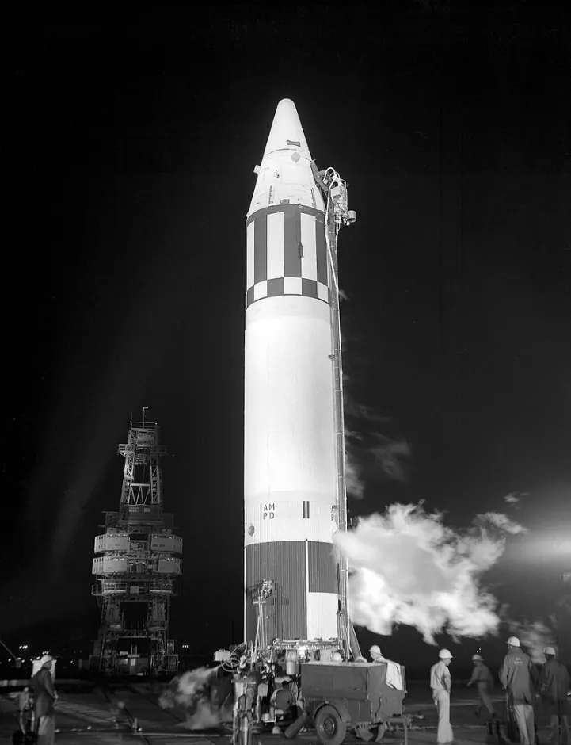

Jupiter containing Able and Baker, May 1959

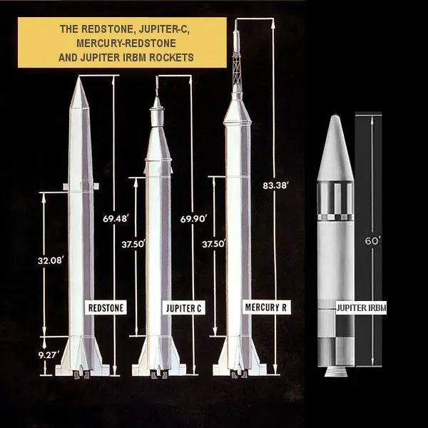

**<u>Juno II</u>**

Space Launch Vehicle

76ft 7in long

150,000lb thrust

1958-1961

The Juno II represents another marriage of concepts from ABMA’s existing family of missiles retooled for science and exploration. The first stage of the vehicle was a Jupiter IRBM stage, meaning this vehicle also was fueled by RP-1 and Liquid Oxygen and produced 150,000lbs of thrust. This initial stage was complimented by the four-stage solid upper of the Juno I, which had been redesignated “Juno I” to minimize confusion about why there was a Juno II. The second and third stages were still tightly clustered and covered by a rotating tub, although on the Juno II, additional fairing was placed on top of the vehicle to improve aerodynamics and safety. The Juno II was utilized for ten satellite launches. Six of those launches failed. Successful satellite launches included Pioneer IV, Explorer VII, Explorer VIII, and Explorer XI. Of these, Pioneer IV is most notable, as it was a lunar probe which completed the first U.S. lunar flyby and then became the first American satellite to enter a heliocentric orbit.

The Army Ballistic Missile Agency and Dr. von Braun, who had designed and created the major components of the Juno II, sought to continue the design and manufacture of dedicated space launch vehicles. They created designs for super-heavy boosters capable of delivering large payloads to the moon. In 1960, NASA opened the Marshall Space Flight Center at Redstone Arsenal. Much of the ABMA would be folded under this new umbrella, with von Braun serving as the center’s first director. The team’s work involved many of the same plans as before, with one notable change. NASA had decided that instead of Juno, the super heavy booster system would carry the name, “Saturn”.

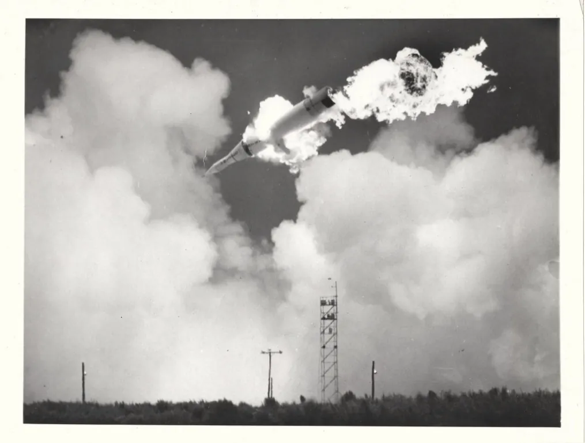

A particularly nasty failure in which Juno II immediately started cartwheeling

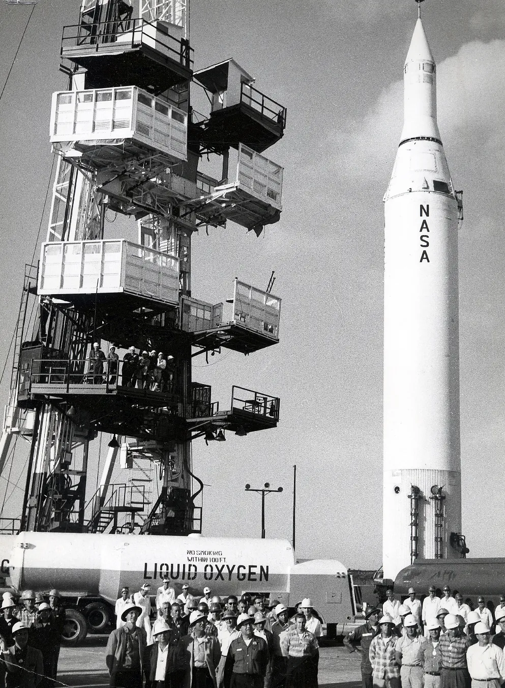

**<u>Mercury-Redstone</u>**

Sub-orbital Space Launch Vehicle

83ft long

78,000lb thrust

1960-1961

NASA had been established as the country’s civilian space flight agency, responsible for keeping the United States in the running in the space race. After satellites, probes, and animal flights, the next logical step would be the launching of humans into space. The first American manned spaceflight program was the Mercury Program, with the goals of getting a man into space and back safely and orbiting the Earth. Seven men were selected to be America’s first astronauts, the Mercury Seven. The McDonnell Aircraft corporation constructed the Mercury space capsule that the astronauts would use to fly into space. NASA had a capsule and a corps of astronauts to fly it, but what vehicle would be used to launch it into space? Recall that Dr. von Braun and many of the scientists who were part of the Army Ballistic Missile Agency had been folded into NASA with the establishment of Marshall Space Flight Center. Von Braun himself would serve as the center’s first director. He was more than happy to lend his team’s early work to the space program. NASA selected the Redstone missile to carry the first Americans into space for the suborbital flights which would be America’s first forays into space.

The Redstone Missile was selected by NASA based in part on its excellent track record of safety and reliability. This had led to it being nicknamed “Old Reliable”. For use in human spaceflight, the existing systems received additional safety and performance upgrades, including an extra six feet of tank for more fuel, which meant more speed and altitude. An in-flight abort sensing system was designed to protect the astronaut during liftoff. In total, about 800 changes were made to the missile to qualify it for manned spaceflight. The rocket was still fueled by liquid oxygen and the alcohol/water mixture, with the Rocketdyne A-7 engine allowing for 78,000lbs of thrust. Being a single state rocket booster, the Redstone did not have the capability for orbital flight (recall that the Juno I required the addition of 4 additional solid-fueled upper stages to achieve this result) so Mercury-Redstone would be utilized for only suborbital flights.

The first test of the Mercury-Redstone system occurred on <u>November 21, 1960.</u> Uncrewed test flights are a way to ensure that critical systems operate as necessary and allow the system to receive its “human rating” for manned spaceflights. This test, designated MR-1 (Mercury-Redstone 1) would be the system’s qualifying flight, also testing flight control and recovery systems, launch and ground tracking operations, and the inflight abort sensing system. Several notable individuals, including several of the Mercury Seven gathered to watch this historic launch. After a nominal countdown, the engine ignited…. And immediately shut off. The rocket had lifted off the pad a total of 4 inches before settling back down onto the pad. Alarms began to blare, as personnel feared an explosion. The rocket did not explode. Instead, as the crowd watched (several of them from underneath the bleachers), the launch escape tower fired its engines and shot into the sky. This would have been a promising sign that the abort system was functioning, except that the tower failed to take the capsule along with it. The launch escape tower, just the tower, flew about 4,000ft into the sky and speared into the ground 400 yards away. As if that were not enough, three seconds later, the capsules parachutes unceremoniously deployed, shooting uselessly into the sky to slow the unmoving capsule. Launch engineers were faced with a dire situation. A fully fueled missile was balancing on the launch pad untethered to the ground with no means to safely resecure it. The parachutes were dangling down the side, and it was feared that a strong gust of wind might blow the rocket over. Launch engineers presented a series of increasingly complicated and dangerous “solutions” including one that involved shooting the booster with rifles to depressurize the tanks. Flight Director Chris Kraft maintained his composure and decided that the best possible course of action would be to do nothing, waiting overnight for the liquid oxygen to boil off and the flight batteries to be depleted. The team let the vehicle sit overnight and were able to render it safe the next morning.

The main cause of the shutdown was the result of two electrical cables disconnecting in the wrong order. A control cable was used that was too long, causing it to disconnect after the electrical power cable, and not before. This sent signals to the booster for a cutoff of engine firing. This flight, a notable failure which provided an excellent learning experience, was dubbed “The Four-Inch Flight”. However, important upgrades were made in preparation for the next test which improved the safety and reliability of the vehicle and launch pad systems. The astronauts grumbled more than their fair share, grumpy because their trips into space had been pushed back yet again. The Mercury-Redstone booster on display in the Rocket Park at the U.S. Space and Rocket Center is MR-1, the booster utilized for the famous 4-inch flight.

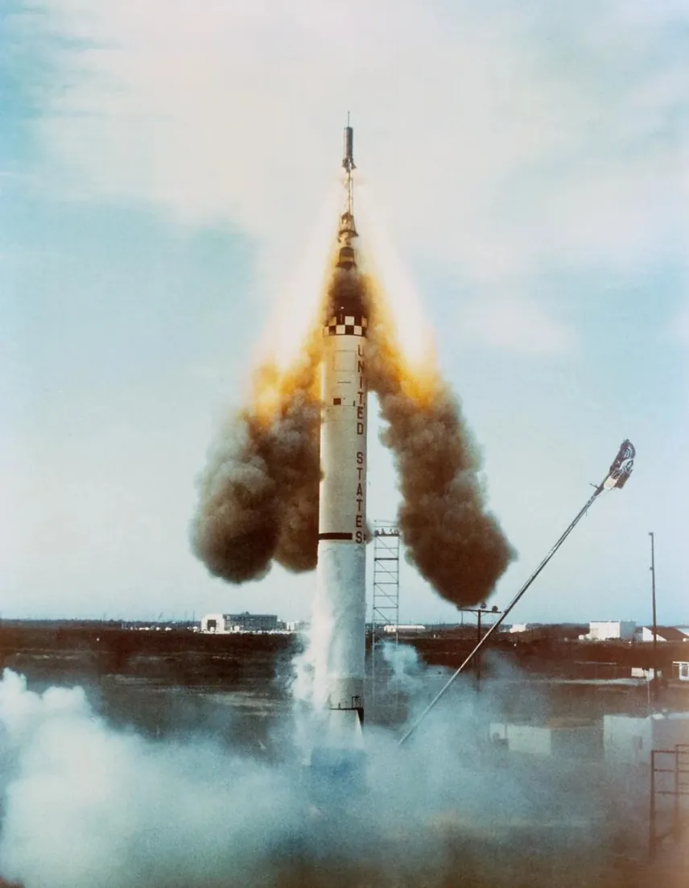

The launch escape tower (and just the tower) flies off the Mercury Capsule during MR-1

The Mercury Capsule from MR-1 was undamaged and was flown aboard the successful unmanned test flight MR-1A. The system had been qualified for human use. The Mercury Seven were eager to begin flying into space, and then disappointed when the first living creature to fly the Mercury Redstone on MR-2 was a chimpanzee named Ham. Ham’s successful flight on MR-2 in January 1961 finally paved the way for Alan Shepard to become the first American in space. After some additional test flights with different names, MR-3 (*Freedom 7*), the first ever American human spaceflight was launched May 5,1961. Alan Shepard spent 15 minutes and 22 seconds on this suborbital flight, the second human to go to space. The Soviet Cosmonaut Yuri Gagarin had been launched on April 12, 1961, and had completed an Orbit of the Earth. The U.S. was still behind in the space race. Despite this, it was shortly after Alan Shepard’s flight that President John F. Kennedy made his famous declaration that the United States should commit itself to getting a man on the moon and back by the end of the 1960s.

The Mercury-Redstone would be used for one more manned spaceflight. On July 21, 1961, on MR-4 (*Liberty Bell 7*), Gus Grissom flew on what was essentially an identical flight to Alan Shepard. The two flights of the Mercury-Redstone had been so successful that plans for two additional manned suborbital launches, MR-5 and MR-6, were scrapped in favor of moving straight to orbital flights. This would require the use of a different booster for the Mercury spacecraft.

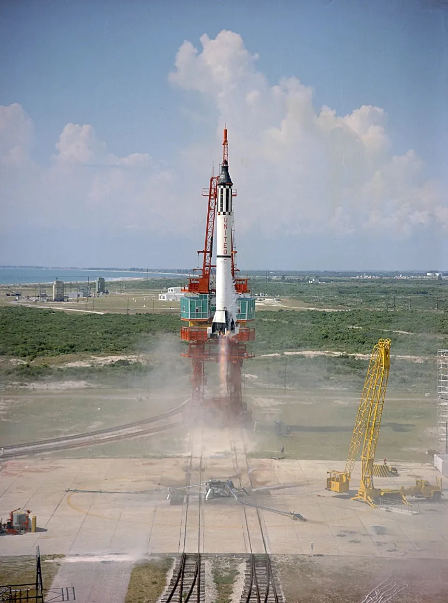

Alan Shepard successfully lifts off the ground during MR-3, flying in *Freedom 7*

**<u>Mercury-Atlas</u>**

Space Launch Vehicle

95ft 4in long

367,000lb thrust

1960-1963

For the first American Orbital flights, NASA needed a vehicle stronger than the Redstone missile. ABMA and the von Braun team had been asked about the possibility of modifying the Jupiter system for higher and faster (but still suborbital) flights, and a Mercury-Jupiter had been designed. However, this program was scrapped, as it was clear that all Mercury Program objectives could be met with the Mercury-Redstone, and the orbital system Mercury-Atlas. The Mercury-Atlas is based on the Atlas D, the first operational U.S. Intercontinental Ballistic Missile (ICBM) in active service. The Atlas system was designed by the U.S. Air Force. For man rating and flights in the Mercury Program, similar safety improvements and upgrades were made to the Atlas, as with the Redstone. Mercury-Atlas was again flown by a chimpanzee, this time named Enos, before astronauts were allowed to make orbital flights (Enos flew aboard MA-5). Astronaut John Glenn became the first American to orbit the Earth on MA-6 (*Friendship 7).*

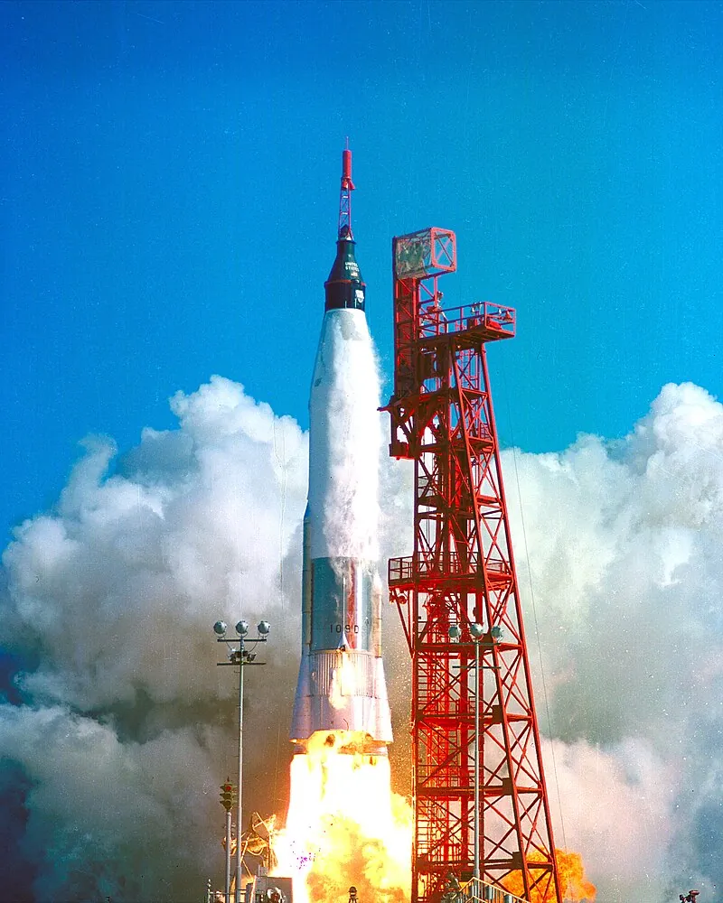

John Glenn launches into orbit on MA-6 (*Friendship 7*)

The U.S. Space and Rocket Center’s Atlas (NOT a Mercury-Atlas, as it lacks the Mercury Capsule) is not included in the new bounds of Rocket Park. It does not therefore have to be included in the tour, but you may wish to invite guests to go view it after the tour concludes. This missile is visibly different from the others. It is lying down on its side. The Atlas is made of a rather thin aluminum alloy material not much thicker than a dime. It is lying down because the pressure exerted on it if it were standing here empty would crush it. There is an air compressor which helps to maintain equal pressure and preserve the missile.

The Mercury-Atlas was utilized for the remaining flights of the Mercury Program.

Scott Carpenter – MA-7 (*Aurora 7*)

Wally Schirra – MA-8 (*Sigma 7*)

Gordon Cooper – MA-9 (*Faith 7*)

**<u>Saturn I Block II</u>**

Space Launch Vehicle

190ft 4in long

1.52 million lb thrust

1964-1965

During project Mercury, the go-ahead was given to start work on a heavy launch vehicle that would be the foundation of vehicles for moon travel. The von Braun team working at Marshall Space Flight Center had created plans to expand upon the existing Juno system, creating super heavy launch vehicles. Under NASA, this program was renamed Saturn. However, much of the existing hardware from the Redstone, Jupiter, and Juno systems would be utilized. The Saturn I was the first American launch vehicle that was built purposely for space exploration. The First stage of the booster, the S-I and later S-IB (S-IB does not mean “Saturn IB” in this case, but refers to the second design of the first stage of the Saturn I. The third Stage 1 design, used on the Saturn V, is therefore designated S-IC) are made of a central Jupiter missile tank surrounded by eight Redstone tanks. The cluster of tanks and engines led some detractors to jokingly refer to the design as “Cluster’s Last Stand”. The S-IB was powered by eight H-1 engines, each capable of producing around 200,000lbs of thrust.

The makeup of the second stage provides clues to the configuration of the Saturn I. The original Saturn I contained a dummy upper stage used only for testing (in fact, more Jupiter tanks filled with water were packed inside this fake stage to provide ballast for the vehicle).

The Saturn I Block II, on display at the U.S. Space and Rocket Center, contained a live second stage called the S-IV, which was powered by six RL-10 engines. The RL-10 engine is notable for being the first successful engine which was fueled by the now iconic combination of liquid hydrogen and liquid oxygen. The RL-10 is often overlooked, but continues to be an extremely reliable engine, seeing continued use even to today. The Interim Cryogenic Propulsion Stage on the Space Launch System, the central part of NASA’s Artemis Program, is powered by a singular RL-10 engine. Planned upgrades to the SLS, the SLS Block IB and SLS Block 2 will make use of the more powerful Exploration Upper Stage, which will be powered by four RL-10s.

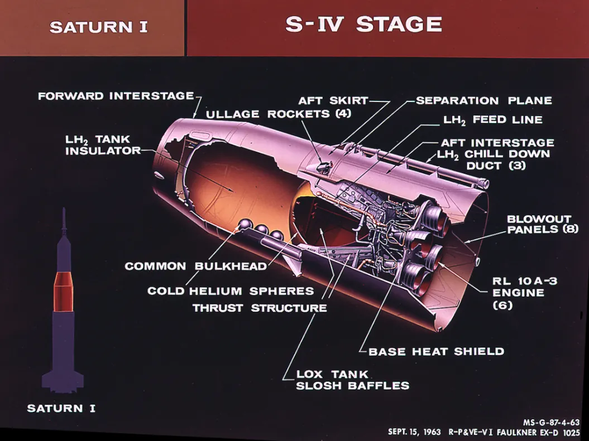

The S-IV stage, found on the Saturn I Block II

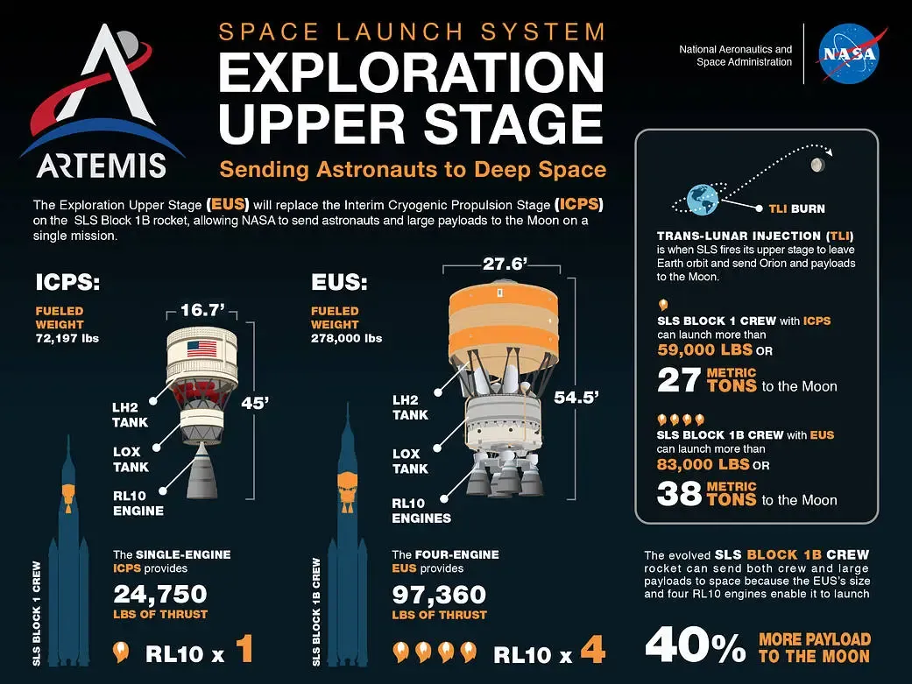

A comparison of the ICPS to the EUS and improvements to the Space Launch System

The Saturn I Block II in the Rocket Park at the U.S. Space and Rocket Center is often misidentified as a Saturn IB. The Saturn IB is the most widely known of the Saturn I designs, due to its use in Apollo 7, Skylab 2, 3, and 4, and the Apollo Soyuz Test Project. The Saturn IB is marked by an S-IVB second stage. This improvement on the S-IV saw the replacement of the six RL-10s with a singular J-2 engine. The S-IVB would serve as the third stage of the Saturn V as well as the second stage of the Saturn IB.

The Saturn I Block II System was used for test launches of boilerplate Apollo Command and Service Module pieces, as well as three successful launches of Pegasus micrometeoroid satellites. The Saturn I Block II at the U.S. Space and Rocket Center is designated SA-D5 Dynamic Test Vehicle (yes, “sad five”). It underwent both dynamic testing at the dynamic test stand at Marshall Space Flight Center in 1962 as well as testing of the facilities of Launch Complex 37B at Kennedy Space Center.

**<u>Wrap-up</u>**

It should be clear by this point how rocket technology evolved out of the missiles of WWII and the early Cold War, with incremental improvements in design, power, and engineering. Weapons of war were converted into spacecraft, and eventually, vehicles were constructed solely for the purpose of space exploration. This concludes the tour of the rockets within the rocket park, but you are strongly encouraged, after discussing the Saturn I Block II, to turn around and look at the mighty Saturn V, the next link in the chain which was the key to America’s victory in the space race and humans finally walking on the lunar surface.

NASA did not stop there. The *Pathfinder* shuttle stack is not easily viewed from rocket park, but you may want to encourage guests to head that way at the conclusion of the tour, as the Space Shuttle’s legacy can still be felt today, primarily through the International Space Station.

The most important ending note is to emphasize how NASA’s current endeavors, The Artemis Program and the Space Launch System, are continuing to push the boundaries of science and exploration, and how they too, can be seen as having evolved from the very rocket systems that we have on display in the Rocket Park. There is a great deal of history in this tour, but the story of these vehicles is also intimately linked to what is happening now. Artemis and SLS should bookend this tour. It is essential to the story.
