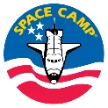

**Saturn V Hall/History Study Guide**

**This list is meant to help you identify what information you need to know to ace your Saturn V Hall Test! Please ask any member of leadership if you have any questions about the material. We are happy to help**😊

Animals in Space (Laika, Able, Baker, Ham, Enos)

First man in space

First American in space

First artificial satellite

First American satellite

First space station

First American space station

First EVA

First American EVA

First man on the moon

Apollo 1

First manned mission to orbit moon

First woman in space

First American woman in space

First American to orbit the earth

First international docking

Mercury astronauts

Apollo 11 astronauts

Apollo 16 Astronauts

Quick Plane

Operation Paperclip

F1 engine static test firing

Mercury program

Mercury Redstone

Mercury Atlas

Gemini program

Titan II

Apollo program

Saturn V

NASA

Date of first moon landing

Apollo 13

Apollo 16 Command Module

Lunar Rover

Lunar Module

Mylar

Mobile Quarantine Facility (Function and what missions)

Skylab

Largest Skylab fragment

Pathfinder

Orbiter

External Tank

Solid Rocket Boosters

Names of the 5 space-flown Orbiters

Saturn V First Stage – engines, thrust, burn time, total fuel, types of fuel, altitude

Saturn V Second Stage - engines, thrust, burn time, total fuel, types of fuel, altitude

Saturn V Third Stage – engine, thrust, total fuel, types of fuel, be able to explain this stage’s two burns

Launch Escape Tower
