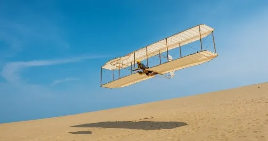
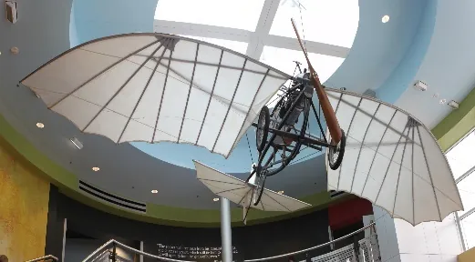
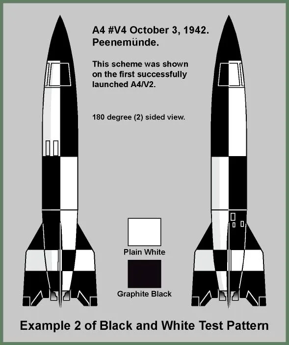
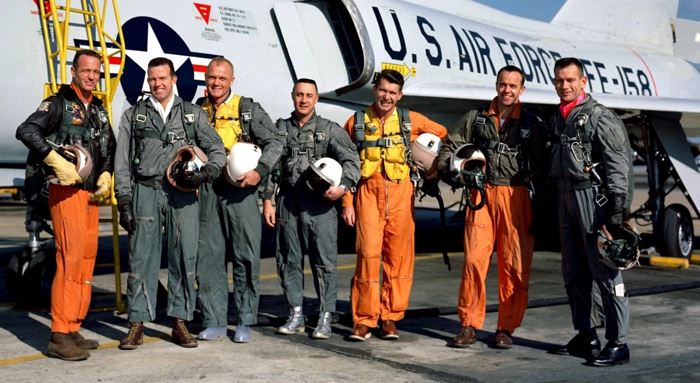
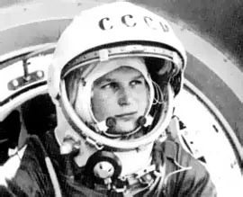
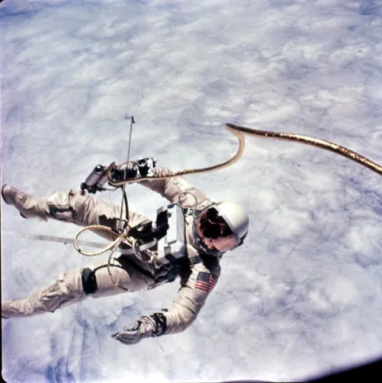
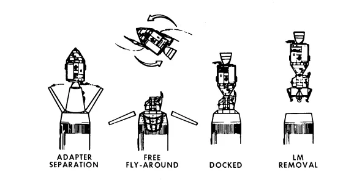
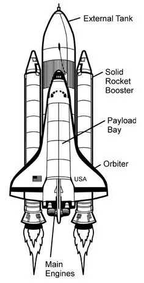
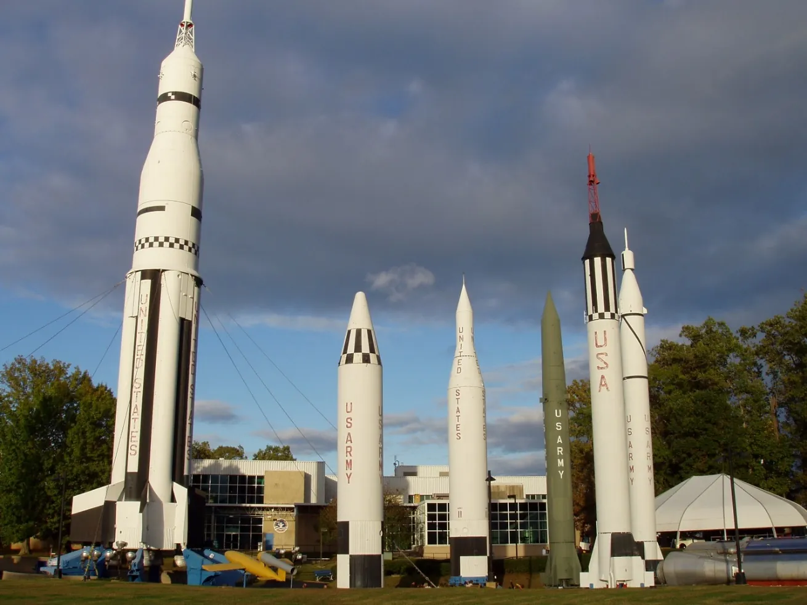

**REDSTONE ARSENAL HISTORY**

**Pre-Arsenal Settlements:**

The middle Tennessee River valley, now occupied by Redstone Arsenal, was originally inhabited by various American Indian tribes including the Creek, Cherokee and Chickasaw. By the early 1800s, Anglo-American farmers had established farming communities along this region of the Tennessee River basin. Over 550 families, mostly tenants and sharecroppers, lived in small farming communities on this land. Ultimately, the U.S. War Department purchased the farm land to build what is now known as Redstone Arsenal.

**1940s:**

Today’s Redstone Arsenal was originally formed as three separate entities in 1941 and 1942 as part of the War Department’s ramp-up for WWII. Huntsville Arsenal manufactured chemicals, Redstone Ordnance Plant (later Redstone Arsenal) manufactured munitions, and the Huntsville Chemical Warfare Depot (later Gulf Chemical Warfare Depot) stored the conventional and chemical filled munitions before being shipped out. Once WWII ended, the focus shifted from production to the demilitarization and salvaging of munitions along with the deactivation of the huge manufacturing facilities at the arsenal complex. Some of the empty buildings were even leased to private enterprise. By 1949, part of the arsenal was advertised for sale by the Army Corps of Engineers. The sale never happened due to the Army’s decision to consolidate its rocket and guided missile missions here in 1948 and 1949.

**1950s:**

With the arrival of Dr. Wernher von Braun and his rocket team from Fort Bliss in 1950, the arsenal became the center of Army missilery and rocketry. During this decade, Redstone’s scientists, engineers, and technicians transformed numerous weapon systems such as the REDSTONE, JUPITER, HAWK, PERSHING, NIKE AJAX, and NIKE HERCULES from dreams into realities. It was also during this time that the von Braun team made several notable contributions to the nation’s space effort while working for the Army. Most notable was the Army’s launching of America’s first satellite, EXPLORER I, into space in January of 1958. This and other achievements by the Army helped lay the foundation for U.S. space exploration.

**1960s:**

In support of the newly formed NASA, a large number of Army employees, land and facilities supporting space and rocket programs were transferred to NASA and the Marshall Space Flight Center (MSFC) was established. Army work continued to focus on developing and sustaining ground and air defense missile systems with a focus on the Cold-War and maintaining a technological edge over Soviet systems. Meanwhile, MSFC was focusing on the ultimate space prize of putting a man on the moon. Rocket motor test stands roared as MSFC worked around the clock to achieve manned space flight. The Saturn-V rocket that eventually carried our three astronauts to the moon in 1969 was ultimately the result of the work performed here.

**1970s & 1980s:**

Although the United States had won the Space Race, the Cold-War continued. Redstone Arsenal activities continued to develop advanced weapon systems and train service members on the maintenance and repair. A few of these systems included the PERSHING-II, CHAPERRAL, Multiple Launch Rocket System (MLRS), PATRIOT, and AVENGER.

After retiring the Apollo space missions, MSFC continued to focus on propulsion systems, space station operations, and numerous other programs. These included the Skylab space station, Space Shuttle development for routine space access, and Spacelab 1.

In 1988, a term that would later become part of the common local vocabulary, was first introduced as the Base Realignment and Closure (BRAC). The 1988 BRAC round realigned the Test, Measurement and Diagnostics Equipment (TMDE) Center from Lexington, KY, and sparked a new era of growth only rivaled by the expansion seen previously with NASA’s space programs.

**1990s:**

The Space Shuttle program throughout the nineties served as NASA’s workhorse. Its many flights included the delivery of the Hubble Space Telescope which was another program developed at MSFC. BRAC 1991 brought materiel and logistics readiness activities from Lexington, KY, and the Presidio of San Francisco, California, which merged and later became AMC’s Logistics Support Activity (LOGSA). Additionally, the Armament, Munitions and Materiel Command (AMCCOM) was to relocate to Redstone, but this decision was reversed in the 1993 BRAC round. Another BRAC round, released in 1995, realigned multiple Army aviation activities and commands from St. Louis, MO, merging them with Redstone Arsenal’s Missile Command and other missile related centers.

**2000s:**

The synergies created by bringing aviation to Redstone Arsenal resulted in tremendous growth on the installation and in the local community as the results of the largest BRAC round to date were released. BRAC 2005 brought the Army Materiel Command’s four-star headquarters, Space and Missile Defense Command’s Three-star headquarters, the majority of DoD’s Missile Defense Agency, and U.S. Army Security Assistance Command’s Two-star headquarters from Northern Virginia. The Aviation Technical Test Center moved from Fort Rucker, Alabama, and merged with the Redstone Technical Test Center to become Redstone Test Center. Second Recruiting Brigade and 2nd Medical Recruiting Battalion were also realigned to Redstone from Fort Gillem, Georgia.

Other significant growth has occurred due to decisions outside of the BRAC process as well. The newly activated Army Contracting Command and Expeditionary Contracting Command, realignment of Department of Justice’s explosives research and analytical centers for the FBI and ATF, and various new programs within existing organizations have brought more than growth. They have added to the already diverse and dynamic mission set, only found at Redstone Arsenal.

**SATURN V HALL TOUR EXPECTATIONS**

- The DC tour guide shift will start at 8:30am. After clocking in, walk the hall, looking for lights out, trash, things left out from events, damaged exhibits etc.

- Guided tours of the Saturn V Hall are everyday 10am,12pm,1:30pm and 3:30pm. Please meet your guests at the F-1 engines by the Tour Sign. Please invite guests to your tour, even if they don’t want it, it’s good to let them know you are there for them if they have any questions.

- Guided Tours must be between 45 minutes and one hour long. The tour needs to cover information from the Quick Plane to the Space Shuttle.

- In between your tour times, please walk the hall greeting all our guests. Encourage guests to go to talk to a docent (REAL Rocket Scientists) or find the Moon Rock.

- Please don’t leave the Saturn V Hall/DC unless for lunch. It is important that our guests know that you are there and not socializing across campus. There is a breakroom with a Refrigerator and microwave if you would like to store your lunch, or you may venture to Mars Grill or Crew Galley. Just make sure you are always early for your tour times.

**SATURN V HALL TOUR OUTLINE**

Time allotted for this tour is 1 hour.

Below is a general outline for the tour. It is not required to mention every piece of information in this outline. Some of the more important info from each topic is in bold, but this outline is not all-inclusive. You are encouraged to bolster your tours with information which you come across in your own research, or any additional stories/facts which interest you. Guests will appreciate you talking with enthusiasm about your own interests. There is no need to cover every single topic on each of your tours. Instead, tailor your tour for the interest and attention span of your audience.

You are encouraged to tell as many stories as you can during your tour. The history of the space program is full of stories – some funny, some tragic, some inspiring, all interesting. Share these stories with the guests. It will help them connect to the people and events of the space race in a much deeper way than if your tour was nothing more than a recitation of facts. Even a guest who knows a lot about the space program already may learn something new from one of your stories.

- Introduce yourself

- Launch the tour: It may be helpful to set the stage with a brief historical context i.e. the space race, the post-WWII era, etc.

- **<u>Quick Plane –</u>** Good to talk about if you meet your group downstairs

  - **William Lafayette Quick – New Market Alabama, 1908**

  - **Birds, Bats, Bugs – inspiration for wings**

  - **Differences from the Wright Brothers’ plane**

- **<u>Mercury Program</u>**

  - **Goals** – Get a man in space and back safely, orbit the Earth

  - First man in space and in orbit was a Soviet named **Yuri Gagarin**

  - First American in space – **Alan Shepard**: Mercury capsule, launched by a **Mercury** **Redstone** launch vehicle

  - First American in orbit – **John Glenn**, same type of capsule, launched by a **Mercury** **Atlas** launch vehicle

  - First woman in space – Soviet **Valentina Tereshkova**

  - 7 Mercury Astronauts – 6 manned launches

- **<u>Gemini Program</u>**

  - **Goals** – Spend 2 weeks in space, perform EVA, rendezvous and dock spacecraft.

  - Nicknamed the Program of 2s: second American space program, two men in the capsule, named after the constellation Gemini (the twins), Titan II rocket, docking 2 spacecraft together.

  - First EVA**: Alexi Leonov**, USSR

  - First American EVA: **Ed White, Gemini 4**

  - **Titan II** rocket

  - **Rendezvous** – Gemini 6A and Gemini 7

  - First use of fuel cells to generate electrical power in space craft

  - **First docking** – Gemini 8, Neil Armstrong

  - 12 launches, 10 manned

- **<u>V2</u>** – the rocket that provided the base of knowledge for the launch vehicles for Mercury, Gemini and Apollo missions

  - **Operation Paperclip**

  - **Dr von Braun and his work at Redstone Arsenal**

- **<u>Saturn V</u>**:

  - **363 Feet, 3 stage, Expendable**

  - Overview of Apollo mission goals (Get men to the moon and back safely)

- **<u>Stage I</u>**

  - **5 F-1 Engines**

  - **7.5 million pounds of thrust**

  - **Burn time of 2.5 minutes**

  - **About 42 miles above the surface of the Earth**

- **<u>1:10 scale model</u>**

  - **Point out the 3 stages of the Saturn V**

  - **The Launch Escape Tower**

  - **Explain the difference between the Saturn V and the Apollo Spacecraft**

- **<u>Stage II</u>**

  - **5 J-2 Engines**

  - **1 million pounds of thrust**

  - **Burn time of 6 minutes**

  - **116 miles above the surface of the Earth**

- **<u>Stage III</u>**

  - **1 J-2 Engine**

  - **200,000 Pounds of Thrust**

  - **2 burns of this stage**

- **<u>Instrument Unit</u>**

  - **Main Computer of the Saturn V**

  - **Less powerful than modern cell phones or singing birthday cards**

- **<u>Apollo Spacecraft</u>**

  - **Command Module**

  - **Lunar Module**

  - **Crew of 3 Astronauts**

    - Commander, Lunar Module Pilot, Command Module Pilot

  - **Explain the process of transposition and docking**

- **<u>Lunar Module</u>**

  - **2 Stage Vehicle**

  - **Crew of 2**

  - **Mylar –** The foil-like material which surrounds the metal skeleton of the descent stage

- **<u>Lunar Rover</u>**

  - **Used on the final 3 Apollo Missions – 15, 16, 17**

  - **Increased Range –** These missions were focused more on doing science on the surface of the moon. The rover allowed the astronauts to cover more ground and collect a broader sample.

  - **Foldable** – The Lunar Rover folded up and was stored in the descent stage of the LM

- **<u>Apollo 16 Command Module</u>**

  - **Orbited the Moon in 1972**

  - **Nicknamed Casper**

  - **Protected by an ablative heat shield for the process of reentry**

  - **Splashdown in the Pacific - Parachutes**

- **<u>Moon Rock</u>**

  - **3.16 billion years old**

  - **Brought back by Apollo 12, 1969**

  - **Alan Bean, LMP**

- **<u>Apollo Suit</u>**

  - **Three Layers**

  - **Tailor made for the dimensions of each astronaut**

- <u>**Mobile Quarantine Facility (MQF**)</u>

  - **Moon Germs**

  - **Short term quarantine in the trailer –** longer stay in Houston quarantine

  - **Apollo 12, 1969 –** Pete Conrad, Dick Gordon, Alan Bean

  - **Used for Apollo 11, 12, 14 –** <u>NOT 13 BECAUSE THEY DID NOT MAKE IT TO THE MOON!!!</u>

- **<u>Skylab</u>**

  - **1st American Space Station**

  - **3 manned missions, 4 total missions**

  - **The orbit decayed – fell to earth in 1979**

  - **Landed in Australia, the oxygen tank on display is a real artifact recovered from the wreckage of the station**

<!-- -->

- **<u>The Space Shuttle</u>**

<!-- -->

- **NASA wanted a reusable launch system after the Apollo Program**

- **5 Shuttle Orbiters, Columbia, Challenger, Discovery, Atlantis, Endeavour**

- **1981-2011**

- **First American woman, First African American man and woman**

- **135 missions**

- **Built the International Space Station**

- **Hubble Telescope, Chandra, etc.**

- **Challenger (1986) and Columbia (2003) tragedies**

<!-- -->

- **<u>The Space Launch System (SLS) - not on display in SVH, but you may want to mention</u>**

  - **NASAs Next Rocket**

  - **Upgraded Space Shuttle parts stacked in a more Saturn V mindset**

  - **Will carry humans back to the Moon and to Mars**

**SATURN V HALL RESOURCES**

**<u>Quick Plane:</u>**

The Quick Plane was designed and built by William Lafayette Quick, a native of New Market, AL. Quick was a contemporary of the Wright brothers and was intrigued by the idea of human flight. He studied birds and insects, noting the structure of their wings and how they glide. His observations aided him in the design of his flying machine. He completed the plane in 1908, only five years after the Wright Brother’s historic flight at Kitty Hawk. The Quick Plane had a couple of different components than the Wright brothers’ plane. Firstly, it enabled the pilot to sit upright in the plane. Additionally, it was a mono-plane, meaning it had one wing on each side. The Wright brothers’ plane was a bi-plane, having two wings on each side. The Quick Plane also had two components that would continue to be integral parts of later planes—the retractable landing gear and the steering tail wheel which was later replaced by nose wheel steering. Only 60 years separate the flight of the Quick Plane and the first manned flight of the Saturn V rocket (December 1968 – Apollo 8).

Wright Brothers’ Plane Quick Plane

 

**<u>V2:</u>**

The V 2 was developed and used during World War II by Germany. Wernher von Braun and his rocket team developed the Aggregate series of rockets initially in Kummersdorf, with later work at Peenemunde. The A4 is what today is commonly called the V2 (Hitler called his rockets “vengeance weapons,” giving them a V instead of an A). These rockets were propelled by an ethanol and water propellant and liquid oxygen. Germany began launching the V2s in 1944, specifically to target London and Antwerp. Over 1000 V2s were launched during the ar. It was the best technology of the era and coveted by all—they could fly 200 miles, carry a 2200 pound warhead, reach a height of 55 miles when launched for long range (higher for short range), traveled at a max speed of 3580 mph, and impacted at 1790 mph. As the war drew to a close, von Braun and his team recognized that Germany would not win, and they had few options. As a team, they decided to surrender to the U.S., as they would be treated better by the Americans than they would by the Soviets, and that the U.S. would have the means to continue working on rockets and perhaps give the team the ability to continue their first desire: to build rockets for space travel. The German rocket scientists and their families were brought to the U.S. through a secret initiative known as Operation Paperclip. Paperclips were placed on the files of German rocket scientists who were being brought to the U.S.

\[http://www.v2rocket.com/start/deployment/timeline.html\]

Von Braun’s brother Magnus spoke the best English, so he was sent out on a bicycle to the nearest American check point to relay that there were rocket scientists in the area ready to surrender. The specifics were worked out, and the team was interviewed by the US to determine that they were indeed rocket scientists. Over 100 scientists from that team and 300 railcars of V2 components were sent to White Sands, NM, to help train and education American rocket scientists. More joined them later, and this is where the American space program really began moving forward.

**<u>Mercury Program Notes:</u>**

Before 1958, there was little information on the space environment. No one knew if humans could function in space, or what they would need to take with them in order to survive. Between 1958 and 1963, both manned and unmanned missions were launched to find the answers to these questions. Project Mercury included the first manned U.S. missions into space. Seven astronauts were selected for this first project. The exhibit in the SVH is a trainer that was used at the Langley Research Center in Langley, VA. Astronauts practiced all their procedures for operating the capsule in this trainer. Technicians would insert anomalies or problems that they anticipated in flight to train the astronauts for a variety of in-flight situations.

**<u>Goals for Project Mercury:</u>**

1.  Put a man and craft into Earth orbit

2.  Investigate man’s ability to work in space

3.  Recover both astronaut and spacecraft safely

The capsules were being built before astronauts were recruited. Many men applying to be astronauts were not able to fit into the capsule. Based on the measurements of the capsule, it was determined that astronauts could not be taller than 5’11”.

The space race was part of the Cold War between the U.S. and the Soviet Union (USSR). The USSR beat the U.S. in launching the first satellite to space (Sputnik) in 1957, and the first living thing into orbit (a dog named Laika). The Soviet’s first manned space program was called Vostok and was similar to the Mercury program. Soviet cosmonaut Yuri Gagarin was the first man in space and the first man in orbit, launched on April 12, 1961 from Baikonur, Kazakhstan. The Soviet achievements in their space program served as a motivating factor for the acceleration of the U.S. space program.

**<u>Redstone and Atlas</u>**

Two different rockets were used to launch the Mercury capsules into space. Initially, the Mercury Redstone was used. This was a variation on the Redstone missile, which was the first missile that Dr. von Braun had built for the United States. The Mercury Redstone was nicknamed “Old Reliable” because of its excellent service record. Being a single stage missile, it lacked the power for orbital flight. Alan Shepard and Gus Grissom both rode the Mercury Redstone up into space and straight back down to Earth (about 15-minute flights). NASA realized that it needed a more powerful vehicle to achieve orbit. They switched to the Mercury Atlas, another modified missile. The Mercury Atlas was an early multi-stage design (not quite 2, but 1 and ½). The extra half-stage provided the extra power which was necessary to achieve orbit around the Earth. John Glenn would be the first American in orbit, and the rest of the Mercury astronauts would also use the Atlas to successfully reach the Earth’s orbit.

**<u>The Mercury 7:</u>**

(from left: Scott Carpenter, Gordon Cooper, John Glenn, Gus Grissom, Wally Schirra, Alan Shepard, Deke Slayton)

<u>Alan Shepard</u> was the first American in space. His capsule, Freedom 7, was launched by a Mercury Redstone launch vehicle on May 5, 1961. Shepard had a problem on that first flight that no one had foreseen. He drank a lot of coffee for breakfast the morning before his launch, on the way to the Cape, and during meetings leading up to the launch. Once he was secured in the capsule, he realized that he had to go—to the bathroom. He reported this to the CAPCOM (another astronaut who is responsible for communication between the capsule and mission control). Shepard’s flight was only supposed to be 15-18 minutes, so he was told to hold it. As it often happens with space flight, there were delays, and Shepard was on the launch pad for about 4 hours. He couldn’t be let out because of the time involved, and the people on the ground didn’t want water in the capsule—there were a lot of electronics and Alan himself was wired so his health could be monitored. Finally, a message came from the ground that he could go. Shepard was quite happy and asked when they would be letting him out. He was told to go in his suit—which he did, because there was no choice, then he was launched on his first flight. The flight was 15 minutes and suborbital.

<u>Gus Grissom</u> was the second American in space. He was launched on a Mercury Redstone on July 21, 1961 and named his capsule the Liberty Bell 7 because he thought the capsule looked like a bell. The only thing missing was the crack, which he painted on as a joke. It seemed all was going well with Gus on his suborbital flight until landing. Gus’s capsule splashed down in the ocean and the hatch blew open causing the capsule to take on water. Gus got out, but the capsule was not recovered and sank to the bottom of the ocean. There was suspicion that Gus had done something to cause the hatch to pop open. He denied doing anything to cause the incident, but it was 1999 before the capsule was retrieved and he was proven to be innocent of any action causing the sinking.

<u>John Glenn</u> launched on a Mercury Atlas launch vehicle on February 20, 1962 and became the first American to orbit the Earth. His trip on the Friendship 7 took five hours and he performed three orbits before returning to Earth. He reported seeing fireflies while in orbit, which created a mystery. John was declared a National Treasure by the president and did not fly in space again until 1998 when he flew aboard the space shuttle *Discovery* (STS-95). He was 77 years old and became the oldest man to visit space.

<u>Scott Carpenter</u> flew after John Glenn on May 24, 1962. He solved the mystery of Glenn’s fireflies (frozen condensate on the windows and the play of the lights). While on his mission, Carpenter used too much fuel, and splashed down over 100 miles off target. He was asked by NASA to not fly again – he never did.

<u>Wally Schirra</u> Flew after Carpenter – was nicknamed Textbook Wally because everything on his flight went near-perfectly, and his splash down was the closest to the target of any of the Mercury astronauts. Schirra would later fly in both the Gemini and Apollo programs – The only American astronaut to fly in all 3 early American space programs

<u>Gordo Cooper</u> was the last Mercury astronaut to fly on October 3, 1962. He was known as the sleepy astronaut because he was the first astronaut to sleep in space and fell asleep on the pad waiting for launch.

<u>Deke Slayton</u> was selected as part of the Mercury 7, but it was discovered that he had idiopathic atrial fibrillation (the heart fibrillates or flutters rather than beats for no known reason). He was assigned a position in the Astronaut Office and worked closely with astronauts on training and mission line-ups. He was able to overcome his condition (he credits healthy eating, vitamins and exercise) and later flew the Apollo-Soyuz Test Program (1975).

**<u>First Woman in Space:</u>**

One month after Gordo Cooper’s flight, the Soviets launched the first woman into space. Valentina Tereshkova was a hobby parachutist turned cosmonaut who orbited the Earth 48 times in June 1963, spending more time in space on that one flight (Nearly 3 days) than all 6 Mercury astronauts combined.

**<u>Animals of Mercury</u>**

The Mercury Seven were not the only passengers of the Mercury capsules. Two Chimpanzees were also launched into space in separate Mercury capsules. The chimp Ham tested the Mercury Redstone ahead of Alan Shepard’s first American flight. Another chimp, named Enos, tested the more powerful Mercury Atlas before John Glenn’s first American orbital spaceflight.

**<u>Gemini:</u>**

**The New Nine**

For the Gemini program, new astronauts would be needed. The second Group of NASA astronauts called themselves the “New Nine” or the “Next Nine”. With many of the original Mercury Seven astronauts, retiring, being asked to not fly again, or sidelined by disease, it would be up to these rookie astronauts to take on high levels of responsibility in the Gemini and the Apollo Programs. Seven out of the nine of them would go on to command Apollo Missions. These new nine astronauts were:

Ed White – Gemini 4, Apollo 1

Jim McDivitt – Gemini 4, Apollo 9

Elliott See – Did not get to fly, killed in an accident before Gemini 9

John Young – Gemini 3, Gemini 10, Apollo 10, Apollo 16, STS-1, STS-9

Pete Conrad – Gemini 5, Gemini 11, Apollo 12, Skylab 2

Frank Borman – Gemini 7, Apollo 8

Neil Armstrong – Gemini 8, Apollo 11

Tom Stafford – Gemini 6A, Gemini 9A, Apollo 10, Apollo-Soyuz Test Project

Jim Lovell – Gemini 7, Gemini 12, Apollo 8, Apollo 13

The New Nine would be followed by NASA Astronaut Group 3, which includes many names from later Apollo missions, such as Buzz Aldrin, Michael Collins, Alan Bean, Gene Cernan, Roger Chaffee, and David Scott, to name a few.

The next step in American manned space travel was Project Gemini. Gemini was a stepping stone to travel to the moon. Gemini was named for the constellation Gemini – the twins. The number two comes up many times in the Gemini program. It was the second manned US space program, the capsule held two men, the men were to be gone for two weeks, and the new launch vehicle for Gemini was called **<u>Titan II</u>**. Capsule size was 150% the size of the Mercury capsule. Unlike the Mercury capsule, there is no abort tower on the Gemini capsule. Gemini astronauts had ejection seats they were to use in case of emergency. NOTE: The ejection seats were never used, which was a good thing! In the 100% oxygen atmosphere of the capsule, any use of the rocket motors on the seats would most certainly have resulted in the deaths of the astronauts, Wally Schirra joking “We’d have been a pair of Roman Candles!” Astronauts sometimes referred to the capsule as the “Gus Mobile” because Gus Grissom was, as were many other astronauts, an engineer and contributed greatly to the overall design and function of the Gemini capsule. On Gemini 7, a sign saying “Home Sweet Home” was placed in the capsule to emphasize that the capsule would be home to the crew for two weeks. There were 12 total Gemini missions – 2 unmanned and 10 manned (Gemini 3-12)

**Goals for Gemini Program:**

1.  Put two men into space for two weeks

2.  Rendezvous and dock with orbiting vehicles (fly near and then connect with)

3.  Maneuver vehicles that were docked

4.  Perfect the process of reentry and landing

An early design for the Gemini capsule involved the ability to land on land. This idea was abandoned at the time but revived when NASA was developing the reusable STS (Space Transport System) also known as the Space Shuttle.

**Gemini 3:**

On the first manned Gemini flight, there was a piece of unauthorized cargo – a sandwich. A corned beef sandwich from Wolfie’s Restaurant was snuck on board. The sandwich was purchased by (Textbook) Wally Schirra and carried on the flight by John Young. During the mission’s planned food tasting experiment, John Young presented Gus Grissom with the sandwich, which was at this point 2 days old and very unappetizing. The sandwich practically disintegrated as soon as Young removed it from his pocket. NASA was none too pleased –all those crumbs in their capsule! It was thought that, though unintentional, the crumbs could have posed a hazard and so personal cargo was more closely scrutinized in flights after that. There was quite an uproar at NASA and even in Congress. Deke Slayton later wrote in his autobiography that he was aware of the sandwich prior to launch.

*Research notes:*

*Sandwich and Wolfie’s research:*

*http://www.collectspace.com/ubb/Forum29/HTML/000452.html, http://www.spaceline.org/flightchron/gemini3.html, http://www.nationalaviation.org/young-john http://mentalfloss.com/article/26849/foooood-iiiiin-spaaaaace-curious-case-contraband-corned-beef/*

*Also, in: Deke! An Autobiography (Deke Slayton); Last Man on The Moon – Eugene Cernan autobiography; Fallen Astronauts: Heroes Who Died Reaching the Moon; The Race for Space: The United States and the Soviet Union Compete*

Gemini 3 was also the last time NASA allowed the astronauts to name their capsules. Gus wanted to name the craft Wapasha after a Native American tribe from his home state of Indiana, but it was pointed out that this sounded a lot like the “Wabash Cannon Ball”, so Gus decided to poke a little fun at the mishap of the sinking of the Liberty Bell and called the Gemini 3 capsule Molly Brown, after a song entitled “The Unsinkable Molly Brown” from a Broadway show of the same name about the famous Titanic survivor Margaret “Molly” Brown. NASA did not really see the humor in naming this capsule Molly Brown but found it more appealing than his next choice – the Titanic. Thereafter, the spacecraft were known officially by their numbers, but given affectionate nicknames by their crews.

Capsule name: http://history.nasa.gov/Apollo204/zorn/grissom.htm

The Soviets also continued their manned space program, also in an attempt to get to the Moon. The second manned Soviet program was called Voskhod and flew crews of 2-3. Voskhod 1 was a 3-man crew that included the first doctor in space. Voskhod 2 was a crew of 2 – Alexi Leonov and Pavel Belyayev. On this flight, Leonov became the first man to leave the safety of his craft and perform an EVA (extra-vehicular activity or spacewalk). While on his EVA, Leonov’s suit over-inflated and he could not fit back into the airlock to return to his capsule. He slowly bled off some of the pressure until the suit returned to a size that allowed him to return to the interior of the capsule. During re-entry, the pair’s capsule landed far north of their intended landing zone in the Ural Mountains in March. They endured the cold night in the capsule after hearing wolves howling outside. Crews were able to cut through the pine trees and bring the crew out on skis the next day, leaving the capsule to be recovered later.

http://nssdc.gsfc.nasa.gov/nmc/spacecraftDisplay.do?id=1965-022A

**Gemini 4:**

Crew: Jim McDivitt and Edward White

Ed White performed the first American EVA which lasted about 20 minutes. Through his experiences, it was discovered that spacewalking was more difficult than imagined, but improvements were made to procedures for EVAs and space suits for future astronauts. The golden hose in the display case in front of the trainer was very important for EVAs. This is called a tether and it secured the space walking astronaut to the capsule while he was in space and provided him with oxygen and communications. It was also learned during the Gemini 4 mission that after 4 days in space, astronauts begin to lose calcium from their bones (bone decalcification). This is a medical issue that doctors and scientists continue to study, as astronauts have a very high incidence of kidney stones as a result of this calcium loss.

Ed White performs the first American EVA on Gemini 4

**Gemini 6 & 7:**

Crews: Wally Schirra and Tom Stafford (Gemini 6A)

Frank Borman and Jim Lovell (Gemini 7)

Gemini 6 was to dock with an Agena satellite, but the satellite was destroyed before Gemini 6 was launched. This delayed the Gemini 6 launch until after the launch of Gemini 7. Since GT-7 was in space, 6’s new mission would be to rendezvous with 7, making Gemini 7 and 6A the first American craft to rendezvous with each other. During the rendezvous, Gemini 6’s Wally Schirra held up a “Beat Army” sign for Gemini 7’s commander Frank Borman, who was a West Point graduate. During this flight, Schirra and Tom Stafford played Jingle Bells on a harmonica and bells (both are located at the Smithsonian National Air and Space Museum). The craft were able to rendezvous at a distance of 30cm or 12 inches for 20 minutes, far surpassing what the Soviets were able to complete (their closest rendezvous was several kilometers).

**Gemini 8:**

Crew: Neil Armstrong and David Scott

Gemini 8 was the first successful docking of spacecraft. In command was a relatively new astronaut, on his first mission – NASA’s first civilian astronaut, Neil Armstrong. Gemini 8 successfully docked with an Agena satellite, and the two were able to maneuver for a bit. This was an important lesson the astronauts needed to learn because the craft for moon travel were being built already and required this type of flight. About 27 minutes after they docked, they started to tumble. Neil Armstrong was able to stop the tumble and un-dock the craft. The cause was a stuck attitude engine on the Gemini, but the docking was successful. Neil Armstrong used the capsules RCS (Reaction Control System) thrusters to stop the roll and save the lives of both himself and Scott. However, any use of these thrusters mandated an immediate abort of the mission, as this fuel was needed for reentry. Neil Armstrong’s quick thinking and piloting skills probably saved the entire Space program. He was a hero even before he set foot upon the moon. NOTE: From this point on, the Americans are no longer trailing in the space race.

**Gemini 9-12:**

These were manned missions that refined and perfected techniques for EVA, rendezvous, docking, and living in space. By the time Jim Lovell and Buzz Aldrin went up on Gemini 12, all of the major goals of the Gemini program had been achieved. It was time to try for a trip to the Moon.

**<u>The Apollo Program:</u>**

The Apollo program was the third American space program. After the success of the Mercury and Gemini programs, the Americans finally had all of the tools which would be necessary for a trip to the moon. The goals of the program were simple – Get a man to the moon and return him safely to the Earth. The first crew of Apollo astronauts – Gus Grissom, Ed White, and Roger Chaffee – were killed on the launch pad during a test. There was a fire inside the capsule, which spread rapidly due to the 100% oxygen atmosphere. The tragedy led to a full redesign of the Apollo spacecraft into a much safer and more reliable vehicle than the first version. Although the crew did not fly their mission, NASA still honors them by naming them as the crew of Apollo 1. Apollo missions 2-6 were unmanned test flights of the newly redesigned Apollo spacecraft as well as the Saturn V rocket. Apollo 7 was the first manned Apollo flight. The astronauts launched aboard a Saturn 1-B rocket and successfully tested the Apollo spacecraft in low-Earth orbit. Apollo 8 became the first mission to successfully orbit the moon and return to Earth. Apollo 9 tested the systems of the lunar module in low-Earth orbit, and Apollo 10 was the lunar landing “dress rehearsal”, in which the lunar module was flown down to 10 miles away from the moon, and the abort systems were tested. Apollo 11 became the first mission to land on the moon on July 20, 1969. All subsequent Apollo missions (with the exception of 13) were successful moon landings. Apollo 17 was the final mission to the moon. As of right now, no human has set foot upon the lunar surface since Gene Cernan stepped off in 1972.

Apollo crews were made up of a group of three astronauts. Of those three, two would walk on the moon. The third crew member piloted the Apollo spacecraft, orbiting the moon while his two companions were walking on the surface. Each astronaut was assigned a specific position in the crew. The three positions were the Commander, the Lunar Module Pilot, and the Command Module Pilot.

**<u>The Commander</u>** – the Apollo Commander was the astronaut in charge of the mission. Most mission commanders were veteran/experienced astronauts. During the launch of the Saturn V, which was controlled by the computer, the Commander had the power to throw the abort switch, activating the launch escape tower. The Commander, along with the Lunar Module Pilot were the crew members who would walk on the moon. Interestingly it was the Commander – not the Lunar Module Pilot – who piloted the LM and landed on the moon.

**<u>The Lunar Module Pilot</u>** – The Lunar Module Pilot, or LMP, is a position which is slightly misnamed. “Lunar Module Caretaker” is a more accurate title, as the LMP did not actually fly the LM – This was the Commander’s job. The LMP was instead responsible for having an intimate understanding of the systems of the LM and making sure it was operating as it should be. The LMP accompanied the Commander down to the surface of the moon. Interestingly, it was common for the LMP to have little experience before being assigned to walk on the moon. In fact, every LMP after Buzz Aldrin (Alan Bean, Fred Haise, Edgar Mitchell, James Irwin, Charlie Duke, Harrison Schmitt) was a rookie who had never even been to space before!

**<u>The Command Module Pilot</u>** – The Command Module Pilot, or CMP, is often thought of as the most boring job. Everybody knows Neil Armstrong and Buzz Aldrin, the first moonwalkers, but fewer people recall the name of the third crew member of Apollo 11. However, CMPs such as Michael Collins have an extremely important job. They are responsible for piloting the command module, performing important maneuvers such as docking with the LM both on the way to the moon and once again as it ascends from the lunar surface. While their two companions are walking on the moon, the CMP orbits above them, taking pictures of the moon to scout out future landing sites. One of the most somber duties of the CMP is to return the Apollo spacecraft to Earth alone should something go wrong, and his two companions not survive. Fortunately, this never happened, but it was for this reason that the CMP was often a more experienced astronaut than the LMP.

**<u>The Saturn V:</u>**

The Saturn V (say “five”) remains to this day the only launch vehicle to take men to the Moon, and for that reason is sometimes referred to as the Moon Rocket. There are only 3 originals left today—the one in the Davidson Center, one at Johnson Space Center in Houston, and one at Kennedy Space Center in Florida. The Saturn V was a liquid propelled, expendable rocket—i.e. a one-use vehicle (no part is reusable-the only part that is recovered is the command module, which is never reused).

The Saturn V was proposed by Wernher von Braun in 1957 and was designed by the Marshall Space Flight Center (MSFC), located just south of the Space & Rocket Center on Redstone Arsenal. The Saturn V in the Davidson Center was the first full scale Saturn V to be completed by MSFC. Although never flown, it was stacked and used for dynamic testing at MSFC. The testing included structural tests, guidance and flight control systems, determining the ability to mate the stages of the rocket and how to best transport the vehicle to the Kennedy Space Center. 450 hours of testing resulted in minor modifications that were incorporated before the first Saturn V launch in November 1967.

After testing, the launch vehicle was assembled at the Alabama Space Science Center (later renamed the U.S. Space & Rocket Center) to allow public viewing.

The model outside was constructed in 1999 for the 30th anniversary of the Apollo 11 moon landing. The USSRC director at the time was Mike Wing. It is a scale model, so if the launch vehicle inside were stood up, it would look just like the one outside.

The launch vehicle is 363 feet tall, weighed more than 6 million pounds at lift off, and continues to be the largest vehicle used to date.

**Saturn V Quick Facts**

<table>
<colgroup>
<col />
<col />
<col />
<col />
</colgroup>
<thead>
<tr>
<th></th>
<th>
<strong>STAGE 1</strong>
</th>
<th>
<strong>STAGE 2</strong>
</th>
<th>
<strong>STAGE 3</strong>
</th>
</tr>
</thead>
<tbody>
<tr>
<td>
<strong>Engines</strong>
</td>
<td>
5 F-1
</td>
<td>
5 J-2
</td>
<td>
1 J-2
</td>
</tr>
<tr>
<td>
<strong>Thrust</strong>
</td>
<td>
7.5 million lbs.
</td>
<td>
1 million lbs.
</td>
<td>
200,000 lbs.
</td>
</tr>
<tr>
<td>
<strong>Type of fuel</strong>
</td>
<td>
Kerosene and liquid oxygen
</td>
<td>
Liquid hydrogen and liquid oxygen
</td>
<td>
Liquid hydrogen and liquid oxygen
</td>
</tr>
<tr>
<td>
<strong>Amount of fuel</strong>
</td>
<td>
543,000 gal
</td>
<td>
330,000 gal
</td>
<td>
90,000 gal
</td>
</tr>
<tr>
<td>
<strong>Burn Time</strong>
</td>
<td>
2.5 minutes
</td>
<td>
6 minutes
</td>
<td>
Burn 1: 2 minutes

Burn 2: 5 minutes
</td>
</tr>
<tr>
<td>
<strong>Altitude</strong>
</td>
<td>
42 miles
</td>
<td>
116 miles
</td>
<td>
Burn 1: Earth orbit

Burn 2: Escape Earth orbit
</td>
</tr>
<tr>
<td>
<strong>Final Destination</strong>
</td>
<td>
Splash down in ocean
</td>
<td>
Splash down in ocean
</td>
<td>
Crashed into moon OR heliocentric orbit
</td>
</tr>
</tbody>
</table>

**F1 engines:**

Rocketdyne (now Aerojet Rocketdyne) developed the F1 for the US Air Force, however the Air Force had no use for such power. Von Braun and the newly created NASA were dually impressed and contracted with Rocketdyne to finish development of the engine. Each engine produces 1.5 million pounds of thrust. 5 x 1.5 M = 7.5 M pounds of thrust on the first stage

.

**First Stage:\**

The S-1C first stage was built by Boeing at NASA’s Michoud Assembly Facility in New Orleans and sent to Kennedy by barge. It holds about 543,500 gallons of propellant—liquid oxygen and kerosene. The propellant is burned in about 2.5 minutes and will be enough to boost the launch vehicle to an altitude of about 42 miles. When the propellant from the first stage is used to a pre-determined level, a signal is sent to the Instrument Unit in the third stage area, and the first stage separates from the launch vehicle, returns back to Earth, burning up and falling into the ocean in smaller parts.

**1:10 scale model:**

The cut away model allows an “inside” view of the launch vehicle. The model shows that most of the area in the 3 stages is for propellant storage. Guests are standing under the first stage when viewing the 1:10 scale model. Here is it easy to point out each of the stages, the engines, the parts of the Apollo spacecraft, and the launch escape system.

**Second Stage:**

The second stage (S-II) was built in California by North American Aviation and arrived at Kennedy by ship through the Panama Canal. There are 5 J2 engines on this stage of the launch vehicle. They provide over 200,000 pounds of thrust each x 5 = 1 million pounds of thrust. The second stage holds 330,000 gallons of propellant (which makes up 97% of the weight of this stage) and will allow the vehicle to continue to travel to an altitude of about 116 miles. The propellants for this stage are liquid hydrogen and liquid oxygen – the same propellants that were used in the External Tank on the Shuttle. It will take about six minutes to use up the propellant in the second stage. The second stage of the Saturn V was actually the stage that was designed and built last of the three stages. This meant that the engineers had to design the stage to be as light as possible, lest the rocket be too heavy to lift off the ground. To reduce weight, both the liquid hydrogen and liquid oxygen fuel were stored in one specially designed fuel tank rather than in two separate tanks as with the first and third stage. The two fuels were separated by a common metal bulkhead and the tank was surrounded by insulation to keep the temperature of the fuel at its proper level. This is why the outer skin of the second stage looks different from the metal shell of the first and third stages.

**Third Stage:**

The S-IVB or third stage was built by Douglas Aircraft (later McDonald Douglas) in California and arrived at Kennedy from Sacramento on the Super Guppy airplane. It has one J2 engine, the same engine that was used on the second stage and it carries only about 90,000 gallons of propellant – liquid hydrogen and liquid oxygen. This stage is unique in that it is the only stage where the engine performs two separate burns. The first will be just over 2 minutes to allow the astronauts to get into a low orbit around the Earth, called a parking orbit. Their speed is approximately 17,500 mph (28,000 kph) at this point, and the J2 engine shuts down. During the orbit, the spacecraft and S- IVB will receive final checks before departure for the moon. After approximately 1 ½ orbits of Earth are completed, the Moon and vehicle are in alignment for a maneuver called the translunar injection (TLI) burn. The J2 engine will re-ignite, and the craft will accelerate. Earth escape velocity (the speed required to leave the Earth’s orbit – between 22,000 – 24,000 mph) is attained and the craft is off to the Moon. The second burn will last just over 5 minutes. At the end of the TLI, the craft will be on an intercept course with the moon.

After the last burn is complete, the astronauts pressed the “CSM/LV Sep” button to separate the Command and Service Modules from the S-IVB. Simultaneously the Spacecraft Lunar Module Adapter (SLA) panels open, like four flower petals, and the panels are jettisoned. The Apollo Command and Service Module (CSM) on the top of the vehicle fires attitude control engines to pull away from the third stage. Manually, the crew fly the Apollo Spacecraft away from the LM and make a 180 degree turn, a U-turn in space. They fly back to the third stage to dock with the LM which is still attached to the top of the third stage (S-IVB). Once hard docked, charges were initiated to sever the connectors that kept LM in place in the Lunar Module Adapter. Springs then push the LM, and CSM, away from the third stage, permitting it to continue to the moon.

The tower on top of the capsule is the launch escape system (LES). This system has smaller rockets that can be fired if needed to remove the Command Module and astronauts from the rest of the vehicle should there be an emergency during launch. This removes the astronauts from the source of the fuel or propellant. In the absence of an emergency, the LES was routinely jettisoned about 20 or 30 seconds after the launch vehicle's second-stage ignition (this is about 3 ½ - 4 minutes after launch at an altitude of roughly 295,000 feet \[just under 55 miles\])

**Boiler plates:**

Boiler plate refers to mock ups which are not real hardware. They are the same size and weight as the real piece, for testing purposes, but are not real. In the case of our Saturn V, the first three stages are real, but the Spacecraft Lunar Module Adapter (SLA), the command and service module and the launch escape tower are mock ups.

**The Apollo Spacecraft:**

On top of the Saturn V sits the Apollo spacecraft. It is important to note that the Saturn V is technically the name given to the booster which carries the Apollo spacecraft into orbit and beyond. After the astronauts separate from the third stage of the Saturn V and undock the LM, the Saturn V has served its purpose and it is the Apollo spacecraft which then carries the astronauts the rest of the way to the moon and then back home when the mission is complete. The Apollo spacecraft is composed of two distinct parts – the Command Module, in which the three astronauts sit, and the Service module, which contains oxygen, water, and provides electrical power to the systems of the Command Module. When these two components are connected, they are referred to as the Command-Service Module (CSM). The final step for the astronauts before reentry into the atmosphere is to jettison the Service Module. Only the Command Module will reenter the atmosphere at the end of the mission, safely carrying the astronauts to splashdown.

**Moon Map:**

Shows the location of the 6 Moon landing sites, the dates of the missions and crew names. You can invite guests to “walk on the Moon,” or teach younger guests about the 3 ways astronauts walked to move about on the Moon.

Side step slow motion jog bunny hop

**Lunar Module:**

The LM is a 2-stage vehicle, the upper ascent stage in silver, and the lower, descent stage in gold. The shiny, foil looking covering is many layers of a special wrapping, primarily aluminized **<u>mylar</u>**, designed to protect the craft from intense heat and cold, and damage from micro-meteorites and other space debris. Mylar is a brand name for a type of stretched polyester film. It is often coated with extremely thin layers of metal materials, as it was for the LM (covered in aluminum).

Grumman designed the lander to land on the surface of the moon, and then lift off from the lunar surface and rendezvous with the command module in lunar orbit. The LM would be the home of the two astronauts during their stay on the lunar surface, providing them with oxygen and life support.

When lunar orbit was achieved, and the landing site within range, the Mission Commander and the LM Pilot would take their positions in the LM and separate from the command module. The LM would then execute a computer-controlled series of main and auxiliary engine burns in conjunction with the landing radar to reach essentially a hover state above the landing site. At this point the crew would take control of the LM. When the LM was about five feet above the surface of the moon, sensors would contact the moon and indicate to the LM pilot to cut the engine, causing the entire craft to settle down on the surface.

The LM was redesigned several times by Grumman during its development. It was initially designed as a rather heavy craft with large observation windows and chairs for the astronauts to sit in. However, this design was going to be too heavy. Weight was at a premium for the NASA engineers designing the Apollo Spacecraft and the Saturn V, so the chairs and windows were removed. When landing on the moon, the astronauts are actually standing upright, peering down from a small observation window at the surface of the moon below. Additional weight was shed by making the lower stage of the LM a metal skeleton covered in mylar and foil.

**Lunar Rover:**

During the last three lunar flights (Apollo 15, 16, and 17) astronauts were provided with a lunar rover. To transport this rover to the moon, it was folded up into a space of about 4 ft3 and stored on one side of the LM. The rover weighs about 460 pounds and was designed solely for use on the moon. The wheels were designed to work in the vacuum of space, while providing the greatest amount of cushion and traction. Lack of air pressure on the moon doesn’t allow for air inflatable tires - they would expand until they pop or have to be so thick to prevent popping that they would have been too heavy to meet launch requirements. Instead, the wheels were made from woven and welded piano wires and titanium. The rover had four battery-powered motors, one for each wheel, and could be recharged with solar panels. The astronauts could travel 8-11 miles per hour, within a 75 square mile range. The rovers were left on the moon. Every year on our campus, Marshall Space Flight Center sponsors and we host The Great Moon Buggy Race \[recently renamed the Rover Challenge\]. Typically, the first or second weekend in April, high school and college students from around the world come here to race their own versions of the lunar rover. They are required to build a 2-person vehicle that folds the way the original lunar rover did and then race it along a course.

**Apollo 16 – Casper**

This is the actual Command Module that was home to John Young, Ken Mattingly and Charlie Duke for 12 days in April 1972. Ken Mattingly, the Command Module Pilot, was in here alone for about 3 days while John and Charlie were down on the lunar surface. The interior space is about equal to that of VW beetle. The couches were specially designed for each astronaut. On the trip to the moon, the astronauts could also hang out in the attached LM. On the way home, however, all three of them and their collected lunar samples were forced to stay in the tight space that was the Apollo Command Module.

**Ablative Shield:**

All spacecraft designed by the United States prior to the space shuttle utilized layered ablative materials for heat protection during re-entry into the Earth’s atmosphere. Ablative means that as the material is subjected to the heat of re-entry, the material would absorb a certain amount of heat, turn to a liquid, then “burn off” the craft, taking the heat away from the capsule and keeping it cool near the top, where the astronauts sat. The heat of re-entry is quite intense, up to 6000 degrees F, and without some kind of heat protection, re-entry would be impossible to survive. The thermal protection system is a honeycomb matrix that is bonded to a stainless-steel shell. The ablative material (Avco brand of an epoxy resin) was then inserted into the honeycomb cells with a device that looked much like a caulking gun. The thickness of the material before use varied from .7 to 2.7 inches. Each cell was X-ray inspected, and if the slightest crack or imperfection was found in a particular cell, it was completely drilled out before being refilled and reinspected.

The parachute is an original and was used during re-entry to slow the capsule down before splash down into the Pacific. They are so large that they are folded about in half to be on display here. Three were used on the capsules.

**Suit components:**

You may want to talk briefly about some of the changes over the years – example: oxygen was first carried like a briefcase, then was carried as part of the backpack. Also interesting to guests is the weight of the suits – generally they run from about 175-225 pounds. The display shows layers of the same suit, not different suits. Also interesting is that suits were tailor made for astronauts until the Shuttle era – that is the size in the suit is the astronaut’s last name!\].

**Apollo Command Module Simulator:**

The Apollo trainer helps us understand how astronauts were trained in capsule activities and for possible anomalies. NASA engineers would simulate all kinds of glitches, and mission problems which could come up during the real mission. It was the astronauts’ job to stay “alive” despite all of these issues. This helped the astronauts learn to think on the fly and make quick decisions, as well as preparing them for things that could (and did) go wrong. This trainer is the same size as the Apollo 16 capsule.

**LM Simulator:**

The LM is a two-man vehicle with a height of 12 ft 4 in, and 14 feet in diameter. This simulator replicates the interior of the ascent stage, where the astronauts lived. The crew controlled the LM from this upper, pressurized area. There are no seats, and the crew used tethers to support themselves when in motion. They slept in a type of hammock. The descent stage was not accessible to the astronauts. This craft had separate life support and power systems and could support the two-man crew for 48 hours on the early Apollo missions, but up to 75 hours for later flights. The Lunar Module simulator next to the MQF is the one that was in Houston during the Apollo 13 mission, making this a good time to talk about Apollo 13, if you wish to or if you have time.

**Apollo 13:**

Crew: Jim Lovell, Jack Swigert, Fred Haise

Fuel cells take oxygen and hydrogen and combine them to create power and water. This was the main source of electricity for the Gemini, Apollo and even Shuttle craft. The Apollo 13 crew experienced an O2 tank explosion almost 56 hours into the mission. The loss of this tank caused a chain reaction of shorts and failures. This limited power, heat, water and clean air and led to a shutdown of the CM and the 3 astronauts moved into the LM. The LiOH (Lithium Hydroxide) filters for air cleaning were taxed, and with guidance from mission control the crew built an adapter for the CM filter to accept the LM hoses. (The filters for the CM were square and the filters for the LM were round!) One of the many other issues was that the LM was created to support a crew of 2 for 1-2 days, not a crew of 3 for 4 days. The LM also had to power down to minimal usage to ensure power long enough to return the crew home. Because the crew was returned home safely but the mission objective was to land on the Moon, Jim Lovell referred to Apollo 13 as a successful failure. Flight Director Gene Kranz would call this NASA’s finest hour. (O2 tank explodes approx. MET 56:00.0, LM jettisoned approx. MET 141:00.0 – LM in use for ~85 hours as life boat \[just over 3 ½ days\]). Another interesting thing you may want to mention about Apollo 13 is the story of Ken Mattingly. Ken Mattingly was originally slated to be the command module pilot of Apollo 13. However, mere days before the flight, Charlie Duke, a member of the backup crew for Apollo 13 was diagnosed with measles. Ken Mattingly had never had the measles, and it was feared that he would be getting sick right around the time that Lovell and Haise would be lifting off the lunar surface. Mattingly was replaced by backup Command Module Pilot Jack Swigert. Ken Mattingly never got sick, and in fact, ended up spending hours working with NASA engineers to get his friends home safely. Mattingly did get to fly to the moon on Apollo 16 in 1972. Ironically, Charlie Duke, who had kept him off Apollo 13, would be his crewmate on Apollo 16.

**Mobile Quarantine Facility:**

In the 1960s when we went to the moon, NASA was not sure what was “out” there and if astronauts and the samples were infected with moon germs or viruses that would spread worldwide causing disease or infections. The LRL (Lunar Receiving Laboratory) was a larger quarantine facility built at Johnson Space Center in Houston, TX, but they needed a way to isolate the astronauts and lunar samples during transport from splashdown to Houston. The MQF was used to transport the astronauts from the recovery ship to the receiving lab. The travel trailer could accommodate up to six people for as long as ten days, as they were transported to the LRL.

Once in the raft the astronauts were scrubbed down and their flight suits were thrown back into the CM module that was floating in the water. They then were then put into a zippered nylon head-to-toe coverall which was equipped with a respirator called a Biological Isolation Garment (or BIG suit). Astronauts were airlifted from the CM to the recovery ship where they entered the MQF. The BIG suits were removed, and the astronauts were able to wear NASA flight suits for the rest of the quarantine period. While it doesn’t look very spacious, compared to the capsule this was a lot of room. The trailer contained a kitchen, living and sleeping quarters, and a latrine. The MQF and the astronauts were flown to the Lunar Receiving Laboratory, Ellington Air Force Base in Houston Texas. Astronauts entered the Lunar Receiving Laboratory and finished their quarantine time there. Total time in the MQF was about 65 hours. Astronauts were joined in MQF by a doctor and an assistant for cooking and cleaning.

The units were used for **<u>Apollo 11, 12, and 14.</u>** NASA planned to use them for the first 4 missions, but **<u>there was no need to utilize the MQF for Apollo 13</u>.** **<u>The crew of 13 did not actually make it to the moon, so there was no need to quarantine them after their mission.</u>**

MQF001 was last seen in MS, possibly destroyed, and thought to be slated for Apollo 13.

MQF002 was used for Apollo 12- and is the one here in the Davidson Center.

MQF003 was used for Apollo 11- and located at the Hazy Center, Chantilly VA.

MQF004 was used for Apollo 14- and located at USS Hornet Museum- in Alameda, CA.

No germs were found so the quarantine process ended after the Apollo 14 flight.

**Skylab:**

Apollo 17 was the last lunar mission. No human has set foot upon the moon since Gene Cernan stepped off the surface in 1972. NASA may have been done with lunar landings, but they had been planning their next project since the early 60s – a space station. Launched in 1973, Skylab was America’s first space station. It was created by re-purposing the third stage of an unused Saturn V launch vehicle. The space station, unmanned at the time of launch, suffered damage. The meteorite shield which also helped with thermal control was ripped away, and in the process the solar panels – the main source of electrical power – were damaged as well. There were 3 manned missions to Skylab. The first manned mission had to initially concentrate on repairs to the orbiting laboratory. Much was learned about long-term living in space during the Skylab years. The station never really operated at 100% due to the damage that it had suffered. In 1979, Skylab’s orbit had decayed enough that gravity was able to pull the station from space back to Earth. While most of the station burned up and came down in smaller pieces, the largest piece to return is on display in front of the simulator. It fell in Australia and that country assessed a littering fee on the US. A DJ in California heard about the fee, and discovering that it hadn’t been paid, raised the funds and sent the fee to Australia.

**<u>The Space Shuttle</u>**

After the Apollo Program and Skylab, NASA continued to aim for low-Earth orbit missions. It was determined that a new spacecraft with heavy lift capabilities would be needed. In order to allow for more missions and reduce costs, it was decided to make the spacecraft partially reusable. What they would come up with was the Space Transportation System, colloquially referred to as the Space Shuttle. A fleet of 5 reusable Shuttle Orbiters would be built. They would launch attached to an expendable external fuel tank and reusable solid rocket boosters.

**<u>The Five Shuttle Orbiters</u>**

Columbia

Challenger

Discovery

Atlantis

Endeavour

The Space Transportation System, or STS, received its funding in April 1972. John Young was walking on the moon during the Apollo 16 mission when the announcement came that the Shuttle program was a go. Nine years later, the first shuttle, Columbia, flew its maiden voyage with astronauts John Young and Robert Crippen on board. Columbia’s first launch was potentially the most dangerous launch ever attempted by American astronauts. Before the Space Shuttle, every piece of hardware ever launched was completely tested before humans were allowed to enter the vehicle. The maiden launch of Columbia was the first time all the Space Shuttle engines were ignited at the same time. This seemingly uncharacteristic move by NASA actually has a relatively simple explanation: Somebody must sit in the cockpit of the Orbiter to land it. This means that uncrewed test flights of the spacecraft would be impossible. The systems worked perfectly.

The RS-25 Space Shuttle Main Engine (SSME) is the most powerful reusable fueled engine in the world. It is designed to operate for approximately eight hours and endure up to fifty-five starts. The three main engines of the shuttle orbiter are only used during launch. After the shuttle reaches its orbit, the engines are shut down, and are not used again until the orbiter’s next launch. The average burn time for the SSMEs is eight minutes per flight, which would mean that the main engines would only have to be replaced three times over the expected life of each orbiter. These engines are throttle-controlled during liftoff and can be reduced to 65% of their rated power. Throttling back during liftoff keeps the orbiter from shaking apart when it passes through what is known as Max-Q or maximum aerodynamic pressure. At full power, the SSMEs produce as much power as 13 Hoover Dams.

Even though the three main engines are powerful, they are not enough to place the shuttle into Earth’s orbit. Therefore, we rely on the two Solid Rocket Boosters (SRBs) to give the shuttle more thrust for launch. The SRBs have an equivalent power of 14,700 six-axle locomotives and are re-usable for up to 15 flights. The SRBs are jettisoned after the shuttle travels approximately 30 miles down range, leaving the three main engines to complete the next 130 miles to Earth orbit. The SRBs are retrieved from the ocean, inspected and cleaned up. If deemed fit, they can be refueled for another mission. Each SRB weighs about 185,000 pounds empty and just over a million pounds full of fuel.

This large rust colored tank is the External Tank or ET. The ET is not really covered in rust, it is an aluminum tank covered with foam. During a mission the ET contains the liquid hydrogen and liquid oxygen that the three SSMEs use for fuel. This tank is so large that it could fit the air capacity of six average sized homes inside. The ET provides 64,868 pounds of fuel per minute to the SSMEs. When the tank was empty, it was released from the orbiter and burned up in the upper atmosphere and the ashes landed in the Indian Ocean. The ET is the only part of the shuttle that could not be re-used.

The Space Shuttle can send 22 tons of cargo into space such as experiments, satellites and space station components. About 80% of the components for the International Space Station were carried into orbit by the Space Shuttle. The payload bay of the shuttle has enough room to carry an average sized school bus into space.

The orbiter travels about 17,500 miles per hour in space and would burn up if it tried to re-enter Earth’s atmosphere without heat protection. The orbiter is covered with approximately 24,300 tiles and 2,300 Flexible Insulation Blankets which are made of a compound found in sand. These tiles are very light weight and each one has a unique design, depending upon its placement on the orbiter. These tiles are designed to absorb the heat of re-entry, and then radiate that captured heat away from the orbiter. The color markings on the orbiter designate different colored tiles. The white colored tiles are used in areas where the heat of re-entry is not as strong, and the black tiles are used in areas where the shuttle receives more heat. Some tiles do get damaged and may fall off, however, they can be replaced when the orbiter is being prepared for its next flight.

When the orbiter lands it is much like a glider. For every foot of forward motion, the orbiter falls five feet. Shuttle astronauts train in special aircraft to learn how to land the orbiter perfectly each time.

**<u>Some Notable Space Shuttle Events</u>**

Sally Ride – First American Woman in space, STS-7 (Challenger), 1983

Guion Bluford – First African American Man in space, STS-8 (Challenger), 1983

Bruce McCandless and Bob Stewart – First Untethered spacewalks using the MMU (Challenger), 1984

Challenger Tragedy (Challenger), 1986

Hubble Space Telescope (Discovery), 1990

Unity Node – First American piece of the ISS (Endeavour), 1998

Eileen Collins – First Female Shuttle Commander (Columbia), 1999

Columbia Tragedy (Columbia), 2003

Final Flight of the Space Shuttle Program (Atlantis), 2011

**<u>Some of what’s going on now – Commercial and New Space</u>**

**About Dream Chaser:**

SNC's Dream Chaser® spacecraft is a multi-mission space utility vehicle designed for transporting crew and cargo to low-Earth orbit (LEO) destinations such as the International Space Station. An unmanned version, to be used specifically for cargo delivery is also in the works.

Our Dream Chaser spacecraft was selected by NASA to provide cargo delivery, return and disposal service for the space station under the Commercial Resupply Service 2 (CRS2) contract. Dream Chaser will carry critical supplies like food, water, and science experiments and returns to Earth with a gentle runway landing. The spacecraft will provide a minimum of six cargo missions to and from the space station between 2019 and 2024.

Recently, Huntsville International Airport applied for approval to be the first commercial airport where the Dream Chaser could land. This makes sense, as Marshall Space Flight Center is responsible for handling the science experiments of the ISS, which would be the primary cargo of the Dream Chaser.

**ULA:**

United Launch Alliance is a provider of spacecraft launch services to the United States government. It was formed as a joint venture between Lockheed Martin Space Systems and Boeing Defense, Space & Security in December 2006 by combining the teams at the two companies. U.S. government launch customers include the Department of Defense and NASA, as well as other organizations. With ULA, Lockheed and Boeing held a monopoly on military launches for more than a decade until the US Air Force awarded a GPS satellite contract to SpaceX in 2016. ULA builds rockets in Decatur, Al. ULA’s next big project is the Boeing Starliner, which is slated to be an affordable commercial vehicle for taking astronauts up to the ISS. The Starliner had a less-than-successful test flight in 2019 (It got into the wrong orbit and missed the ISS). But more test flights as well as the first crewed flight are on the books for the future.

**Blue Origin:**

Blue Origin, LLC is an American privately funded aerospace manufacturer and spaceflight services company headquartered in Kent, Washington. Founded in 2000 by Jeff Bezos, the company, which in 2017 hired NASA Silver Snoopy Award winner Robert Smith as CEO, is developing technologies to enable private human access to space with the goal to dramatically lower costs and increase reliability. Blue Origin is employing an incremental approach from suborbital to orbital flight, with each developmental step building on its prior work. The company motto is Gradatim Ferociter, Latin for "Step by Step, Ferociously". Blue Origin’s New Shepard rocket (named after Alan Shepard) has been very successful. On July 20, 2021, Bezos himself, along with Wally Funk, a member of the “Mercury 13” – women who applied to be astronauts during the Mercury program and passed several tests before the program was cut to focus resources on the Mercury 7- successfully launched into space, following a similar flight path to Alan Shepard. This successful flight has opened the door for future Blue Origin launches.

**SLS:**

NASA’s Space Launch System will be the most powerful rocket we’ve ever built, outstripping the Saturn V by almost 1 million pounds of thrust. Many of the components are recycled from the Space Shuttle, such as the RS-25 engines on the bottom of the core stage, and the two solid rocket boosters which flank the core stage. These pieces are assembled in a configuration more like the Saturn V – a multistage, non-reusable rocket. When completed, SLS will enable astronauts to travel back to the moon for the first time since 1972, including the first female astronaut to walk on the moon. NASA also has its sights set on deep space as well, planning on using the SLS to put the first astronauts on the surface of Mars.

**SHUTTLE PARK TOUR**

Tour begins at the Pathfinder or can be added on to the Rocket Park Tour.

Sample introduction: Hello and welcome to the US Space and Rocket Center. My name is (first name) and I will be your guide as we explore the Space Transportation System, better known as the Space Shuttle. Please feel free to ask questions at any time.

The Space Transportation System, or STS, received its funding in April 1972. John Young was walking on the moon during the Apollo 16 mission when the announcement came that the Shuttle program was a go. Nine years later, the first shuttle, Columbia, flew its maiden voyage with astronauts John Young and Robert Crippen on board. Columbia’s first launch was potentially the most dangerous launch ever attempted by American astronauts. Before the Space Shuttle, every piece of hardware ever launched was completely tested before humans were allowed to enter the vehicle. The maiden launch of Columbia was the first time all of the Space Shuttle engines were ignited at the same time. They worked perfectly.

Our exhibit consists of an Orbiter, an External Tank (ET), the Space Shuttle main engines, and the Solid Rocket Boosters (SRBs). The exhibit is assembled in what is known as the “Launch Configuration” for the STS. The Orbiter, Pathfinder, served as an exact replica of the proposed Shuttle before NASA placed the Orbiter fleet into production. Pathfinder was never intended to fly. It was used to make sure that the orbiters being built would fit everywhere they needed to go (bridges, doorways, VAB). The orbiter is one of the reusable parts of this system.

\[Move to the rear to view the main engines\]

The three main engines of the shuttle are only used during launch. After the shuttle reaches its orbit, the engines are shut down, and are not used again until the orbiter’s next launch. The RS-25 Space Shuttle Main Engine (SSME) is the most powerful reusable fueled engine in the world. It is designed to operate for approximately eight hours and endure up to fifty-five starts. The average burn time for the SSMEs is eight minutes per flight, which would mean that the main engines would only have to be replaced three times over the expected life of each orbiter. These engines are throttle-controlled during liftoff and can be reduced to 65% of their rated power. Throttling back during liftoff keeps the orbiter from shaking apart when it passes through what is known as Max-Q or maximum aerodynamic pressure. At full power, the SSMEs produce as much power as 13 Hoover Dams. The bottom two engines on our shuttle display were actually used in the first flight of Columbia. NASA’s next great ship, the Space Launch System (SLS) will have 4 RS-25s on its first stage, which along with some upgraded SRBs, will propel the next generation of astronauts to the moon and beyond.

\[Move along one side of Pathfinder to allow a good view of the SRBs\]

Even though the three main engines are powerful, they are not enough to place the shuttle into Earth’s orbit. Therefore, we rely on the two Solid Rocket Boosters (SRBs) to give the shuttle more thrust for launch. The SRBs have an equivalent power of 14,700 six-axle locomotives and are re-usable up to 15 flights. The SRBs are jettisoned after the shuttle travels approximately 30 miles down range, leaving the three main engines to complete the next 130 miles to Earth orbit. The SRBs are retrieved from the ocean, inspected and cleaned up. If deemed fit, they can be refueled for another mission. Each SRB weighs about 185,000 pounds empty and just over a million pounds full of fuel.

This large rust colored tank is the External Tank or ET. The ET is not really covered in rust, it is an aluminum tank covered with foam. During a mission the ET contains the liquid hydrogen and liquid oxygen that the three SSMEs use for fuel. This tank is so large that it could fit the air capacity of six average sized homes inside. The ET provides 64,868 pounds of fuel per minute to the SSMEs. When the tank was empty, it was released from the orbiter and burned up in the upper atmosphere and the ashes landed in the Indian Ocean. The ET is the only part of the shuttle that could not be re-used. This ET was the first ever made and was used in structural tests in Mississippi for over 10 years.

The Space Shuttle can send 22 tons of cargo into space such as experiments, satellites and space station components. About 80% of the components for the International Space Station were carried into orbit by the Space Shuttle. The payload bay of the shuttle has enough room to carry an average sized school bus into space.

The orbiter travels about 17,500 miles per hour in space and would burn up if it tried to re-enter Earth’s atmosphere without heat protection. The orbiter is covered with approximately 24,300 tiles and 2,300 Flexible Insulation Blankets which are made of a compound found in sand. These tiles are very light weight and each one has a unique design, depending upon its placement on the orbiter. These tiles are designed to absorb the heat of re-entry, and then radiate that captured heat away from the orbiter. The color markings on the orbiter designate different colored tiles. The white colored tiles are used in areas where the heat of re-entry is not as strong, and the black tiles are used in areas where the shuttle receives more heat. Some tiles do get damaged and may fall off, however, they can be replaced when the orbiter is being prepared for its next flight.

When the orbiter lands it is much like a glider. For every foot of forward motion, the orbiter falls five feet. Shuttle astronauts train in special aircraft to learn how to land the orbiter perfectly each time. During your time in the museum, be sure to try your hand at landing the orbiter on our “land the shuttle” simulators. It is interesting to note that the length of the Shuttle from nose to tail is equal to the length of the Wright Brothers’ first flight – 122 feet.

This concludes our tour of the STS. Do you have any questions for me? Please enjoy the rest of your day at the Space and Rocket Center!

**PATHFINDER INFORMATION**

Focus: Ask why NASA did not continue to make the rockets, like the ones in rocket park, that send man into space? (We continue to send man to space, but in a vehicle that is very different from the capsules and rockets used in Mercury, Gemini, and Apollo.) (They wanted a space vehicle that was reusable because it would be cheaper than having to make a new rocket for every manned launch.)

- Pathfinder Purpose

  - to find the best path from the airfield on Redstone Arsenal to the dynamic test stand

  - to make sure the hoists could lift an orbiter off of a Boeing 747

  - test the crane at the dynamic test stand to ensure that the crane could maneuver the orbiter

  - to make sure the test stand door was wide enough to accommodate the orbiter

- Pathfinder History

  - All of these purposes were accomplished in late 1977, early 1978 as we were preparing for Enterprise to come in and actually be tested on the dynamic test stand

  - Pathfinder went to Kennedy in mid ‘78 and was used to ensure equipment and facilities in the VAB would accommodate the orbiter properly.

  - Came back to Huntsville where Teledyne Brown rebuilt it so that it looked more like a real orbiter

  - Went on a tour of Japan

  - 1986- came here to be displayed

  - 1988- added SRB’s and ET to display

- Pathfinder Description

  - Built from steel and old rocket motor

  - Nickname- Iron Bird

  - Hollow on inside

  - Never designed for flight; testing only

  - 99 tons, 122 ft. long, 78 ft. wide

  - If put on a football field:

    - SRB- almost 50-yard line (49.7) - Two prototype Advanced Solid Rocket Booster casings, which were developed after the Challenger accident but never put into production. In 1999, NASA removed the forward assemblies from each SRB attached to the Pathfinder stack. Although the SRBs are recovered and reused after each flight, several of the forward assemblies had been damaged or lost over the history of the Space Shuttle program necessitating requisition of those attached to the Pathfinder stack as spares

    - ET- about 51-yard line (51.2)

    - Orbiter- almost 41-yard line (40.7)

  - ET on the display is the first one built- used for testing. Main Propulsion Test Article External Tank (MPTA-ET) was built by NASA to be used in conjunction with MPTA-098 for structural tests of the Space Shuttle Main Engines prior to construction of flyable craft. It rolled off the assembly line on September 9, 1977 at Michoud Assembly Facility in New Orleans, Louisiana, and was then transported to the National Space Technology Laboratories in southern Mississippi where it was used in the static test firing of the Shuttle's cluster of three main engines.

  - Lower 2 main engines in back are real- used on STS-1 in 1981

  - Top engine was a test article

**ROCKET PARK TOUR**

**V1:**

The V1, also called the Buzz Bomb is the oldest rocket in our park. It was a weapon produced and used by the Germans during World War II against the Allies. It is called the Buzz Bomb because the gasoline powered engine made a buzzing sound as it traveled through the air. Even though many consider this the first missile, it is actually a robot bomb. The V1 was not very effective for several reasons. One, it could travel only 350 miles per hour and two, it was easy to knock off target – both with rifle fire and by flying underneath and creating lift under the wings. It was effective as a psychological weapon though.

As you walk through Rocket Park, you will notice that some of the rockets have US Army printed on them, while other have USA or United States printed on them. With the exception of the Buzz Bomb, the rockets here were developed after World War 2 when a number of German Rocket Scientists were brought to the US. They worked in partnership with the army to improve upon the V-2 that they had created during the war, so many are printed with US Army. As time went along, it was decided that an Army putting rockets into the air might be taken as a hostile message. The US spent several years trying to determine under which umbrella agency to put rockets for space, and eventually decided that a new agency would be best. NASA was opened in October 1958, and USA appears on the rockets developed for space after that time.

**Jupiter:**

The Jupiter rocket was developed by the US Army and was used to launch two monkeys, Able and Baker, into space. The monkeys were sealed into special compartments at the top of the rocket and launched. They traveled about 300 miles around the Earth at about 10,000 miles per hour. This launch proved that humans could survive launch and re-entry. The nose cone from the Able and Baker Jupiter rocket is on display in the main museum next to a model of their capsule. Miss Baker lived here at the Space and Rocket Center for many years after that flight. She died of old age and is buried by the museum exit near the main gift shop.

**Juno II:**

The Juno II is a modified Jupiter rocket. The Juno rockets were used to launch the first US lunar flyby mission – Pioneer IV. Pioneer IV was the first US probe to orbit the sun.

**Redstone:**

The Redstone missile was Dr. von Braun’s first missile for the United States. The German rocket team that was relocated to the United States after World War II was originally sent to Ft. Bliss, Texas and then was brought to Redstone Arsenal here in Huntsville. This is when the Redstone missile project was started. The Redstone used an upgraded V2 engine (the V2 is the black and white rocket inside the Davidson Center by Dr. von Braun’s office) and could travel up to 3,800 miles per hour. The Redstone became known as “Old Reliable” because of its outstanding launch record.

**Jupiter C:**

The Jupiter C was a variant on the Redstone missile. On October 7, 1957, the Soviet Union launched the world’s first satellite, Sputnik. The United States panicked. It was unknown what this machine that was orbiting the Earth could do. The United States committed to also launching a satellite. In 1958, Explorer 1 was launched on a Jupiter C rocket. Explorer 1 discovered the Van Allen Radiation Belt while Sputnik took temperature and pressure readings and beeped.

**Mercury-Redstone:**

The name of the United States’ first manned mission to space was Mercury. The Mercury Redstone was a modified Redstone missile with a second stage added for the capsule. In May 1961, Alan Shepard became the first American man in space. Prior to his flight the Mercury-Redstone was test flown by a chimp named Ham. The Mercury-Redstone was not powerful enough for anything other than a sub-orbital flight, so another rocket would be needed before an American could orbit the Earth.

**Mercury-Atlas:**

The Mercury-Atlas was built by the US Air Force to keep the Mercury program in operation. The Atlas rocket was test flown by another chimp, Enos. When the rocket was cleared for human flight, John Glenn became its first human passenger. The Mercury Atlas is the rocket that got the United States into Earth orbit. You may notice that this rocket is visibly different from the others we have talked about so far. It is lying down and silver. The Mercury Atlas rocket is made of a rather thin aluminum alloy material. This rocket isn’t much thicker than a dime. It is lying down because the pressure exerted on it if it were standing here empty would crush it much like we can crush a soda can in our hands. There is an air compressor in this rocket that helps to maintain equal pressures preserving the rocket.

**NASA Mobile Laboratory:**

The Mobile Laboratory was built so engineers could study the type of vehicle that could be used to explore the moon’s surface. This research led to development of the Lunar Rover Vehicle. Upon completion of the research, the mobile laboratory was used by the US Department of the Interior for field geological projects.

**F-1 Engine:**

This engine is an F-1 engine. Your visit to the Space and Rocket Center started in the Davidson Center and hopefully you had time to walk upstairs to see the Saturn V on display. This engine is the same model that is on the first stage of that rocket. The F-1 engine produces 1.5 million pounds of thrust. The five that are on the end of the Saturn V produced 7.5 million pounds of thrust. That is equal to the power of 85 Hoover Dams. If you missed seeing the Saturn V in the Davidson Center, please be sure to view and tour it on your way out of the Center today.

**Saturn I:**

During project Mercury, the go-ahead was given to start work on a heavy launch vehicle that would be the foundation of vehicles for moon travel. This Saturn I is the first of two rockets to be developed in the Saturn series. This vehicle weighs 1.1 million pounds and is 190 feet tall. The lower stage was made of tanking from older rocket designs, a Jupiter tank surrounded by Redstone tanks. The cluster of 8 H-1 engines (200,000 pounds of thrust each and running on liquid oxygen and RP1) provides the power for the Saturn 1. Its nickname was “Clusters Last Stand” because of the cluster of engines and the recycled tanking. The rocket could launch test missions for the Apollo program but did not have enough power for moon travel. The Saturn 1s were used again for the Apollo-Soyuz and Skylab Missions.
