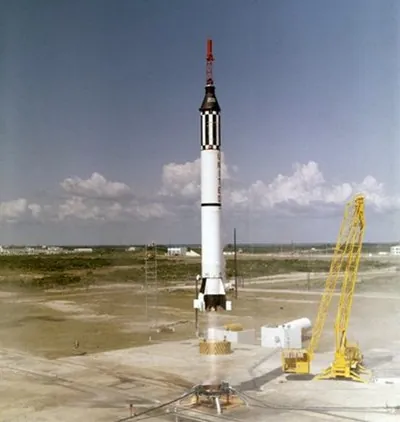
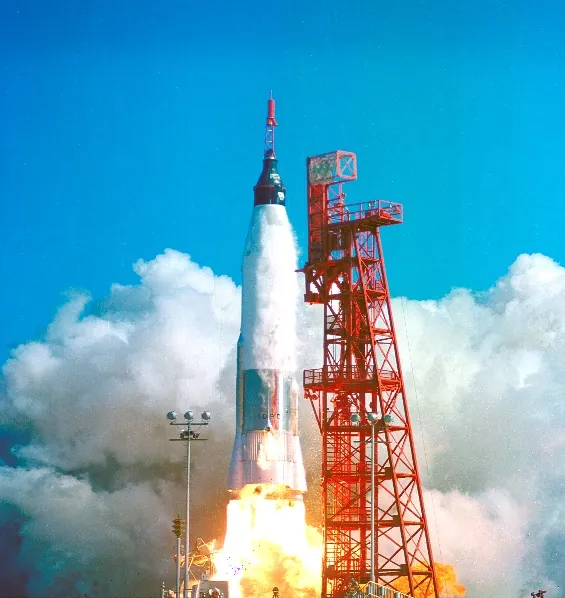
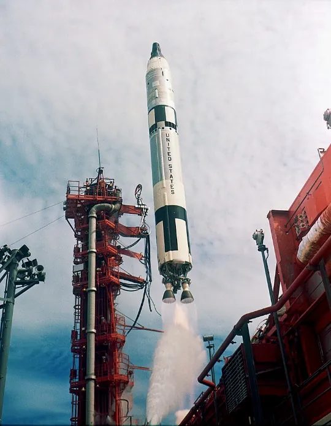
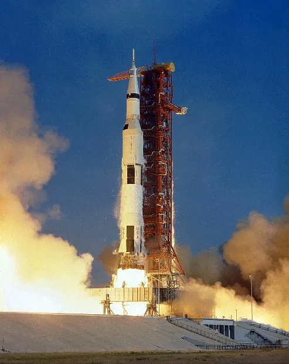
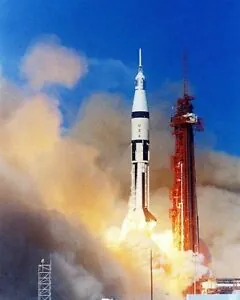

**<u>American Space Program Review</u>**

**<u>Mercury Program</u>**

<u>Goals</u> - Get a man into space. Return that man safely to Earth. Successfully orbit the Earth.

<u>Launch Vehicles</u> - Mercury **Redstone**. Mercury **Atlas**. (The Mercury **Redstone**, a variation of Dr. von Braun’s Redstone missile, was used for the first two Mercury Launches. Being a single stage missile, it lacked the power to achieve orbit around the Earth. The more powerful Mercury **Atlas** was used for the remaining launches, and successfully carried the remaining 4 Mercury Astronauts into orbit)

**Mercury Redstone Mercury Atlas**

<u>Missions</u> - **Six** manned missions (and two Chimps! A chimpanzee named **Ham** flew aboard the Mercury **Redstone** before **Alan Shepard’s** flight. Another chimp, **Enos** flew aboard the Mercury **Atlas** before **John Glenn**)

<u>Notable Astronauts</u> - The Mercury Seven. (In order)

1.  **Alan Shepard** (First American in space)

2.  **Gus Grissom** (Nearly sank in the Pacific when he landed)

3.  **John Glenn** (First American to orbit the Earth)

4.  **Scott Carpenter** (Used too much fuel and landed off target)

5.  **Wally Schirra** (Textbook Wally – flight went perfectly)

6.  **Gordo Cooper** (Sleepy Astronaut – fell asleep in orbit)

7.  **Deke Slayton** (Did not get to fly until 1975 on Apollo-Soyuz)

**<u>Gemini Program</u>**

<u>Goals</u> – Successfully place two men in space for a period of up to two weeks (the length of the longest proposed lunar missions), Learn and perfect key maneuvers such as Extravehicular Activity (EVA), Rendezvous, and Docking of spacecraft (all of which are required for a successful voyage to the moon)

<u>Launch Vehicles</u> – **Titan II** Rocket (an intercontinental ballistic missile repurposed for human spaceflight)

**Titan II**

<u>Missions</u> – **Twelve** missions total – **two** unmanned missions and **ten** manned missions

<u>Notable Astronauts</u> – Several Returning **Mercury** astronauts as well as new astronauts who got their start in the **Gemini** program, and would later become household names during the **Apollo** program.

- **Gus Grissom** (**Gemini 3** – returning **Mercury** Astronaut)

- **John Young** (**Gemini 3**, **Gemini 10** – walked on the moon during **Apollo 16**)

- **Ed White** (**Gemini 4** – performed America’s first **EVA**)

- **Wally Schirra** (**Gemini 6A** - first rendezvous with **Gemini 7**)

- **Jim Lovell** (**Gemini 7**, **Gemini 12** – part of the first crew to orbit the moon on **Apollo 8**, also commanded **Apollo 13**, the successful failure)

- **Neil Armstrong** (**Gemini 8** – First man to walk on the moon on **Apollo 11**)

- **Michael Collins** (**Gemini 10** – Command Module Pilot of **Apollo 11**)

- **Buzz Aldrin** (**Gemini 12** – Second man to walk on the moon on **Apollo 11**)

**<u>Apollo Program</u>**

<u>Goals</u> – Place a man on the moon and return him safely to the Earth

<u>Launch Vehicles</u> – **Saturn 1B**. **Saturn V**. (The **Saturn 1B** was a rocket which was purpose-built for spaceflight. It excelled at carrying payloads to Low-Earth orbit but lacked the power to make it all the way to the moon. The **Saturn 1B** was used for the **Apollo 7** mission, the first manned **Apollo** launch which tested the newly redesigned **Apollo** Spacecraft. The massive **Saturn V** rocket was used to send the **Apollo** astronauts to the moon. It remains the most powerful rocket of all time. The **Saturn V** was used with a crew from **Apollo 8 – Apollo 17**.)

**Saturn 1B Saturn V**

<u>Missions</u> – **Seventeen** total Apollo missions – **eleven** manned missions, **six** moon landings. (Although the three astronauts slated to be the first **Apollo** crew – **Gus Grissom, Ed White, Roger Chaffee** – were killed in a tragic fire on the launch pad during a prelaunch test run, NASA honored them by designating them as the crew of **Apollo 1.**)

<u>Notable Astronauts</u> – **Twelve** total moonwalkers, and many familiar faces.

- **Wally Schirra** – commander of **Apollo 7**, **The only American astronaut to <u>fly</u> in all three American space programs.**

- **Jim Lovell** – part of the first crew to orbit the moon on **Apollo 8**, and commander of **Apollo 13**, which suffered a critical failure before reaching the moon, but was able to return safely to Earth.

- **John Young** – flew on **Apollo 10**, the lunar landing “dress rehearsal”, and walked on the moon during **Apollo 16**, his command module, **“Casper”** is now housed at the US Space and Rocket Center

- **Neil Armstrong** – Commander of **Apollo 11** and first man to walk on the moon

- **Buzz Aldrin** – Lunar Module Pilot of **Apollo 11** – Second man to walk on the moon

- **Michael Collins –** Command Module Pilot of **Apollo 11** – Orbited the moon while Neil and Buzz were walking on the surface.

- **Alan Bean** – Walked on the moon during **Apollo 12** and gathered many moon rocks, one of which is now housed at the US Space and Rocket Center.

- **Alan Shepard** – The only one of the **Mercury Seven** to walk on the moon, on **Apollo 14.** Famously played golf on the moon.

- **Charlie Duke** – Walked on the moon with John Young on **Apollo 16**.

- **Ken Mattingly** – The Command Module Pilot of **Apollo 16** – Orbited the moon while John and Charlie were walking on the surface

- **Eugene Cernan** – The Commander of **Apollo 17**, the final moon mission. The last man to stand on the surface of the moon.
