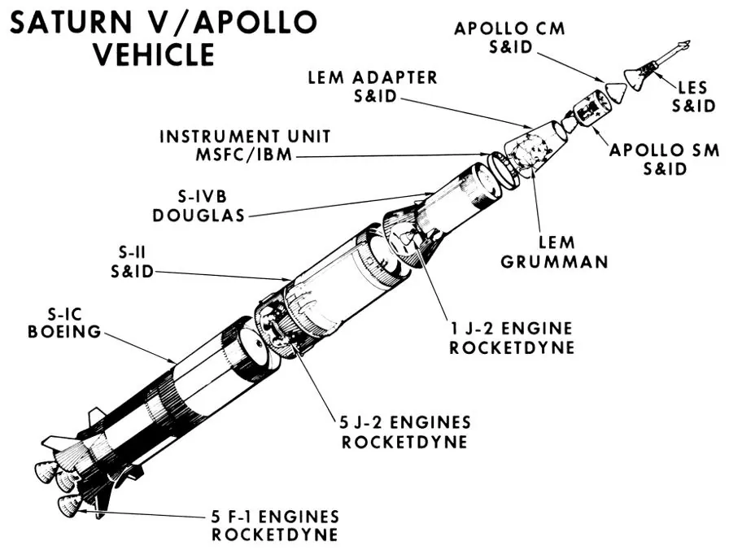

**<u>Saturn V Review</u>**

“Many people call it the moon rocket, which is fair. It remains to this day the only rocket that has ever taken people out of the Earth’s orbit to a different part of the solar system. I like to call it the coolest vehicle ever designed by humankind, but that’s a personal preference”

-Carter Anderson

**<u>Overview</u>**

Standing **363 ft** tall, weighing in at over **6 million pounds** when fully fueled, the **three-stage** Saturn V rocket is truly a marvel of engineering. Even over 50 years later, the Saturn V remains the most powerful rocket ever successfully flown. The Saturn V was designed at the **Marshall Space Flight Center in Huntsville, Alabama** by **Dr. Wernher von Braun.** The Saturn V would be used from **Apollo 8** (The first mission to orbit the moon, 1968) to **Apollo 17** (The final Apollo mission, 1972). The final launch of a Saturn V took place in **1973**, launching **Skylab**, America’s first **space station.**

<table>
<colgroup>
<col />
<col />
<col />
<col />
</colgroup>
<thead>
<tr>
<th></th>
<th>
<strong>STAGE 1 (S-IC)</strong>
</th>
<th>
<strong>STAGE 2 (S-II)</strong>
</th>
<th>
<strong>STAGE 3 (S-IV B)</strong>
</th>
</tr>
</thead>
<tbody>
<tr>
<td>
<strong>Engines</strong>
</td>
<td>
5 F-1
</td>
<td>
5 J-2
</td>
<td>
1 J-2
</td>
</tr>
<tr>
<td>
<strong>Thrust</strong>
</td>
<td>
7.5 million lbs.
</td>
<td>
1 million lbs.
</td>
<td>
200,000 lbs.
</td>
</tr>
<tr>
<td>
<strong>Type of fuel</strong>
</td>
<td>
Kerosene and liquid oxygen
</td>
<td>
Liquid hydrogen and liquid oxygen
</td>
<td>
Liquid hydrogen and liquid oxygen
</td>
</tr>
<tr>
<td>
<strong>Amount of fuel</strong>
</td>
<td>
543,000 gal
</td>
<td>
330,000 gal
</td>
<td>
90,000 gal
</td>
</tr>
<tr>
<td>
<strong>Burn Time</strong>
</td>
<td>
2.5 minutes
</td>
<td>
6 minutes
</td>
<td>
Burn 1: 2 minutes

Burn 2: 5 minutes
</td>
</tr>
<tr>
<td>
<strong>Altitude</strong>
</td>
<td>
42 miles
</td>
<td>
116 miles
</td>
<td>
Burn 1: Earth orbit

Burn 2: Escape Earth orbit
</td>
</tr>
<tr>
<td>
<strong>Final Destination</strong>
</td>
<td>
Splash down in ocean
</td>
<td>
Splash down in ocean
</td>
<td>
Crashed into moon OR heliocentric orbit
</td>
</tr>
</tbody>
</table>
