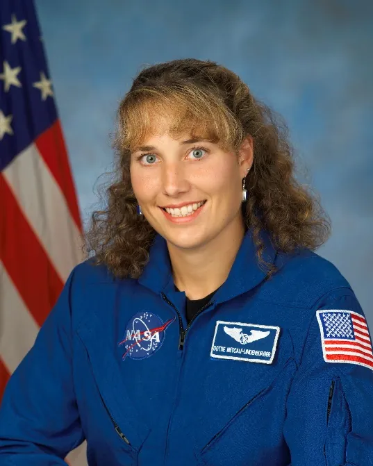
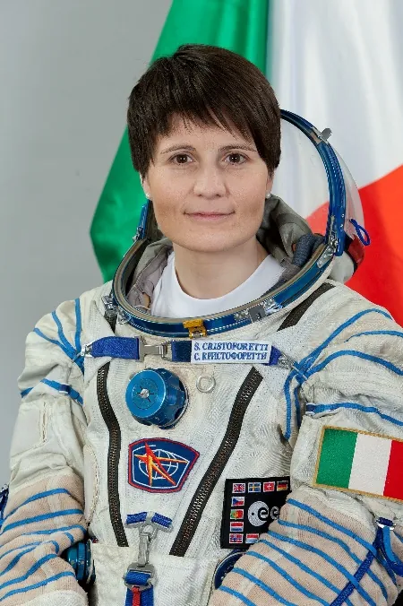
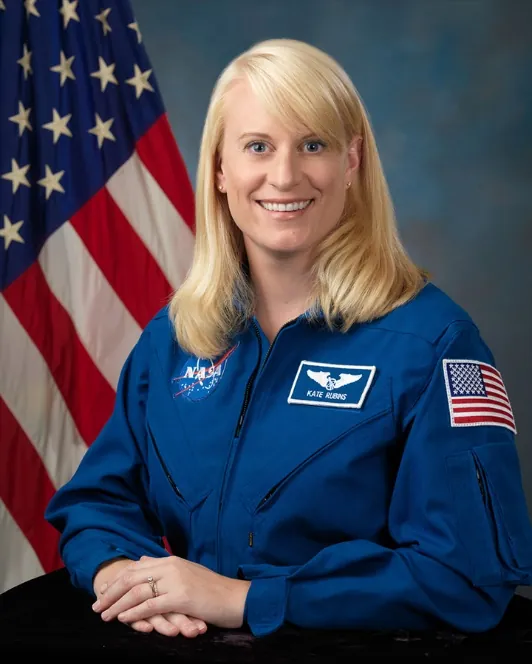
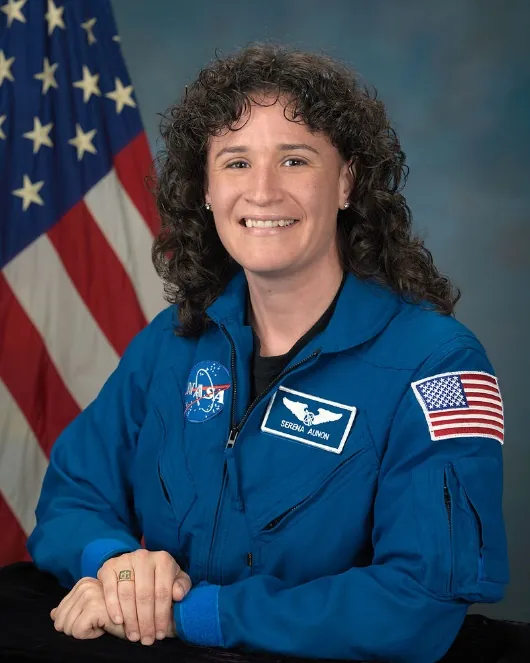
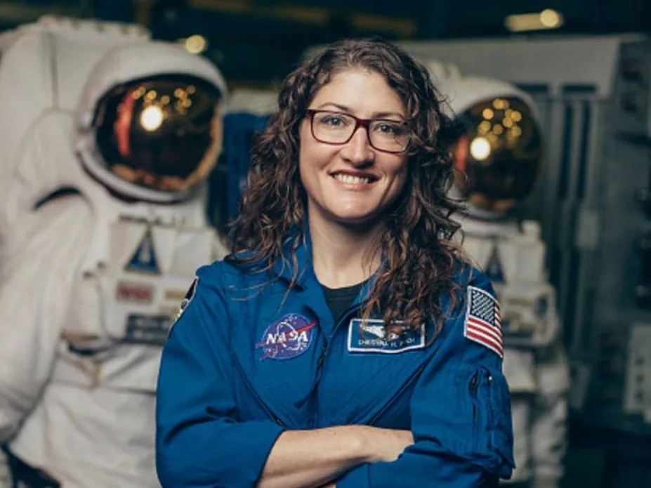
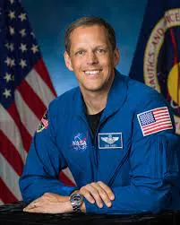

**<u>Space Camp® Graduates in Space</u>**

**Dottie Metcalf-Lindenburger**

Missions – STS-131, 2010

Time in Space – 15d 02h 47m

Dottie Metcalf-Lindenburger completed her NASA

training in 2006, and flew on the Space Shuttle

*Discovery* in 2010 as a Mission Specialist on STS-

131\. She also commanded the NEEMO 16

underwater mission in 2012. She spent over 24

hours underwater, officially making her an

aquanaut. She retired from NASA in 2014. Dottie

has frequently performed as the lead singer of the

all-astronaut rock band “Max Q”, with fellow astronauts such as Hoot Gibson and Chris Hadfield.

**Samantha Cristoforetti**

Missions – ISS Expedition 42/43, 2014- 2015

ISS Expedition 67, 2022

Time in Space – 199d 16h 42m (soon to be more)

Samantha Cristoforetti spent 199 days aboard the ISS

on expedition 42/43, which at the time was the longest

single spaceflight by a woman. Although this record

was broken by NASA Astronauts Peggy Whitson and

Christina Koch, Cristoforetti still holds the record for

Longest uninterrupted spaceflight by a European

astronaut. She also has the distinction of being the first

Italian woman in space. Cristoforetti will be returning to the ISS on expedition 67.

**Dr. Kate Rubins**

Missions – ISS Expedition 48/49, 2016

ISS Expedition 63/34, 2020-2021

Time in Space – 300d 1h 31m

Kate Rubins became the 60th woman to fly in space

when she travelled to the ISS in 2016. A

microbiologist by trade, Rubins continued her

research onboard the ISS, studying breast cancer

cells and the effect of radiation on the crew of the

ISS. Rubins has performed a total of 4 EVAs during

Her tenure as an astronaut, and has accumulated

a total of 26 hours and 46 minutes of EVA time. She also was announced as a member of the group of astronauts who will eventually serve as the crews of the Artemis missions to the moon.

**Serena Auñón-Chancellor**

Missions – ISS Expedition 56/57, 2018

Time in Space – 196d 17h 49m

Serena Auñón-Chancellor got her start at NASA as

a flight surgeon, ensuring that the astronauts

aboard the ISS were staying healthy. She

completed her astronaut training in 2011. She

now works in the astronaut office as a

management astronaut, continuing to oversee

medical issues which may come up on the ISS.

**Christina Koch**

Missions – ISS Expedition 59/60/61, 2019-2020

Time in Space – 328d 13h 58m

Christina Koch currently holds the record for

the longest continuous time in space by a

woman, spending a staggering 328 days aboard

the ISS. Koch made up half of the first

all-female spacewalk in history. She was joined

by NASA astronaut Jessica Meir. Koch was

selected as a candidate for the upcoming

Artemis missions to the moon.

> **Bob Hines**
>
> Missions – ISS Expedition 67/68, 2022-Present
>
> Time in Space – 153d
>
> Bob Hines was selected as an astronaut candidate in 2017 after serving as a Research Pilot at NASA’s Johnson Space Center. In addition to working at NASA, Hines has served more than 21 years in the United States Air Force (USAF) as an instructor pilot, fighter pilot, and a test pilot. Overall, Hines has accumulated more than 3,500 hours of flight time in 50 different types of aircraft and has flown 76 combat missions in 3 different aircraft types while supporting contingency operations around the world. On April 27, 2022, Hines launched to the International Space Station aboard the SpaceX Crew Dragon Freedom spacecraft as the pilot of NASA’s SpaceX Crew-4 mission and most recently served as a flight engineer on the space station Expedition 67/68.
